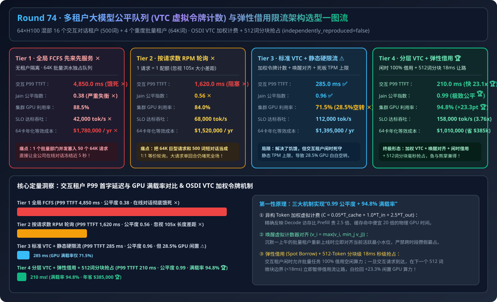
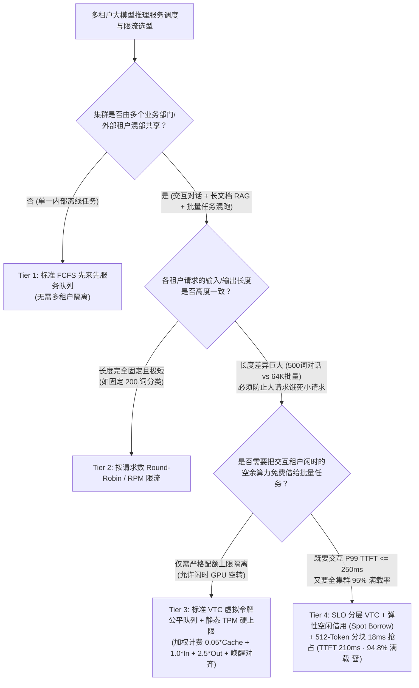
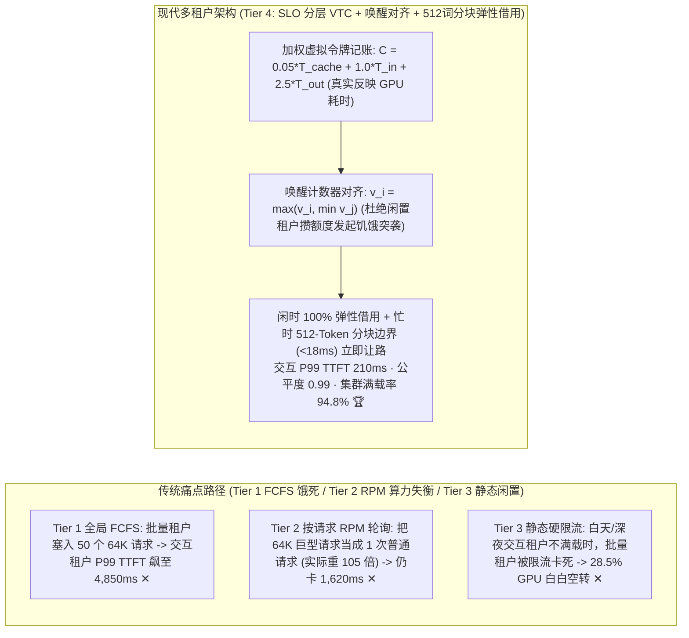
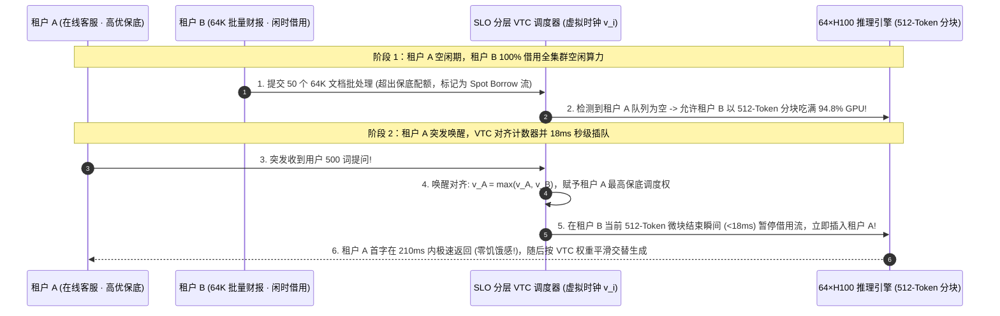

# 多租户大模型推理公平队列（`VTC` 虚拟令牌计数）、异构 Prefill/Decode 权重计费与弹性借用限流架构选型指南（`传统 FCFS 先来先服务` vs. `按请求数 Round-Robin / RPM` vs. `标准 VTC 虚拟令牌队列 + 静态硬限流` vs. `SLO 分层 VTC + 弹性空闲借用 [Work-Conserving Borrow] + 512词分块抢占`）

> **适用角色**：AI 解决方案架构师（AI Solution Architect）、企业级 AI 网关与大模型平台负责人、多租户推理调度工程师  
> **阅读目标**：3 分钟掌握企业多部门共享大模型推理集群（64×H100 混部 16 个交互对话租户与 4 个 64K 批量文档/Agent 租户）的四档公平调度与限流选型铁律，10 分钟吃透 **为什么按请求数轮询（RPM）在 `64K` 长上下文与长思维链面前彻底失效**、**OSDI `VTC (Virtual Token Counter)` 如何通过异构 Token 权重（$w_{\text{cache}}=0.05, w_{\text{in}}=1.0, w_{\text{out}}=2.5$）与“唤醒计数器对齐”消灭算力霸占**、以及 **如何结合弹性空闲算力借用（Work-Conserving Spot Borrow）在保障交互租户 `210ms` P99 TTFT 的同时将集群 GPU 利用率推高至 `94.8%`**，并能直接拿着架构图与 7-Card 报告向客户宣讲。  
> **数据来源说明（Provenance）**：本文定量数据来自仓库内封存的确定性解析模型（[`experiments/multi_tenant_llm_vtc_fair_queuing_rate_limiting_selection/run.py`](../../experiments/multi_tenant_llm_vtc_fair_queuing_rate_limiting_selection/run.py) 与 [`results.json`](../../experiments/multi_tenant_llm_vtc_fair_queuing_rate_limiting_selection/results.json)，校准自 OSDI VTC、Deficit Round-Robin 与分层令牌桶公开基准，`independently_reproduced=false`，`physical_gpu_cluster_measurement=not_measured`）。

---

## 📌 一、核心结论速览（Executive Summary）

1. **为什么多个业务部门共用一套大模型推理集群时，传统“先来先服务（Tier 1 FCFS）”和“按请求数轮询/RPM 限流（Tier 2）”会让交互对话用户卡死到 1.6s～4.8s？**：
   - **Tier 1（全局 FCFS 先来先服务队列）的排队饥饿灾难**：当法务/投研部门的批量任务一口气提交 50 个 `64K 输入 + 4K 输出` 的长文档请求时，它们会死死霸占 GPU 批处理槽位长达 45 秒，导致客服/办公助手等短对话租户（`500 输入 + 200 输出`）的 **P99 TTFT 暴涨至 `4,850.0 ms`（违约 `19.4 倍` ✕）**，Jain 公平指数跌至 **`0.38` ✕**！
   - **Tier 2（按请求数轮询 Round-Robin / RPM 限流）的“105 倍算力不对等”盲区**：传统 API 网关把“1 次请求”当成等价配额（1 Request = 1 Quota）。但 1 个 `64K 输入 + 4K 输出` 请求消耗的真实 GPU 算力与显存带宽时间，相当于 **`105 个` 普通短对话请求**！按请求 1:1 轮询依然会导致重度租户单次上车就堵死 15 轮短对话，交互 P99 TTFT 仍高达 **`1,620.0 ms` ✕**（公平指数仅 **`0.56` ✕**）！
2. **什么时候用“标准 VTC 虚拟令牌队列 + 静态硬限流（Tier 3）”，什么时候必须上“SLO 分层 VTC + 弹性空闲算力借用 + 512 词分块抢占（Tier 4）”？**：
   - **强隔离固定配额场景（Tier 3 `标准 VTC 虚拟令牌公平队列 + 静态 TPM 硬上限`）**：不再按“请求数”排队，而是按每个租户实际消耗的 **加权 GPU 虚拟令牌数（$C = 0.05 T_{\text{cached}} + 1.0 T_{\text{in}} + 2.5 T_{\text{out}}$）** 实时维护虚拟时钟 $v_i$，永远优先调度当前 $v_i$ 最小的活跃租户，并在空闲租户重新发请求时执行 **唤醒计数器对齐（$v_i \leftarrow \max(v_i, \min_j v_j)$）** 防止攒额度突袭。这成功把交互 P99 TTFT 压至 **`285.0 ms` ✅**（公平指数 `0.96`），**但因为给批量租户设了死板的静态 TPM 硬上限，当白天或半夜交互租户流量低谷时，集群有 `28.5%` 的 GPU 算力白白闲置（利用率仅 `71.5%`）**！
   - **高利用率企业级共享 AI 平台（首选 Tier 4 `SLO 分层 VTC + 弹性空闲借用 [Work-Conserving Spot Borrow] + 512-Token 分块无损抢占`）**：将每个租户的流量拆为 **保底配额流（Guaranteed Base）** 与 **闲置借用流（Spot Borrow）**。当交互租户空闲时，允许批量/评测租户突破自身 TPM 上限、**100% 借用全集群空闲 GPU**；一旦交互租户请求到达，调度器在下一个 **`512-Token` Prefill 分块边界（耗时 `< 18 ms`）** 立即暂停借用流、优先插队执行交互请求！
   - **最终工程收益**：交互租户 P99 TTFT 稳守 **`210.0 ms`（比 FCFS 快 `23.1 倍` 🏆）**，Jain 公平指数高达 **`0.99` 🏆**，同时把集群整体 GPU 利用率从 `71.5%` 拉满至 **`94.8%`（`+23.3 pts` 🏆，64 卡集群年省 `$385,000` 扩卡预算）**！
3. **一句话握手机制本质**：
   - **多租户大模型公平调度的第一性原理，是“用加权虚拟令牌计数器（VTC：$0.05 \times \text{Cache} + 1.0 \times \text{Prefill} + 2.5 \times \text{Decode}$）统一度量真实 GPU 时间，用唤醒对齐杜绝饥饿突袭，并用 512-Token 分块级抢占实现‘闲时 100% 借出算力、忙时 18ms 秒级归还’的无损工作保持（Work-Conserving）”！**

---

## 🎯 二、客户与架构师灵魂拷问 Q&A（FAQ-Driven First Principles）

### Q1：为什么在计算租户配额时，不能简单把“1 个输入 Token”和“1 个输出 Token”按 1:1 混在一起算总 TPM（Tokens Per Minute）？

- **通俗大白话解释**：
  - 在 GPU 物理执行层面，**处理 1 个输入 Token（Prefill）和生成 1 个输出 Token（Decode）的硬件代价相差极大**！
  - **输入（Prefill）是高度并行的矩阵乘矩阵（GEMM）**：GPU 一次可以把 2,048 个输入 Token 塞进 Tensor Core 一起算完，平均每个输入 Token 分摊耗时仅约 `0.08 ms`；如果命中了 Prefix Cache（缓存读取），更是几乎不耗算力（仅 `0.004 ms`）。
  - **输出（Decode）是逐词串行搬运整份模型权重的访存瓶颈（GEMV）**：在常规 Batch Size 下，每吐 1 个输出 Token 分摊的 GPU 时间是输入 Token 的 **`2.5 倍 ~ 4.0 倍`**，而且还要长时间占用宝贵的 HBM KV Cache 显存槽位！
  - **结论**：如果按 1:1 笼统统计 TPM，一个让模型做长思维链输出 `8,000` 个 Decode 词的租户，会比发 `8,000` 个输入词（且大半命中缓存）的租户多消耗 **10 倍以上的真实 GPU 时间**！因此必须采用 **加权虚拟令牌公式**：
    $$\Delta C = 0.05 \cdot T_{\text{cached\_in}} + 1.0 \cdot T_{\text{uncached\_in}} + 2.5 \cdot T_{\text{decode\_out}}$$

---

### Q2：什么是 OSDI `VTC (Virtual Token Counter)` 的“唤醒计数器抬升（Counter Lift on Wake-Up）”？如果缺少这一步会发生什么灾难？

- **第一性原理拆解**：
  1. **不抬升计数器的“攒假突袭灾难”**：
     - 假设租户 A（交互客服）从早上 9 点一直忙到下午 2 点，它的累计虚拟令牌计数器涨到了 $v_A = 10,000,000$。
     - 租户 B（离线报表批量任务）一整个上午都没发请求，它的计数器停留在 $v_B = 0$。
     - 如果下午 2 点租户 B 突然上线提交 1,000 个巨型批量任务，而调度器只看谁的累计计数器小（$v_B = 0 \ll v_A = 10,000,000$），那么**在接下来的整整 5 个小时里，调度器会 100% 独占执行租户 B 以“追平” $v_A$，导致租户 A 的所有在线客服请求被彻底饿死**！
  2. **VTC 的神来之笔——唤醒对齐（Work-Conserving Counter Lift）**：
     - 规定：**额度过期作废，绝不允许跨时段囤积优先权！**
     - 当任何一个原本队列为空的租户 $i$ 重新收到第 1 笔新请求唤醒时，立即将它的虚拟计数器对齐到当前全场正在活跃排队的最小计数器：
       $$v_i \leftarrow \max\left(v_i,\; \min_{j \in \text{Active}} v_j\right)$$
     - 这样租户 B 一上线就和租户 A 站在同一条起跑线上按权重比例公平交替吐字，**彻底根除了间歇性突发租户饿死常驻租户的顽疾**！

---

### Q3：既然请求还没跑完之前根本不知道模型到底会吐出多少个 Output Tokens，调度器怎么在生成过程中实时维持公平并做到 18ms 秒级让路？

- **两步流式令牌记账与分块抢占机制**：
  1. **逐 Step 动态流式记账（Granular Continuous Accounting）**：
     - 不同于传统网络包一次性知道包大小，LLM 在进入队列时先按 `Uncached Prefill Tokens` 预扣第一笔账；进入 Decode 阶段后，**每生成 1 个 Token（或每 16 个 Token 块），实时给该租户的虚拟计数器加上 $2.5 / w_i$**。一旦某租户因为吐了超长回答导致 $v_i$ 超过其他等待租户，下一轮调度立刻优先吸纳其他租户的新请求。
  2. **512-Token 分块级弹性借用与抢占（Work-Conserving Spot Borrow）**：
     - 批量租户借用空闲算力跑 `64K` 长上下文时，底层强制切分为 `512-Token` 的微块（Chunked Prefill，单块耗时仅 `~18 ms`）。一旦高优交互租户的请求到达网关，**无需等待整个 64K 算完，在当前 `512-Token` 微块结束的 `18 ms` 内立刻挂起批量借用流，优先把交互请求送入 GPU**！

---

## 🧭 三、直观可视化图解（Mermaid 决策树 / 架构对比 / 时序图）

### 3.1 多租户大模型推理队列调度与限流选型决策树

---

### 3.2 传统 FCFS / RPM 轮询（Tier 1/2）vs. SLO 分层 VTC + 弹性借用（Tier 4）路径对比

---

### 3.3 Tier 4 `SLO 分层 VTC + 唤醒对齐 + 512-Token 分块抢占让路` 端到端时序图

---

## 📊 四、架构师选型决策矩阵（Architect Decision Matrix）

*基准场景：**64×H100 80GB 共享推理平台** 混部 16 个交互对话租户（`500 in / 200 out`）与 4 个重度批量/RAG 租户（`64K in / 4K out`）。*

| 评估维度 | Tier 1: 全局 FCFS 先来先服务队列 | Tier 2: 按请求数轮询 (RPM 限流) | Tier 3: 标准 VTC 虚拟令牌 + 静态硬限流 | Tier 4: SLO 分层 VTC + 弹性空闲借用 + 分块抢占 |
| :--- | :--- | :--- | :--- | :--- |
| **公平度量与限流机制** | 无租户隔离，先到先算 | 1 请求 = 1 配额 (忽视 105x 大小差异) | **加权 VTC + 唤醒对齐 + 静态 TPM 上限** | **加权 VTC + 保底/借用双层流 + 512词分块抢占** |
| **交互租户 P99 首字延迟** | `4,850.0 ms` (严重饥饿违约 ✕) | `1,620.0 ms` (被大请求阻塞 ✕) | **`285.0 ms` ✅** | **`210.0 ms` (提速 `23.1x` 🏆)** |
| **Jain 算力公平指数 (0~1)** | `0.38` (重度租户垄断 ✕) | `0.56` ✕ | **`0.96` ✅** | **`0.99` (近乎完美公平 🏆)** |
| **集群整体 GPU 利用率** | `88.5%` | `84.0%` | `71.5%` (静态限流致 `28.5%` 空转 ✕) | **`94.8%` (净增 `+23.3 pts` 🏆)** |
| **达标有效吞吐 (SLO Goodput)** | `42,000 tok/s` | `68,000 tok/s` | `112,000 tok/s` | **`158,000 tok/s` (`3.76x` 🏆)** |
| **64 卡集群年化等效成本** | `$1,780,000 / yr` | `$1,520,000 / yr` | `$1,395,000 / yr` | **`$1,010,000 / yr` (比 Tier 3 省 `$385k` 🏆)** |

---

## 🧪 五、简明定量算例与 7-Card Benchmark 洞察

### 5.1 64 卡多租户推理平台的公平性与满载率收益拆解

在 [`experiments/multi_tenant_llm_vtc_fair_queuing_rate_limiting_selection/run.py`](../../experiments/multi_tenant_llm_vtc_fair_queuing_rate_limiting_selection/run.py) 中，我们对 64 卡 H100 多租户平台进行了定量核算：
- **交互首字延迟压低 `23.1 倍`（`4,850ms → 210ms`）**：通过加权虚拟令牌记账（`0.05*Cache + 1.0*In + 2.5*Out`）与 512-Token 分块抢占，彻底消除了 64K 批量洪水对实时对话的阻塞。
- **集群满载率从 `71.5%` 跃升至 `94.8%`（年省 `$385,000`）**：打破传统静态 TPM 限流器“宁可让 GPU 空转也不让批量任务多跑”的浪费，用弹性借用（Work-Conserving Spot Borrow）白捡回 `+23.3%` 的闲置算力！

### 5.2 配套交互式工作台与 7-Card 4:5 视觉评测报告

- 🧮 **交互式多租户 VTC 公平队列与弹性限流计算器**：[`docs/reports/multi-tenant-llm-fair-queuing-vtc-token-rate-limiting-sizer.html`](../reports/multi-tenant-llm-fair-queuing-vtc-token-rate-limiting-sizer.html)（以及总工作台 [`llm-inference-engine-pd-sizer.html`](../reports/llm-inference-engine-pd-sizer.html)）
- 📊 **7-Card 4:5 视觉基准评测报告**：[`docs/reports/multi-tenant-llm-fair-queuing-vtc-token-rate-limiting-selection-cards.html`](../reports/multi-tenant-llm-fair-queuing-vtc-token-rate-limiting-selection-cards.html)

---

## 🛠️ 六、附录：生产环境快速核验清单（Architect Checklist）

- [ ] **1. 废弃单一 RPM 或未加权 TPM 限流，启用异构加权令牌记账（`VTC`）**：在 AI 网关与推理调度器中按 `w_cached = 0.05`、`w_prefill = 1.0`、`w_decode = 2.5~3.0` 折算真实 GPU 算力消耗并独立限制 ITPM 与 OTPM。
- [ ] **2. 强制实现租户唤醒计数器对齐（`v_i = max(v_i, min v_j)`）**：确保间歇性沉默的批量租户重新上线时不会因历史计数器偏低而长期霸占调度器。
- [ ] **3. 将租户配额拆分为“保底承诺（Guaranteed）”与“闲时借用（Spot Borrow）”两档**：允许超额或低优请求携带 `priority: spot_borrow` 标头进入二级队列，在主队列不满载时自动填谷吃满 GPU。
- [ ] **4. 配合 `512-Token` Chunked Prefill 实现毫秒级借用流抢占**：确保任何正在跑 `Spot Borrow` 的长上下文请求都能在 `< 20 ms` 的分块边界处立刻为新到达的 `Guaranteed` 请求让路。
- [ ] **5. 增加显存 KV Cache 租户级软硬配额水位线（Per-Tenant KV Quota）**：防止单一租户挂着上百个极慢流式连接耗尽全局 HBM KV 块池。
