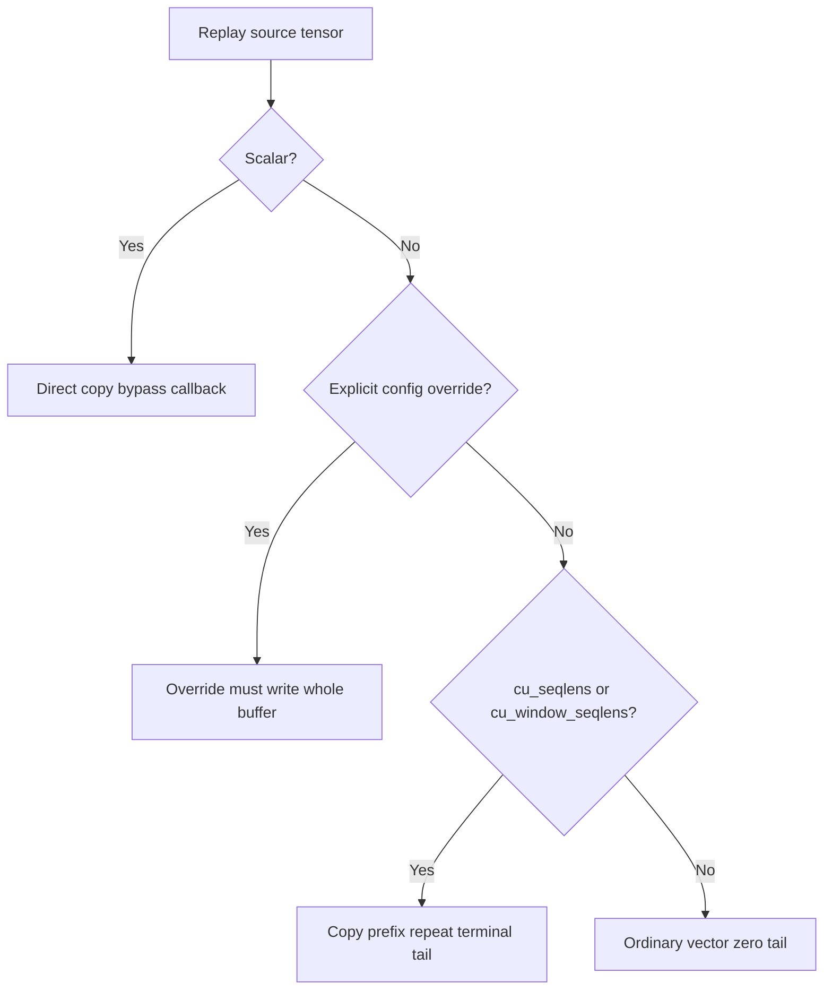
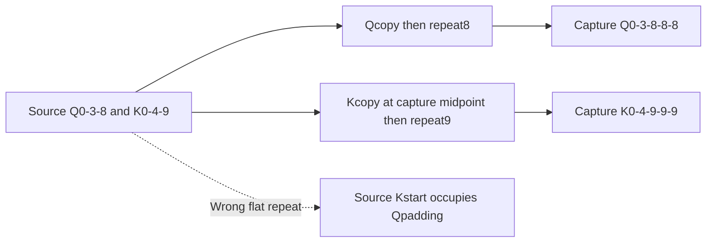
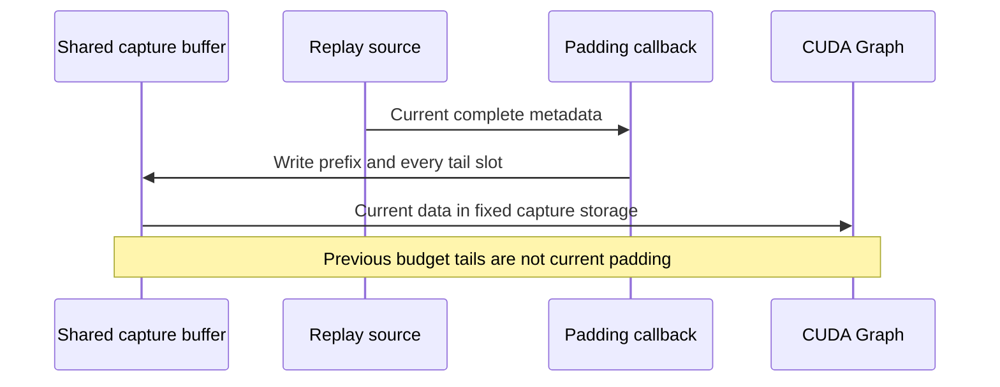

# Multimodal CUDA Graph selection FAQ:cumulative tails,FlashInferQ/Ksections and full overwrite

> **Language**: English | [中文](multimodal-graph-cumulative-offset-padding-selection-faq.md)  
> **Round160**:actualNov14metadata correction.Original eight copy-policy cases:invalid **3→0**;single-stream zero-tail misses **2/5**words;declared int32buffer remains **20B**.`synthetic`, `independently_reproduced=false`;CPU timing separately `measured`.No CUDAgraph/FlashInferexecution.
>
> [H5](../reports/multimodal-graph-cumulative-offset-padding-sizer.html) · [Seven cards](../reports/multimodal-graph-cumulative-offset-padding-selection-cards.html) · [1600px SVG](../../assets/svg/multimodal-graph-cumulative-offset-padding-selection-faq-summary.svg) · [Experiment/evidence](../../experiments/cumulative_graph_buffer_selection/README.md)

## Q1: Why cannot cumulative offsets be zero-padded like ordinary inputs?

Sequence lengths are differences between adjacent offsets.`[0,3,8,0,0]` yields `[3,5,-8,0]`,not two empty padding sequences.Repeat the terminal to produce `[0,3,8,8,8]`,with lengths `[3,5,0,0]`.

The source adds repeat-last defaults for exactly two cumulative keys—not every name containingseqlens,andnot every backend layout.The original single-stream legacy policy misses2/5words;the new rule matches.This is metadata proof,not native attention acceptance.

## Q2: Why must FlashInferpacked Q/Koffsets be padded independently?

Some FlashInferbuffers concatenate equal-sized QandKoffset sections.Each starts at zero and has its own terminal.The concatenation is not a single monotonic cumulative stream.

Original source `[0,3,8,0,4,9]`,capacity10,needs `[0,3,8,8,8,0,4,9,9,9]`.Flat repeat produces `[0,3,8,0,4,9,9,9,9,9]`,missing4/10words and misplacing the section boundary.

`MMEncoderAttention.get_cu_seqlens_padding_logics` supplies section-aware FlashInfercallbacks.Config overrides precede generic cumulative defaults.Our independent terminals demonstrate the mechanism;we do not claim a real vision model uses these lengths.

## Q3: Why must a callback write the whole capture buffer?

Token budgets can share input buffers.Copying only `[0,3,8]` while retaining old `[17,21]`tails leaves another budget's metadata.Correct prefix contents do not prove correct replay.

Our `prefix_only` preset explicitly reports `invalid_padding_policy` and incomplete writing.The Pythonlist identity test proves only original in-place behavior,not native graph pointer binding.

The native packed FlashInferhelper still calls `dst.zero_()` before independent copies/tails.Our CPUoverwrite-versus-redundant-zero experiment is not its execution trace or a claim that its zeroing was removed.

## Q4: How do empty offsets,missing source,scalars and oversize replay behave?

No-sequence cumulative metadata still needs `[0]`.An empty vector has no terminal;the prototype rejects it rather than inventing zero for `src[-1]`.An ordinary generic vector may be empty and zero-filled.

Native scalar sources bypass padding callbacks and copy directly.Our scalar42case ignores the selectedprefix-only override accordingly.

A missing shared-key source raises natively because capture contents may belong to another budget.Static nonshared keys may retain capture constants.The prototype distinguishes that legitimate case from error.

Oversize leading dimensions are detected before copy;native graph execution returns a miss so the caller can run eagerly.Our `eager_required` status leaves the previous buffer unchanged.**No truncation or claimed graph replay.**This1-D model does not implement multidimensional ABI,graph selection or output slicing/clone flow.

## Q5: What did the local verification and timing cover?

Eight tests cover terminal repeat,packed sections,override precedence,scalar bypass,original in-place identity,complete writes,stale tails,shared source errors,oversize,invalid offsets and `[0]`empty-sequence representation.64random cases verify prefix/tail preservation;Node/Python compare66cases/132outcomes.

| Original words | Complete overwrite / ms | Redundant zero+overwrite / ms |
| :--- | ---: | ---: |
| 64 | 0.004267 | 0.006000 |
| 256 | 0.016300 | 0.023100 |
| 1024 | 0.066833 | 0.096867 |
| 4096 | 0.302433 | 0.417133 |

Both paths reuse preallocated Pythonlists and produce identical results;writes areNversus2N.Sealed samples record2warmups,7alternating repeats,3operations/sample and median repeat means.Setup,Torch/H2D,CUDAgraphs,FlashInfer,attention and model throughput are excluded.

20Bis a declared five-word int32logical payload,not allocator peak.All numeric bars use sealed values;native unknowns remainnull.The earlier browser refusal is respected;visual acceptance is not claimed.

## Q6: What constitutes production acceptance?

Check actual backend and layout.Accept the two cumulative keys,ordinary vectors,scalars and explicit overrides separately.Verify packed halves,terminals,zero-length padding,complete shared writes,missing-source errors,oversize eager fallback,real graph storage reuse and output ownership.Then run native attention/graph tests and measure H2D/copy/replay/model impact.

Unlike MoEpadding sentinels,this concerns **adjacent cumulative differences and shared-buffer overwrite**,not expert assignments.Primary implementation rights and licenses remain;only original explanations/models are archived.

**Pinned primary evidence**:

- [ActualNov14commit](https://github.com/vllm-project/vllm/commit/1a594a3ec1872b40ac00131a31d1f83d81cbdd80)
- [Default dispatch,shared source,scalar and oversize](https://github.com/vllm-project/vllm/blob/1a594a3ec1872b40ac00131a31d1f83d81cbdd80/vllm/v1/worker/encoder_cudagraph.py)
- [Whole-callback contract](https://github.com/vllm-project/vllm/blob/1a594a3ec1872b40ac00131a31d1f83d81cbdd80/vllm/v1/worker/encoder_cudagraph_defs.py)
- [FlashInfersections/backend selection](https://github.com/vllm-project/vllm/blob/1a594a3ec1872b40ac00131a31d1f83d81cbdd80/vllm/model_executor/layers/attention/mm_encoder_attention.py)
- [Native encoder graph tests](https://github.com/vllm-project/vllm/blob/1a594a3ec1872b40ac00131a31d1f83d81cbdd80/tests/v1/cudagraph/test_encoder_cudagraph.py)
- [Apache-2.0LICENSE](https://github.com/vllm-project/vllm/blob/1a594a3ec1872b40ac00131a31d1f83d81cbdd80/LICENSE)
