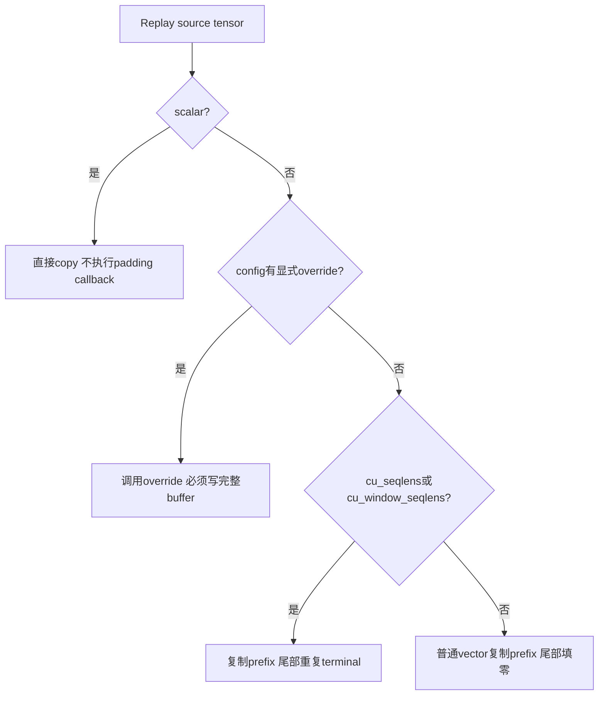
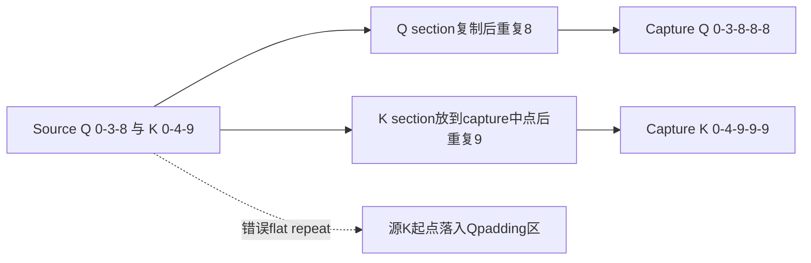
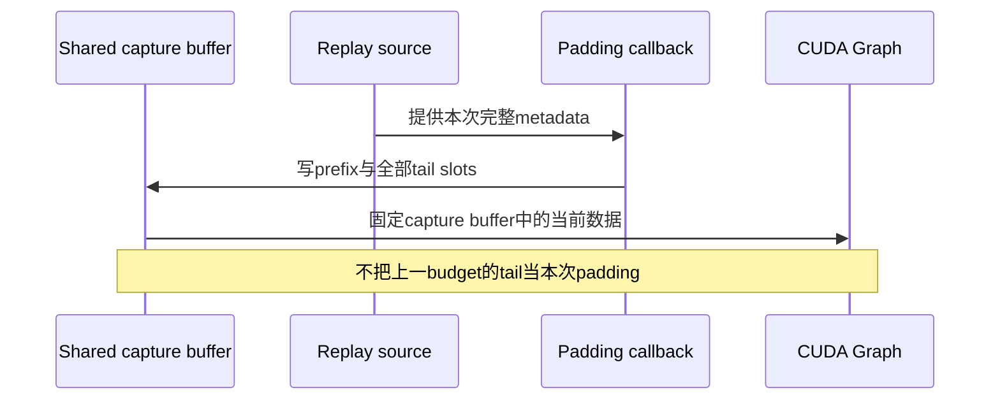

# Multimodal CUDA Graph 架构选型 FAQ：cumulative tail、FlashInfer Q/K 分段与完整 overwrite

> **语言**：中文 | [English](multimodal-graph-cumulative-offset-padding-selection-faq.en.md)  
> **Round160**：实际 Nov14 metadata padding 修正。原创八种 copy-policy case：无效 **3→0**；单流 zero-tail 错 **2/5** words；声明的 int32 buffer 保持 **20 B**。`synthetic`、`independently_reproduced=false`；CPU 时延另标 `measured`，未执行 CUDA Graph/FlashInfer。
>
> [H5](../reports/multimodal-graph-cumulative-offset-padding-sizer.html) · [七卡](../reports/multimodal-graph-cumulative-offset-padding-selection-cards.html) · [高清 SVG](../../assets/svg/multimodal-graph-cumulative-offset-padding-selection-faq-summary.svg) · [实验/封存证据](../../experiments/cumulative_graph_buffer_selection/README.md)

## Q1：为什么 cumulative offsets 不能像普通 input buffer 一样补零？

普通 buffer 尾部填零与 cumulative offsets 表达不同语义。序列长度是相邻 offset 的差。`[0,3,8]` 补为 `[0,3,8,0,0]` 会产生 `[3,5,-8,0]`，不是两个空 padding sequences；应补成 `[0,3,8,8,8]`，长度为 `[3,5,0,0]`。

源码对两个 cumulative key 引入默认 repeat-last；并非任意名字含 `seqlens` 都自动识别，也不是替代所有 backend 的特殊布局。原型的单流 case 旧 zero-tail 错2/5 words，新规则完整匹配；这不等于原生 attention 输出已经验收。

## Q2：FlashInfer packed Q/K offsets 为什么要分别 padding？

某些 FlashInfer buffers 将 Q offsets 与 K offsets 串接为两个等长 section。各 section 都从零开始，分别有 terminal。不能把整条串接 vector 当一条单调 cumulative stream。

原创 source `[0,3,8,0,4,9]`、capture容量10，正确结果是 `[0,3,8,8,8,0,4,9,9,9]`。flat repeat 得到 `[0,3,8,0,4,9,9,9,9,9]`，错4/10 words，Q/K 边界被放错。

`MMEncoderAttention.get_cu_seqlens_padding_logics` 为 FlashInfer 返回 section-aware callback；config override 优先于通用 cumulative default。Q/K terminal 不必被原型强行设成一样；反例只是分段机制证明，不宣称真实 vision 模型采用本例长度。

## Q3：为什么 callback 必须写完整 capture buffer，而不是只覆盖 source prefix？

不同 token budgets 可能共享 input buffer。只复制 `[0,3,8]` 而保留旧 tail `[17,21]` 会留下其他 budget 的 metadata。callback 的职责是 **完整覆盖本次 capture buffer**；prefix 正确不足以证明 replay 正确。

原型 `prefix_only` preset 明确返回 `invalid_padding_policy`、`full_buffer_written=false`，不伪装成成功 callback。in-place list 测试证明原型对象 identity 保留；没有因此声称绑定原生 CUDA graph pointer。

native packed FlashInfer helper仍先 `dst.zero_()` 再分别复制与填尾；本机 CPU“一次 overwrite versus 冗余 zero+overwrite”实验不是它的执行记录，也不声称该 helper 已移除 zero。

## Q4：空 offsets、缺 replay source、scalar 与 oversize 如何处理？

没有序列的 cumulative metadata 应至少含 `[0]`；空 vector `[]` 没有 terminal，本原型显式拒绝，不能偷偷用零代替 `src[-1]`。ordinary generic vector 可以为空并使用零填充。

native scalar (`src.ndim==0`) 直接 copy，绕过 padding callback。原型 scalar case 即使选择 `prefix_only` override也直接复制42，不把 scalar 当一个 cumulative vector。

shared key 缺少 replay source 时，native manager抛 RuntimeError，因为 capture-time contents可能来自另一budget；非shared/static key允许保留capture常量。原型相应区分错误与 `captured_constant_retained`。

source leading dimension超过capture容量时，native先检测并返回graph miss，调用方应走eager；本原型标记 `eager_required`，原buffer不变。**不截断source、不声称已replay，也不将这个fallback包装为GPU成功**。本研究是1-D metadata，未复制多维tensor ABI、graph选择或output slicing/clone流程。

## Q5：本机验证和时延的范围是什么？

八项测试覆盖terminal repeat、packed sections、override precedence、scalar bypass、原型in-place identity、完整write、stale tail、missing/shared、oversize、非法offset及`[0]`空序列表示。64随机单流case验证prefix保留与全部tail；Node/Python比较66cases的132outcomes。

| 原创 buffer words | 直接完整 overwrite / ms | 冗余 zero+overwrite / ms |
| :--- | ---: | ---: |
| 64 | 0.004267 | 0.006000 |
| 256 | 0.016300 | 0.023100 |
| 1024 | 0.066833 | 0.096867 |
| 4096 | 0.302433 | 0.417133 |

两路复用预分配Python lists、产生完全相同结果；写入数为N与2N。两次warmup、七次交替repeat、每sample三次运行，median来自封存`latency.json`。setup、Torch/H2D、CUDA Graph、FlashInfer、attention和model throughput均不计时。

20B只是五个声明int32 metadata words的逻辑payload，不是allocator peak。七卡数值条均来自封存数据；native未知保留null。尊重已有browser拒绝，没有视觉验收声称。

## Q6：上线验收应保留哪些独立边界？

核对实际backend与buffer layout，分别验收两个cumulative key、ordinary vector、scalar和显式config overrides。检验packed halves、terminal与zero-length intervals、所有shared slots写满、缺source错误、oversize eager fallback，以及真实graph的buffer复用与输出所有权。再用nativeattention/graph tests验证结果并测H2D/copy/replay/端到端速度。

与上一专题的MoE padding sentinel不同，这里padding是 **cumulative metadata相邻差与shared-buffer覆盖契约**，不是expert assignment数量。保留第三方许可与来源，不镜像实现。

**固定一手证据**：

- [实际Nov14commit](https://github.com/vllm-project/vllm/commit/1a594a3ec1872b40ac00131a31d1f83d81cbdd80)
- [default dispatch、shared source、scalar和oversize](https://github.com/vllm-project/vllm/blob/1a594a3ec1872b40ac00131a31d1f83d81cbdd80/vllm/v1/worker/encoder_cudagraph.py)
- [config完整callback契约](https://github.com/vllm-project/vllm/blob/1a594a3ec1872b40ac00131a31d1f83d81cbdd80/vllm/v1/worker/encoder_cudagraph_defs.py)
- [FlashInfer分段callback/backend selection](https://github.com/vllm-project/vllm/blob/1a594a3ec1872b40ac00131a31d1f83d81cbdd80/vllm/model_executor/layers/attention/mm_encoder_attention.py)
- [native encoder graph tests](https://github.com/vllm-project/vllm/blob/1a594a3ec1872b40ac00131a31d1f83d81cbdd80/tests/v1/cudagraph/test_encoder_cudagraph.py)
- [Apache-2.0 LICENSE](https://github.com/vllm-project/vllm/blob/1a594a3ec1872b40ac00131a31d1f83d81cbdd80/LICENSE)
