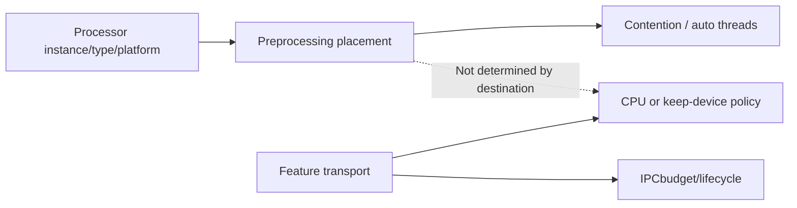
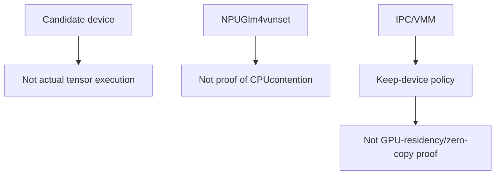
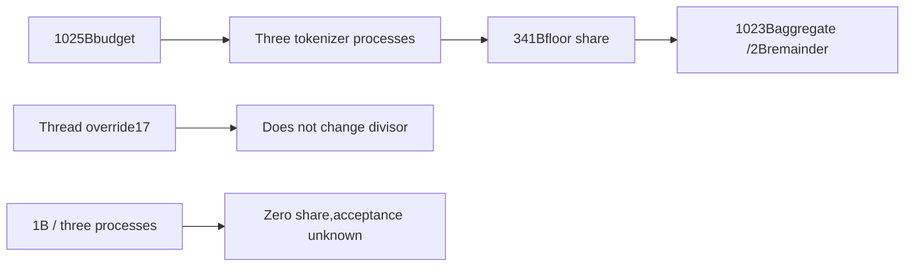

# AI Infra multimodal FAQ: preprocessing placement,feature transport and worker/pool budgets

> **Language**: English | [中文](multimodal-preprocessing-placement-feature-transport-selection-faq.md)  
> **Round156 · 2026-11-14daytime**: same-day module refactor;original policies,no native processors/IPC/GPU.

**Finding:** Destination does not determine preprocessing contention.Six scenarios×three transports:transport-only auto selection misses10/18.GPUpreprocessing→CPUfeatures still auto1,not synthetic declared8.IPC1025B/3tokenizer processes=341Beach,total1023B,remainder2B—not full-budget multiplication3075B.

**Artifacts**:[H5policies](../reports/multimodal-preprocessing-placement-feature-transport-sizer.html) · [seven cards](../reports/multimodal-preprocessing-placement-feature-transport-selection-cards.html) · [1600px SVG](../../assets/svg/multimodal-preprocessing-placement-feature-transport-selection-faq-summary.svg) · [sealed report](../../experiments/multimodal_placement_transport_selection/report.json)

## Q1: Which decisions did the refactor separate?

Pinned **Nov14,06:44:04UTC=14:44:04BJT**.Serving-preprocessing owns candidate device/contention/auto threads;feature-transport owns keep-device/IPCpool/hash-before-CPU/wrapping.**Existing policy extraction,not a new algorithm or first capability introduction.**



Fast HFimageprocessing in tokenizer process can share scheduler accelerator even withCPUoutputs.CPU/RLforcedCPU,disabled-fast/nonBaseImageProcessor do not trigger this predicate;custom processing is not fully certified.

## Q2: What do unset device,base IDandkeep-device mean?

CPU/RLcandidatecpu;XPUxpu;NPUusuallynpu,butGlm4vreturnsNone/leave unset.CUDA-alike usesinstance device_type:base_gpu_id,cuda:3→cuda:7.None does not meanCPUexecution;the NPUunset/HFfast case still contends/auto1.



Original booleans are not transformers isinstance/NPUpatch/media/tensor/driver execution.IPCwraps direct tensor fields;recursive CPUlist/tuple movement does not imply nested IPCleases.This study projects policies only.

## Q3: How do auto,manual,skip-pool and worker roles differ?

Contending auto1overrides synthetic declaration8;otherwise declaration is honored ordefault2.**Explicit4can override GPUauto1**.Skip-pool construction is synchronous1,not ordinary parallel featurepool setup.

Preprocessing threads,tokenizer processes(IPCbudget divisor),CPUexecutor process workers(environment/CPUconfiguration)are distinct.Source VMMexecutor policyspawn,other transportsfork;no Windowsfork/spawn executed.

Six scenarios:CUDAfast,CPU,RLforcedCPU,NPUunset,FastDisabled,OtherPlatform,each crossed withcpu/ipc/vmm.Declared8is synthetic metadata,not tuning advice.

## Q4: Who splits IPCbudget,and is zero share successful allocation?



Source positive-budget/count helper uses integer division without minimum-allocation inflation.Aggregate≤budget,remainder<process count.1B/3gives0share/remainder1,not driver/pool success.

CPU/VMMdo not configure thisIPCpool.Active IPCbudget0means thispool absent,not total GPUmemory0.Skip-pool also avoids thatpool;no CUDAwrap was executed.Other buffers/driver feasibility remainnull.

## Q5: What do original CPUprojection timings show?

| Projections | Hoisted(ms) | Repeated(ms) |
| ---: | ---: | ---: |
| 64 | 0.043933 | 0.081200 |
| 256 | 0.169467 | 0.317333 |
| 1024 | 0.776767 | 1.539700 |
| 4096 | 3.409667 | 6.107200 |

Immutable placement/three transports yield identical descriptors.Two warmups,seven alternating repeats,three operations/sample,median repeat means.Excludes inputs/validation,actual workers/preprocessing,IPC/VMM,hash/copy/SGLang/GPU.

**Not evidence native code recomputes policies perfeature**,nor reproduction of source H200/GB300throughput comments.Not GPUacceleration/service capacity.

## Q6: How can real multimodal serving be validated?

```powershell
python -m unittest discover -s tests -p test_multimodal_placement_transport_selection.py -q
python -m experiments.multimodal_placement_transport_selection.run --check
# --measure only executes original CPUpolicy projection.
```

Eight tests coverGPU→CPUfeatures,CPU/RL/disabled/nonHF,NPUunset/XPU/instanceIDs,manual/skipPool,budget/process-vs-thread/zero share,VMM/invalidconfig,48randomcases/49Nodefixtures,and18sealed cases/hoisting.

Sources:[Nov14refactor](https://github.com/sgl-project/sglang/commit/04eece19ada1bf2fee46ab52f19e570f581f2118),[placement](https://github.com/sgl-project/sglang/blob/04eece19ada1bf2fee46ab52f19e570f581f2118/python/sglang/srt/multimodal/serving_preprocessing.py),[transport](https://github.com/sgl-project/sglang/blob/04eece19ada1bf2fee46ab52f19e570f581f2118/python/sglang/srt/multimodal/transport/feature_transport.py),[budget helper](https://github.com/sgl-project/sglang/blob/04eece19ada1bf2fee46ab52f19e570f581f2118/python/sglang/srt/multimodal/transport/cuda_ipc.py),[integration](https://github.com/sgl-project/sglang/blob/04eece19ada1bf2fee46ab52f19e570f581f2118/python/sglang/srt/multimodal/processors/base_processor.py),[LICENSE](https://github.com/sgl-project/sglang/blob/04eece19ada1bf2fee46ab52f19e570f581f2118/LICENSE).Rights retained,no implementation mirror.

Native helper normalizes unknown transport tocPU;**original tool rejects typos explicitly**,not claiming native exceptions.Real checks needactual devices,async/lease rollback,hash/padding identity,drivers,contention/capacity/latency.Main`synthetic`, `independently_reproduced=false`;CPUseparately`measured`;native throughput/peak/IPCunknown/null.Original60-solid cabinet is not hardware.No browser visual acceptance;prior refusal respected.
