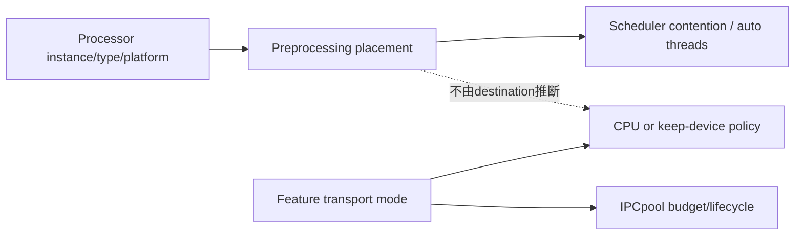
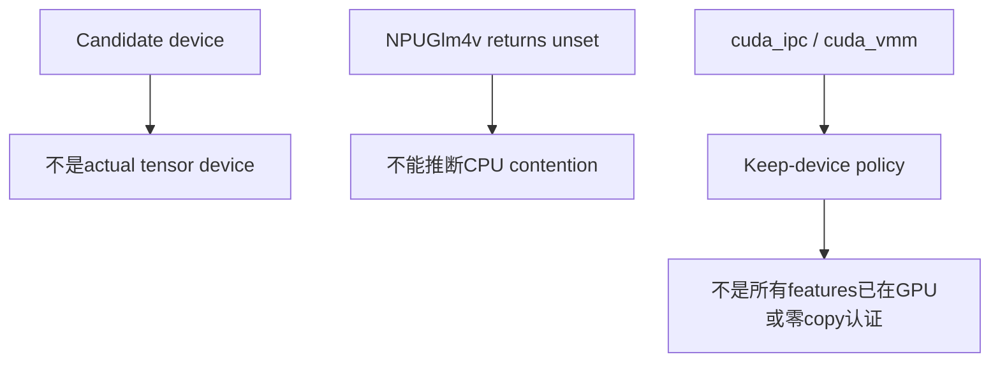
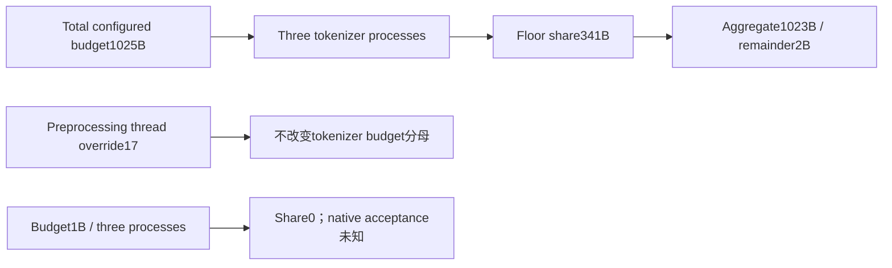

# AI Infra Multimodal FAQ：Preprocessing Placement、Feature Transport 与 Worker/Pool Budget

> **语言**：中文 | [English](multimodal-preprocessing-placement-feature-transport-selection-faq.en.md)  
> **Round156 · 2026-11-14白班**：当天SGLang module refactor；原创policy projection，无native processor/IPC/GPU执行。

**结论速览**：feature destination不决定preprocessing device/contention。六placement scenarios×三transports的18原创cases，transport-only auto选择错10/18；GPUpreprocess即使送CPUfeatures，auto仍1，不是示例declared8。IPCbudget1025B/3tokenizer processes＝341B各、总1023B、剩2B，不应按每process完整预算乘成3075B。

**交付**：[H5 policy工作台](../reports/multimodal-preprocessing-placement-feature-transport-sizer.html) · [7-Card](../reports/multimodal-preprocessing-placement-feature-transport-selection-cards.html) · [1600px SVG](../../assets/svg/multimodal-preprocessing-placement-feature-transport-selection-faq-summary.svg) · [sealed report](../../experiments/multimodal_placement_transport_selection/report.json)

## Q1：当天refactor拆开了哪两种决策？

固定commit时间**Nov14 06:44:04UTC＝14:44:04BJT**。`serving_preprocessing`处理processor candidate device、scheduler contention与auto threads；`feature_transport`处理keep-device/IPCpool/hash-before-CPU/最终field wrapping。这是**既有policy模块拆分，不是新算法或当天首次能力上线**。



fast HFimage processor可在tokenizer process内使用scheduler accelerator，送CPUfeatures不消除这段竞争。CPU/RLforcedCPU、disable-fast或非BaseImageProcessor witness则不触发此contention predicate；native其他custom processing不被这个predicate全面认证。

## Q2：Candidate device=None、base_gpu_id与keep-device意味着什么？

CPU/RL候选`cpu`；XPU候选`xpu`；NPU普通候选`npu`，`Glm4vProcessor`例外返回None（leave unset）；CUDA-alike用**instance**device_type:base_gpu_id，例如cuda:3→cuda:7。None不是“执行CPU”；NPUunset例在HFfast witness成立时仍contends/auto1。



原型用platform/type booleans，不执行transformers isinstance、NPUpatch、media decode、tensor conversion或driver probes。IPC仅wrap直接tensor fields；CPUmove helper可递归list/tuple，不能因此宣称任意nested tensors都获得IPCleases。本轮只计policy，不实现wrapping。

## Q3：Auto、manual override、skip_pool与三种workers如何区分？

auto在contends时1，即便示例model declaration8；否则honor declaration，未声明则2。**explicit4可以覆盖GPUauto1**；skip_mm_pool构造强制synchronous1，不应把该路径当正常并行featurepool初始化。

preprocessing worker threads、tokenizer worker processes（IPCbudget分母）、CPUexecutor process workers（环境/CPU配置）是不同roles。sourceCPUexecutor start-method在cuda_vmm为spawn，其他fork；原型只显示policy标签，**未在Windows执行fork/spawn**。

六scenarios包含CUDAfast、CPU、RLforcedCPU、NPUunset、FastDisabled、OtherPlatform；各交叉cpu/ipc/vmm。declared8是synthetic metadata，不是推荐配置或native最优吞吐。

## Q4：IPCbudget按谁拆分，零share是不是成功pool？



source helper直接integer floor division，positive total/process count，没有minimum share扩容。数学上aggregate≤budget、remainder<processes；1B/3返回0share、剩1B，不应伪称driver/pool已支持zero-size配置。

cpu/vmm没有这个CUDA IPCpool，原型active IPCbudget为0只表示**该pool不配置**，不是total GPUmemory0。skip_pool下也不配置该pool，未执行CUDAfield wrap；nativeother buffers/driver feasibility都是null。

## Q5：原创bulk policy projection的CPU计时能说明什么？

| Projections | Hoisted placement（ms） | Repeated resolver（ms） |
| ---: | ---: | ---: |
| 64 | 0.043933 | 0.081200 |
| 256 | 0.169467 | 0.317333 |
| 1024 | 0.776767 | 1.539700 |
| 4096 | 3.409667 | 6.107200 |

同immutable placement配三transport configs，两个paths返回exact相同policy descriptors；2warmups、7轮交替repeat、每sample3operations、median repeat means。排除inputs/validation、actual preprocessing/workers、IPC/VMMallocation、hash/copy/SGLang/GPU。

**不表示native每feature重算这些policies**，也不复现sourcecomments的H200/GB300吞吐；不能把这段CPUdictionary projection作为GPU加速或真实服务容量。

## Q6：怎样复现并验证真实多模态服务？

```powershell
python -m unittest discover -s tests -p test_multimodal_placement_transport_selection.py -q
python -m experiments.multimodal_placement_transport_selection.run --check
# --measure只执行原创CPUpolicy projection。
```

八项测试覆盖GPU→CPUfeature policy、CPU/RL/disabled/nonHF、NPUunset/XPU/instanceIDs、manual/skipPool、budget/process-vs-thread/zero share、VMMpolicy/invalidconfig、48randomcases/49Nodefixtures、18-case sealed matrix/hoisting。

来源：[Nov14refactor](https://github.com/sgl-project/sglang/commit/04eece19ada1bf2fee46ab52f19e570f581f2118)、[Placement policies](https://github.com/sgl-project/sglang/blob/04eece19ada1bf2fee46ab52f19e570f581f2118/python/sglang/srt/multimodal/serving_preprocessing.py)、[Feature transport](https://github.com/sgl-project/sglang/blob/04eece19ada1bf2fee46ab52f19e570f581f2118/python/sglang/srt/multimodal/transport/feature_transport.py)、[Pool budget helper](https://github.com/sgl-project/sglang/blob/04eece19ada1bf2fee46ab52f19e570f581f2118/python/sglang/srt/multimodal/transport/cuda_ipc.py)、[Processor integration](https://github.com/sgl-project/sglang/blob/04eece19ada1bf2fee46ab52f19e570f581f2118/python/sglang/srt/multimodal/processors/base_processor.py)、[LICENSE](https://github.com/sgl-project/sglang/blob/04eece19ada1bf2fee46ab52f19e570f581f2118/LICENSE)。rights保留，无实现镜像。

native transport helper unknown mode会normalize到cpu；**原型显式拒绝typo**以暴露配置错误，不声称native也raise。真实验收需实际processor/tensor device、async/lease rollback、hash/padding identity、platformdriver、worker contention与pool capacity/latency。主`synthetic`、`independently_reproduced=false`；CPU单独`measured`；native吞吐/peak/IPC未知/null。原创60-solid柜非hardware；无视觉浏览器验收，尊重此前拒绝。
