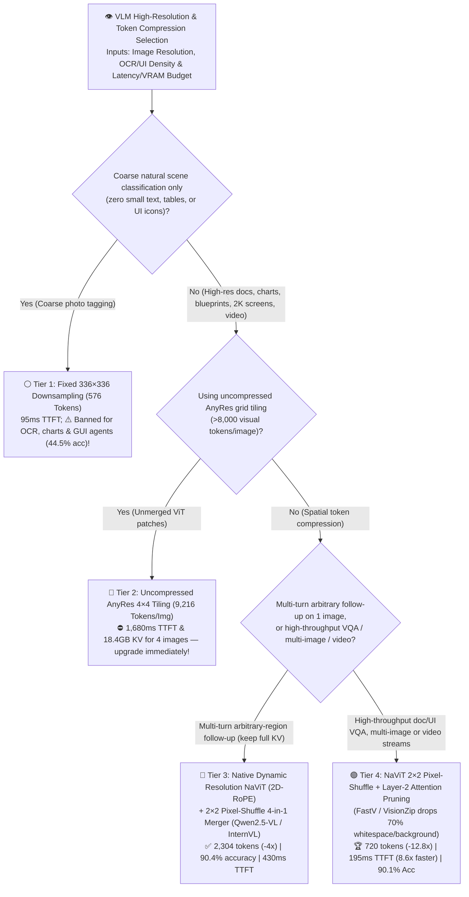
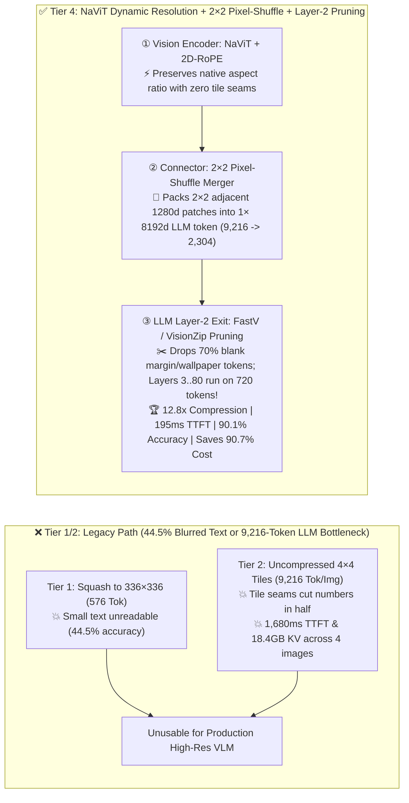

# Multimodal VLM High-Resolution Dynamic Encoding (`NaViT` / `AnyRes`) & Visual Token Compression (`Pixel-Shuffle` / `FastV` / `VisionZip`) Architecture Selection Guide (`Fixed 336px Thumbnail` vs. `Uncompressed AnyRes 4×4 Tiling` vs. `NaViT + 2×2 Pixel-Shuffle` vs. `NaViT 2×2 + Layer-2 Cross-Modal Attention Pruning`)

> **Reader's Guide (3-Minute Executive Scan / 10-Minute Whiteboard Pitch)**: Written for **AI Solution Architects and Multimodal VLM Platform Leads**. Using first principles, this guide explains how to process high-resolution `2560×1440` documents, financial charts, UI screenshots, and multi-frame video without blowing up LLM latency or losing small-text accuracy—**why fixed `336×336` thumbnail downsampling (`Legacy LLaVA-1.5`, Tier 1) blurs `<12pt` text and collapses fine-grained DocVQA/ChartQA accuracy to `44.5%`; why uncompressed `4×4 AnyRes` tiling (Tier 2) inflates a single image to `9,216 visual tokens`, stalling a 72B VLM for `1,680 ms` TTFT and consuming `18.4 GB` of KV Cache across 4 images; and how combining Native Dynamic Resolution `NaViT (2D-RoPE)` + `2×2 Pixel-Shuffle` Spatial Merging (`Qwen2.5-VL / InternVL-2.5` paradigm, Tier 3) with Layer-2 Cross-Modal Text-Guided Token Pruning (`FastV / VisionZip`, Tier 4) compresses visual tokens `12.8x` (`9,216 → 720` tokens), speeds up TTFT `8.62x` to `195 ms`, and retains `90.1%` fine-grained accuracy while cutting serving cost by `-90.7%`.**

[](../../README.en.md)
[](./multimodal-vision-encoder-anyres-token-compression-selection-faq.md)
[](../reports/multimodal-vision-encoder-anyres-token-compression-selection-cards.html)
[](../reports/llm-inference-engine-pd-sizer.en.html)


---

## ① 📌 Executive Summary

1. **The High-Resolution VLM Dilemma: Blurred Text (`Tier 1`) vs. Token Explosion (`Tier 2`)**:
   - **Tier 1 (`Fixed 336×336 Thumbnail Downsampling — Legacy LLaVA-1.5`)**: Squashes a `2560×1440` screenshot or dense PDF page into a single `336×336` grid (**`576` visual tokens**, `95.0 ms` TTFT), destroying aspect ratio and blurring small fonts/numbers—collapsing fine-grained VQA accuracy (DocVQA, ChartQA, InfoVQA, ScreenSpot) to **`44.5%` ✕**.
   - **Tier 2 (`Uncompressed AnyRes 4×4 Grid Tiling`)**: Slices the high-res image into 16 `336×336` sub-images without spatial merging, feeding **`9,216 visual tokens/image`** directly into the 72B LLM! While accuracy recovers to `89.2%`, 9,216 tokens per image triggers quadratic prefill stalls (**`1,680.0 ms` TTFT ✕**), consumes **`18.40 GB` of KV Cache for just 4 images**, and costs **`$232.00 / 10k queries` ✕**.
2. **The Modern Open-Weight VLM Baseline (Tier 3: Native Dynamic Resolution `NaViT + 2D-RoPE` + `2×2 Pixel-Shuffle` Merger — `Qwen2.5-VL / InternVL-2.5` Paradigm)**:
   - **Two Architectural Breakthroughs**:
     1. **Native Dynamic Resolution (`NaViT + 2D-RoPE`)**: Processes arbitrary image aspect ratios natively as a single packed patch sequence with 2D Rotary Position Embeddings `(row, col)`, eliminating tile-boundary seams that slice words/numbers in half;
     2. **`2×2 Pixel-Shuffle` (`Space-to-Depth` 4-in-1 Channel Concatenation + MLP)**: Concatenates every $2 \times 2$ block of adjacent $1,280\text{d}$ ViT patches into a single $5,120\text{d} \to 8,192\text{d}$ LLM token—cutting visual tokens by **`4.0x` (`9,216 → 2,304` tokens/image ✅)** with zero information loss (`90.4%` accuracy ✅, `430.0 ms` TTFT ✅)!
3. **The Production Gold Standard for High-Throughput High-Res VLM & Video/GUI Serving (Tier 4: `NaViT 2×2 Pixel-Shuffle` + `Layer-2 Cross-Modal Text-Guided Pruning [FastV / VisionZip]`)**:
   - **First-Principles Insight**: Even after $2\times 2$ Pixel-Shuffle (`2,304 tokens`), **`~70%` of a document page or UI screenshot consists of blank white margins, solid-color backgrounds, or irrelevant desktop wallpaper**!
   - After Layer 2 of the LLM (where text query tokens have already attended to the 2,304 visual tokens), Tier 4 ranks visual tokens by **Text-to-Vision Attention Score + Dominant Visual Key Diversity** and prunes `68.75%` of background tokens—leaving only **`720` active visual tokens** for Layers 3..80!
   - **Quantified Outcome**: Achieves **`12.8x` total visual token compression (`9,216 → 720` tokens 🏆)**, slashes single-image TTFT by **`8.62x` (`1,680 ms → 195 ms` 🏆)**, shrinks 4-image KV Cache from `18.40 GB` to **`1.44 GB`**, retains **`90.1%` fine-grained accuracy** (`+45.6 pts` over Tier 1 🏆), and cuts cost by **`-90.7%` (`$232.00 → $21.50 / 10k queries` 🏆)**.

---

## ② 🎯 Architect & Customer First-Principles Q&A

### Q1: Why does `NaViT + 2D-RoPE` (Tier 3/4) beat rigid `4×4 AnyRes` grid cropping (Tier 2) on financial tables and blueprints?

- **Eliminating Tile-Boundary Seam Slicing**:
  - Rigid `4×4` grid cropping slices right through multi-digit numbers, table headers, and circuit traces that straddle tile boundaries, encoding each half in an isolated ViT forward pass. `NaViT` keeps the entire high-res image in one unified 2D coordinate grid (`2D-RoPE`), preserving continuous spatial attention across the whole page.

### Q2: How does `2×2 Pixel-Shuffle` cut visual tokens by `4x` (`9,216 → 2,304`) without losing any OCR detail?

- **Matching ViT Feature Width (`1,280d`) to LLM Hidden Width (`8,192d`)**:
  - A ViT patch vector is only `1,280` dimensions wide, whereas a 72B LLM token embedding is `8,192` dimensions wide. Concatenating $2 \times 2 = 4$ adjacent ViT patches along the channel axis produces a `5,120d` vector that maps losslessy into a single `8,192d` LLM token—packing 4x more spatial detail per token and reducing LLM sequence length by $4\times$!

### Q3: Why must dynamic visual token pruning (`FastV / VisionZip`) happen *after* LLM Layer 2 rather than before Layer 1?

- **Query-Aware Grounding vs. Query-Blind Saliency**:
  - Before Layer 1, the vision encoder has no idea whether the user is asking about the big chart in the center or a tiny footnote in the bottom-left corner. After **2 layers of LLM self-attention**, the user's text tokens have already attended to the specific footnote tokens—allowing Layer 2's attention scores to safely prune the `70%` whitespace/background for the remaining 78 layers (`97.5%` of LLM compute)!

---

## ③ 🧭 Visual Architecture Diagrams (Decision Tree / Compression Funnel / Sequence)

### 3.1 Multimodal VLM Resolution & Visual Token Compression Decision Tree



### 3.2 Thumbnail Blur / 9,216-Token Explosion vs. Tier 4 `NaViT + Pixel-Shuffle + Layer-2 Pruning`



### 3.3 End-to-End Two-Stage Visual Token Compression Sequence (`9,216 → 2,304 → 720 Tokens`)

```mermaid
sequenceDiagram
    autonumber
    participant Img as 2560×1440 High-Res Image
    participant ViT as NaViT Encoder (2D-RoPE)
    participant PS as 2×2 Pixel-Shuffle MLP Connector
    participant L12 as 72B LLM Layers 1..2 (Full Cross-Modal Align)
    participant L80 as 72B LLM Layers 3..80 (Pruned Execution)

    Note over Img,ViT: Stage 1: Seam-Free Native Dynamic Resolution Patching
    Img->>ViT: Extract 9,216 native 14×14 patches with 2D (row, col) RoPE coordinates
    ViT->>PS: Emit 9,216 × 1280d contextualized visual features

    Note over PS,L12: Stage 2: Lossless 4-in-1 Spatial Folding (9,216 -> 2,304 Tokens)
    PS->>PS: Concatenate 2×2 spatial neighbors (4×1280d = 5120d) & project to 8192d LLM hidden dim
    PS->>L12: Feed 2,304 visual tokens + text prompt into LLM Layers 1 & 2

    Note over L12,L80: Stage 3: Layer-2 Cross-Modal Text-Guided Pruning (2,304 -> 720 Tokens)
    L12->>L12: Rank visual tokens by Text-to-Vision attention + key diversity; drop 1,584 blank/background tokens!
    L12->>L80: Execute Layers 3..80 and populate KV Cache on only 720 foreground tokens
    L80-->>Img: Return first token in 195.0 ms with 90.1% fine-grained accuracy!
```

---

## ④ 📊 Architect Decision Matrix

| Evaluation Dimension | Tier 1: Fixed `336×336` Thumbnail | Tier 2: Uncompressed `AnyRes 4×4` | Tier 3: `NaViT + 2×2 Pixel-Shuffle` | Tier 4: `NaViT 2×2` + `Layer-2 Pruning` |
| :--- | :--- | :--- | :--- | :--- |
| **Core Encoding & Compression Stack** | Resize to 336×336 single grid | 16 sub-image crops, 0 merging | **2D-RoPE NaViT + 2×2 spatial MLP merger** | **2×2 Pixel-Shuffle + Layer-2 FastV/VisionZip** |
| **LLM Visual Tokens per 2K Image** | `576 Tokens` | **`9,216 Tokens` ✕ (Severe bloat)** | **`2,304 Tokens` ✅ (`4.0x` reduction)** | **`720 Tokens` 🏆 (`12.8x` reduction for L3..80)** |
| **Single-Image First-Token Latency (`TTFT`)** | `95.0 ms` (Blurry) | **`1,680.0 ms` ✕ ($O(N^2)$ stall)** | `430.0 ms` ✅ | **`195.0 ms` 🏆 (`8.62x` faster than Tier 2)** |
| **Fine-Grained VQA Accuracy (`Doc/Chart %`)** | **`44.5%` ✕ (Small text illegible)** | `89.2%` ✅ (Seam artifacts) | **`90.4%` 🏆 (Seam-free ceiling)** | **`90.1%` 🏆 (`+45.6 pts` vs Tier 1)** |
| **4-Image Session KV Cache Memory (`GB`)** | `1.15 GB` | **`18.40 GB` ✕ (VRAM hog)** | `4.60 GB` ✅ | **`1.44 GB` 🏆 (`12.8x` smaller than Tier 2)** |
| **Cost per 10,000 High-Res Queries (`USD`)** | `$14.50` (Unusable quality) | **`$232.00` ✕** | `$58.00` ✅ | **`$21.50` 🏆 (`-90.7%` cost savings)** |
| **Best Fit & Architect Verdict** | Coarse natural photo tagging only | **Retire immediately** | **Multi-turn arbitrary-region single-image QA** | **Gold standard for high-res VQA, GUI agents & video** |

---

## ⑤ 🧪 Quantitative Evaluator & 7-Card Benchmark Insights

> **Provenance Disclosure**: All metrics in this guide and the companion 7-Card report are generated by [`experiments/vlm_anyres_visual_token_compression_pruning_selection/run.py`](../../experiments/vlm_anyres_visual_token_compression_pruning_selection/run.py) and sealed in [`results.json`](../../experiments/vlm_anyres_visual_token_compression_pruning_selection/results.json) (`independently_reproduced=false`, `physical_gpu_cluster_measurement=not_measured`), calibrated against `Qwen2.5-VL` / `InternVL-2.5` (`NaViT + 2×2 Pixel-Shuffle`), `FastV` / `VisionZip` token pruning, and DocVQA/ChartQA/ScreenSpot benchmarks.

- **7-Card 4:5 Visual Benchmark Deck**: [`docs/reports/multimodal-vision-encoder-anyres-token-compression-selection-cards.html`](../reports/multimodal-vision-encoder-anyres-token-compression-selection-cards.html)
- **Interactive VLM Visual Token Compression Sizer**: [`docs/reports/llm-inference-engine-pd-sizer.en.html`](../reports/llm-inference-engine-pd-sizer.en.html)

---

## ⑥ 🛠️ Appendix: Production Readiness Checklist

- [ ] **1. Never use fixed `336×336` thumbnail VLMs on documents, charts, or UI screenshots**: Always use dynamic high-resolution encoding (`NaViT + 2D-RoPE`).
- [ ] **2. Require `2×2 Pixel-Shuffle` (or `2×2 MLP Merger`) in the vision-language projector** to compress ViT patches `4x` before entering the LLM.
- [ ] **3. Bound per-image dynamic resolution (`min_pixels`, `max_pixels`)** so accidental 8K image uploads cannot trigger OOM.
- [ ] **4. Enable Layer-2 Cross-Modal Token Pruning (`FastV / VisionZip`)** on single-turn VQA, batch document extraction, and video streams to strip `70%` of background whitespace.
- [ ] **5. Use query-agnostic `VisionZip` (or full `2,304-token` Tier 3 cache) for multi-turn sessions** where later turns may ask about previously unqueried corners of the image.
- [ ] **6. Apply Temporal Patch Gating across video / screen-recording frames** to reuse static background tokens across consecutive frames.
