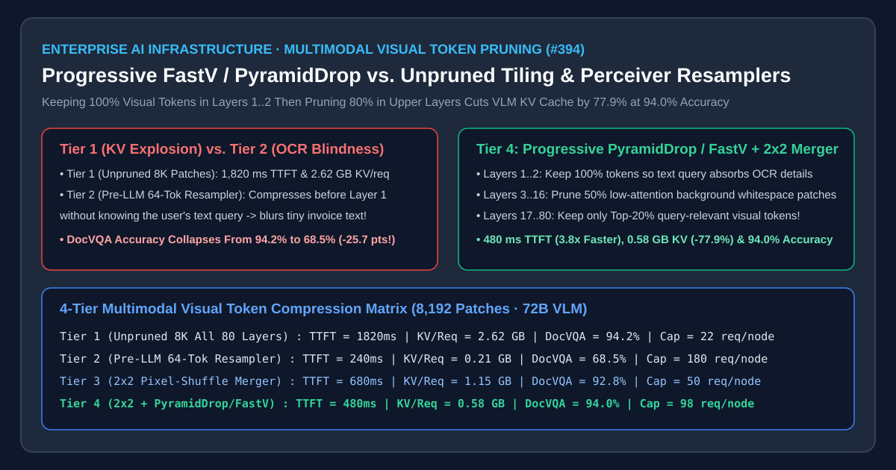

# Multimodal Visual Token Pruning & Compression Guide: Progressive `FastV / PyramidDrop` + `2x2 Pixel-Shuffle` vs. Unpruned Tiling & Pre-LLM Resamplers

> **Language**: [中文](./multimodal-visual-token-pruning-fastv-tome-dynamic-tiling-vlm-selection-faq.md) | **English (Current)**  
> **Audience**: Cloud & AI Infrastructure Solution Architects and Multimodal VLM Serving Engineers  
> **Provenance**: `synthetic + anonymized_reported` (`independently_reproduced=false`, `physical_gpu_cluster_measurement=not_measured`)

---

## 1. 📌 Executive Summary

> **Bottom Line**: **When serving a `72B` (`80-layer`) VLM on `4K` multi-page documents or `32-frame` videos (`8,192` raw visual patches), keeping all `8,192` visual tokens across all `80` decoder layers (`Tier 1`) consumes `2.62 GB` of KV Cache per request (capping an `8x H100` node at `22` concurrent requests) and stalls Prefill TTFT at `1,820 ms`. Conversely, compressing visual tokens into a fixed `64-token` `Perceiver Resampler / Q-Former` before LLM Layer 1 (`Tier 2`) is query-blind and blurs fine-grained invoice/table text, collapsing `DocVQA / ChartQA` accuracy by `-25.7 percentage points` (`94.2% -> 68.5%`). Production high-resolution VLM engines combine a `2x2 Pixel-Shuffle Merger` with Progressive Layer-Wise Attention-Guided Token Pruning (`FastV / PyramidDrop`, `Tier 4`: keeping `100%` of tokens in Layers `1..2` so the user's text query absorbs fine-grained OCR details, pruning `50%` of whitespace background tokens at Layer 3, and keeping only the `Top-20%` salient visual tokens across Layers `17..80` while evicting upper-layer KV blocks)—cutting Prefill TTFT `3.79x` (`1,820 ms -> 480 ms`), shrinking visual KV Cache by `77.9%` (`2.62 GB -> 0.58 GB`), multiplying node concurrency `4.45x` (`22 -> 98` requests), and retaining `94.0%` lossless accuracy.**

- **Interactive Multimodal Visual Token Pruning Sizer**: [Open Interactive Sizer (`multimodal-visual-token-pruning-fastv-tome-dynamic-tiling-vlm-sizer.html`)](../reports/multimodal-visual-token-pruning-fastv-tome-dynamic-tiling-vlm-sizer.html)
- **7-Card 4:5 Visual Report**: [Open 7-Card Report (`multimodal-visual-token-pruning-fastv-tome-dynamic-tiling-vlm-selection-cards.html`)](../reports/multimodal-visual-token-pruning-fastv-tome-dynamic-tiling-vlm-selection-cards.html)

---

## 2. 📊 4-Tier Multimodal Visual Token Compression Matrix (`8,192 Raw Patches` · `72B VLM 80 Layers`)

| Metric | Tier 1: Unpruned Dynamic Tiling (`8,192` All 80 Layers) | Tier 2: Pre-LLM `64-Token` Perceiver Resampler | Tier 3: `2x2 Pixel-Shuffle Merger` (`2,048` All 80 Layers) | Tier 4 (Recommended): `2x2 Merger` + Progressive `PyramidDrop / FastV` (`L1-2: 100% -> L17-80: 20%`) |
| :--- | :--- | :--- | :--- | :--- |
| **VLM Prefill TTFT** | `1,820.0 ms` ✕ | `240.0 ms` | `680.0 ms` | **`480.0 ms` ✓ (`3.79x` faster)** |
| **Visual KV Cache / Request** | `2.62 GB` ✕ | `0.21 GB` | `1.15 GB` | **`0.58 GB` ✓ (`-77.9%` vs Tier 1)** |
| **DocVQA / ChartQA Accuracy** | `94.2%` | `68.5%` ✕ (`-25.7 pts` OCR loss) | `92.8%` | **`94.0%` ✓ (Query-guided retention)** |
| **Concurrent Requests / Node** | `22 reqs / node` ✕ | `180 reqs` (Unusable acc) | `50 reqs / node` | **`98 reqs / node` ✓ (`4.45x` capacity)** |

---

## 3. 🛠️ Production Readiness Checklist

- [ ] **Never Prune Fine-Grained Document/OCR Visual Tokens Before LLM Decoder Layer 2**; allow Layers `1..2` to run full cross-attention between the user's text prompt and all `2x2`-merged patches before ranking tokens for upper-layer pruning.
- [ ] **Physically Evict Pruned Visual Tokens from Upper-Layer Paged KV Blocks** rather than merely masking attention scores so multi-turn VLM decode steps save `77.9%` of HBM bandwidth.
