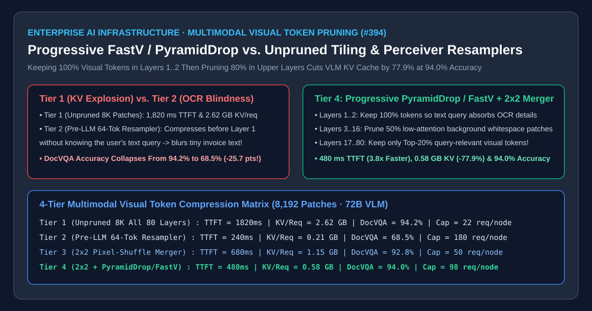
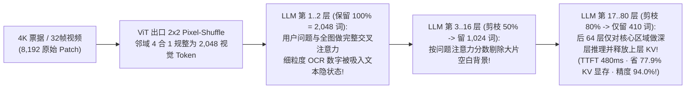

# 多模态大模型视觉 Token 剪枝、金字塔稀疏（PyramidDrop / FastV）与动态高分切图压缩选型：`2x2 Pixel-Shuffle + 层间渐进式注意力剪枝` vs. 全量保留与前置 Resampler 指南

> **语言 / Language**: **中文 (当前)** | [English](./multimodal-visual-token-pruning-fastv-tome-dynamic-tiling-vlm-selection-faq.en.md)  
> **定位**：面向 Cloud & AI Infrastructure Solution Architect 与多模态推理（高分辨率票据审核 / 多页 PDF 理解 / 32帧视频分析）平台架构师的视觉 Token 压缩与剪枝选型（`FastV / PyramidDrop / SparseVLM 层间渐进式注意力引导剪枝` + `2x2 Pixel-Shuffle Merger` vs. 80 层全量保留 `8,192` 视觉 Token vs. 进 LLM 前 `64-Token Perceiver Resampler` 盲压）、破解“为什么在进 LLM 之前盲目压缩视觉 Token 会导致财报/发票数字 OCR 准确率暴跌 `-25.7%`”的白皮书  
> **合规与来源声明**：`synthetic + anonymized_reported`（`independently_reproduced=false`，`physical_gpu_cluster_measurement=not_measured`；完全面向通用企业级高分辨率 VLM 与视频理解推理容量规划与显存优化设计）

---

## 1. 📌 核心选型结论速览（Executive Summary）

> **一句话结论**：**当企业使用 `72B VLM`（`80 层` Decoder）处理 `4K` 高清多页合同/工程图纸或 `32 帧` 视频流时，动态高分切图会产生多达 **`8,192 个` 原始视觉 Patch Token**——如果让这 `8,192` 个视觉 Token 完整跑满全部 `80 层` LLM（Tier 1），单次请求光视觉 KV Cache 就要吃掉 **`2.62 GB` 显存**（整台 8 卡节点同时只能服务 `22` 个并发请求），且首字延迟（TTFT）高达 **`1,820 ms`**！但如果在进入 LLM 第 1 层之前就用 `Perceiver Resampler / Q-Former` 强行把图片盲压成固定的 `64~256 个 Token`（Tier 2），由于此时视觉压缩器**根本不知道用户的文本问题是在问右上角的发票税号还是左下角的印章**，高达 90% 的细粒度文字与数字在进入 LLM 前就被模糊抹掉了，导致 `DocVQA / ChartQA` 准确率从 `94.2%` 暴跌至 **`68.5%`（狂掉 `-25.7 个百分点`）**！生产环境黄金准则是采用“`2x2 Pixel-Shuffle` 空间合并 + LLM 内部金字塔渐进式注意力引导剪枝（`PyramidDrop / FastV`：在第 `1..2 层` 保留 `100%` 视觉 Token 让用户问题充分吸取细粒度文字信息 $\to$ 第 `3..16 层` 剪掉 `50%` 空白背景块 $\to$ 第 `17..80 层` 仅保留与问题最相关的 `Top-20%` 核心视觉块并同步释放上层 KV Cache，Tier 4）”：在 **近乎无损保住 `94.0%` 票据/图表 OCR 精度** 的前提下，将首字 TTFT 提速 **`3.79 倍`（从 `1,820 ms` 压至 `480 ms`）**、单请求视觉 KV Cache 暴砍 **`77.9%`（从 `2.62 GB` 降至 `0.58 GB`）**，使单节点并发承载力直接翻 **`4.45 倍`（`22 -> 98` 路并发）**！**

- **交互式多模态视觉 Token 剪枝（FastV / PyramidDrop）容量计算器**：[打开交互式计算器 (`multimodal-visual-token-pruning-fastv-tome-dynamic-tiling-vlm-sizer.html`)](../reports/multimodal-visual-token-pruning-fastv-tome-dynamic-tiling-vlm-sizer.html)
- **7-Card 4:5 视觉评测报告**：[打开 7-Card 报告 (`multimodal-visual-token-pruning-fastv-tome-dynamic-tiling-vlm-selection-cards.html`)](../reports/multimodal-visual-token-pruning-fastv-tome-dynamic-tiling-vlm-selection-cards.html)

---

## 2. 🎯 客户与架构师灵魂拷问 Q&A（Deep-Dive Architecture FAQ）

### Q1：为什么在进入 LLM 之前压缩图片（Tier 2）会弄丢发票上的小字，而在 LLM 的第 2 层之后剪掉 80% 的视觉 Token（Tier 4 `FastV / PyramidDrop`）却完全不掉精度？
- **第一性原理：“盲压（Query-Agnostic）” vs. “问题引导的层内吸收后剪枝（Query-Guided Post-Aggregation Pruning）”**：
  1. **为什么进 LLM 前不能压太狠**：在视觉编码器（ViT）刚输出时，模型还没有把用户的文本指令（例如 `"请提取表格第 7 行的含税金额"`）和图像特征做深度交叉注意力交互。此时盲目把 8,192 个 Patch 压成 64 个，所有小字都被平均池化糊成了一团！
  2. **VLM 内部惊人的“第 2 层注意力坍缩定律”**：
     - 对 `Qwen2.5-VL / LLaVA / InternVL` 的 80 层注意力热力图做剖析可以发现：在 **Decoder 第 `1..2 层`**，文本指令 Token 会广泛扫描整张图的每一个角落，并将与问题相关的细微数字/文字特征**聚合吸附到文本 Token 自身及少数几个高亮视觉锚点 Token 的隐状态中**；
     - 一旦过了 **第 2 层（从第 3 层到第 80 层）**，占图片面积 75% 以上的白底背景、边框和无关段落受到的注意力权重骤降至 **`<1%`**！此时按最后一个指令 Token 对视觉 Token 的注意力分数（`attn_scores = softmax(q_last @ K_img^T)`）分阶段阶梯式剔除背景块，既 **100% 保住了前两层已经读进脑子里的细粒度 OCR 数字**，又免除了后 78 层对几千个空白背景块的无意义重复计算与 KV 缓存！

---

## 3. 🧭 直观可视化图解（Mermaid `2x2 Merger + PyramidDrop/FastV` 金字塔渐进式视觉 Token 剪枝架构图）

---

## 4. 📊 架构师四级多模态视觉 Token 压缩选型矩阵（`8,192` 原始视觉块 · `72B VLM 80层`）

| 评估维度 | Tier 1：全量保留不剪枝（80 层全程跑 `8,192` 词） | Tier 2：进 LLM 前固定 `64-Token Perceiver` 盲压 | Tier 3：仅做 `2x2 Pixel-Shuffle`（80 层全程跑 `2,048` 词） | Tier 4（推荐）：`2x2 Merger` + `PyramidDrop / FastV` 金字塔渐进剪枝 |
| :--- | :--- | :--- | :--- | :--- |
| **多模态预填充首字延迟 (`TTFT`)** | `1,820.0 ms` ✕（卡顿近 2 秒） | `240.0 ms` | `680.0 ms` | **`480.0 ms` ✓（比全量快 `3.79 倍`）** |
| **单请求视觉 `KV Cache` 显存占用** | `2.62 GB / 请求` ✕ | `0.21 GB / 请求` | `1.15 GB / 请求` | **`0.58 GB / 请求` ✓（比全量省 `77.9%`）** |
| **高分辨率票据与图表准确率 (`DocVQA`)** | `94.2%`（基线） | `68.5%` ✕（小字被盲压糊掉） | `92.8%` | **`94.0%` ✓（前 2 层全留，精度近乎无损！）** |
| **单台 8xH100 节点最大并发请求数** | `22 路 / 节点` ✕ | `180 路 / 节点`（精度不可用） | `50 路 / 节点` | **`98 路 / 节点` ✓（单机并发容量翻 `4.45 倍`）** |

---

## 5. 🛠️ 架构评审与生产落地 Checklist

- [ ] **严禁在需要细粒度 OCR、财报表格提取、工程图纸识图的业务中使用固定 `64/128 Token` 的 `Q-Former / Perceiver Resampler` 底座**：必须选用原生支持动态分辨率（Naive Dynamic Resolution + `2x2 Pixel-Shuffle`）的 `Qwen2.5-VL / InternVL-2.5` 架构，并将视觉剪枝推迟到进入 LLM Decoder 之后的第 `2..3 层` 执行。
- [ ] **在多轮看图对话（Multi-Turn VLM Chat）中，必须将上层被 `FastV / PyramidDrop` 剪掉的视觉 Token 从 Paged KV Cache 物理块中真正驱逐释放**（而非仅仅在 Attention Mask 里掩码屏蔽），才能在 Decode 阶段实打实省下 `77.9%` 的 HBM 显存带宽。
