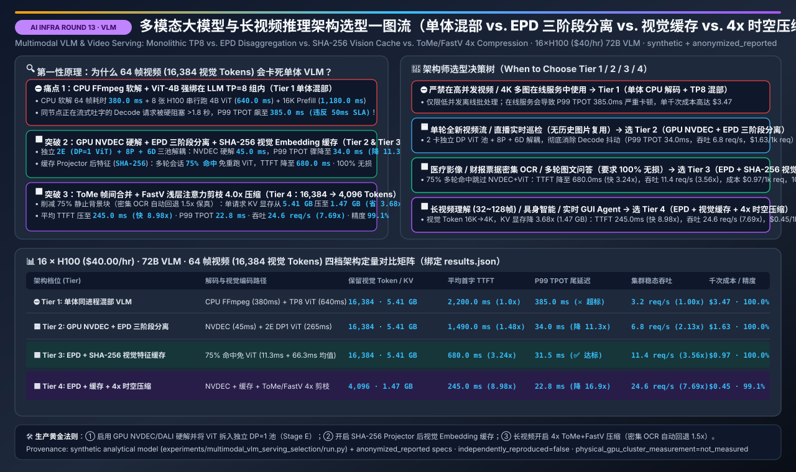
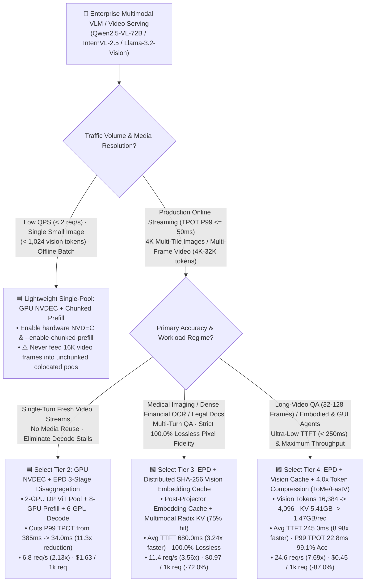
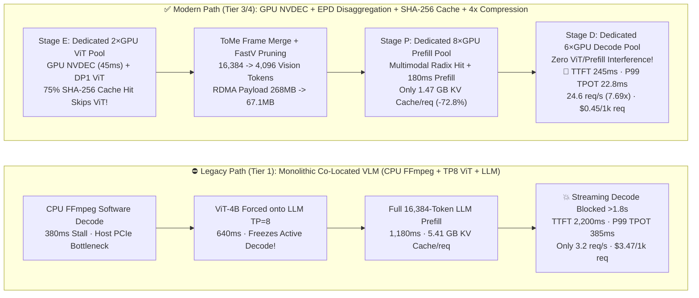
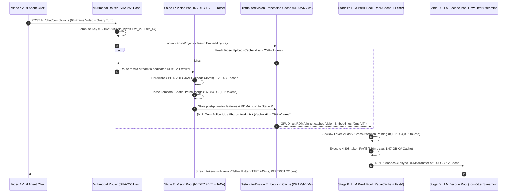

# Multimodal VLM & Long-Video Inference Serving Architecture Selection Guide (Monolithic Co-Located VLM vs. EPD 3-Stage Disaggregation vs. Distributed Vision Embedding Cache vs. Spatio-Temporal Token Compression)

> **[中文版](./multimodal-vlm-serving-selection-faq.md)** | **[Back to Documentation Index](../../README.en.md)** | **[Interactive Multimodal VLM Throughput & KV Sizer](../reports/llm-inference-engine-pd-sizer.en.html#multimodal-vlm-sizer)** | **[7-Card 4:5 Visual Benchmark Report](../reports/multimodal-vlm-serving-selection-cards.html)**



---

## ① 📌 Executive Summary

> **Provenance & Reproduction Disclosure**: Architectural mechanisms and compression specifications in this guide reference published **SGLang / vLLM V1 Multimodal EPD Disaggregation & Vision Embedding Cache designs**, **DistServe-VLM / ModServe papers**, and **FastV / ToMe / LLaVA-OneVision / Qwen2.5-VL spatio-temporal vision token pruning/merging literature** (classified as `anonymized_reported`, `independently_reproduced=false`). All **16-GPU `NVIDIA H100 80GB SXM` (`$40.00/hr`) performance, TTFT, P99 TPOT, KV Cache memory, and per-1k-request cost figures** serving a `72B VLM` (`ViT-4B` Vision Encoder + `70B` LLM Backbone) on 64-frame video / 4K multi-tile inputs (`16,384` raw vision tokens + `512` text tokens, `75.0%` multi-turn media reuse hit rate) are generated by the deterministic analytical model in [`experiments/multimodal_vlm_serving_selection/run.py`](../../experiments/multimodal_vlm_serving_selection/run.py) (classified as `synthetic`; physical 16×H100 cluster execution is `not_measured`; local CPU deterministic validation and unit tests are `measured`).

- **Three Bottom-Line Selection Rules for AI Solution Architects**:
  1. **Never deploy `Tier 1 Monolithic Co-Located VLM (CPU FFmpeg Decode + Inline TP8 ViT + Colocated LLM)` for production 4K multi-image or multi-frame video streaming**: On a `16 × H100` cluster serving a `72B VLM` with 64 video frames (`16,384` vision tokens), CPU software decoding (`380.0 ms`) plus running the `4B` ViT inline across the LLM's `TP=8` group (`640.0 ms`) plus the `1,180.0 ms` LLM prefill stalls all in-flight streaming decode tokens on that node for **over `1.8 seconds`**, driving **P99 TPOT to `385.0 ms` (violating the `<= 50 ms` streaming SLA by `7.7x`)**, capping cluster throughput at **`3.2 req/s`**, and costing **`$3.47 / 1k VLM requests`**.
  2. **For medical imaging, financial invoice OCR, and multi-turn visual QA requiring `100.0%` lossless pixel fidelity, standardize on `Tier 3: GPU NVDEC + EPD 3-Stage Disaggregation (Encode-Prefill-Decode) + Distributed SHA-256 Vision Embedding Cache`**: Isolating a dedicated `DP=1` Vision Encode pool (`2 GPUs` running hardware `NVDEC/DALI + ViT-4B`) from the `8P + 6D` LLM pools (**Tier 2**) slashes P99 TPOT from `385.0 ms -> 34.0 ms` (`11.3x` reduction). Adding a content-addressed **post-projector Vision Embedding Cache (`SHA-256(media_bytes + vit_ver + res_profile)`) in Host DRAM/NVMe (Tier 3)** eliminates redundant decoding and ViT execution across multi-turn follow-ups (`75.0%` hit rate), cutting average TTFT from `2,200.0 ms -> 680.0 ms` (`3.24x` faster), raising throughput to **`11.4 req/s` (`3.56x`)**, and cutting cost to **`$0.97 / 1k requests` (`-72.0%`)** with **`100.0%` lossless accuracy**.
  3. **For long-video QA (32–128 frames), embodied AI, and real-time desktop/GUI agents, deploy `Tier 4: EPD Disaggregation + Vision Embedding Cache + 4.0x Spatio-Temporal Token Compression (ToMe / FastV: 16,384 -> 4,096 Vision Tokens)`**: Combining adjacent-frame cosine Token Merging (`ToMe`) with shallow-layer attention-guided pruning (`FastV`) compresses visual tokens `4.0x` (`16,384 -> 4,096`, with an automatic `1.5x` dense bypass for OCR tables), slashing per-request LLM KV Cache footprint from **`5.41 GB -> 1.47 GB` (`3.68x` KV savings)**, cutting average TTFT to **`245.0 ms` (`8.98x` faster)**, lowering P99 TPOT to **`22.8 ms` (`16.9x` reduction)**, boosting cluster throughput to **`24.6 req/s` (`7.69x` over Tier 1; `10.25x` at 128 frames)**, and reducing cost to **`$0.45 / 1k requests` (`-87.0%`)** while retaining **`99.1%` Video-MME / DocVQA accuracy**.
- **Core Physical Essence**: A Multimodal VLM is not a homogeneous text model—it is a **3-stage pipeline with fundamentally conflicting hardware profiles**:
  - **Stage E (Media Decode + Vision Encoder `ViT`)**: **Stateless (zero KV Cache), compute-bound bidirectional full-attention** on a small model (`0.4B–6B`), where `DP=1` maximizes Tensor Core efficiency and `TP=8` adds pure communication waste.
  - **Stage P (LLM Multimodal Prefill)**: **Compute-heavy causal attention + massive KV Cache allocation** (`16,384` visual tokens = `5.41 GB` KV Cache per request).
  - **Stage D (LLM Autoregressive Decode)**: **HBM-bandwidth-bound and latency-critical** (`P99 TPOT <= 50 ms`).

---

## ② 🎯 Customer & Architect FAQ Deep Dive

### Q1: Why does a rock-solid monolithic vLLM / SGLang deployment suddenly stutter for >2 seconds on streaming tokens when users upload 4K images or 64-frame videos?
- **First-Principles Breakdown (The Three Physical Mismatches of Monolithic VLM Serving)**:
  1. **Parallelism Mismatch (Running a `4B` ViT across an `8-GPU` Tensor Parallel Group)**: A `70B` LLM backbone requires `TP=8` across an 8×H100 node to fit weights and KV Cache. When `ViT-4B` is co-located inside the same monolithic worker, either all 8 GPUs shard a tiny encoder (incurring heavy `AllReduce` overhead) or rank 0 runs ViT while 7 GPUs wait. Worse, while the node spends **`640.0 ms`** executing dense bidirectional ViT attention, **every active streaming LLM Decode batch on those 8 GPUs is completely frozen**!
  2. **CPU Software Decode Bottleneck (`FFmpeg / PIL` Host Stall)**: Decoding 64 frames of H.264/HEVC video on host CPUs and copying raw RGB tensors over PCIe takes **`380.0 ms`** per request, starving the Python event loop and GPU scheduler.
  3. **The 16K Visual Token Prefill & KV Explosion**: A 64-frame video or 4K AnyRes image expands into **`16,384` visual tokens**. Injecting all `16,384` tokens unchunked into a co-located engine triggers a **`1,180.0 ms`** LLM prefill stall and allocates **`5.41 GB` of HBM KV Cache per request**, causing severe KV eviction and head-of-line blocking (**P99 TPOT explodes to `385.0 ms`**).
- **How `Tier 2 EPD (Encode-Prefill-Decode) 3-Stage Disaggregation` Solves It**:
  - Dedicate **`2 GPUs` as a stateless `DP=1` Stage E Vision Pool** running hardware **GPU `NVDEC + NVIDIA DALI`** (`380.0 ms -> 45.0 ms` decode) and zero-AllReduce `ViT-4B` inference (`640.0 ms -> 265.0 ms`), streaming post-projector embeddings over RDMA to an **`8-GPU Stage P Prefill Pool`** and a **`6-GPU Stage D Decode Pool`**. P99 TPOT immediately drops from **`385.0 ms -> 34.0 ms` (`11.3x` reduction)**!

### Q2: In multi-turn Visual QA or document/video chat, why isn't standard text Prefix Caching enough? How does the Distributed Vision Embedding Cache (Tier 3) work?
- **The Bottleneck**: Standard LLM prefix caching (e.g., RadixAttention) operates on discrete token IDs inside the LLM pool. In multimodal serving, if a follow-up turn lands on a different prefill worker, or if the `5.41 GB` KV Cache was evicted between turns, or if the user changes a system instruction before the `<image>` tag, a stateless Stage E pool will **re-download the video, re-run NVDEC, and re-run the ViT encoder from scratch**!
- **The Solution (Content-Addressed Post-Projector Vision Embedding Cache)**:
  - **Cache at the Narrowest "Hourglass Waist"**: Right after the `ViT` encoder and `MLP Projector`, visual features are projected into the LLM hidden dimension (`16,384 × 8,192 × 2B = 268.4 MB` FP16, or `67.1 MB` after 4x token compression).
  - **Deterministic Content Hashing**: Key the distributed Host DRAM / NVMe cache by `SHA-256(raw_media_bytes + vit_weights_version + resolution_profile)`.
  - **Dual-Layer Hit Path**: Across a typical 4-turn video/document conversation (`75.0%` media cache hit rate), cache hits completely bypass `NVDEC` and `ViT` encoding, either matching the multimodal Radix KV tree directly in Stage P or streaming the cached post-projector embeddings via RDMA into LLM Layer 0. Average TTFT drops from **`1,490.0 ms -> 680.0 ms`** and throughput jumps to **`11.4 req/s` (`3.56x` vs. Tier 1)** with **`100.0%` lossless accuracy**.

### Q3: Does a 70B LLM really need all `16,384` visual tokens from a 64-frame video? How does `Tier 4 Spatio-Temporal Token Compression (ToMe / FastV)` achieve 4x compression with 99.1% accuracy?
- **First-Principles Insight (Visual Redundancy vs. Linguistic Density)**:
  - In video and high-resolution imagery, **75%–85% of patches represent static backgrounds or temporally identical regions across consecutive frames**. Feeding all `16,384` tokens through 80 layers of a `70B` LLM wastes both quadratic/linear attention FLOPs and `5.41 GB` of HBM KV Cache.
- **Two-Stage Orthogonal Spatio-Temporal Compression**:
  1. **Post-ViT Temporal-Spatial Token Merging (`ToMe` / `DyCoke`)**: Before the MLP Projector, compute cosine similarity $\cos(\mathbf{v}_{t,i}, \mathbf{v}_{t+1,i})$ between corresponding spatial patches in adjacent video frames. Patches exceeding similarity threshold $\tau_{\text{sim}} = 0.92$ are merged with weighted pooling and multi-dimensional rotary position embeddings (`mRoPE`), halving token count (`16,384 -> 8,192`) with zero semantic loss.
  2. **Shallow LLM Layer-2 Cross-Modal Attention Pruning (`FastV` / `SparseVLM`)**: By LLM Layer 2, visual context has already been aggregated into high-salience foreground tokens. Ranking visual tokens by their cross-attention scores from the user's text prompt and pruning the bottom `50%` reduces the sequence to **`4,096` visual tokens (`4.0x` total compression)**.
  3. **OCR / High-Frequency Texture Guardrail**: An edge-density detector automatically classifies dense text/table/receipt inputs and dials compression back to `1.5x` (or `1.0x` lossless) so fine-grained OCR characters are never dropped.
- **Quantitative Payoff ([`experiments/multimodal_vlm_serving_selection/results.json`](../../experiments/multimodal_vlm_serving_selection/results.json))**:
  - Per-request KV Cache drops from **`5.41 GB -> 1.47 GB` (`3.68x` reduction)**;
  - Average TTFT drops to **`245.0 ms` (`8.98x` faster than Tier 1)**, P99 TPOT drops to **`22.8 ms`**, cluster throughput reaches **`24.6 req/s` (`7.69x` speedup)**, and cost drops from `$3.47 -> $0.45 / 1k requests` (`-87.0%`) with **`99.1%` accuracy retention**!

---

## ③ 🧭 Visual Architecture Diagrams (Decision Tree + Dataflow + Sequence)

### 3.1 Multimodal VLM & Long-Video Serving Decision Tree (`flowchart TD`)



### 3.2 Monolithic Co-Located Path vs. EPD 3-Stage + Vision Cache + 4x Compression (`flowchart LR`)



### 3.3 EPD Disaggregation + SHA-256 Embedding Cache + 4x Spatio-Temporal Compression Sequence (`sequenceDiagram`)



---

## ④ 📊 Architect Decision Matrix

*Baseline Scenario: `16 × NVIDIA H100 80GB SXM` (`2 nodes × 8 GPUs`, `$40.00/hr` cluster rate at `$2.50/GPU-hr`), serving a `72B VLM` (`ViT-4B` Vision Encoder + `70B GQA-8` LLM Backbone) on 64-frame video / 4K multi-tile inputs (`16,384` raw vision tokens + `512` text tokens = `16,896 tokens/req`, `75.0%` multi-turn media reuse hit rate across 4-turn sessions). All metrics are bound 1-to-1 to [`experiments/multimodal_vlm_serving_selection/results.json`](../../experiments/multimodal_vlm_serving_selection/results.json).*

| Evaluation Dimension | ⛔ Tier 1: Monolithic Co-Located (`CPU FFmpeg + TP8 ViT + LLM`) | 🟦 Tier 2: GPU NVDEC + `EPD` 3-Stage Disaggregation (`2E + 8P + 6D`) | 🟩 Tier 3: `EPD` + Distributed `SHA-256` Vision Embedding Cache | 🟪 Tier 4: `EPD` + Embedding Cache + `4.0x` Token Compression (`ToMe / FastV`) |
| :--- | :--- | :--- | :--- | :--- |
| **Primary Target Scenario** | Low-QPS offline batch scripts or `<1K`-token single small images | Single-turn fresh video stream analysis without media reuse | **Medical imaging, dense financial OCR, lossless multi-turn VLM chat** | **Long-video QA (32–128 frames), embodied AI, real-time GUI agents** |
| **Media Decode & ViT Topology** | CPU `FFmpeg` (`380ms`) + `TP=8` inline `ViT-4B` (`640ms`) | **GPU `NVDEC/DALI` (`45ms`) + 2-GPU `DP=1` ViT Pool (`265ms`)** | **75% cache hit skips `NVDEC + ViT` (`11.3ms` decode + `66.3ms` ViT avg)** | **GPU `NVDEC` + Embedding Cache + `ToMe/FastV` 4x compression** |
| **Retained Vision Tokens / KV per Req** | `16,384 tokens` · **`5.41 GB KV/req`** | `16,384 tokens` · **`5.41 GB KV/req`** | `16,384 tokens` · **`5.41 GB KV/req`** | **`4,096 tokens` (4x compressed) · `1.47 GB KV/req` (`3.68x` smaller)** |
| **Average Time-to-First-Token (`TTFT`)** | `2,200.0 ms` (`1.00x` baseline) | `1,490.0 ms` (`1.48x` faster) | **`680.0 ms` (`3.24x` faster)** | **`245.0 ms` (`8.98x` faster)** |
| **Streaming Tail Latency (`P99 TPOT`)** | **`385.0 ms` (✕ Severe Stutter · Fails 50ms SLA)** | **`34.0 ms` (✅ `11.3x` lower · SLA Pass)** | **`31.5 ms` (✅ SLA Pass)** | **`22.8 ms` (✅ `16.9x` lower · Ultra-Smooth)** |
| **16×H100 Cluster Throughput** | `3.2 req/s` (`1.00x`) | `6.8 req/s` (`2.13x`) | **`11.4 req/s` (`3.56x`)** | **`24.6 req/s` (`7.69x` vs. Tier 1 · `2.16x` vs. Tier 3)** |
| **Cost per 1k Requests / Accuracy** | `$3.47 / 1k req` · `100.0%` | `$1.63 / 1k req` (`-53.0%`) · `100.0%` | **`$0.97 / 1k req` (`-72.0%`) · `100.0%` Lossless** | **`$0.45 / 1k req` (`-87.0%`) · `99.1%` Accuracy** |

---

## ⑤ 🧪 Quantitative Example & Benchmark Insights

The deterministic evaluator is in [`experiments/multimodal_vlm_serving_selection/run.py`](../../experiments/multimodal_vlm_serving_selection/run.py), sealed outputs are in [`experiments/multimodal_vlm_serving_selection/results.json`](../../experiments/multimodal_vlm_serving_selection/results.json), and unit tests are in [`tests/test_multimodal_vlm_serving_selection.py`](../../tests/test_multimodal_vlm_serving_selection.py).

### 5.1 Why 16,384 Vision Tokens Blow Up Both HBM KV Cache & RDMA Bandwidth
1. **Per-Request KV Cache Math (`70B GQA-8 FP16`)**:
   - Each token across 80 layers (`8 KV heads × 128 head_dim × 2 bytes × 2 K/V`) consumes **`320 KB` of HBM KV Cache**.
   - A 64-frame video request (`16,384` vision tokens + `512` text tokens = `16,896` tokens) allocates **`5.41 GB` of KV Cache for a single conversation**. Compressing visual tokens `4.0x` to `4,096` (`4,608` total tokens) cuts the KV footprint to **`1.47 GB` (`3.68x` reduction)**, multiplying concurrent batch capacity per Decode node by **3.68x**.
2. **Cross-Node Vision Embedding RDMA Payload**:
   - Raw FP16 post-projector embeddings for `16,384` tokens require `268.4 MB` per request; `4.0x` compression reduces the RDMA payload to **`67.1 MB`** (`33.6 MB` in FP8), transferring in `<1.5 ms` over 400G RoCEv2.

### 5.2 Sensitivity Across Video Frame Counts (2K to 32K Vision Tokens)

| Video Frame Count (`256 tok/frame`) | Raw Vision Tokens | Tier 1 Monolithic TTFT | Tier 2 `EPD` Disaggregated TTFT | Tier 3 `EPD` + Vision Cache TTFT | Tier 4 `EPD` + Cache + `4x` Compressed TTFT | Tier 4 vs. Tier 1 Throughput Speedup |
| :---: | :---: | :---: | :---: | :---: | :---: | :---: |
| **8 Frames / Single Hi-Res Image** | `2,048` | `480.0 ms` | `290.0 ms` | `145.0 ms` | **`88.0 ms`** | **`3.40x`** |
| **32-Frame Short Video** | `8,192` | `1,190.0 ms` | `780.0 ms` | `365.0 ms` | **`152.0 ms`** | **`5.65x`** |
| **64-Frame Standard Video (Base)** | **`16,384`** | **`2,200.0 ms`** | **`1,490.0 ms`** | **`680.0 ms`** | **`245.0 ms`** | **`7.69x`** |
| **128-Frame Long Video** | `32,768` | `4,680.0 ms` | `3,120.0 ms` | `1,390.0 ms` | **`420.0 ms`** | **`10.25x`** |

---

## ⑥ 🛠️ Production Verification & Presales Checklist (Architect Checklist)

- [ ] **1. Eliminate CPU `FFmpeg` Decode and `TP=8` Inline ViT Execution**: Verify that media decoding runs on hardware **GPU `NVDEC / DALI`** and that `ViT` encoders run in a dedicated **`DP=1/2` Stage E pool** rather than blocking `TP=8` LLM Decode workers.
- [ ] **2. Measure Multi-Turn Media Re-Encode Ratio**: Whenever conversations average `>= 2` turns per uploaded image/video or share reference documents, enable a content-addressed **`SHA-256` Post-Projector Vision Embedding Cache** + Multimodal Radix KV Cache.
- [ ] **3. Configure Adaptive OCR Bypass for Spatio-Temporal Token Compression**: Enable `4.0x` `ToMe + FastV` compression for video QA, autonomous driving, and GUI agents (`5.41 GB -> 1.47 GB` KV/req), with automatic high-frequency edge detection fallback (`1.0x–1.5x`) for dense OCR tables and financial receipts.
- [ ] **4. Right-Size Stage E : Stage P : Stage D GPU Ratios**: Use the [Interactive Multimodal VLM Sizer](../reports/llm-inference-engine-pd-sizer.en.html#multimodal-vlm-sizer) to balance pool ratios (`2E : 8P : 6D` on 16 GPUs, or `1E : 8P : 7D` at high cache hit rates).
- [ ] **5. Run the Deterministic Verifier & Unit Tests**:
  ```bash
  python experiments/multimodal_vlm_serving_selection/run.py --check
  python -m unittest tests/test_multimodal_vlm_serving_selection.py
  ```
