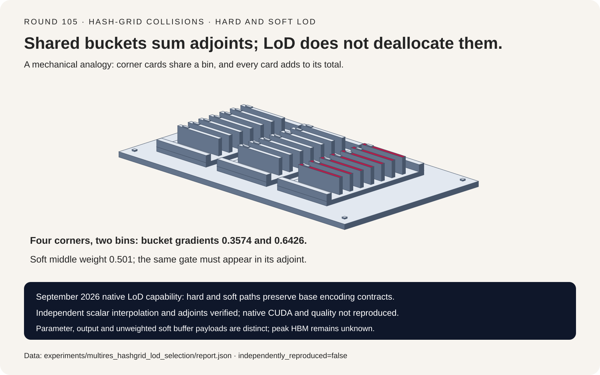
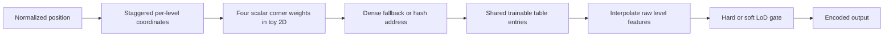
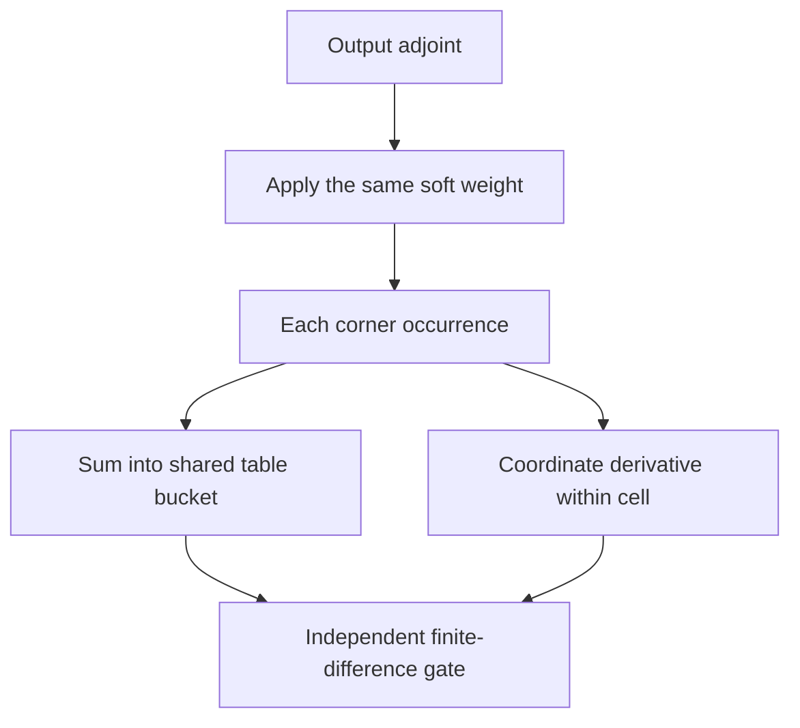
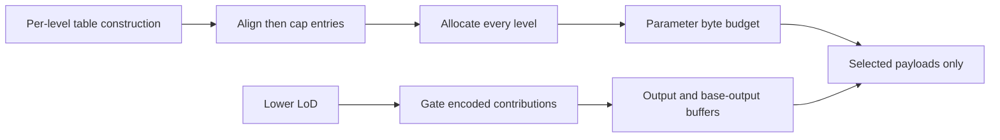

# Hash-grid FAQ: collision adjoints and hard/soft level of detail

> **Language**: [中文](multires-hash-grid-collision-lod-selection-faq.md) | English
>
> **Round 105 · 2026-11-14 (fourteenth round of the November 13 night)** · [SVG](../../assets/svg/multires-hash-grid-collision-lod-selection-faq-summary.svg) · [7-card report](../reports/multires-hash-grid-collision-lod-selection-cards.html) · [H5 workbench](../reports/multires-hash-grid-collision-lod-sizer.html) · [Sealed report](../../experiments/multires_hashgrid_lod_selection/report.json)
>
> **Synthetic, `independently_reproduced=false`.** Only original Python CPU functions were timed. No tiny-cuda-nn/CUDA execution, neural-field training, image-quality, GPU-throughput or peak-HBM observation.



## 1. Executive summary: collisions share parameters; LoD does not free them

The pinned September 29, 2026 tiny-cuda-nn change generalizes native
hard/soft level-of-detail wrappers across multilevel encodings. It
preserves base layouts and retains unweighted soft outputs for derivative
paths. This is a concrete implementation capability, not a claim of a
same-day release or daily popularity ranking.

Our independent 2D scalar example maps four bilinear corners to two
shared table entries. Their parameter gradients must **sum** to
`.3574/.6426`; overwriting occurrences loses `.5913` in one bucket.
This is the adjoint of parameter tying, not an exotic hash-specific
gradient rule.

| Contract | Preserve | Do not infer |
| :--- | :--- | :--- |
| Table addressing | Dense fallback, hash identity, level offsets | Every level is already hash-cap-sized |
| Interpolation | Coordinate convention and all corner weights | A different coordinate origin is equivalent |
| Collision adjoint | Sum every occurrence of each parameter | Duplicate indices may be overwritten |
| LoD | Same hard predicate or soft weight in derivative paths | Fewer active levels means deallocated parameters |

The scalar checks are float64 mathematical references, not source
float32 FMA, half-precision atomic, layout, JIT or double-backward parity.

## 2. Architect Q&A: what changes the function or its adjoint?

### Q1: Are hash collisions dropped samples?

No. A table bucket is one trainable parameter. Several spatial vertices
may address it, so they share that value in the forward pass. The VJP
sums every occurrence: `dtable[bucket] += upstream * corner_weight`.

For table `[.2,-.4,.7,1.1]`, resolution four and point `[.23,.41]`,
the four weights are `.2187/.5913/.0513/.1387`, addressing buckets
`0/3/3/0`. Output is `.77834`. The correct table gradient for upstream
one is `[.3574,0,0,.6426]`; overwrite produces
`[.1387,0,0,.0513]` in our declared corner order.

Collisions restrict representational capacity and couple updates.
They do not justify inventing a PSNR score from collision counts.
An independent unfolded corner field agrees with direct gathers;
that field retains the **same tied values**, not independently trained
dense parameters.

### Q2: Which coordinate and addressing conventions matter?

The inspected source uses
`scale = base_resolution * growth^level - 1`,
`resolution = ceil(scale)+1`, and staggered position
`scale*x + .5`. Base resolution counts vertices, not cells.
Dropping the `.5` or the `-1` changes the sampled function.

When a level's logical dense grid fits its table, source indexing uses
linear coordinates modulo table size. Otherwise the chosen hash is
used. Our bounded 2D reference uses coherent-prime XOR hashing with
32-bit multiplication wrapping; it does not reproduce every source
hash family or large-coordinate overflow branch.

The source aligns per-level entries to eight, then caps hash entries.
The calculator mirrors that logical allocation for integer growth
one/two and bounded resolutions. An ideal dense-vertex payload is
only a mathematical comparator, not an assertion that the source
can allocate such a dense level.

### Q3: What does soft LoD do to the backward pass?

Let `z=lod*L+.001`. The inspected convention has
`hard_l = 1[l<z]` and `soft_l=clamp(z-l,0,1)`.
The wrapper multiplies raw per-level features by soft weights; the
upstream adjoint passed to the base must receive the same weight.

For three levels at lod `.5`, weights are `[1,.501,0]`.
The middle raw feature is `.06486`, so output is `.03249486`.
For `loss=sum(output²)/2`, the raw-feature derivative is
`raw*soft² = .01627992486`.
Omitting the backward weight gives `.03249486`; applying an extra
weight gives `.00815624235486`. Neither matches finite differences.

The source retains unweighted base outputs and stages incompatible
layouts; these are real buffer contracts, not optional bookkeeping.
Our raw-feature squared-loss Hessian check uses `soft²` with fixed
LoD. It is not a reproduction of the source's full second-order or
LoD-input derivative implementation.

### Q4: Does lod zero disable every level?

Not with the inspected epsilon convention. At lod zero the first hard
weight is one; its soft weight is `.001`. For four levels and
lod `.24975`, z is one and **level one is off**. Immediately above
that boundary it activates.

Forward and derivative paths must use the same strict `level < z`
predicate. The pinned change aligns grid derivative cutoffs with the
forward boundary. Our boundary controls use float64 mathematics;
native float32 rounding near epsilon requires native tests.

### Q5: Does lowering LoD reduce parameter allocation or peak memory?

It does not deallocate the already constructed multilevel table.
With the H5 default—3D, 12 levels, base 16, growth two, cap `2^19`,
two features and two bytes per scalar—the table has **5,017,600**
entries and **20,070,400 bytes**, independently of LoD fraction.

A batch of 65,536 points has **3,145,728 bytes** of unpadded encoded
features; a soft-wrapper unweighted base output has the same modeled
payload. This does not establish exact source padding or peak HBM.
Gradients, optimizer state, input derivatives, temporary layout
staging and allocator/workspace remain separate.

The ideal uncapped dense-vertex comparator is
160,842,843,832,320 bytes. It is deliberately **not** presented as a
supported allocation, measured compression speedup or quality result.

## 3. Visual architecture: shared addressing and gated adjoints







## 4. Selection matrix: choose by representation and derivative contracts

| Choice | Good fit | Gate before adoption |
| :--- | :--- | :--- |
| Dense-addressed low levels | Logical vertices fit the table | Preserve staggered coordinates and modulo convention |
| Hash-capped high levels | Bounded trainable table capacity | Evaluate task quality; sum collision adjoints |
| Hard LoD | Discrete level activation | Same strict boundary in forward/backward |
| Soft LoD | Fractional contribution from the boundary level | Weight adjoints once; preserve unweighted base data |
| Unfolded toy field | Independent scalar-reference check | Same shared parameters; account for materialization |

Native feature specializations, alternative encodings, training
stability, scientific/image quality and CUDA throughput need separate
end-to-end evidence. The calculator does not certify native configuration.

## 5. Hands-on: sealed values, timing and focused checks

```powershell
python -m experiments.multires_hashgrid_lod_selection.run
python -m unittest tests.test_multires_hashgrid_lod_selection -q
python -m experiments.multires_hashgrid_lod_selection.run --check
```

`--measure` is a separate explicit operation that replaces the sealed
CPU samples; ordinary generation and checking do not remeasure.
Table and coordinate VJPs match independent finite differences within
`1.74e-11/2.61e-11`; the soft raw-feature gradient error is below
`3.50e-11`. Dense-addressed and three hash-capped profiles agree with
unfolded interpolation within `2.23e-16`.

Original ARM64 Python 3.12.10 CPU medians, two warmups and seven
alternating repeats:

| Points | Direct gathers, ms | Per-batch unfolded field, ms |
| ---: | ---: | ---: |
| 16 | .0777 | .1013 |
| 64 | .2718 | .1690 |
| 256 | 1.0191 | .3915 |
| 1024 | 4.0484 | 1.3248 |

Both use resolution 16 and 64 shared table entries. The baseline
includes constructing a 17×17 scalar corner field every batch; direct
gathers construct Python term tuples including derivative coefficients.
These are untuned, unequal implementation costs and memory payloads,
not CUDA performance comparisons or general algorithmic speedup claims.

The seven-card report is script-free with CSP
`default-src 'none'; style-src 'unsafe-inline'`. H5 uses only inline
code, visible validation errors and exact-integer guards. The 1600×1000
SVG is original explanatory art. Browser inspection was not performed:
the earlier browser-operation refusal remains respected.

## 6. Sources, provenance and boundaries

- [Pinned native LoD wrapper](https://github.com/NVlabs/tiny-cuda-nn/blob/3daa6e5b8b8e0fa17971a1a20acfbb3754494b38/include/tiny-cuda-nn/encodings/multi_level_lod.h):
  hard/soft conventions, unweighted output and derivative staging.
- [Pinned grid encoding](https://github.com/NVlabs/tiny-cuda-nn/blob/3daa6e5b8b8e0fa17971a1a20acfbb3754494b38/include/tiny-cuda-nn/encodings/grid.h):
  aligned capped allocations, forward/derivative cutoff and collision accumulation.
- [Pinned coordinate/index helpers](https://github.com/NVlabs/tiny-cuda-nn/blob/3daa6e5b8b8e0fa17971a1a20acfbb3754494b38/include/tiny-cuda-nn/common_device.h):
  staggered coordinates, dense fallback and coherent-prime hashing.
- [September 29 capability change](https://github.com/NVlabs/tiny-cuda-nn/commit/3daa6e5b8b8e0fa17971a1a20acfbb3754494b38)
  and [LICENSE.txt](https://github.com/NVlabs/tiny-cuda-nn/blob/3daa6e5b8b8e0fa17971a1a20acfbb3754494b38/LICENSE.txt):
  BSD-3-Clause terms inspected directly; GitHub's license API returned
  `NOASSERTION`, not a license grant or a reason to discard the actual terms.

Upstream rights remain with their holders. No source implementation,
trained weights or rendered scene assets are vendored. Original scalar
data is synthetic; measured CPU timing is separately labeled.
Unknown GPU latency, reconstruction quality and peak HBM remain null.
