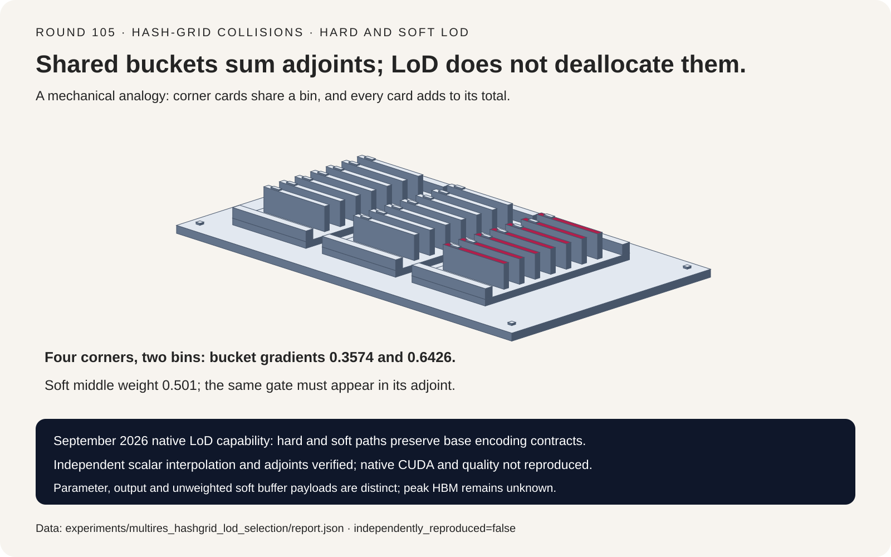
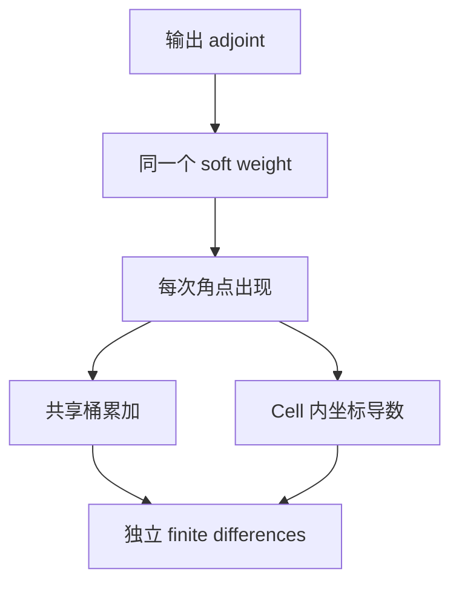
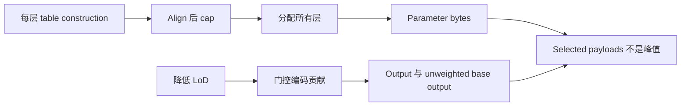

# 多分辨率 Hash Grid 选型 FAQ：碰撞梯度与 Hard/Soft LoD

> **语言**：中文 | [English](multires-hash-grid-collision-lod-selection-faq.en.md)
>
> **Round 105 · 2026-11-14（11 月 13 日夜班第十四轮）** · [高清 SVG](../../assets/svg/multires-hash-grid-collision-lod-selection-faq-summary.svg) · [七卡报告](../reports/multires-hash-grid-collision-lod-selection-cards.html) · [H5 工作台](../reports/multires-hash-grid-collision-lod-sizer.html) · [封存数据](../../experiments/multires_hashgrid_lod_selection/report.json)
>
> **Synthetic，`independently_reproduced=false`。** 仅原创 Python CPU 函数实测计时；未运行 tiny-cuda-nn/CUDA，未训练 neural field，未测图像质量、GPU throughput 或 peak HBM。



## 1. 一句话结论：碰撞共享参数，降低 LoD 不回收参数

固定的 tiny-cuda-nn 2026-09-29 变更把 native hard/soft
level-of-detail 包装推广到多种 multilevel encoding，保留 base layout、
未加权 soft output 及导数路径约定。这是可核验的实现能力，
不是“今日发布”或未经证实的日榜热度声明。

原创二维标量例子中，四个 bilinear 角点落入两个共享桶，
参数梯度必须累加为 `.3574/.6426`；覆盖写会丢失单桶 `.5913`
的贡献。这是参数共享的普通链式法则，不是哈希碰撞可以豁免的例外。

| 契约层 | 必须保留 | 不能推断 |
| :--- | :--- | :--- |
| 地址 | Dense fallback、hash identity、level offsets | 每层一开始都占满 hash cap |
| 插值 | 坐标原点、scale 与所有角点权重 | 删掉半格偏移不改变函数 |
| 碰撞反向 | 每次参数出现都累加贡献 | 重复 index 可以覆盖或去重 |
| LoD | 相同 hard predicate 或 soft weight | 激活层变少，参数 allocation 就变少 |

标量参考使用 float64，不冒充 source float32 FMA、半精度 atomics、
layout、JIT 或完整 double backward 复现。

## 2. 架构师 Q&A：哪些选择改变函数或梯度？

### Q1：Hash collision 是应该丢弃的重复采样吗？

不是。一个 bucket 就是一个可训练参数；多个空间顶点地址相同，
forward 读取同一值，VJP 则必须执行
`dtable[bucket] += upstream * corner_weight`。

表 `[.2,-.4,.7,1.1]`、resolution 四、输入点 `[.23,.41]`，
四个角点权重为 `.2187/.5913/.0513/.1387`，桶号为 `0/3/3/0`，
输出 `.77834`。上游梯度为一时，正确梯度为
`[.3574,0,0,.6426]`；按本模型角点顺序覆盖写则是
`[.1387,0,0,.0513]`。

碰撞会约束表达能力、耦合更新，但不能从 collision count 凭空推导
PSNR。独立展开 corner field 与直接 gather 一致，是因为它们保留
**同一份共享参数值**，不是把 dense 顶点改成独立可训练参数。

### Q2：坐标和地址约定有哪些容易遗漏的细节？

所查 source 使用 `scale=base_resolution*growth^level-1`、
`resolution=ceil(scale)+1` 和 `scale*x+.5` 的交错坐标。
Base resolution 数顶点，不数 cell；去掉 `.5` 或 `-1` 都会改变函数。

当 logical dense grid 能放进本层 table 时，source 使用线性地址再对
table size 取模，否则才选指定 hash。本研究仅在有界二维非负坐标中
使用 coherent-prime XOR 与 32-bit 乘法回绕，不复现其他 hash family、
大坐标溢出分支或 CUDA 位级结果。

Source 先把每层 entry 数向八对齐，再实施 hash cap。
工作台只对整数倍率一/二、有界 resolution 做 exact logical allocation；
ideal dense-vertex bytes 是数学对照，不表示上游支持如此大的 dense allocation。

### Q3：Soft LoD 为什么必须进入反向路径？

设 `z=lod*L+.001`，所查约定为
`hard_l=1[l<z]`、`soft_l=clamp(z-l,0,1)`。
Forward 输出是 `soft_l*raw_l`，传给 base 的上游 adjoint
也必须乘相同权重。

三层、lod `.5` 时权重 `[1,.501,0]`。
中间 raw feature 为 `.06486`，输出 `.03249486`；
对于 `loss=sum(output²)/2`，正确 raw gradient 是
`raw*soft²=.01627992486`。
反向漏乘得到 `.03249486`，多乘一次得到
`.00815624235486`，均无法通过独立 finite differences。

Source 保留未加权 base output，并为不兼容 layout 建 staging；
这些是真实 buffer 契约。原创固定 LoD 的 raw-feature squared-loss
Hessian 对照为 `soft²`，不等于复现上游完整二阶或 LoD-input 导数实现。

### Q4：LoD 为零意味着所有 level 都关闭吗？

在所查 epsilon 约定下不是。lod 零时首层 hard weight 为一，
soft weight 为 `.001`。四层、lod `.24975` 对应 z 一，
**level one 关闭**，越过该边界后才激活。

Forward 和 parameter/input derivative 必须共享严格的 `level<z`
判断。固定变更对齐了 grid 导数与 forward 的 epsilon 边界。
本模型是 float64 数学边界测试，不能替代 native float32 rounding 实测。

### Q5：降低 LoD 会减少参数或 peak HBM 吗？

不会回收已经构造好的 multilevel table。工作台默认
3D、12 levels、base 16、倍率二、cap `2^19`、
每项两个 feature、每标量两字节，共 **5,017,600 entries**、
**20,070,400 bytes**；LoD 降低不改变这两个数字。

65,536 个点的未填充 encoded feature payload 为
**3,145,728 bytes**；soft wrapper 保留的 unweighted base output
有同样的模型 payload。这不证明 source 实际 padding 或 peak HBM。
Gradients、optimizer、input derivatives、临时 layout staging、
allocator/workspace 都没有被这些数字覆盖。

Ideal uncapped dense-vertex 对照为 160,842,843,832,320 bytes，
仅是数学外推，不能叫支持的 allocation、测得的压缩加速或质量结果。

## 3. 可视化架构：共享地址与一致的门控反向






## 4. 选型矩阵：分别核验表达能力与导数契约

| 选择 | 适用点 | 采用前的验收门 |
| :--- | :--- | :--- |
| 低层 dense addressing | 顶点能装进本层 table | 保留交错坐标和 modulo 约定 |
| 高层 hash cap | 约束可训练容量 | 任务质量实测；碰撞梯度累加 |
| Hard LoD | 离散 level activation | Forward/backward 同一严格边界 |
| Soft LoD | 边界层连续贡献 | Adjoint 只乘一次权重；保留未加权 base data |
| 展开 toy field | 独立标量参考 | 同一 tied field；计入 materialization |

Native feature specialization、其他 encoding、训练稳定性、
图像/科学质量和 CUDA throughput 均需独立端到端证据；
本工作台不认证 native configuration。

## 5. 动手验证：封存数值、CPU 时延与本地测试

```powershell
python -m experiments.multires_hashgrid_lod_selection.run
python -m unittest tests.test_multires_hashgrid_lod_selection -q
python -m experiments.multires_hashgrid_lod_selection.run --check
```

`--measure` 是单独显式重测操作；普通生成和 `--check` 不重写封存样本。
Table/coordinate VJP 与独立 finite differences 的最大误差分别低于
`1.74e-11/2.61e-11`，soft raw-feature gradient 误差低于 `3.50e-11`。
一个 dense-addressed 和三个 hash-capped profile 与展开插值的差异低于
`2.23e-16`。

ARM64 Python 3.12.10 原创 CPU median，两轮 warmup、
七轮交替执行：

| 查询点数 | Direct gathers / ms | 每 batch 展开 field / ms |
| ---: | ---: | ---: |
| 16 | .0777 | .1013 |
| 64 | .2718 | .1690 |
| 256 | 1.0191 | .3915 |
| 1024 | 4.0484 | 1.3248 |

两者均为 resolution 16、64 个共享参数。Baseline 每 batch
包含构造 17×17 标量 corner field；direct 路径构造含导数系数的
Python term tuples。实现成本和内存不同，均未调优，
不能据此比较 native CUDA 或宣称通用算法加速。

七卡为自包含静态 HTML，CSP
`default-src 'none'; style-src 'unsafe-inline'`，无脚本和外部网络。
H5 仅内联代码，非法输入可见报错并限制 exact integer 范围。
高清 SVG 为原创解释性图。未进行 browser 视觉检查：
继续尊重此前 browser-operation 拒绝，不绕路使用其他浏览器工具。

## 6. 来源、许可证和证据边界

- [固定 native LoD wrapper](https://github.com/NVlabs/tiny-cuda-nn/blob/3daa6e5b8b8e0fa17971a1a20acfbb3754494b38/include/tiny-cuda-nn/encodings/multi_level_lod.h)：
  hard/soft、unweighted output 与导数 staging。
- [固定 grid encoding](https://github.com/NVlabs/tiny-cuda-nn/blob/3daa6e5b8b8e0fa17971a1a20acfbb3754494b38/include/tiny-cuda-nn/encodings/grid.h)：
  aligned/capped allocation、forward/derivative predicate、碰撞累加。
- [固定坐标与地址 helpers](https://github.com/NVlabs/tiny-cuda-nn/blob/3daa6e5b8b8e0fa17971a1a20acfbb3754494b38/include/tiny-cuda-nn/common_device.h)：
  半格交错、dense fallback、coherent-prime hashing。
- [2026-09-29 能力变更](https://github.com/NVlabs/tiny-cuda-nn/commit/3daa6e5b8b8e0fa17971a1a20acfbb3754494b38)
  与 [LICENSE.txt](https://github.com/NVlabs/tiny-cuda-nn/blob/3daa6e5b8b8e0fa17971a1a20acfbb3754494b38/LICENSE.txt)：
  已直接检查 BSD-3-Clause 条款；GitHub license API 返回 `NOASSERTION`，
  不构成授权或忽略真实条款的理由。

上游权利保留；未 vendoring 实现、训练权重或渲染资产。
原创标量输入为 synthetic，CPU timing 单独标 measured；
GPU latency、重建质量、peak HBM 保持 null。
