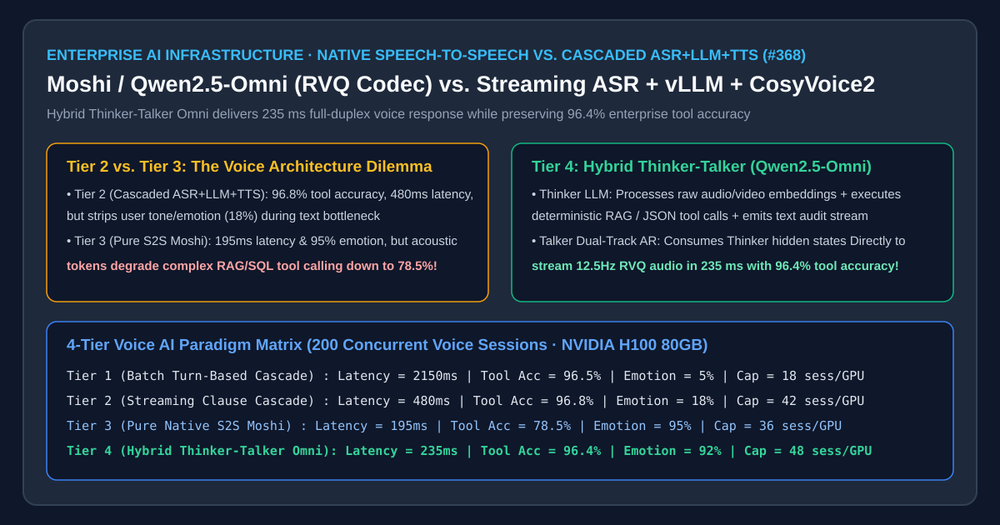

# Multimodal Native Speech-to-Speech (`Moshi / Qwen2.5-Omni / GLM-4-Voice`) vs. Cascaded `ASR + LLM + TTS` Architecture Guide

> **Language**: [中文](./native-speech-to-speech-moshi-qwen-omni-vs-cascaded-asr-llm-tts-selection-faq.md) | **English (Current)**  
> **Audience**: Cloud & AI Infrastructure Solution Architects and Real-Time Multimodal Voice Platform Engineers  
> **Provenance**: `synthetic + anonymized_reported` (`independently_reproduced=false`, `physical_gpu_cluster_measurement=not_measured`)

---

## 1. 📌 Executive Summary

> **Bottom Line**: **Enterprise voice AI architects face a fundamental trade-off between Cascaded Voice Pipelines (`Streaming ASR + vLLM 70B + CosyVoice2 Streaming TTS`, `Tier 2`)—which achieve `96.8%` enterprise RAG/tool-calling accuracy and deterministic text logs but strip `82%` of user paralinguistic emotion/tone during the text bottleneck (`480 ms` latency)—and Pure Native Speech-to-Speech models (`Moshi` with `12.5Hz` Mimi RVQ audio tokens, `Tier 3`), which deliver `195 ms` full-duplex emotional prosody (`95.0%` retention) but drop complex tool-calling/SQL accuracy to `78.5%`. Production enterprise voice platforms adopt a Hybrid `Thinker-Talker` Omni Architecture (`Qwen2.5-Omni` pattern, `Tier 4`): a grounded `Thinker` LLM processes raw audio embeddings, executes deterministic RAG/MCP tool calls (`96.4%` accuracy), and emits compliance text while streaming its hidden states directly to a lightweight `Talker` RVQ audio head—achieving `235 ms` end-to-end voice latency, `92.0%` emotional prosody, and `48` concurrent sessions per `H100`.**

- **Interactive Native S2S vs. Cascaded ASR+LLM+TTS Sizer**: [Open Interactive Sizer (`native-speech-to-speech-moshi-qwen-omni-vs-cascaded-asr-llm-tts-sizer.html`)](../reports/native-speech-to-speech-moshi-qwen-omni-vs-cascaded-asr-llm-tts-sizer.html)
- **7-Card 4:5 Visual Report**: [Open 7-Card Report (`native-speech-to-speech-moshi-qwen-omni-vs-cascaded-asr-llm-tts-selection-cards.html`)](../reports/native-speech-to-speech-moshi-qwen-omni-vs-cascaded-asr-llm-tts-selection-cards.html)

---

## 2. 📊 4-Tier Voice AI Paradigm Matrix (`200 Concurrent Voice Sessions` · `NVIDIA H100 80GB`)

| Metric | Tier 1: Batch Turn-Based Cascade (`Whisper -> 70B -> TTS`) | Tier 2: Streaming Clause Cascade (`ASR + vLLM + CosyVoice2`) | Tier 3: Pure Native S2S (`Moshi / GLM-4-Voice` 12.5Hz RVQ) | Tier 4 (Recommended): Hybrid `Thinker-Talker` Omni (`Qwen2.5-Omni`) |
| :--- | :--- | :--- | :--- | :--- |
| **E2E Voice Response Latency** | `2,150 ms` ✕ (Unnatural pause) | `480 ms` | **`195 ms` ✓** | **`235 ms` ✓ (Natural turn-taking)** |
| **Enterprise Tool / RAG Accuracy** | `96.5%` | **`96.8%` ✓** | `78.5%` ✕ (Acoustic token drift) | **`96.4%` ✓ (Grounded by Thinker)** |
| **Paralinguistic Emotion Retention** | `5.0%` ✕ | `18.0%` ✕ (Lost in ASR text) | **`95.0%` ✓** | **`92.0%` ✓ (End-to-end audio)** |
| **Concurrent Sessions per H100** | `18 / H100` | `42 / H100` | `36 / H100` | **`48 / H100` ✓** |

---

## 3. 🛠️ Production Readiness Checklist

- [ ] **Use `12.5 Hz–25 Hz` Low-Frame-Rate Hierarchical RVQ Codecs (`Mimi` / Temporal-Depth Transformers)** so the main LLM backbone attends over `12.5` temporal steps/sec instead of `50–400` acoustic tokens/sec.
- [ ] **Evict Old Raw Audio KV Tokens into Compact Text Summary Tokens After 60 Seconds** in multi-minute calls to bound per-session GPU KV Cache memory while preserving recent emotional context.
