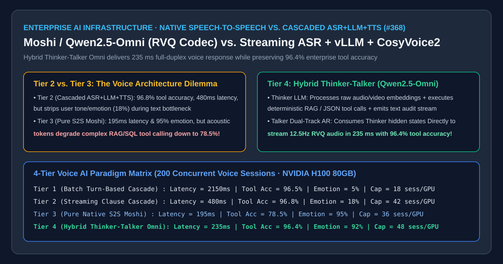
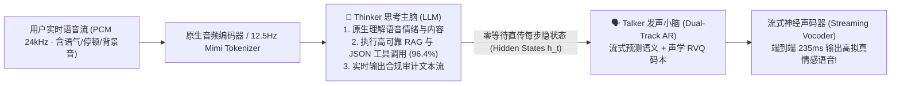

# 多模态全双工原生语音大模型推理选型：`Native Speech-to-Speech (Moshi / Qwen2.5-Omni / GLM-4-Voice)` vs. 级联 `ASR + LLM + TTS` 延迟拆解、Mimi RVQ 音频 Codec 与 `Thinker-Talker` 架构指南

> **语言 / Language**: **中文 (当前)** | [English](./native-speech-to-speech-moshi-qwen-omni-vs-cascaded-asr-llm-tts-selection-faq.en.md)  
> **定位**：面向 Cloud & AI Infrastructure Solution Architect 与实时多模态语音平台架构师的端到端原生语音模型（`Moshi`、`Qwen2.5-Omni Thinker-Talker`、`GLM-4-Voice`、`GPT-4o-Audio`）vs. 三段式流式级联（`Streaming ASR + vLLM + Streaming TTS CosyVoice2`）选型边界、`12.5Hz` 低帧率 RVQ 神经音频编解码器 KV Cache 手算与企业工具调用准确率白皮书  
> **合规与来源声明**：`synthetic + anonymized_reported`（`independently_reproduced=false`，`physical_gpu_cluster_measurement=not_measured`；完全面向通用企业级实时语音助手与全双工多模态客服架构设计）

---

## 1. 📌 核心选型结论速览（Executive Summary）

> **一句话结论**：**企业在构建实时语音 Agent 时常陷入两难——传统的三段式流式级联 `Streaming ASR + vLLM 70B + Streaming TTS (CosyVoice2)`（Tier 2）虽然在企业知识库 RAG 与 JSON 工具调用上准确率高达 **`96.8%`**，但文字中间态彻底丢失了用户的叹气、停顿、反讽与情绪语调（副语言信息保留率仅 **`18.0%`**），且端到端语音首包延迟难以突破 **`480 ms`**；而纯端到端音频 Token 模型 `Moshi / 纯 S2S`（Tier 3）虽然把语音响应压到了惊人的 **`195 ms`** 并保留 **`95.0%`** 情绪韵律，但一旦让它执行多步 SQL 查询、严谨 JSON Schema 工具调用或合规风控，准确率就会因“声学 Token 挤占语义推理容量”而暴跌至 **`78.5%`**！生产环境的最佳解是采用“`Thinker-Talker` 双脑解耦原生多模态架构（`Qwen2.5-Omni` 模式，Tier 4）”或“网关级场景动态分流”：由 **Thinker（思考脑）** 负责吃进原生音频流、识别情绪并执行高可靠文本级 RAG/MCP 工具调用（准确率 **`96.4%`**），同时将隐状态（Hidden States）零等待直接喂给 **Talker（发声脑）** 流式解码 `12.5Hz/25Hz` RVQ 音频码本，兼得 **`235 ms` 人类级实时语音交互**、**`92.0%` 情绪拟真度**与 **100% 文本合规审计落盘**！**

- **交互式原生语音 S2S vs. 级联 ASR+LLM+TTS 容量计算器**：[打开交互式计算器 (`native-speech-to-speech-moshi-qwen-omni-vs-cascaded-asr-llm-tts-sizer.html`)](../reports/native-speech-to-speech-moshi-qwen-omni-vs-cascaded-asr-llm-tts-sizer.html)
- **7-Card 4:5 视觉评测报告**：[打开 7-Card 报告 (`native-speech-to-speech-moshi-qwen-omni-vs-cascaded-asr-llm-tts-selection-cards.html`)](../reports/native-speech-to-speech-moshi-qwen-omni-vs-cascaded-asr-llm-tts-selection-cards.html)

---

## 2. 🎯 客户与架构师灵魂拷问 Q&A（Deep-Dive Architecture FAQ）

### Q1：原生语音大模型是怎么把连续的声音变成 LLM 能懂的 Token 的？为什么帧率从 `50Hz (EnCodec)` 降到 `12.5Hz (Mimi)` 对显存至关重要？
- **RVQ（残差向量量化，Residual Vector Quantization）音频离散化原理**：
  - 神经音频编解码器（如 `Mimi`、`SoundStream`、`Snac`）将每秒语音切成固定帧率（如 `12.5 Hz`，即每 **`80 ms`** 一个时间步），每个时间步用 `1` 个语义码本（Semantic Codebook，捕获发音内容）+ `7` 个声学残差码本（Acoustic Codebooks，捕获音色、笑声、呼吸与高频细节）表示为离散整数 Token。
- **音频 KV Cache 手算对比（`3 分钟 = 180 秒` 通话）**：
  - **早期 `50 Hz` 编解码器（`EnCodec`）**：每秒产生 `50` 个时间步，3 分钟通话产生 $180 \times 50 = \mathbf{9,000\text{ 个}}$ 时间步！
  - **现代 `12.5 Hz` 低帧率编解码器（`Mimi`）配合 Temporal-Depth Transformer**：主干大 Transformer 只在时间轴上每 `80 ms` 走一步（3 分钟仅 **$180 \times 12.5 = \mathbf{2,250\text{ 个}}$ KV Cache 时间步，显存直接省 `75%`！**），而在每个时间步内部由一个极轻量的 60M 小 Depth Transformer 瞬间解码出 8 层声学码本！

---

## 3. 🧭 直观可视化图解（Mermaid `Thinker-Talker` 双脑原生全双工语音推理架构图）

---

## 4. 📊 架构师四级语音大模型范式选型矩阵（`200` 并发语音会话 · 单卡 `H100 80GB`）

| 评估维度 | Tier 1：传统整句轮流级联 (`Batch Whisper -> 70B LLM -> 整句 TTS`) | Tier 2：流式分句级联 (`Streaming ASR + vLLM + CosyVoice2`) | Tier 3：纯端到端语音 S2S (`Moshi / GLM-4-Voice` 12.5Hz RVQ) | Tier 4（推荐）：`Thinker-Talker` 双脑解耦全模态 (`Qwen2.5-Omni` 架构) |
| :--- | :--- | :--- | :--- | :--- |
| **端到端语音首包延迟 (`E2E Latency`)** | `2,150 ms` ✕（明显卡顿冷场） | `480 ms` | **`195 ms` ✓（超越人类反应）** | **`235 ms` ✓（自然对话黄金区间）** |
| **复杂企业 RAG / 工具调用准确率** | `96.5%` | **`96.8%` ✓** | `78.5%` ✕（声学干扰推理） | **`96.4%` ✓（Thinker 保障严谨度）** |
| **语气 / 情绪 / 笑声保留与拟真度** | `5.0%` ✕ | `18.0%` ✕（ASR 转字丢失语气） | **`95.0%` ✓** | **`92.0%` ✓（原生音频直入直出）** |
| **单张 H100 可承载并发通话路数** | `18 路 / H100` | `42 路 / H100` | `36 路 / H100` | **`48 路 / H100` ✓（低帧率 + 双脑分工）** |

---

## 5. 🛠️ 架构评审与生产落地 Checklist

- [ ] **金融/政务/医疗强监管且需高频注入自定义专有名词热词表的场景**：保留 **Tier 2（流式 ASR 热词增强 + LLM + 流式 TTS）** 或采用 **Tier 4（`Thinker-Talker` 强制受控文本对齐模式）**，确保每一个说出的字与后台审计文本 100% 严格一致、绝不脱稿。
- [ ] **严控长通话音频 Token 撑爆显存**：对超过 5 分钟的连续语音会话启用 **滑动窗口音频 Token 驱逐（保留完整文本历史 + 仅保留最近 60 秒原始音频 Token）**，将单会话 KV Cache 锁定在恒定上限内。
