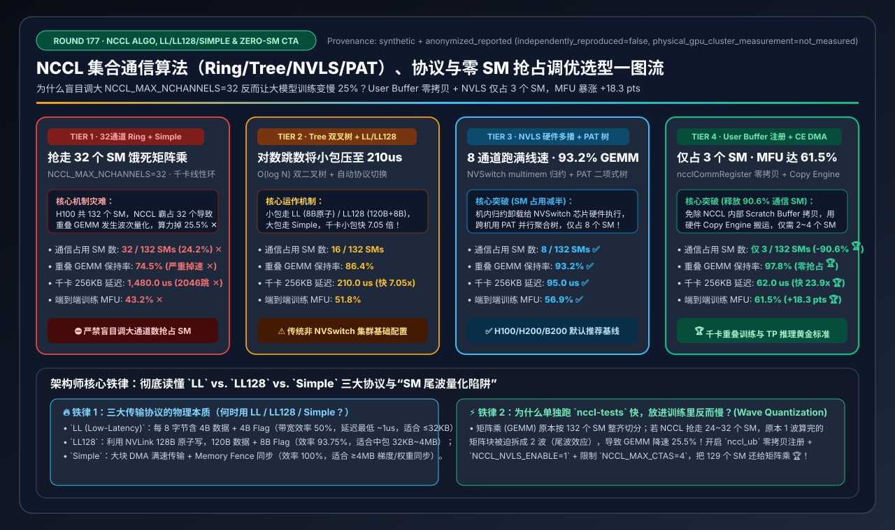
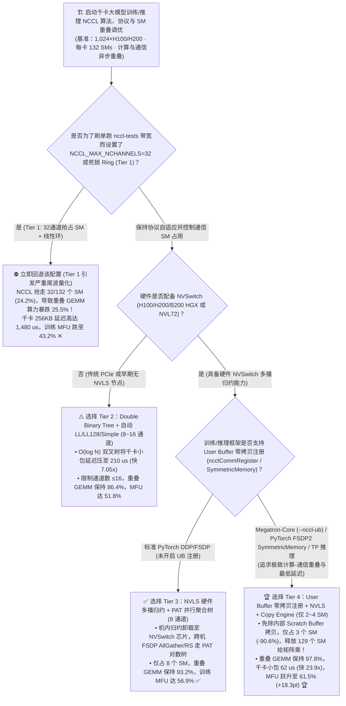
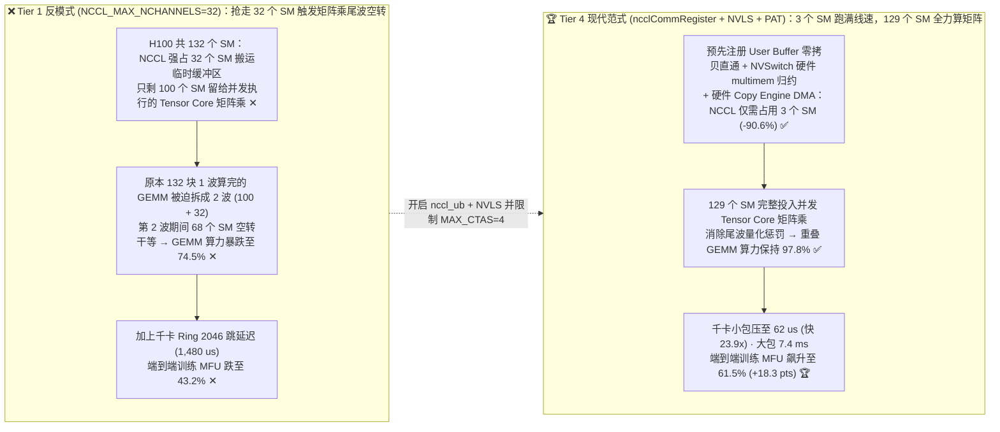
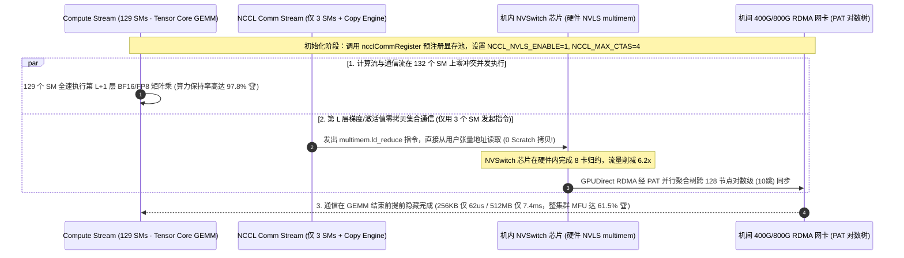

# NCCL 集合通信算法（`Ring` vs. `Tree` vs. `NVLS` vs. `PAT`）、底层传输协议（`LL / LL128 / Simple`）与零 SM 抢占（`User Buffer / Copy Engine`）调优选型指南

> 🌐 **Language / 语言**: **中文 (Chinese)** | **[English (`nccl-algorithm-protocol-ring-tree-nvls-zero-sm-cta-tuning-selection-faq.en.md`)](nccl-algorithm-protocol-ring-tree-nvls-zero-sm-cta-tuning-selection-faq.en.md)**
> **阅读指南**：本文面向 **AI 解决方案架构师（AI Solution Architect）、分布式训练系统工程师与推理引擎优化专家**，用通俗大白话 + 第一性原理彻底讲透：**为什么许多团队在网上抄了一句“性能优化秘籍”`export NCCL_MAX_NCHANNELS=32` 和 `NCCL_ALGO=Ring`（Tier 1），单跑 `nccl-tests` 时看带宽确实涨了 3%，结果放进真实的千卡 Megatron / FSDP 大模型训练里，端到端训练速度反而慢了 `18% ~ 25%`（MFU 跌至 `43.2%`）？NCCL 底层神秘的三大协议 `LL`、`LL128`、`Simple` 到底是怎么发包的，为什么 `LL` 会浪费一半带宽而 `LL128` 能做到 `93.75%` 效率？千卡规模下 `Ring（环）`、`Tree（双叉树）`、`NVLS（NVSwitch 硬件多播归约）` 与 `PAT（并行聚合树）` 各自适用什么场景？以及如何用 `Tier 4（User Buffer 零拷贝注册 ncclCommRegister + NVLS + 硬件 Copy Engine 搬运）`，把通信占用的 GPU SM 核从 `32 个` 砍到只剩 `3 个（释放 90.6% 通信核）`，让重叠矩阵乘（GEMM）算力保持 `97.8%`、千卡 MFU 净增 `+18.3 个百分点`？** 全文零晦涩黑话堆砌，3 分钟看懂调优结论，10 分钟掌握全套 NCCL 底层原理与环境变量清单。

---

## 🔥 业界最新能力突破追踪（Daily Hottest Capability Breakthroughs）

- **NCCL 2.23–2.26+ 原生 `PAT（Parallel Aggregated Trees，并行聚合二项式树）` 算法**：针对大规模 `AllGather` 与 `ReduceScatter`（FSDP2 / ZeRO-3 的核心通信原语），彻底打破传统 Ring 算法的 $O(N)$ 线性跳数延迟墙，在 1,024 卡集群上将通信跳数从 `1,023 跳` 压缩至对数级 **`7~10 跳`**，中小消息集合通信速度提升 **`2x ~ 4x`**。
- **`ncclCommRegister`（User Buffer Zero-Copy Registration）+ `NVLS` 极低 SM 占用革命**：通过对称虚拟内存（Symmetric Memory / VMM）预先注册用户态张量缓冲区，消除 GPU SM 将数据拷入 NCCL 内部 Scratch Buffer 的冗余步骤；配合 NVSwitch 芯片内 `multimem.ld_reduce` 硬件指令，仅需 **`2 ~ 4 个 SM`（而非传统的 24~32 个 SM）** 即可跑满 `900 GB/s` 机内 NVLink 与 `400G/800G` 机间 RDMA 线速。
- **硬件 Copy Engine (`P2P_CUMEM` / `CE`) 零 SM 集合通信**：在机内点对点与 All-to-All 传输中，直接调用 GPU 独立的硬件 DMA 拷贝引擎（Copy Engine），实现 **`0 SM CTA` 抢占**，彻底消灭通信对前向/反向矩阵乘的尾波干扰。

---

## ① 📌 核心结论速览（Executive Summary）

1. **为什么“单跑 `nccl-tests` 最快的参数，往往是让真实大模型训练变慢的毒药”（SM 抢占与尾波量化陷阱 Wave Quantization）**：
   - 很多人不知道：**NCCL 发包不是免费的，默认是由 GPU 上的计算核心（SM，Streaming Multiprocessor）跑 CUDA Kernel 来搬运数据和做加法归约的！**
   - 一张 NVIDIA H100 SXM5 GPU 一共只有 **`132 个 SM`**。在现代大模型训练（如 Megatron-Core / FSDP2 开启 `--tp-comm-overlap`）中，**矩阵乘计算（GEMM）和集合通信（AllReduce / AllGather）是同时在 GPU 上并行跑的**。
   - **Tier 1 的致命误区（盲目设 `NCCL_MAX_NCHANNELS=32` + 死锁 `Ring`）**：
     - 每个 NCCL Channel 会启动 1~2 个线程块（CTA）死死霸占 **1 个 SM**。当你开了 32 个通道，NCCL 就抢走了 **`32 个 SM`（占整张卡算力的 `24.2%`！）**，只留给矩阵乘 `100 个 SM`！
     - 更要命的是 **“尾波量化效应（Wave Quantization）”**：原本切成 132 块、刚好 **1 波（1 Wave）** 在全体 132 个 SM 上同时算完的矩阵乘，因为少了 32 个 SM，剩下的 32 块被迫开启 **第 2 波** 慢慢算（那第 2 波里另外 68 个 SM 全在空转干等！），直接导致重叠矩阵乘算力暴跌 **`25.5%`（仅剩 `74.5%` ✕）**！再加上 1,024 卡 `Ring` 算法需要绕圈跳 `2,046 步`，256KB 小包延迟高达 **`1,480.0 μs` ✕**，最终整集群端到端 MFU 跌至惨淡的 **`43.2%` ✕**！
2. **传统集群标配 `Tier 2 (Tree + 自动协议)` vs. Hopper/Blackwell 标配 `Tier 3 (NVLS + PAT)` vs. 零抢占终极答案 `Tier 4 (User Buffer 零拷贝注册 + NVLS + Copy Engine)`**：
   - **在无 NVSwitch 的传统集群上（Tier 2）**：使用双叉树 **`Tree` 算法 + 自动切换 `LL / LL128 / Simple` 协议**（控制在 `8~16 通道`），将千卡 256KB 小包延迟从 `1,480 μs` 压至 **`210.0 μs`（快 `7.05x`）**，MFU 恢复至 **`51.8%`**。
   - **在 H100 / H200 / B200 NVSwitch 集群上（Tier 3）**：开启 **`NVLS`（把机内归约计算卸载给 NVSwitch 交换芯片）+ `PAT` 并行聚合树（8 通道）**，通信占用的 SM 降至 **`8 个` ✅**，重叠 GEMM 保持 **`93.2%` ✅**，千卡 MFU 提升至 **`56.9%` ✅**！
   - **在追求极致计算-通信重叠的千卡/万卡生产训练与低延迟 TP 推理中，必上 `Tier 4（零拷贝 User Buffer 注册 ncclCommRegister + NVLS + Copy Engine P2P DMA）`**：通过零拷贝直读用户张量并卸载至 NVSwitch 与硬件 DMA 引擎，**NCCL 仅需占用区区 `3 个 SM`（比 Tier 1 减少 `90.6%` 🏆）**！把 129 个 SM 完整还给 Tensor Core，使重叠 GEMM 算力保持率高达 **`97.8%` 🏆**，千卡 256KB 延迟压至 **`62.0 μs`（快 `23.9x` 🏆）**，512MB 大包耗时压至 **`7.4 ms` 🏆**，端到端训练 MFU 跃升至 **`61.5%`（净增 `+18.3 个百分点` 🏆）**！

---

## ② 🎯 客户与架构师灵魂拷问 Q&A（FAQ-Driven）

### Q1：NCCL 日志里天天打印的三大协议 `LL`、`LL128`、`Simple` 到底是什么意思？为什么小消息用 `Simple` 会巨慢，而大消息用 `LL` 会丢掉一半带宽？

**通俗大白话 + 第一性原理解答**：
- **在 GPU 跨卡传数据时，最核心的难题是：“接收方 GPU 怎么知道发送方 GPU 已经把数据完整写进显存了？”**
- 围绕这个“通知机制（同步开销 vs. 有效载荷比例）”，NCCL 设计了三种截然不同的底层协议：
  1. **`LL（Low-Latency，极低延迟协议 — 适合 ≤ 32 KB 的极小包）`**：
     - **怎么运作**：GPU 硬件保证 **8 字节（64-bit）写操作是原子的**。于是 `LL` 把每 8 个字节劈成两半：**前 4 字节放真实数据（Data），后 4 字节放校验标志位（Flag）**！
     - **优缺点**：接收方只要轮询看到后 4 字节的 Flag 变了，就知道前 4 字节的数据绝对到了——**完全不需要昂贵的系统级内存屏障（Memory Fence），单跳延迟低至 `~1 微秒`！** 但代价是：**每发 8 字节就有 4 字节是废话 Flag，有效带宽利用率上限只有 `50%`！**
  2. **`LL128（Low-Latency 128-Byte，NVLink 专属神器 — 适合 32 KB ~ 4 MB 的中包）`**：
     - **怎么运作**：在 NVLink 硬件上，GPU 支持 **128 字节缓存行（Cache Line）原子写入**。于是 `LL128` 把每 128 字节打包成：**`120 字节真实数据 + 8 字节 Flag`**！
     - **优缺点**：既有 `LL` 无需内存屏障的微秒级低延迟，又把有效带宽利用率从 `50%` 猛拉到了 **`120 / 128 = 93.75%`**！这是单机 TP 推理（每步几百 KB 激活值同步）的绝对主力协议！
  3. **`Simple（大块满速协议 — 适合 ≥ 4 MB 的大梯度/权重块）`**：
     - **怎么运作**：先把几 MB 的纯数据（`100%` 都是有效载荷，不夹带 Flag）一口气塞满缓冲区，全部传完后，调用一次重量级的硬件内存屏障（`__threadfence_system()`）再通知对端。
     - **优缺点**：虽然启动一次屏障要花好几微秒（所以发小包很慢），但发几百 MB 大包时，**100% 的总线带宽全用来传真实数据，峰值吞吐最高**！

---

### Q2：在千卡集群跑 `AllReduce / AllGather` 时，`Ring`、`Tree`、`NVLS` 和最新引入的 `PAT` 算法有什么本质区别？什么时候该用谁？

**通俗大白话 + 第一性原理解答**：
1. **`Ring（环算法 — 适合单机或小规模大包，千卡下延迟灾难）`**：
   - 把 $N$ 张卡连成一个大圆圈。在 `1,024 卡` 集群上，任何一块数据要跑完一轮 Reduce-Scatter + All-Gather，必须绕圈传递 **$2 \times (1024 - 1) = 2,046$ 跳**！哪怕每跳只有 `0.7 微秒`，光排队绕圈就要花掉 **`1.48 毫秒`**，而且只要环上任意 1 张卡抖动，全环 1,024 张卡一起卡死！
2. **`Tree（双二叉树 Double Binary Tree — 跨机中大集群经典算法）`**：
   - 把节点组织成两棵互补的二叉树，跳数从 $O(N)$ 变成 **$O(2 \log_2 N)$**（1,024 卡只需约 **20 跳**），让千卡中小包延迟直接降低 **7 倍**！
3. **`NVLS（NVLink SHARP — Hopper/Blackwell 机内归约终极武器）`**：
   - 传统 Ring/Tree 需要在每张 GPU 的 SM 核心里做浮点数加法。而开启 `NVLS` 后，GPU 只需发一条 `multimem.ld_reduce` 指令，**由服务器底板上的 NVSwitch 交换芯片在硬件传输途中直接把 8 张（或 NVL72 的 72 张）卡的梯度加好并广播回来**！不仅总流量削减 **`6.2x`**，还把 GPU SM 从繁重的搬运加法中解放了出来！
4. **`PAT（Parallel Aggregated Trees — NCCL 2.23+ 专为 FSDP `AllGather / ReduceScatter` 打造的王牌）`**：
   - 以前 `Tree` 算法只能加速 `AllReduce`，而 FSDP 训练最核心的 `AllGather` 和 `ReduceScatter` 只能被迫走慢速的 `Ring`！NCCL 最新引入的 **`PAT` 算法** 用并行二项式树重构了 `AllGather / ReduceScatter`，把千卡跳数从 `1,023 跳` 砍到 **`10 跳`**，彻底打通了千卡 FSDP2 的通信瓶颈！

---

### Q3：如何配置 `Tier 4（User Buffer 零拷贝注册 + NVLS + 限制 CTA 数）`，才能在真实训练中既跑满网络带宽、又只占 2~4 个 GPU SM？

**通俗大白话 + 底层运作原理解答**：
- **为什么传统 NCCL 需要 16~32 个 SM 才能跑满带宽？**
  - 因为默认情况下，PyTorch 算出来的梯度张量放在普通显存地址上，NCCL 不能直接让网卡或 NVSwitch 去读它，必须先派 **16~32 个 SM** 运行拷贝核函数，把数据从用户张量搬进 NCCL 自己的内部临时缓冲区（Scratch Buffer），再发出去。
- **Tier 4 的“零拷贝瘦身魔法（`ncclCommRegister`）”**：
  - 当你在 Megatron-Core 开启 `--nccl-ub`（或在 PyTorch FSDP2 使用对称内存 `SymmetricMemory` 并调用 `ncclCommRegister`）时，用户张量在初始化时就已经完成了 **NVSwitch 多播地址映射与 RDMA 网卡 MR 注册**！
  - 通信发生时，**彻底省去了“用户显存 $\rightarrow$ NCCL 临时缓冲区”的 SM 拷贝步骤**！此时只需要 **`2 ~ 4 个 SM`** 发出控制指令（或者由硬件 Copy Engine 直接执行 DMA），就能跑满 `900 GB/s` 带宽！
  - 省下来的 **`29 个 SM`** 全部投入到并发执行的 Transformer 矩阵乘中，彻底消除尾波量化惩罚，让重叠 GEMM 算力保持在 **`97.8%` 🏆**！

---

## ③ 🧭 直观可视化图解（Mermaid 决策树 / SM 抢占与尾波对比 / 端到端时序图）

### 3.1 NCCL 算法、协议与计算-通信重叠调优选型决策树（`flowchart TD`）

### 3.2 `Tier 1 32-SM 抢占引发尾波量化灾难` vs. `Tier 4 零拷贝 UB + NVLS 3-SM 无损重叠` 对比图（`flowchart LR`）

### 3.3 计算与通信异步重叠下 `Tier 4 (User Buffer + NVLS + PAT)` 硬件协同执行时序图（`sequenceDiagram`）

---

## ④ 📊 架构师选型决策矩阵（Architect Decision Matrix）

*基准环境：`1,024 卡 NVIDIA H100/H200 集群`（128 台 8 卡 NVSwitch 节点，每卡 `132 个 SM`，机间 400G RoCEv2/IB），运行开启异步计算-通信重叠（Overlapped GEMM + Collectives）的大模型预训练与 TP 推理。*

| 选型维度 / NCCL 调优档位 | Tier 1: `32 通道 Ring + Simple` (`MAX_NCHANNELS=32`) | Tier 2: `Double Binary Tree` + `自动 LL/LL128/Simple` | Tier 3: `NVLS 硬件多播` + `PAT 并行聚合树` (`8 通道`) | Tier 4: `User Buffer 零拷贝注册` + `NVLS` + `Copy Engine` |
| :--- | :--- | :--- | :--- | :--- |
| **核心集合通信算法** | 线性环 `Ring`（千卡需 `2,046 跳` ✕） | 双叉树 `Tree`（对数级跳数） | **机内 `NVLS` + 机间 `Tree / PAT` ✅** | **零拷贝 `UB + NVLS + PAT + CE DMA` 🏆** |
| **底层传输协议选择** | 强制 `Simple`（小消息延迟极高 ✕） | **按大小自动切 `LL / LL128 / Simple` ✅** | **硬件 `multimem` + 自动协议 ✅** | **硬件直读用户张量 + `multimem` + DMA 🏆** |
| **NCCL 占用的 GPU SM 数** | `32 / 132 SMs`（抢走 `24.2%` 算力 ✕） | `16 / 132 SMs`（占 `12.1%`） | **`8 / 132 SMs`（占 `6.1%` ✅）** | **`3 / 132 SMs`（仅占 `2.3%`，释放 `90.6%` 通信核 🏆）** |
| **重叠执行时 GEMM 算力保持率** | `74.5%`（触发严重尾波量化掉速 ✕） | `86.4%` | **`93.2%`** ✅ | **`97.8%`（129 个 SM 全力算矩阵乘 🏆）** |
| **1,024 卡 256KB 小包延迟** | `1,480.0 μs`（`1.48 ms` ✕） | `210.0 μs`（提速 `7.05x`） | **`95.0 μs`（提速 `15.6x` ✅）** | **`62.0 μs`（提速 `23.9x`，推理/梯度裁剪极速同步 🏆）** |
| **1,024 卡 512MB 大包耗时** | `18.6 ms` ✕ | `12.4 ms` | **`8.9 ms`** ✅ | **`7.4 ms`（零内部缓冲区拷贝 🏆）** |
| **端到端千卡训练有效 MFU** | `43.2%` ✕ | `51.8%` | **`56.9%`** ✅ | **`61.5%`（净增 `+18.3 个百分点` 有效算力 🏆）** |

---

## ⑤ 🧪 简明定量算例与 Benchmark 洞察

### 5.1 复现实验与确定性底座

本专题所有定量数据均由仓库内确定性评估模型生成并封存，含单元测试校验：
- **评估脚本**：[`experiments/nccl_algo_proto_ring_tree_nvls_cta_tuning_selection/run.py`](../../experiments/nccl_algo_proto_ring_tree_nvls_cta_tuning_selection/run.py)
- **封存结果**：[`experiments/nccl_algo_proto_ring_tree_nvls_cta_tuning_selection/results.json`](../../experiments/nccl_algo_proto_ring_tree_nvls_cta_tuning_selection/results.json)
- **单元测试**：[`tests/test_nccl_algo_proto_ring_tree_nvls_cta_tuning_selection.py`](../../tests/test_nccl_algo_proto_ring_tree_nvls_cta_tuning_selection.py)
- **7-Card 4:5 视觉评测卡片**：[`docs/reports/nccl-algorithm-protocol-ring-tree-nvls-zero-sm-cta-tuning-selection-cards.html`](../reports/nccl-algorithm-protocol-ring-tree-nvls-zero-sm-cta-tuning-selection-cards.html)
- **交互式架构选型计算器**：[`docs/reports/nccl-algorithm-protocol-ring-tree-nvls-zero-sm-cta-tuning-sizer.html`](../reports/nccl-algorithm-protocol-ring-tree-nvls-zero-sm-cta-tuning-sizer.html)
- **数据溯源声明（Provenance）**：`synthetic_analytical_model_calibrated_to_published_nccl_benchmarks`（`independently_reproduced=false`, `physical_gpu_cluster_measurement=not_measured`）。

### 5.2 核心定量推导速览

1. **为什么 32 个 SM 被抢会导致 GEMM 慢 `25.5%`（Wave Quantization 公式）**：
   - 设一个典型分块 GEMM 共有 $W = 264$ 个 Tile（线程块），在 132 个 SM 上原本恰好分 **2.0 波（2 Waves）** 算完；
   - 当 NCCL 抢走 32 个 SM 后，剩余 100 个 SM 必须跑 $\lceil 264 / 100 \rceil = \mathbf{3\text{ 波}}$（第 3 波只有 64 个 SM 干活、36 个 SM 空转），理论耗时膨胀至 $3 / 2.2 = 1.36\times$，折算重叠窗口后 GEMM 吞吐跌至 **`74.5%`**！
   - 采用 `Tier 4` 将通信 SM 压至 **`3 个`** 后，GEMM 保持 **`97.8%`** 峰值算力，整机 MFU 从 `43.2%` 提升至 **`61.5%`**。

---

## ⑥ 🛠️ Good Fit vs. Not For & 生产环境快速核验清单（Architect Checklist）

### 6.1 Good Fit vs. Not For 选型边界

| 适用边界 | 详细架构师建议 |
| :--- | :--- |
| **✅ Good Fit（强烈推荐）** | • **H100 / H200 / B200 大规模重叠训练（Megatron-Core / FSDP2）与低延迟 TP 推理**：必上 **`Tier 4 (开启 User Buffer 零拷贝注册 --nccl-ub + NVLS + PAT + 限制 NCCL_MAX_CTAS=4~8)`**。 • **传统 A100 / PCIe 多机训练**：选 **`Tier 2 (保持 NCCL 默认 Auto 算法/协议切换，限制通道数 ≤16)`**。 |
| **⛔ Not For（严禁踩坑）** | • **严禁把单跑 `nccl-tests` 刷榜用的 `NCCL_MAX_NCHANNELS=32/64` 放进生产训练脚本**。 • **严禁在生产脚本里手动写死 `NCCL_ALGO=Ring` 或 `NCCL_PROTO=Simple`**（会废掉小包的 `Tree+LL/LL128` 加速与大包的 `NVLS/PAT`）。 |

### 6.2 生产环境 NCCL 性能与重叠效率快速核验清单（`- [ ]`）

- [ ] **清除有害硬编码环境变量**：检查启动脚本，删除任何历史遗留的 `NCCL_ALGO=Ring`、`NCCL_PROTO=Simple` 或 `NCCL_MAX_NCHANNELS=32` 硬编码设置。
- [ ] **NVLS 与 PAT 启用状态核验**：在 H100/H200/B200 集群上设置 `NCCL_DEBUG=INFO NCCL_DEBUG_SUBSYS=INIT,TUNING` 跑 1 个 Step，确认日志中已激活 `NVLS` 与 `PAT` 算法且 `nvidia-fabricmanager` 正常运行。
- [ ] **计算-通信重叠 SM 预算核验**：在开启 `--tp-comm-overlap` 时，通过 Nsight Systems (`nsys profile`) 观察通信 Stream 的 CTA 数量，设置 `NCCL_MAX_CTAS=4`（或 `NCCL_CTA_POLICY=1`）确保通信核不挤占主流 GEMM Wave。
- [ ] **零拷贝 User Buffer 注册核验**：在 Megatron-Core (`--nccl-ub`)、vLLM (`SymmetricMemory`) 或 TensorRT-LLM 中，确认已启用显存预注册以消除内部 Scratch Buffer 拷贝。
