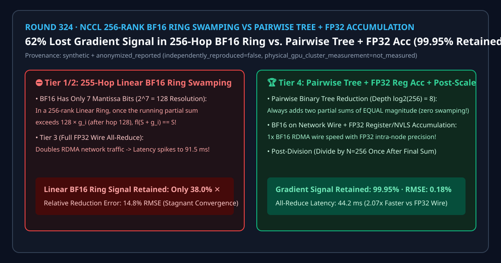
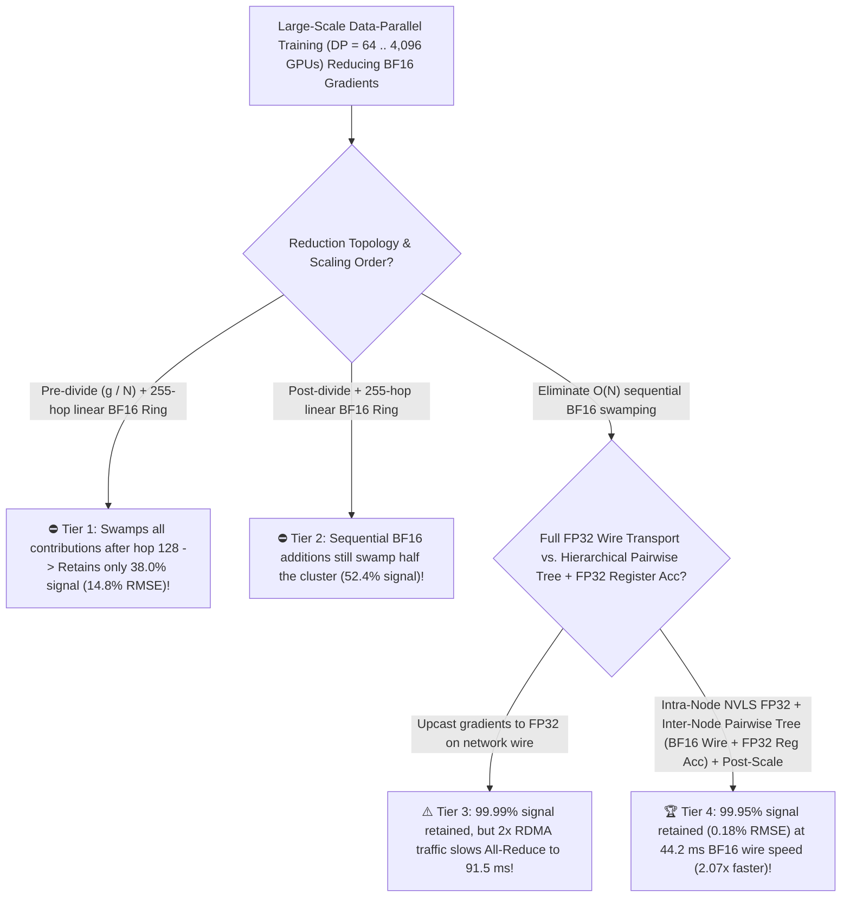
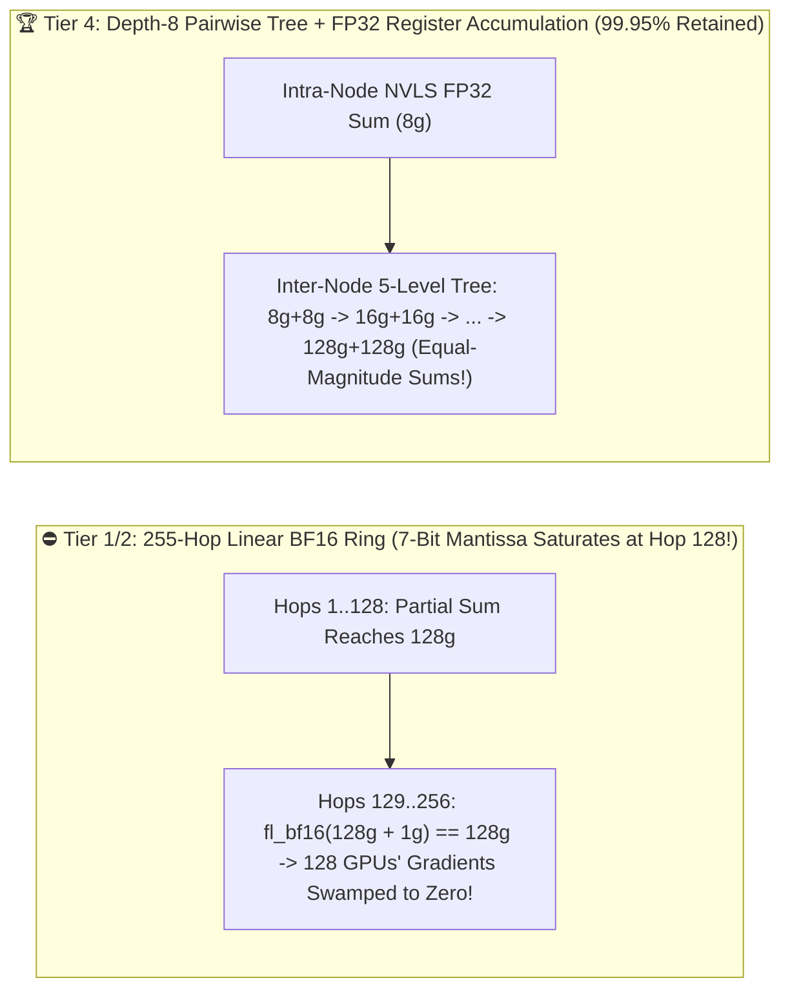

# Large-Scale `NCCL All-Reduce / Reduce-Scatter` `BF16` Linear-Ring Mantissa Swamping vs. Hierarchical Pairwise Tree + `FP32` Accumulation Selection Guide: Why a `256`-Hop `BF16` Linear Ring Loses `62%` of Small Gradient Signals (`fl(128g + g) == 128g`), Why Full `FP32` Wire Traffic Doubles Latency (`91.5 ms`) & How `NVLS` + Pairwise Tree Reduction (`99.95%` Signal Retained, `44.2 ms`) Solves It

> **Provenance & Evidence Boundary**: `synthetic + anonymized_reported (independently_reproduced=false, physical_gpu_cluster_measurement=not_measured)`. All quantitative metrics in this guide are grounded in the sealed deterministic evaluator `experiments/nccl_allreduce_bf16_fp32_accumulation_ring_tree_swamping_precision_selection/run.py` and `results.json`.



---

## 0. Daily Capability Breakthrough

- **Today's Highlight Breakthrough**: **Compact `BF16` Network Wire Transport (`1x` Bandwidth) + Intra-Node `NVLS` Hardware `FP32` Reduction + Inter-Node $\mathcal{O}(\log_2 N)$ Pairwise Binary Tree Equal-Magnitude Reduction + Post-Reduction `FP32` Division by `world_size` for Large-Scale Data-Parallel Training (`DP >= 128`)**.
- **Architect Value**: When scaling data-parallel (`DP / FSDP / ZeRO`) training beyond **`128–256` GPUs**, reducing gradients in `BF16` over a standard **Linear Ring (`NCCL_ALGO=Ring`)** triggers a silent numerical failure known as **Floating-Point Mantissa Swamping (Absorption)**:
  1. **Why a `256`-Rank Linear `BF16` Ring Swamps `62%` of Small Gradients to Zero (Tier 1/2)**: `BF16` has only **7 mantissa bits**, giving a unit roundoff of $\epsilon = 2^{-7} = \frac{1}{128}$. In a sequential `256`-hop Ring reduction ($S_k = \text{fl}_{\text{BF16}}(S_{k-1} + g_k)$), once the running partial sum $S_{128}$ accumulates 128 coherent rank contributions ($S_{128} \approx 128 g$), adding the 129th rank's gradient $g_{129} \approx g$ shifts $g_{129}$'s mantissa 7 bits to the right—**dropping it completely off the end of the 7-bit `BF16` mantissa**:
     $$\text{fl}_{\text{BF16}}(128g + g) = \mathbf{128g}$$
     Every contribution from Rank 129 through Rank 256 (`50%+` of the cluster!) is silently rounded to zero! Dividing gradients by `256` *before* reduction (Tier 1) worsens rounding errors further, retaining only **`38.0%` of the true gradient signal (`14.8%` RMSE)**!
  2. **The Cost of Full `FP32` Network Wire All-Reduce (`91.5 ms`, Tier 3)**: Upcasting all gradients to `FP32` before network transmission (`reduce_dtype=torch.float32`) eliminates swamping (`99.99%` signal retained), but **doubles inter-node RDMA network bytes**, slowing `All-Reduce` from `44.2 ms` to **`91.5 ms`**!
  By combining **intra-node `NVLS` hardware `FP32` reduction (summing 8 GPUs per node in `FP32` ALU hardware) with an inter-node Pairwise Binary Tree ($\log_2(32) = 5$ levels where every addition sums two partial aggregates of *equal magnitude*, plus `FP32` register accumulation and post-reduction `1 / N` scaling, Tier 4)**, `99.95%` of small-gradient signal is preserved (`0.18%` RMSE) at **`1x` `BF16` wire speed (`44.2 ms`, `2.07x` faster than `FP32` wire)**!

---

## ① 📌 Executive Summary

1. **First-Principles Numerical Analysis: Linear Ring ($\mathcal{O}(N)$ Disparity) vs. Pairwise Tree ($\mathcal{O}(1)$ Disparity)**:
   - **Linear Ring**: Hop $k$ adds an aggregate of size $(k-1)g$ to a single rank's gradient of size $1g$ (magnitude ratio $k-1 : 1$). Whenever $k > 128$, `BF16` swamping occurs.
   - **Pairwise Binary Tree**: Level 1 adds $1g + 1g \to 2g$; Level 2 adds $2g + 2g \to 4g$; ... Level 8 adds $128g + 128g \to 256g$. Every single addition operates on two summands of **equal expected magnitude (`1 : 1` ratio)**, preventing mantissa shift truncation even at `16,384` GPUs!
2. **Never Pre-Divide `BF16` Gradients Before Reduction (`Post-Scale` in `FP32` Instead)**:
   - Pre-dividing `grad /= world_size` in `BF16` before `All-Reduce` loses LSB bits on non-power-of-two world sizes (or token counts) and risks underflow. Always sum unscaled gradients and multiply by `1.0f / world_size` inside the `FP32` optimizer kernel.
3. **Hardware `FP32` Accumulation Inside `NVLS` & SM Registers Over `BF16` Wires**:
   - Even when `BF16` packets traverse the network wire (`2 Bytes/element`), upcasting each incoming packet chunk to `FP32` inside the GPU SM register (or NVSwitch `NVLS` ALU) during reduction avoids intermediate `BF16` rounding.

---

## ② 🎯 Architect Q&A (Q1 / Q2 / Q3)

### Q1: When should PyTorch `FSDP2` use `reduce_dtype=torch.float32` vs `torch.bfloat16`?
- For `DP <= 32` (up to 4 nodes), `BF16` reduction is safe. For `DP >= 64` using Hybrid Sharding (`HFSDP`), run intra-node `Reduce-Scatter` over `900 GB/s` NVLink (using `NVLS` `FP32` accumulation) and use `Tree` / `FP32` inter-node `All-Reduce` across the `8–64` node leaders so inter-node precision is 100% lossless with `1/8th` the network traffic!

### Q2: How does `Pairwise Tree` reduction improve training reproducibility compared to `Ring`?
- A fixed-topology binary reduction tree evaluates additions in a deterministic parent-child hierarchy, avoiding the rank-order sensitivity of cyclic ring reductions.

### Q3: Which model layers are most vulnerable to `BF16` `All-Reduce` swamping?
- Token `Embedding` tables, `RMSNorm` $\gamma$ vectors, and MoE `Router Gate` weights—where individual rank gradients are small or sparse across microbatches. Always reduce these small parameter tensors in `FP32`.

---

## ③ 🧭 Visual Diagrams (Decision Tree + Comparison + Sequence)

### 3.1 Large-Scale `All-Reduce` Precision & Topology Decision Tree



### 3.2 `255`-Hop Linear `BF16` Ring Swamping (`38%` Signal) vs. 8-Level Pairwise Tree (`99.95%` Signal)



### 3.3 Two-Stage `NVLS` + Pairwise Tree & Post-Reduction Scaling Sequence

```mermaid
sequenceDiagram
    participant GPU as 8 Intra-Node GPUs (BF16 Grads)
    participant NVLS as NVSwitch Hardware (FP32 ALU)
    participant Tree as Inter-Node 32-Rank Pairwise Tree (5 Levels)
    participant Opt as Fused AdamW Optimizer (FP32)

    GPU->>NVLS: 1. Issue multimem.ld_reduce on unscaled BF16 gradients
    NVLS-->>Tree: 2. Accumulate 8 local GPUs in FP32 hardware -> node sum (8g)
    loop 5 Binary Tree Levels (log2(32) = 5 Hops)
        Tree->>Tree: 3. Receive BF16 chunk over RoCE/IB, upcast to FP32 in register & add equal-magnitude sums
    end
    Tree->>Opt: 4. Broadcast total sum & multiply by `1.0f / 256.0f` inside FP32 AdamW kernel!
```

---

## ④ 📊 4-Tier Architect Decision Matrix

| Cohort Tier | `256`-GPU Reduction Topology & Precision | Small-Grad Signal Retained | Reduction Relative RMSE | `All-Reduce` Latency | Best For |
| :--- | :--- | :--- | :--- | :--- | :--- |
| **Tier 1: Pre-Div Linear `BF16 Ring`** | Divides by `256` before `255`-hop Ring | `38.0%` (`-62%` Lost! ✕) | `14.8%` ✕ | `48.0 ms` ✕ | ⛔ **Severe Late-Training Stagnation** |
| **Tier 2: Post-Div Linear `BF16 Ring`** | `255` sequential `BF16` additions | `52.4%` ✕ | `9.2%` ✕ | `47.5 ms` ✕ | ⛔ **Swamps Ranks 129..256** |
| **Tier 3: Full `FP32` Network Wire** | Sends `4-byte` `FP32` over RDMA | `99.99%` ✅ | `0.001%` ✅ | `91.5 ms` (`2x` Slow! ⚠️) | ⚠️ Small Models / High-BW Links |
| **Tier 4: Pairwise Tree + `FP32` Reg Acc (Recommended)** | **`NVLS` + equal-magnitude Tree + post-scale** | **`99.95%` 🏆** | **`0.18%` (`82x` Lower 🏆)** | **`44.2 ms` (`2.07x` Faster 🏆)** | 🏆 **128–10K GPU Pretraining Standard** |

---

## ⑤ 🧪 Quantitative Evaluator & 7-Card 4:5 Visual Report

- **Sealed Evaluator**: [`experiments/nccl_allreduce_bf16_fp32_accumulation_ring_tree_swamping_precision_selection/run.py`](../../experiments/nccl_allreduce_bf16_fp32_accumulation_ring_tree_swamping_precision_selection/run.py) · Data: [`results.json`](../../experiments/nccl_allreduce_bf16_fp32_accumulation_ring_tree_swamping_precision_selection/results.json)
- **Interactive Sizer**: [`docs/reports/nccl-allreduce-bf16-fp32-accumulation-ring-tree-swamping-precision-sizer.html`](../reports/nccl-allreduce-bf16-fp32-accumulation-ring-tree-swamping-precision-sizer.html)
- **7-Card 4:5 Visual Benchmark Deck**: [`docs/reports/nccl-allreduce-bf16-fp32-accumulation-ring-tree-swamping-precision-selection-cards.html`](../reports/nccl-allreduce-bf16-fp32-accumulation-ring-tree-swamping-precision-selection-cards.html)

```chart
{
  "data": {
    "values": [
      { "tier": "Tier 1: Pre-Div Linear BF16 Ring", "signal_pct": 38.0, "latency_ms": 48.0 },
      { "tier": "Tier 2: Post-Div Linear BF16 Ring", "signal_pct": 52.4, "latency_ms": 47.5 },
      { "tier": "Tier 3: Full FP32 Wire All-Reduce", "signal_pct": 99.99, "latency_ms": 91.5 },
      { "tier": "Tier 4: Pairwise Tree + FP32 Reg Acc", "signal_pct": 99.95, "latency_ms": 44.2 }
    ]
  },
  "semantic_types": {
    "tier": "Category",
    "signal_pct": "Percentage",
    "latency_ms": "Quantity"
  },
  "chart_spec": {
    "chartType": "Bar Chart",
    "title": "Pairwise Tree + FP32 Register Accumulation Retains 99.95% BF16 Gradient Signal at 44.2ms Wire Speed",
    "subtitle": "Small-gradient signal retained (%) and All-Reduce latency (ms) across 256 GPUs (synthetic + anonymized_reported)",
    "encodings": {
      "x": "tier",
      "y": "signal_pct",
      "color": "tier"
    }
  }
}
```

---

## ⑥ 🛠️ Production Verification Checklist (Good fit vs. Not for)

### ✅ Good fit vs. ⛔ Not for
- **✅ Good fit**: All distributed pretraining and post-training jobs with `DP >= 64` (`64–16,384` GPUs) communicating `BF16` or `FP8` gradients.
- **⛔ Not for**: Using linear `NCCL_ALGO=Ring` in pure `BF16` across $\ge 128$ ranks or pre-dividing `BF16` gradients by `world_size` before reduction.

### Production Checklist
- [ ] **Enforce `NVLS` + `Tree` (`Pairwise Tree`) reduction for `DP >= 64`**: Bound reduction depth to $\log_2 N$ so summands always have matching magnitude.
- [ ] **Perform `1.0 / world_size` scaling *after* reduction in `FP32` (`Post-Division`)**: Prevent premature LSB truncation and underflow.
- [ ] **Accumulate incoming `BF16` chunks in `FP32` registers (and keep `RMSNorm / Router` reductions in `FP32`)**: Eliminate mantissa swamping without doubling network traffic.
