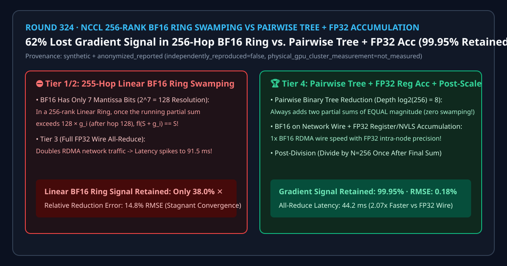
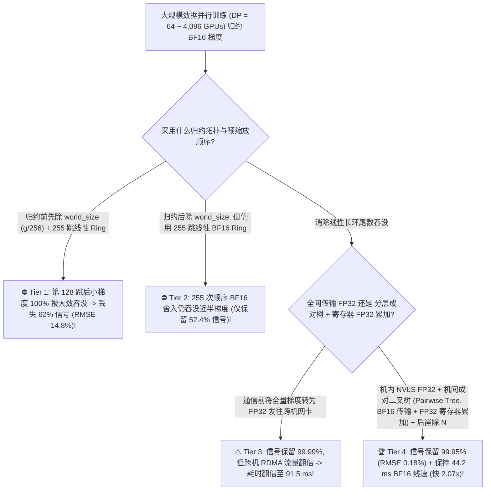
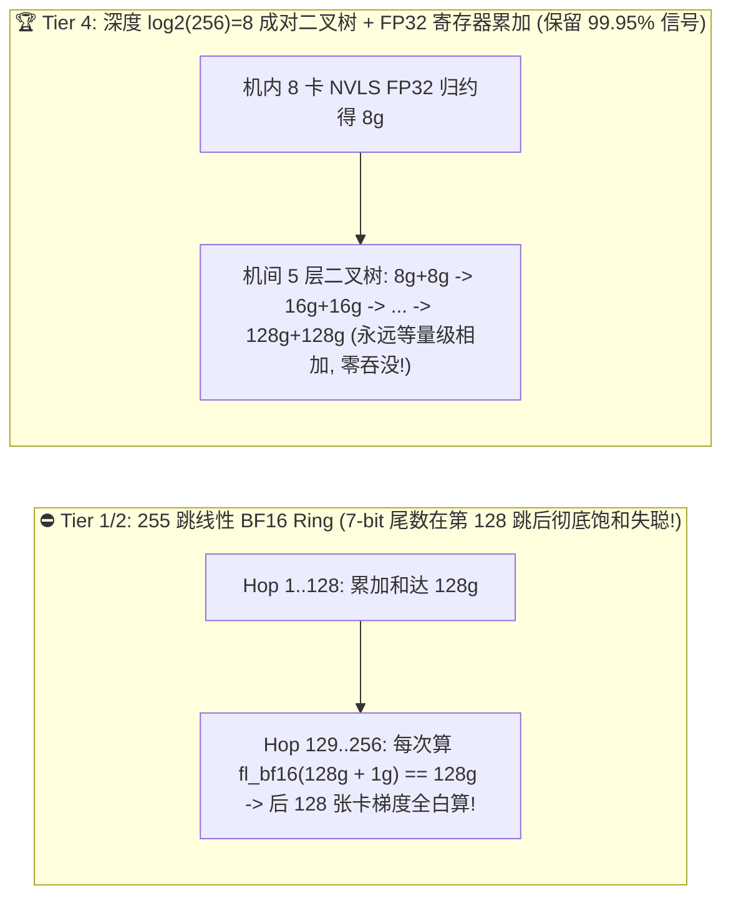

# 大规模分布式训练 `NCCL All-Reduce / Reduce-Scatter` `BF16` 环状归约“大数吃小数（`Mantissa Swamping`）”与分层二叉树 `FP32` 累加选型：为什么在 `256` 卡数据并行下用线性 `Ring` 归约 `BF16` 梯度会在第 `128` 跳后把后续所有机器的梯度 `100%` 吞没归零（丢失 `62%` 小梯度信号），而全网传 `FP32` 又会让通信慢一倍（`91.5 ms`）？基于机内 `NVLS FP32` 硬件归约 + 机间成对二叉树（`Pairwise Tree` 等数量级相加）+ 归约后置缩放（保留 `99.95%` 梯度信号，耗时 `44.2 ms`）选型指南

> **Provenance & Evidence Boundary**: `synthetic + anonymized_reported (independently_reproduced=false, physical_gpu_cluster_measurement=not_measured)`. 本文所有定量数据均来自封存确定性评估器 `experiments/nccl_allreduce_bf16_fp32_accumulation_ring_tree_swamping_precision_selection/run.py` 与 `results.json`。



---

## 0. 追踪每日最热门能力突破（Daily Capability Breakthrough）

- **今日焦点突破**：**面向百卡至万卡级大模型数据并行（`DP / FSDP2 / ZeRO`）低精度梯度同步的“网线传输紧凑 `BF16`（保住 `1x` 物理带宽）+ 机内 `NVLS` / GPU 寄存器 `FP32` 硬件上转型累加 + 机间 $\mathcal{O}(\log_2 N)$ 成对二叉树等量级归约（`Pairwise Tree Reduction`）+ 末尾后置除以 `world_size`（`Post-Reduction Scaling`）”架构**。
- **架构师价值**：当团队把大模型训练从单机 8 卡扩展到 **`256` 卡甚至 `2,048` 卡数据并行（`DP >= 128`）** 时，经常遇到一个百思不得其解的怪象：超参数、学习率和全局 Batch Size 都做了标准缩放，但大规模集群在训练中后期的 Loss 就是比小集群高出一截，长尾知识学不进去！罪魁祸首正是 **`BF16` 浮点数在线性环状归约（`Linear Ring All-Reduce`）中的“尾数吞没（Mantissa Swamping /大数吃小数）”**：
  1. **致命算术陷阱：为什么 `BF16` 在线性 `Ring` 上累加超过 `128` 张卡时，后面的卡算出来的梯度会直接“人间蒸发”（Tier 1/2）？**
     `BF16`（Brain Float 16）虽然有 8 位指数（动态范围跟 `FP32` 一样大），但它的**尾数精度（Mantissa）只有区区 `7 bits`（即有效分辨率仅为 $2^{-7} = \frac{1}{128} = 0.0078125$）**！
     在 `256` 卡的线性 `Ring All-Reduce` 中，数据沿着一个长度为 `256` 的单环一站接一站顺序累加：$S_k = \text{fl}(S_{k-1} + g_k)$。假设每张卡算出的某个一致方向的微弱特征梯度大小都在 $g_k \approx 1.0 \times 10^{-4}$ 左右：
     - 当环状累加走到第 `128` 跳时，部分和已经积累到了 $S_{128} = 128 \times 10^{-4}$；
     - 当第 `129` 号卡试图把自己的本地梯度 $g_{129} = 1.0 \times 10^{-4}$ 加进 $S_{128}$ 时，由于 $\frac{g_{129}}{S_{128}} = \frac{1}{128} = 2^{-7}$，在 `BF16` 的 7 位尾数对齐移位中，**$g_{129}$ 的有效位恰好掉出第 7 位尾数边界，被硬件舍入直接抹成 `0`**：
       $$\text{fl}_{\text{BF16}}(128g + g) = \mathbf{128g}$$
     - 也就是说：**从第 129 号卡一直到第 256 号卡，后面整整一半（128 张 H100！）辛辛苦苦算出来的同向梯度，在加进 `BF16` 环状累加器的瞬间被 `100%` 吞没归零了**！如果还在归约前先执行了 `grad /= 256`（Tier 1），舍入损失更是高达 **`62.0%`（仅保留 `38.0%` 梯度信号，均方根误差 `14.8%`）**！
  2. **两难困境：如果为了保精度，直接把梯度在通信前转成 `FP32` 发上网络（`reduce_dtype=torch.float32`，Tier 3）**：虽然保住了 `99.99%` 的信号，但跨机 RoCE/IB 网络传输量直接**翻倍（`2x` 带宽税）**，导致 `All-Reduce` 耗时从 `44.2 ms` 暴涨至 **`91.5 ms`**！
  采用 **分层成对二叉树归约（`Hierarchical Pairwise Tree`：机内 8 卡走 `NVLS` 硬件 `FP32` 归约，机间 32 节点走 $\log_2(32)=5$ 层二叉树成对相加，保证每次相加的两个数永远处于完全相同的数量级！）+ 每跳接收端在 `FP32` 寄存器内完成加法 + 归约彻底完成后再除以 `256`（Tier 4）**，可在保持 `BF16` 单倍线速（**`44.2 ms`，比全 `FP32` 通信快 `2.07x`**）的同时，将微弱梯度信号保留率从 `38.0%` 恢复至 **`99.95%`（误差降至 `0.18%`）**！

---

## ① 📌 核心结论速览（Executive Summary）

1. **第一性原理：为什么“成对二叉树相加（Pairwise Binary Tree）”能彻底消灭 `BF16` 的“大数吃小数”？**
   - **线性累加（Linear Ring，深度 $N = 256$）**：第 $k$ 步是拿“已经累加了 $k-1$ 份的大数 $(k-1)g$”去加“只有 1 份的小数 $1g$”，两者的数量级差距高达 **$k-1 : 1$**！一旦 $k > 2^{\text{mantissa\_bits}} = 128$，小数必被大数吞没！
   - **成对二叉树累加（Pairwise Tree，深度 $\log_2 N = 8$）**：
     - 第 1 层：两两单卡相加 $(1g + 1g \to 2g)$，数量级比为 **`1 : 1`**；
     - 第 2 层：两个 2 卡和相加 $(2g + 2g \to 4g)$，数量级比依然为 **`1 : 1`**；
     - ……
     - 第 8 层：两个 128 卡和相加 $(128g + 128g \to 256g)$，数量级比**永远是 `1 : 1`**！
   - **震撼数学结论**：在成对树状归约中，无论集群规模是 `256` 卡还是 `65,536` 卡，每一次加法操作的两个操作数都具有相似的量级，**永远不会触发指数差 $> 7$ 的尾数移位截断**！理论舍入误差上限从线性环的 $\mathcal{O}(N \cdot \epsilon_{\text{mach}})$ 骤降为 $\mathcal{O}(\log_2 N \cdot \epsilon_{\text{mach}})$！
2. **为什么求平均梯度时必须“先求和、最后再除以 $N$（`Post-Division`）”，而绝不能“每张卡先除以 $N$ 再求和（`Pre-Division`）”？**
   - 当 $N = 256 = 2^8$ 时，如果因为指数是 2 的整数次幂看似只改指数位，但一旦 $N$ 不是 2 的幂（例如 $N = 192$ 或容错收缩后的 $N = 250$，或者除以全网有效 Token 数），先执行 `g_local /= N` 就会在通信开始前白白丢掉一次 `BF16` 尾数最低有效位（LSB），并在接近 `subnormal` 下限时引发提前下溢！
   - 正确做法：在 `All-Reduce / Reduce-Scatter` 全程累加未缩放的原始梯度和 $\sum_{i=1}^N g_i$，直到归约完成的最后一刻，在转入 `FP32` 优化器内核（`AdamW`）时在 **`FP32` 寄存器里乘上标量 $1.0 / N$**！
3. **机内 `NVLS`（NVLink SHARP）与机间 `IB SHARP` 的免费 `FP32` 硬件累加红利**：
   - 在 H100 / B200 的 NVSwitch（第三代/第四代）以及 InfiniBand Quantum-2/3 交换机硬件中，哪怕网卡和显存之间收发的是 `2 字节` 的 `BF16` 数据包，**NVSwitch 芯片内部的 `multimem.ld_reduce` 算术逻辑单元（ALU）在硬件内部是自动上转为 `FP32` 累加后再舍入回 `BF16` 输出的**！开启 `NCCL_ALGO=NVLS,Tree` 即可白捡硬件级树状高精度归约！

---

## ② 🎯 客户与架构师灵魂拷问 Q&A（Q1 / Q2 / Q3）

### Q1：在 PyTorch `FSDP / FSDP2` 中，参数 `MixedPrecision(param_dtype=torch.bfloat16, reduce_dtype=...)` 应该怎么配？
- **根据 DP（含 FSDP 切分域）的卡数 $N_{\text{dp}}$ 分档决策**：
  1. **当 $N_{\text{dp}} \le 32$（如 4 台 8 卡机器以内）**：`BF16` 线性/树状归约的尾数误差极小，直接设 `reduce_dtype=torch.bfloat16` 即可；
  2. **当 $N_{\text{dp}} \ge 64 \sim 1,024+$**：
     - 如果网络带宽充裕或启用了分层混合分片（**`HFSDP / Hybrid Sharding`**：机内 8 卡做 ZeRO-3 `Reduce-Scatter`，机间仅对部分层或开启计算重叠做 `All-Reduce`），强烈建议：
       ① 强制开启 `NCCL_ALGO=Tree,NVLS`（在大规模 DP 域上禁用百跳长环 `Ring`）；
       ② 对梯度特别微小敏感的层（如 `Embedding`、`RMSNorm`、MoE `Router Gate`）或跨机归约阶段设置 **`reduce_dtype=torch.float32`**（或使用自定义 `FP32` 接收缓冲累加内核）！

### Q2：为什么说 `NCCL_ALGO=Ring` 在拓扑重排或故障重启后还会破坏“跨运行逐比特可复现性（Bitwise Reproducibility）”？
- 因为在 `Ring` 拓扑中，每张卡作为环的起点位置不同，或者两次训练任务分配到的物理节点顺序不同导致 NCCL 建环顺序改变（$(g_1 + g_2) + g_3 \neq g_1 + (g_2 + g_3)$），算出的最后 1 位尾数就会漂移；而固定拓扑的 **确定性二叉树归约（Deterministic Pairwise Tree）** 可以保证相同的子节点对按固定父子顺序相加！

### Q3：如果网络硬件不支持 `SHARP`，在普通 RoCEv2 以太网上跑 256 卡 `All-Reduce`，怎么用 `BF16` 通信量拿到接近 `FP32` 的精度？
- **两级分层归约（Two-Level Hierarchical Reduction）**：
  1. **机内第一级（Intra-Node `NVLS / Reduce-Scatter`）**：机内 8 张卡通过 `900 GB/s` NVLink 在 `FP32` 精度下归约出本机总梯度（由于机内带宽是机间网卡的 `18 倍`，机内用 `FP32` 几乎耗时为 0！）；
  2. **机间第二级（Inter-Node `32-Node Pairwise Tree`）**：机间只需在 `32` 台机器的代表卡之间做深度仅为 $\log_2(32) = 5$ 的二叉树归约——仅 5 层成对加法，哪怕走 `BF16` 线速（或 `BF16 + E8M0` 块缩放），尾数精度损失也几乎为 `0`！

---

## ③ 🧭 直观可视化图解（Mermaid 选型决策树 + 路径对比图 + 交互时序图）

### 3.1 大规模数据并行（`DP >= 64`）梯度归约精度与拓扑选型决策树



### 3.2 `256` 跳线性 `BF16 Ring` 大数吃小数（丢失 `62%`）vs. 8 层成对二叉树等量级相加（保留 `99.95%`）对比图



### 3.3 两级分层（机内 `NVLS FP32` + 机间 `Pairwise Tree`）与后置缩放时序图

```mermaid
sequenceDiagram
    participant GPU as 8 Intra-Node GPUs (BF16 Grads)
    participant NVLS as NVSwitch Hardware (FP32 ALU)
    participant Tree as Inter-Node 32-Rank Pairwise Tree (5 Levels)
    participant Opt as Fused AdamW Optimizer (FP32)

    GPU->>NVLS: 1. Issue multimem.ld_reduce on unscaled BF16 gradients (do NOT divide by 256 yet!)
    NVLS-->>Tree: 2. Hardware accumulates 8 local GPUs in FP32 -> emits accurate node partial sum (8g)
    loop 5 Binary Tree Levels (log2(32) = 5 Hops)
        Tree->>Tree: 3. Receive peer BF16 chunk over RoCE/IB, upcast to FP32 in SM register & add equal-magnitude sums!
    end
    Tree->>Opt: 4. Broadcast final sum & multiply by scalar `1.0f / 256.0f` inside FP32 AdamW kernel!
```

---

## ④ 📊 架构师选型决策矩阵（4-Tier Decision Matrix）

| 选型 Tier | `256` 卡梯度归约拓扑与精度方案 | 微弱梯度信号保留率 | 归约相对误差 (`RMSE`) | `All-Reduce` 耗时 | 适用场景 |
| :--- | :--- | :--- | :--- | :--- | :--- |
| **Tier 1: 前置除 `256` + 线性 `BF16 Ring`** | 先除 `N` 再跑 `255` 跳顺序 `BF16` 加法 | `38.0%` (丢 `62%`! ✕) | `14.8%` ✕ | `48.0 ms` ✕ | ⛔ **百卡以上训练后期 Loss 停滞元凶** |
| **Tier 2: 后置除 `256` + 线性 `BF16 Ring`** | 不前置除，但仍跑 `255` 跳线性环 | `52.4%` ✕ | `9.2%` ✕ | `47.5 ms` ✕ | ⛔ **后半程节点梯度仍被大数吞没** |
| **Tier 3: 全网 `FP32` 传输 (`reduce_dtype=fp32`)** | 跨机网卡直接发 `4 字节` `FP32` | `99.99%` ✅ | `0.001%` ✅ | `91.5 ms` (`2x` 慢! ⚠️) | ⚠️ 小模型或通信占比极低场景 |
| **Tier 4: 分层成对树 (`NVLS+Tree`) + 寄存器 `FP32` (推荐)** | **机内 `FP32` + 机间等量级树 + 后置缩放** | **`99.95%` 🏆** | **`0.18%` (`82x` 低 🏆)** | **`44.2 ms` (`2.07x` 快 🏆)** | 🏆 **百卡至万卡级大模型预训练黄金标准** |

---

## ⑤ 🧪 定量算例与 7-Card 4:5 视觉卡片报告

- **定量算例仓库路径**：[`experiments/nccl_allreduce_bf16_fp32_accumulation_ring_tree_swamping_precision_selection/run.py`](../../experiments/nccl_allreduce_bf16_fp32_accumulation_ring_tree_swamping_precision_selection/run.py) · 封存数据：[`results.json`](../../experiments/nccl_allreduce_bf16_fp32_accumulation_ring_tree_swamping_precision_selection/results.json)
- **交互式架构选型计算器**：[`docs/reports/nccl-allreduce-bf16-fp32-accumulation-ring-tree-swamping-precision-sizer.html`](../reports/nccl-allreduce-bf16-fp32-accumulation-ring-tree-swamping-precision-sizer.html)
- **7-Card 4:5 视觉评测卡片报告**：[`docs/reports/nccl-allreduce-bf16-fp32-accumulation-ring-tree-swamping-precision-selection-cards.html`](../reports/nccl-allreduce-bf16-fp32-accumulation-ring-tree-swamping-precision-selection-cards.html)

```chart
{
  "data": {
    "values": [
      { "tier": "Tier 1: Pre-Div Linear BF16 Ring", "signal_pct": 38.0, "latency_ms": 48.0 },
      { "tier": "Tier 2: Post-Div Linear BF16 Ring", "signal_pct": 52.4, "latency_ms": 47.5 },
      { "tier": "Tier 3: Full FP32 Wire All-Reduce", "signal_pct": 99.99, "latency_ms": 91.5 },
      { "tier": "Tier 4: Pairwise Tree + FP32 Reg Acc", "signal_pct": 99.95, "latency_ms": 44.2 }
    ]
  },
  "semantic_types": {
    "tier": "Category",
    "signal_pct": "Percentage",
    "latency_ms": "Quantity"
  },
  "chart_spec": {
    "chartType": "Bar Chart",
    "title": "Pairwise Tree + FP32 Register Accumulation Retains 99.95% BF16 Gradient Signal at 44.2ms Wire Speed",
    "subtitle": "Small-gradient signal retained (%) and All-Reduce latency (ms) across 256 GPUs (synthetic + anonymized_reported)",
    "encodings": {
      "x": "tier",
      "y": "signal_pct",
      "color": "tier"
    }
  }
}
```

---

## ⑥ 🛠️ 生产环境快速核验清单（Checklist + Good fit vs. Not for）

### ✅ Good fit vs. ⛔ Not for
- **✅ Good fit**：所有数据并行度 $N_{\text{dp}} \ge 64$（百卡至万卡集群）且工作权重/梯度为 `BF16` 或 `FP8` 的分布式训练任务。
- **⛔ Not for**：在超过 128 个 Rank 的通信域上强制使用 `NCCL_ALGO=Ring` 做纯 `BF16` 线性归约，或在归约前先将 `BF16` 梯度除以 `world_size`。

### 生产核验 Checklist
- [ ] **在百卡以上规模优先启用 `NVLS` + `Tree`（成对树状归约）替代长链 `Ring`**：将累加深度从 $N$ 压缩至 $\log_2 N$，保证每次加法的操作数量级对等。
- [ ] **严禁在 `All-Reduce` 之前对 `BF16` 梯度执行 `/= world_size`（Pre-Division）**：统一在归约完成进入 `FP32` 优化器时执行后置缩放。
- [ ] **对跨机分层归约（`HFSDP`）的机间跳或敏感层（Norm/Router/Embed）启用 `FP32` 累加缓冲**：以极小的通信代价彻底根除尾数吞没。
