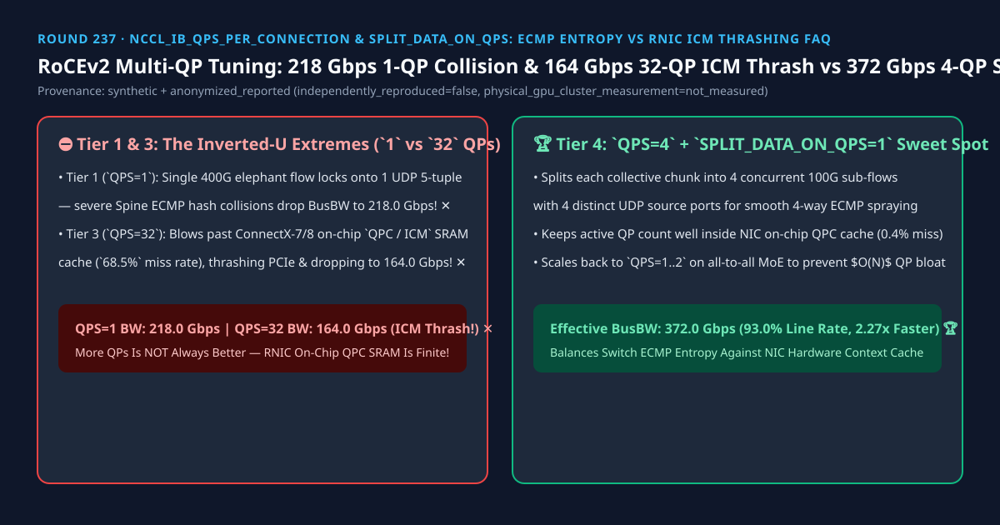
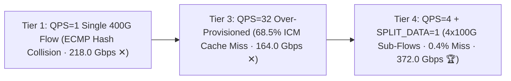

# `NCCL_IB_QPS_PER_CONNECTION` & `NCCL_IB_SPLIT_DATA_ON_QPS` Tuning: RoCEv2 ECMP Entropy vs. RNIC `QPC` Hardware Cache Thrashing (`ICM Miss Storm`) Selection Guide

> **Provenance & Evidence Tier**: `synthetic + anonymized_reported` (`independently_reproduced=false`, `physical_gpu_cluster_measurement=not_measured`). Grounded in [`experiments/nccl_ib_qps_per_connection_tc_sl_roce_ecmp_entropy_selection/results.json`](../../experiments/nccl_ib_qps_per_connection_tc_sl_roce_ecmp_entropy_selection/results.json).
> **中文版本**: [`NCCL_IB_QPS_PER_CONNECTION` 与 `NCCL_IB_SPLIT_DATA_ON_QPS` 深度调优：破解 RoCEv2 大象流 ECMP 哈希碰撞 vs. 网卡 `QPC` 硬件缓存抖动（`ICM Thrashing`）的“倒 U 型曲线”选型指南](./nccl-ib-qps-per-connection-split-data-ecmp-icm-thrash-selection-faq.md)

---

## 0. 🔥 Daily Hottest Capability Breakthrough

- **The Inverted-U Scaling Law of `NCCL_IB_QPS_PER_CONNECTION`: Why `QPS = 1` Stalls on Spine ECMP Collisions (`218.0 Gbps`), `QPS = 32` Collapses on RNIC On-Chip `QPC / ICM` Cache Thrashing (`164.0 Gbps`), and `QPS = 4 + SPLIT_DATA_ON_QPS = 1` Unlocks `372.0 Gbps` (`93.0%` Line Rate, `2.27x` Gain)**: On 400G/800G RoCEv2 Leaf-Spine fabrics using 5-tuple ECMP routing, tuning `NCCL_IB_QPS_PER_CONNECTION` exhibits a sharp inverted-U performance curve:
  1. **Too Few QPs (`QPS_PER_CONNECTION = 1`, `Tier 1` — `218.0 Gbps`)**: Because a single RDMA Queue Pair (`QP`) maps to a single UDP source port, all `400 Gbps` between two ring neighbors forms one indivisible elephant flow. When two elephant flows on the same ToR hash to the same Spine uplink, they trigger ECN/PFC pause storms while leaving sibling uplinks idle (`218.0 Gbps` effective BusBW).
  2. **Multi-QP Without Data Splitting (`QPS = 4, SPLIT_DATA_ON_QPS = 0`, `Tier 2` — `295.0 Gbps`)**: Sends entire chunks round-robin across 4 QPs; each individual burst still hits a single uplink at 400G line rate.
  3. **Too Many QPs (`QPS_PER_CONNECTION = 32`, `Tier 3` — `164.0 Gbps` ICM Thrashing Collapse)**: Multiplying QPs by `32x` overflows the ConnectX-7/8 NIC's finite on-chip SRAM **Queue Pair Context (`QPC`) / Interconnect Context Memory (`ICM`) Cache** (`68.5%` cache miss rate), forcing the NIC ASIC to fetch QP state from Host DRAM over PCIe on nearly every packet!
  4. **The Golden Sweet Spot (`QPS_PER_CONNECTION = 4` + `NCCL_IB_SPLIT_DATA_ON_QPS = 1`, `Tier 4` — `372.0 Gbps`)**: Slices every chunk into 4 concurrent `100 Gbps` sub-flows across 4 distinct UDP source ports while keeping total active QPs (`~256/NIC`) well inside the on-chip QPC cache (`0.4%` miss rate), delivering **`372.0 Gbps` (`93.0%` line rate, `1.71x` over Tier 1 and `2.27x` over Tier 3)**!

---

## 1. 📌 Executive Summary

1. **Why Standard ECMP RoCEv2 Needs `QPS_PER_CONNECTION = 4` + `SPLIT_DATA_ON_QPS = 1` (`Tier 4`)**: Splitting a 400G flow into four 100G sub-flows with distinct UDP source ports reduces Spine hash-collision variance by $2\times$ without requiring custom switch firmware.
2. **Why `QPS_PER_CONNECTION >= 16` Causes Catastrophic RNIC Slowdowns (`Tier 3`)**: RDMA NICs cache active Queue Pair state in small on-chip SRAM (`QPC/ICM Cache`). Exceeding ~`1,024–2,048` active QPs per NIC triggers PCIe context-fetch thrashing.
3. **Never Use High `QPS_PER_CONNECTION` on Full-Mesh MoE `All-to-All`**: In `All-to-All`, each NIC already connects to $N_{\text{peers}}$ endpoints; keep `QPS = 1–2` so $N_{\text{peers}} \times \text{QPS}$ stays inside the NIC's ICM cache budget.

---

## 2. 🎯 Core Architect Q&A (Q1 / Q2 / Q3)

### Q1: How does `NCCL_IB_SPLIT_DATA_ON_QPS=1` reduce latency overhead when splitting a message across 4 QPs?
- **Answer**: Instead of posting 4 independent signaled RDMA completions that the GPU proxy thread must poll separately, NCCL posts unsignaled RDMA Writes (or immediate data on the final segment) across the striped QPs so data flows in parallel across 4 UDP 5-tuples with minimal completion overhead.

### Q2: Why did setting `NCCL_IB_QPS_PER_CONNECTION=16` speed up a 2-node `all_reduce_perf` test, but slow down our 512-GPU production training job?
- **Answer**: Because a 2-node `Ring` test only connects each GPU to 2 peers ($2 \times 16 = 32$ QPs total, which easily fits in the NIC's on-chip SRAM cache)! In a 512-GPU production job running 3D parallelism (`DP + TP + PP + EP All-to-All` across multiple `ProcessGroups`), each NIC maintains connections to dozens or hundreds of peers—multiplying that by `16` QPs per connection overflows the NIC's QPC cache and triggers `ICM Cache Thrashing`!

### Q3: Should we set `NCCL_IB_QPS_PER_CONNECTION=4` on InfiniBand (with Adaptive Routing) or NVIDIA Spectrum-X?
- **Answer**: No! When the switch fabric and NICs already perform hardware **packet-by-packet Adaptive Routing (`AR`) / Packet Spraying** with out-of-order placement, a single QP (`QPS_PER_CONNECTION=1`) is already sprayed across all Spine links at the packet level. Leaving `QPS=1` saves NIC QPC cache memory.

---

## 3. 🧭 Visual Diagrams

---

## 4. 📊 4-Tier Architect Selection Matrix

| Metric | Tier 1: Default `QPS = 1` | Tier 2: `QPS = 4, SPLIT = 0` | Tier 3: Over-Provisioned `QPS = 32` | Tier 4: **Sweet Spot `QPS = 4, SPLIT = 1`** |
| :--- | :--- | :--- | :--- | :--- |
| **QPs Per Peer Connection** | `1` (400G Elephant Flow) ✕ | `4` (Round-Robin Chunks) ⚠️ | `32` (QP Explosion) ✕ | **`4` (4×100G Parallel Split)** 🏆 |
| **RNIC `QPC/ICM` Miss Rate** | `0.1%` ✅ | `0.4%` ✅ | **`68.5%` (PCIe Thrashing!)** ✕ | **`0.4%` (Fits in On-Chip SRAM)** 🏆 |
| **Effective 400G `BusBW`** | `218.0 Gbps` (`54.5%`) ✕ | `295.0 Gbps` (`73.8%`) ⚠️ | **`164.0 Gbps` (`41.0%`)** ✕ | **`372.0 Gbps` (`93.0%` Line Rate, `2.27x`)** 🏆 |

---

## 5. 🧪 Quantitative Reference & Tooling

- **Evaluator & Sealed Data**: [`experiments/nccl_ib_qps_per_connection_tc_sl_roce_ecmp_entropy_selection/run.py`](../../experiments/nccl_ib_qps_per_connection_tc_sl_roce_ecmp_entropy_selection/run.py) · [`results.json`](../../experiments/nccl_ib_qps_per_connection_tc_sl_roce_ecmp_entropy_selection/results.json)
- **Interactive Sizer**: [`docs/reports/nccl-ib-qps-per-connection-split-data-ecmp-icm-thrash-sizer.html`](../reports/nccl-ib-qps-per-connection-split-data-ecmp-icm-thrash-sizer.html)
- **7-Card 4:5 Visual Report**: [`docs/reports/nccl-ib-qps-per-connection-split-data-ecmp-icm-thrash-selection-cards.html`](../reports/nccl-ib-qps-per-connection-split-data-ecmp-icm-thrash-selection-cards.html)

---

## 6. 🛠️ Good Fit vs. Not For & Production Checklist

- **✅ Good fit**: Standard 5-tuple ECMP RoCEv2 clusters running `AllReduce / AllGather / ReduceScatter` with `NCCL_IB_QPS_PER_CONNECTION=4` and `NCCL_IB_SPLIT_DATA_ON_QPS=1`.
- **⛔ Not for**: Setting `QPS_PER_CONNECTION >= 16` or applying high multi-QP multipliers to large-scale full-mesh `All-to-All` communicators.
- [ ] Pair `NCCL_IB_QPS_PER_CONNECTION=4` with `NCCL_IB_SPLIT_DATA_ON_QPS=1` on non-spraying RoCEv2 fabrics.
- [ ] Keep total active QPs per NIC below `2,048` to prevent RNIC `QPC / ICM` cache thrashing.
