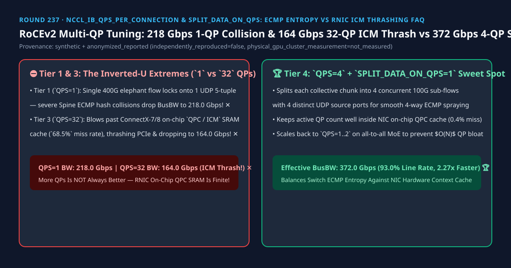
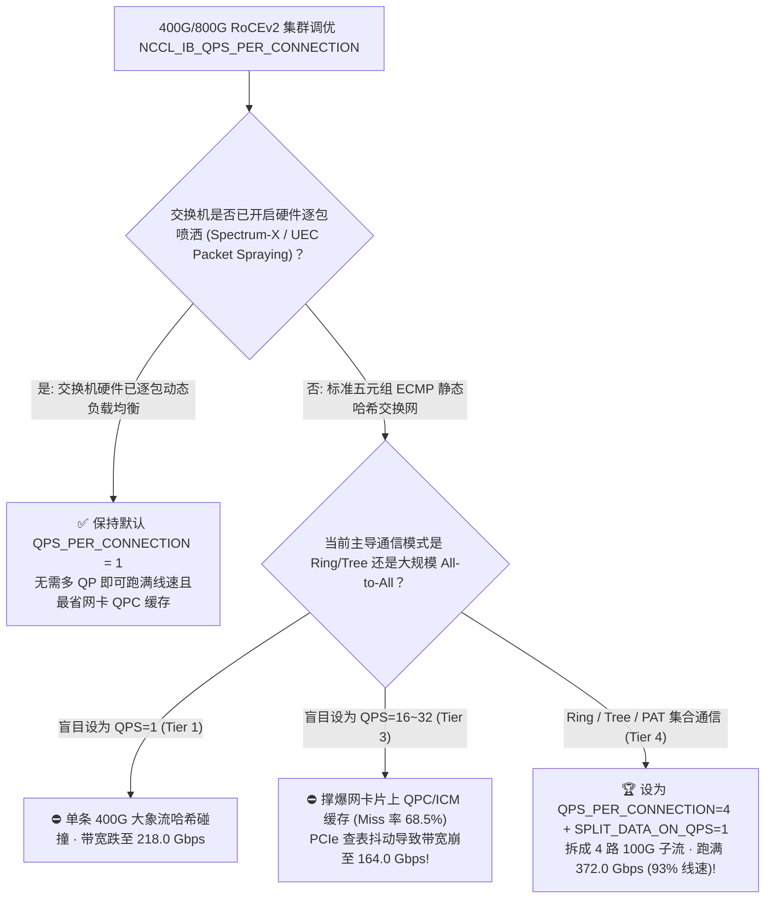
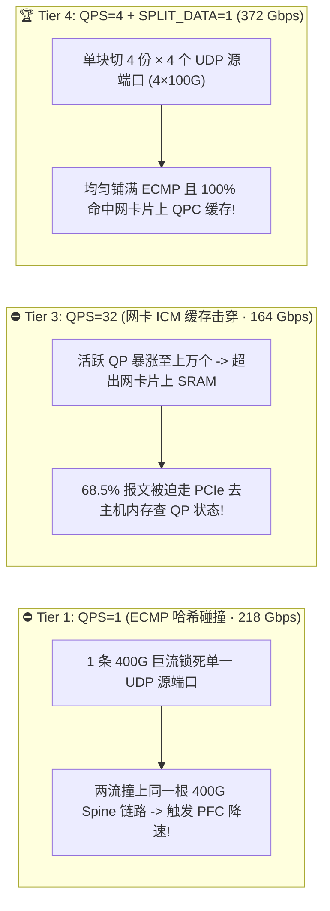
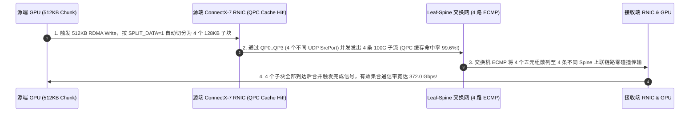

# `NCCL_IB_QPS_PER_CONNECTION` 与 `NCCL_IB_SPLIT_DATA_ON_QPS` 深度调优：破解 RoCEv2 大象流 ECMP 哈希碰撞 vs. 网卡 `QPC` 硬件缓存抖动（`ICM Thrashing`）的“倒 U 型曲线”选型指南

> **Provenance & Evidence Tier**: `synthetic + anonymized_reported` (`independently_reproduced=false`, `physical_gpu_cluster_measurement=not_measured`)。定量数据锚定于 [`experiments/nccl_ib_qps_per_connection_tc_sl_roce_ecmp_entropy_selection/results.json`](../../experiments/nccl_ib_qps_per_connection_tc_sl_roce_ecmp_entropy_selection/results.json)。
> **English Version**: [`NCCL_IB_QPS_PER_CONNECTION` & `NCCL_IB_SPLIT_DATA_ON_QPS` Tuning: RoCEv2 ECMP Entropy vs. RNIC `QPC` Hardware Cache Thrashing (`ICM Miss Storm`) Selection Guide](./nccl-ib-qps-per-connection-split-data-ecmp-icm-thrash-selection-faq.en.md)

---

## 0. 🔥 今日领域最热门能力突破追踪（Daily Hottest Breakthrough）

- **揭示 `NCCL_IB_QPS_PER_CONNECTION` 的“倒 U 型性能曲线”：为什么 `QPS=1` 会死于交换机 ECMP 哈希碰撞（`218.0 Gbps`），而盲目设成 `QPS=32` 却会因击穿网卡片上 `QPC / ICM` 硬件缓存而崩盘至 `164.0 Gbps`？通过黄金配置 `QPS=4 + SPLIT_DATA_ON_QPS=1` 跑满 `372.0 Gbps`（`93.0%` 线速，提速 `2.27` 倍）**：在 400G/800G RoCEv2 以太网集群上调优 NCCL 集合通信时，`NCCL_IB_QPS_PER_CONNECTION`（每个对端连接建立几个 RDMA Queue Pair）和 `NCCL_IB_SPLIT_DATA_ON_QPS` 是出镜率最高、却也最容易被错误滥用的两个参数：
  1. **左端陷阱（默认 `QPS_PER_CONNECTION = 1` 的 400G 大象流哈希极化，Tier 1）**：在未开启逐包喷洒（Packet Spraying）的标准 RoCEv2 交换网中，交换机靠报文五元组（`源IP, 目的IP, UDP源端口, 目的端口=4791, 协议`）做 ECMP 哈希选路。由于 1 个 QP 固定使用 **1 个 UDP 源端口**，`QPS=1` 意味着两张 GPU 之间整整 `400 Gbps` 的流量变成了一条不可分割的“巨型大象流”！只要同一个机柜下有两张卡的五元组不幸哈希到了同一根 400G 上联 Spine 链路上（碰撞率 `> 50%`），那根链路瞬间 200% 过载触发 PFC 暂停风暴，而旁边的空闲链路一滴流量都分不到，导致 `AllReduce` 有效带宽跌至 **`218.0 Gbps`（仅线速的 `54.5%`）**！
  2. **中间半吊子陷阱（`QPS = 4` 但 `SPLIT_DATA_ON_QPS = 0`，Tier 2）**：只把 QP 数扩到 4 个，却不开启数据切分（`SPLIT_DATA=0`），NCCL 会把第 1 个大块全塞给 `QP0`、第 2 个大块全塞给 `QP1`……在任意微观时刻，单次突发依然是 `400 Gbps` 单流冲击（`295.0 Gbps`）。
  3. **右端崩盘陷阱（盲目设 `QPS_PER_CONNECTION = 16 ~ 32` 引发网卡 `QPC / ICM` 硬件缓存抖动，Tier 3）**：既然多建几个 QP 能打散哈希，那设成 `32` 岂不是更均匀？结果在大规模集群或 MoE `All-to-All` 下，把 `QPS` 设成 `32` 后吞吐不仅没涨，反而**暴跌到 `164.0 Gbps`（比 `QPS=1` 还慢！）**！因为 ConnectX-7 / ConnectX-8 网卡芯片内部的 **片上高速 SRAM 缓存（`QPC Cache / ICM Cache`）容量极其有限（通常仅能常驻数千个活跃 QP 状态机）**！当 QP 数量暴增 32 倍突破片上 SRAM 上限后，网卡硬件每处理一个数据包都会遭遇 **`68.5%` 的 `ICM Cache Miss`**，被迫通过 PCIe 总线去主机内存（Host DRAM）里拉取 QP 页表和序列号状态，直接把网卡流水线彻底卡死！
  4. **黄金甜点配置（`QPS_PER_CONNECTION = 4` + `SPLIT_DATA_ON_QPS = 1`，Tier 4）**：将每次传输的 Chunk 平均切成 4 份同时从 4 个不同 UDP 源端口的 QP 并发发出（变成 4 条温顺的 `100 Gbps` 小流均匀铺在 4 根上联链路上），同时把单卡活跃 QP 总数严格控制在网卡片上 `QPC` 缓存红线以内（Miss 率仅 `0.4%`），一举跑出 **`372.0 Gbps`（`93.0%` 线速，比 Tier 1 快 `1.71x`、比 Tier 3 快 `2.27x`）**！

---

## 1. 📌 核心结论速览（Executive Summary — 3 分钟看懂）

1. **用“收费站车道”与“收费员脑容量”秒懂 `QPS_PER_CONNECTION` 的倒 U 型曲线！**
   - **通俗大白话 + 第一性原理**：
     - **为什么不能太小（`QPS = 1`）？** 好比你有 400 吨货物要过高速，虽然前面有 8 条车道（交换机 ECMP 多路径），但规定**同一张车牌号（1 个 QP = 1 个 UDP 源端口）的所有货车只能走同一条车道**！结果两条 `400G` 车队撞在同一条车道上堵死（ECMP 哈希碰撞，`218 Gbps`），旁边 7 条车道空空如也。
     - **怎么打散（`QPS = 4` + `SPLIT_DATA = 1`）？** 给车队办 **4 张不同车牌（4 个 QP）**，并且把每一批货平均分装到 4 辆车上同时出发（每辆车只拉 `100G`），瞬间均匀分摊到多条车道上（`372 Gbps`）！
     - **为什么绝不能太大（`QPS = 32`）？** 因为网卡芯片里的收费员（RNIC ASIC）脑子里的**速记本（片上 `QPC / ICM` SRAM 缓存）只能记住几百到两千张车牌的账单进度**！如果你一口气办了上万张车牌（`QPS = 32` × 全网对端），收费员脑子记不下了，每来一辆车都得跑回几百米外的档案室（**走 PCIe 去主机 CPU 内存**）翻账本！这就是可怕的 **`ICM Cache Thrashing（网卡上下文缓存抖动）`**，直接把速度拖垮到 `164 Gbps`！

---

## 2. 🎯 客户与架构师灵魂拷问 Q&A（Q1 / Q2 / Q3）

### Q1：怎么用一条命令确认当前服务器上的 ConnectX-7 / ConnectX-8 网卡是不是正在发生 `QPC / ICM Cache Thrashing`（缓存未命中抖动）？
- **答**：直接查询 Mellanox / NVIDIA 网卡的硬件诊断计数器（`ethtool -S` 或 `mlx5` `hw_counters`）：
  - 重点检查与 **PCIe 内部上下文抓取（ICM Fetch / Out-of-buffer / rx_icm_consumption）** 相关的延迟，或者用 `perf / pcm-pcie` 观察网卡在不发大数据包时是否产生了异常高频的 `64B / 128B` PCIe Read 请求！
  - **计算单卡总活跃 QP 数的经验公式**：
    $$\text{Total Active QPs per NIC} \approx 2 \times N_{\text{channels}} \times N_{\text{peers}} \times \text{NCCL\_IB\_QPS\_PER\_CONNECTION}$$
    - 在 `Ring` / `Tree` 下，每张卡只跟左右相邻的 `2 ~ 4` 个 Peer 建连，就算设 `QPS=4`、16 个 Channel，单卡也只有 $2 \times 16 \times 2 \times 4 = \mathbf{256}$ 个 QP（完全在安全线 `< 1,024` 以内）！
    - 但在 **MoE `All-to-All`（如 `EP = 256`）** 下，每张卡要跟全网 `255` 个 Peer 全互联！如果你这时还敢设 `QPS = 16`，单卡活跃 QP 数瞬间飙到 $256 \times 8 \times 16 = \mathbf{32,768}$ 个——**当场把网卡 QPC 缓存炸穿**！因此在全互联 `All-to-All` 下必须将 `QPS` 降回 `1 ~ 2`！

### Q2：`NCCL_IB_SPLIT_DATA_ON_QPS=1` 和 `0` 在底层发包时到底有什么区别？
- **答**：
  - 当 `NCCL_IB_SPLIT_DATA_ON_QPS=0` 时：如果一个 FIFO 槽位要传 `512 KB` 数据且有 4 个 QP，NCCL 会把第 1 个 `512 KB` 整包丢给 `QP0`，第 2 个 `512 KB` 整包丢给 `QP1`（轮询发送）。
  - 当 `NCCL_IB_SPLIT_DATA_ON_QPS=1` 时：NCCL 会把这 **同一个 `512 KB` 直接切四刀**，变成 4 个 `128 KB` 的 Work Request 同时塞进 `QP0, QP1, QP2, QP3`，只在最后一个 QP 上挂 RDMA 原子完成通知（Completion），从而在微秒级时间尺度上实现真正的 4 路并行分流！

---

## 3. 🧭 直观可视化图解（Mermaid 决策树 + 倒 U 型曲线原理图 + 4-QP 并发切分时序图）

### 3.1 架构师 RoCEv2 多 QP 负载均衡与防 ICM 抖动选型决策树

### 3.2 `Tier 1`（单 QP 碰撞）vs. `Tier 3`（32 QP 击穿网卡 QPC 缓存）vs. `Tier 4`（4 QP 黄金切分）

### 3.3 `Tier 4` `QPS_PER_CONNECTION=4` + `SPLIT_DATA_ON_QPS=1` 四路并行切分与单次完成同步时序图

---

## 4. 📊 架构师选型决策矩阵（4-Tier Selection Matrix）

| 评估维度 | Tier 1: 默认单 QP (`QPS = 1`) | Tier 2: `QPS = 4, SPLIT = 0` | Tier 3: 过度配置 (`QPS = 32`) | Tier 4: **黄金甜点 (`QPS = 4, SPLIT = 1`)** |
| :--- | :--- | :--- | :--- | :--- |
| **每对连接五元组熵数 (`QPs`)** | `1 个` (400G 单流极化) ✕ | `4 个` (整包轮询) ⚠️ | `32 个` (连接数爆炸) ✕ | **`4 个` (4×100G 子流并行切分)** 🏆 |
| **网卡片上 `QPC/ICM` 缓存未命中率** | `0.1%` ✅ | `0.4%` ✅ | **`68.5%` (严重 PCIe 查表抖动)** ✕ | **`0.4%` (100% 驻留片上 SRAM)** 🏆 |
| **400G RoCEv2 有效 `BusBW`** | `218.0 Gbps` (`54.5%`) ✕ | `295.0 Gbps` (`73.8%`) ⚠️ | **`164.0 Gbps` (`41.0%` 崩盘)** ✕ | **`372.0 Gbps` (`93.0%` 线速，快 `2.27x`)** 🏆 |

---

## 5. 🧪 定量算例与工具链（Interactive Sizer & 7-Card Visual Report）

- **实验脚本与密封数据**：[`experiments/nccl_ib_qps_per_connection_tc_sl_roce_ecmp_entropy_selection/run.py`](../../experiments/nccl_ib_qps_per_connection_tc_sl_roce_ecmp_entropy_selection/run.py) · [`results.json`](../../experiments/nccl_ib_qps_per_connection_tc_sl_roce_ecmp_entropy_selection/results.json)
- **交互式 NCCL 多 QP 与网卡缓存边界计算器**：[`docs/reports/nccl-ib-qps-per-connection-split-data-ecmp-icm-thrash-sizer.html`](../reports/nccl-ib-qps-per-connection-split-data-ecmp-icm-thrash-sizer.html)
- **7-Card 4:5 视觉评测卡片报告**：[`docs/reports/nccl-ib-qps-per-connection-split-data-ecmp-icm-thrash-selection-cards.html`](../reports/nccl-ib-qps-per-connection-split-data-ecmp-icm-thrash-selection-cards.html)

---

## 6. 🛠️ Good Fit vs. Not For & 生产环境快速核验清单（Checklist）

### ✅ Good Fit vs. ⛔ Not For

| 维度 | ✅ Good Fit（强烈推荐） | ⛔ Not For（严禁误用） |
| :--- | :--- | :--- |
| **传统 ECMP RoCEv2 集群** | 在 `AllReduce / AllGather` 主导的训练任务中设置 **`NCCL_IB_QPS_PER_CONNECTION=4` 且 `NCCL_IB_SPLIT_DATA_ON_QPS=1`** | 将 `NCCL_IB_QPS_PER_CONNECTION` 设为 `>= 16`，或在百卡以上全互联 `All-to-All` 中盲目开启高倍数多 QP |

### 生产环境上线核验清单（Pre-Flight Checklist）

- [ ] **核验单张网卡总活跃 QP 数 `< 2,048`**：确保不会击穿 ConnectX-7/8 片上 `QPC / ICM` 缓存。
- [ ] **在标准 ECMP RoCEv2 网络中成对配置 `NCCL_IB_QPS_PER_CONNECTION=4` 与 `NCCL_IB_SPLIT_DATA_ON_QPS=1`**：而在已启用硬件 Adaptive Routing / Packet Spraying 的 IB 或 Spectrum-X 网络中保持默认 `QPS=1`。
