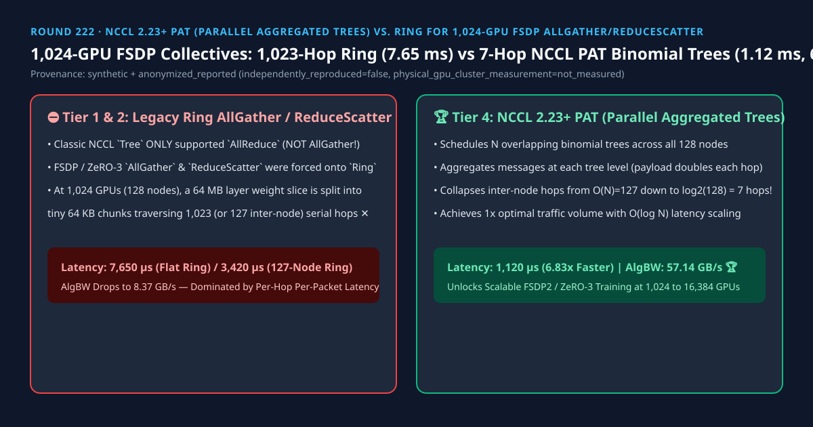
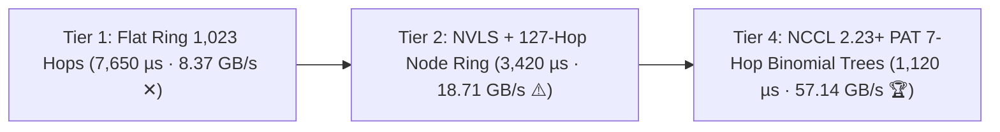

# NCCL 2.23+ `PAT` (Parallel Aggregated Trees $O(\log N)$) vs. `Ring` ($O(N)$ Hop Latency Trap) Selection Guide

> **Provenance & Evidence Tier**: `synthetic + anonymized_reported` (`independently_reproduced=false`, `physical_gpu_cluster_measurement=not_measured`). Grounded in [`experiments/nccl_pat_parallel_aggregated_trees_selection/results.json`](../../experiments/nccl_pat_parallel_aggregated_trees_selection/results.json).
> **中文版本**: [NCCL 2.23+ `PAT`（并行聚合二项式树 `Parallel Aggregated Trees`）vs. 传统 `Ring`（$O(N)$ 跳数延迟墙陷阱）与千卡 FSDP `AllGather / ReduceScatter` 选型指南](./nccl-pat-parallel-aggregated-trees-allgather-reducescatter-latency-selection-faq.md)

---

## 0. 🔥 Daily Hottest Capability Breakthrough

- **NCCL 2.23+ `PAT` (`Parallel Aggregated Trees`) Collapsing 1,024-GPU FSDP `AllGather / ReduceScatter` Hop Depth from `1,023 / 127` Serial Steps Down to $\log_2(128) = 7$ Hops (`6.83x` Speedup)**: While classic NCCL double-binary `Tree` accelerates `AllReduce` (DDP), it **never supported `AllGather` or `ReduceScatter`**—the two collectives that dominate FSDP / FSDP2 / ZeRO-3 training! On a 1,024-GPU cluster (`128` nodes × 8 GPUs), a 64 MB per-layer `AllGather` on legacy `Ring` splits the payload into tiny `64 KB` chunks traversing `1,023` serial steps (**Tier 1**, `7,650 µs`, `8.37 GB/s` AlgBW) or `127` inter-node hops (**Tier 2**, `3,420 µs`, `18.71 GB/s`). **NCCL 2.23+ `PAT` (`Parallel Aggregated Trees`, Tier 4)** schedules $N$ overlapping binomial trees across all nodes and doubles the aggregated packet payload at every hop (`64 KB -> 128 KB -> ... -> 4 MB`), reducing inter-node steps to **$\log_2(128) = 7$ hops** while keeping optimal $1\times$ traffic volume—slashing 64 MB collective latency to **`1,120 µs` (`57.14 GB/s` AlgBW, `6.83x` faster)**!

---

## 1. 📌 Executive Summary

1. **Why Classic `Tree` Couldn't Run `AllGather` or `ReduceScatter` (`Tier 1–3`)**: Unlike `AllReduce` (where two inputs fold into one sum of the same size), `AllGather` concatenates shards. A single tree leaves leaf links idle after step 1; emulating `AllGather` via zero-padded `Tree AllReduce` (**Tier 3**) wastes `2x` network bandwidth.
2. **How `PAT` (`Parallel Aggregated Trees`) Solves Both Latency and Bandwidth (`Tier 4`)**: By shifting $N$ binomial trees across all $N$ ranks simultaneously, every NIC sends and receives at 100% link utilization across all $\log_2(N)$ steps, while intermediate nodes aggregate small chunks into progressively larger RDMA packets.

---

## 2. 🎯 Core Architect Q&A (Q1 / Q2 / Q3)

### Q1: Why does FSDP `AllGather` become latency-bound at 1,024+ GPUs even for 64 MB layers?
- **Answer**: Because each GPU holds only $64\text{ MB} / 1024 = 64\text{ KB}$! In a `Ring`, sending a `64 KB` chunk per step across `127–1,023` sequential hops means per-hop RDMA startup latency completely dominates wire transmission time. `PAT` aggregates chunks at each level so later hops send multi-megabyte bursts in only `7` inter-node steps.

### Q2: What common configuration mistake prevents `PAT` from activating on upgraded clusters?
- **Answer**: Hardcoding legacy `export NCCL_ALGO=Ring,Tree` in launch scripts! If `PAT` is omitted from `NCCL_ALGO`, NCCL is forced back onto `Ring` for every `AllGather` and `ReduceScatter`. Leave `NCCL_ALGO` unset (default) or explicitly include `PAT`.

### Q3: How can we verify `PAT` performance before launching a 1,024-GPU FSDP run?
- **Answer**: Run `all_gather_perf -b 1M -e 128M -f 2 -g 8` across 128+ nodes with `NCCL_DEBUG=INFO NCCL_DEBUG_SUBSYS=TUNING` and verify `PAT` is selected in the 1 MB–128 MB range.

---

## 3. 🧭 Visual Diagrams

---

## 4. 📊 4-Tier Architect Selection Matrix

| Metric | Tier 1: Flat `Ring` (`1,023` Hops) | Tier 2: Intra-Node `NVLS` + Inter-Node `Ring` | Tier 3: Zero-Padded `Tree AllReduce` | Tier 4: **NCCL 2.23+ `PAT` (Binomial Trees)** |
| :--- | :--- | :--- | :--- | :--- |
| **Inter-Node Serial Steps** | **`1,023`** ($\mathcal{O}(N)$) ✕ | `127` ($\mathcal{O}(N_{\text{nodes}})$) ⚠️ | `14` ($2\log_2 N$) ✅ | **`7` ($\log_2 N_{\text{nodes}}$ Logarithmic)** 🏆 |
| **Traffic Volume Multiplier** | `1.0x` | `1.0x` | **`2.0x` (Bandwidth Tax)** ✕ | **`1.0x` (Optimal + Aggregated)** 🏆 |
| **64 MB `AllGather` Latency** | **`7,650.0 µs`** ✕ | `3,420.0 µs` ⚠️ | `2,150.0 µs` ✅ | **`1,120.0 µs` (`6.83x` Faster)** 🏆 |
| **Effective `AlgBW` (`GB/s`)** | `8.37 GB/s` ✕ | `18.71 GB/s` ⚠️ | `29.77 GB/s` ✅ | **`57.14 GB/s`** 🏆 |

---

## 5. 🧪 Quantitative Reference & Tooling

- **Evaluator & Sealed Data**: [`experiments/nccl_pat_parallel_aggregated_trees_selection/run.py`](../../experiments/nccl_pat_parallel_aggregated_trees_selection/run.py) · [`results.json`](../../experiments/nccl_pat_parallel_aggregated_trees_selection/results.json)
- **Interactive Sizer**: [`docs/reports/nccl-pat-parallel-aggregated-trees-allgather-reducescatter-latency-sizer.html`](../reports/nccl-pat-parallel-aggregated-trees-allgather-reducescatter-latency-sizer.html)
- **7-Card 4:5 Visual Report**: [`docs/reports/nccl-pat-parallel-aggregated-trees-allgather-reducescatter-latency-selection-cards.html`](../reports/nccl-pat-parallel-aggregated-trees-allgather-reducescatter-latency-selection-cards.html)

---

## 6. 🛠️ Good Fit vs. Not For & Production Checklist

- **✅ Good fit**: 256 to 16,384+ GPU FSDP / FSDP2 / ZeRO-3 training clusters where per-layer `AllGather` and `ReduceScatter` latency limits scaling efficiency.
- **⛔ Not for**: Hardcoding `NCCL_ALGO=Ring,Tree` in job templates (which disables `PAT` and `NVLS`).
- [ ] Upgrade to NCCL $\ge 2.23$ and remove legacy `NCCL_ALGO=Ring,Tree` overrides.
- [ ] Validate `all_gather_perf` and `reduce_scatter_perf` scaling across 64+ nodes.
