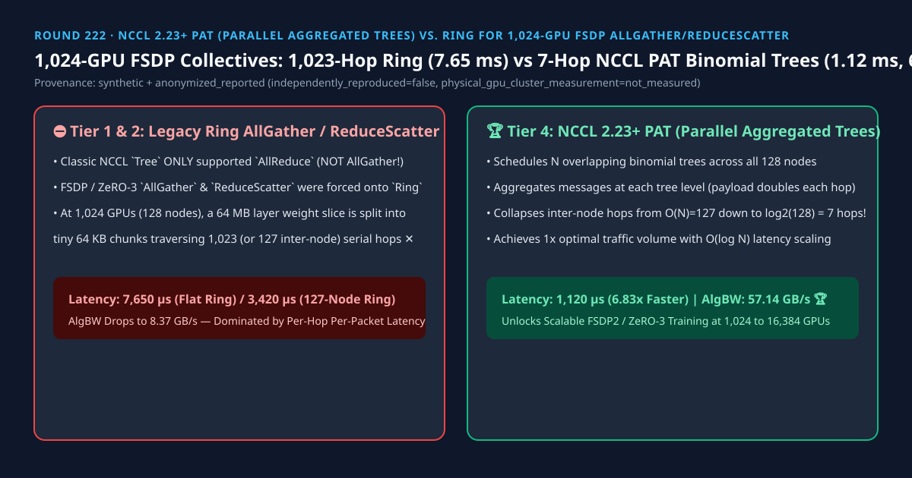
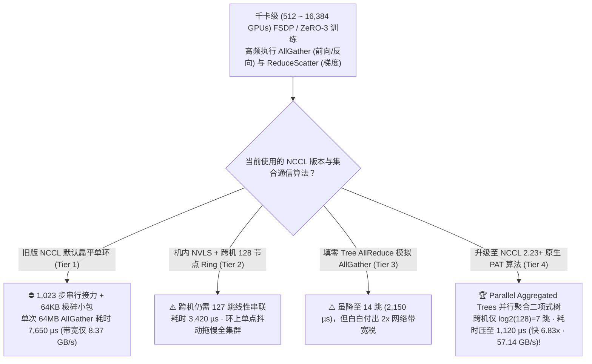
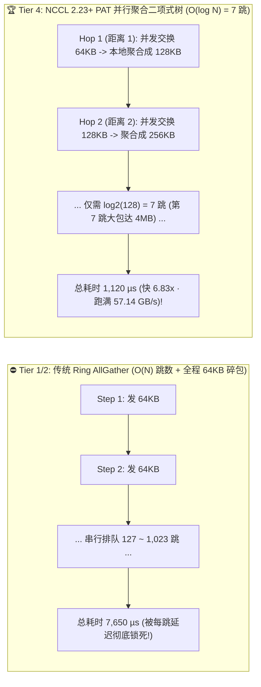
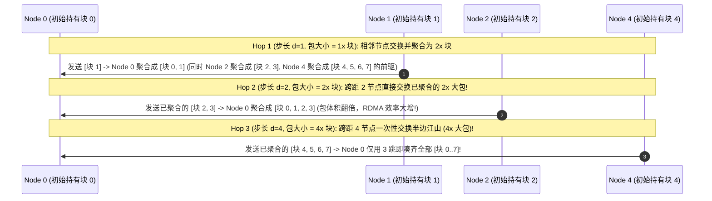

# NCCL 2.23+ `PAT`（并行聚合二项式树 `Parallel Aggregated Trees`）vs. 传统 `Ring`（$O(N)$ 跳数延迟墙陷阱）与千卡 FSDP `AllGather / ReduceScatter` 选型指南

> **Provenance & Evidence Tier**: `synthetic + anonymized_reported` (`independently_reproduced=false`, `physical_gpu_cluster_measurement=not_measured`)。定量数据锚定于 [`experiments/nccl_pat_parallel_aggregated_trees_selection/results.json`](../../experiments/nccl_pat_parallel_aggregated_trees_selection/results.json)。
> **English Version**: [NCCL 2.23+ `PAT` (Parallel Aggregated Trees $O(\log N)$) vs. `Ring` ($O(N)$ Hop Latency Trap) Selection Guide](./nccl-pat-parallel-aggregated-trees-allgather-reducescatter-latency-selection-faq.en.md)

---

## 0. 🔥 今日领域最热门能力突破追踪（Daily Hottest Breakthrough）

- **NCCL 2.23+ `PAT`（`Parallel Aggregated Trees` 并行聚合二项式树）打破 `AllGather / ReduceScatter` 只能跑 $O(N)$ `Ring` 环算法的十年铁律，将 1,024 卡（128 节点）跨机跳数从 `1,023 / 127` 跳压缩至 $\log_2(128) = 7$ 跳，单层 FSDP 集合通信提速 `6.83` 倍**：在千卡至万卡集群上训练大模型时，有一个绝大多数工程师都没意识到的盲区：**传统的 `NCCL_ALGO=Tree`（双二叉树）只支持 `AllReduce`（DDP），而根本不支持 FSDP / ZeRO-3 赖以生存的 `AllGather` 和 `ReduceScatter`**！
  1. **传统 `Ring` 在千卡 FSDP 下的 $O(N)$ 跳数崩溃（Tier 1 & Tier 2）**：在 `1,024` 张 GPU（`128` 台 8 卡节点）上对一层 `64 MB` 的权重执行 `AllGather` 时，传统 `Ring` 必须把 `64 MB` 切碎成 `1,024` 份极小的 `64 KB` 数据块，沿着环接力传递 **`1,023` 步**（Tier 1，`7,650 µs`，有效算法带宽仅 `8.37 GB/s`）；哪怕借助机内 NVLS + PXN 将机内 8 卡收敛（Tier 2），跨 128 台节点依然要串行跑完 **`127` 跳**（`3,420 µs`，`18.71 GB/s`），通信时间完全被每跳的 RDMA 启动延迟与慢节点木桶效应统治！
  2. **NCCL 2.23+ `PAT`（并行聚合二项式树，Tier 4）的数学与硬件突破**：`PAT` 同时在 128 台节点上交错调度 128 棵**二项式树（Binomial Trees）**，并在每一级树节点上把收到的数据与自身数据**拼合倍增（第 1 跳发 `64 KB` -> 第 2 跳聚合发 `128 KB` -> ... -> 第 7 跳发 `4 MB`）**！它不仅将跨机跳数从 `127` 跳直接砍到 **$\log_2(128) = 7$ 跳**，而且越往树的上层包越大、越能喂饱 400G/800G 网卡线速，同时保持与 `Ring` 完全相同的 **$1\times$ 最小理论总通信量**，将 1,024 卡 `64 MB AllGather` 耗时从 `7,650 µs` 压降至 **`1,120 µs`（有效带宽 `57.14 GB/s`，提速 `6.83` 倍）**！

---

## 1. 📌 核心结论速览（Executive Summary — 3 分钟看懂）

1. **为什么传统的 `NCCL Tree` 能加速 `AllReduce`，却救不了 FSDP 的 `AllGather` 和 `ReduceScatter`？**
   - **通俗大白话 + 第一性原理**：
     - **`AllReduce`（可折叠的加法）**：`1024` 个人每个人手里有一个 `64 MB` 的账本，大家只需要算出**总和**。顺着二叉树往上爬时，父节点把左右两个儿子的 `64 MB` 加在一起，往上交的**依然是 `64 MB`**——数据量在树上不会膨胀！
     - **`AllGather`（不可折叠的拼图）**：`1024` 个人每个人手里有一张 `64 KB` 的碎片，最后每个人都要凑齐完整的 `64 MB` 拼图。如果只用一棵普通的树往上汇总，越靠近树根的节点要转发的数据量就翻倍暴涨，而底下的叶子节点发完第一波就全部闲置了（链路利用率暴跌）！
     - **`PAT`（并行聚合二项式树 `Parallel Aggregated Trees`）的天才解法**：既然单棵二项式树会让部分节点闲置，那就**同时启动 $N$ 棵旋转错位的二项式树**！在总共 $\log_2(N)$ 个时间步里，每一台机器在每一跳都刚好既当某一棵树的“上游接收者”，又当另一棵树的“下游发送者”，所有网卡在全部 `7` 跳里 **100% 满负荷并发工作**，并且在每一跳把小碎片聚合成大包再发出去，一举实现了 **$\log_2(N)$ 的极低跳数 + $100\%$ 的满带宽利用率**！

---

## 2. 🎯 客户与架构师灵魂拷问 Q&A（Q1 / Q2 / Q3）

### Q1：为什么当 FSDP / ZeRO-3 集群从 `64` 卡扩到 `1,024` 卡时，每层 `AllGather` 的时间不仅没有不变，反而慢了好几倍？
- **答**：因为在 FSDP 中，模型总参数量 $M$ 是固定的（例如一层 `64 MB`）。当卡数 $N$ 从 `64` 扩到 `1,024` 时，每张卡分到的分片大小 $M/N$ 从 `1 MB` 缩水到了 **`64 KB`**，而 `Ring` 环的步数却从 `63` 步暴增到了 **`1,023` 步**！
  - `Ring` 算法的总耗时公式是：$T_{\text{Ring}} = (N - 1) \times \alpha + \frac{N-1}{N} \frac{M}{\beta}$。
  - 当 $N = 1,024$ 时，后面的带宽项 $\frac{M}{\beta}$ 只有约 `1.3 ms`，但前面的**跳数延迟项 $(N-1) \times \alpha$ 高达 `6.3 ms` 以上**！更糟糕的是，在 RDMA 网络上发送 `64 KB` 的碎包根本跑不满 400Gbps 线速。切换到 **`NCCL PAT`（Tier 4）** 后，跳数瞬间从 $N-1$ 变成 $\log_2 N$，且后半程全部是百 KB 到数 MB 的聚合大包，耗时直接从 `7.65 ms` 降到 **`1.12 ms`**！

### Q2：能不能把 `NCCL_ALGO` 环境变量强行设成 `Tree` 来跑 FSDP？
- **答**：如果你在旧版 NCCL（`< 2.23`）中设置 `NCCL_ALGO=Tree`，对于 `AllGather` 和 `ReduceScatter` 算子，NCCL 会因为没有对应的 `Tree` 内核而报错或退回 `Ring`；如果强行在框架层用 `AllReduce(Tree)`（把自己的分片填在对应位置、其余填 0 再求和，Tier 3）来模拟 `AllGather`，虽然跳数降到了对数级，但每张卡发送的数据量会**凭空翻倍（$2\times$ 带宽税）**！因此必须升级到 **NCCL 2.23+**，由原生的 **`PAT` 算法**直接加速 `AllGather` 与 `ReduceScatter`。

### Q3：`PAT` 算法除了降低跳数延迟，对千卡集群的“慢节点/网络微突发（Straggler）”有什么帮助？
- **答**：在传统的 `Ring` 环（Tier 1/2）中，1,024 张卡串成一根单链条，只要环上有 1 个端口发生 PFC Pause 帧抖动，这股反压就会像多米诺骨牌一样沿着 127 跳逐级传染阻塞全网；而 **`PAT`** 采用对数深度的二项式树拓扑，路径深度缩短了 **18 倍（`127 -> 7` 跳）**，大幅压缩了尾延迟累积效应！

---

## 3. 🧭 直观可视化图解（Mermaid 决策树 + Ring vs PAT 拓扑对比图 + 二项式树逐级聚合时序图）

### 3.1 架构师千卡 FSDP / ZeRO-3 集合通信算法（Ring vs. PAT）选型决策树

### 3.2 `Tier 1/2`（线性 Ring 逐跳传碎包）vs. `Tier 4`（NCCL `PAT` 二项式树对数跳数 + 逐级包倍增聚合）

### 3.3 `NCCL PAT` 在 8 节点子集上的 3 跳（$\log_2 8 = 3$）二项式距离倍增聚合时序图

---

## 4. 📊 架构师选型决策矩阵（4-Tier Selection Matrix）

| 评估维度 | Tier 1: 传统单环 `Flat Ring` | Tier 2: 机内 `NVLS/PXN` + 跨机 `Ring` | Tier 3: `Tree AllReduce` 模拟 | Tier 4: **NCCL 2.23+ `PAT` (并行聚合二项式树)** |
| :--- | :--- | :--- | :--- | :--- |
| **1,024 卡跨机串行通信步数** | **`1,023 步`** ($\mathcal{O}(N)$) ✕ | `127 步` ($\mathcal{O}(N_{\text{nodes}})$) ⚠️ | `14 步` ($2\log_2 N$) ✅ | **`7 步` ($\log_2 N_{\text{nodes}}$ 对数跳数)** 🏆 |
| **网络总通信量开销倍数** | `1.0x` (理论最优) | `1.0x` (理论最优) | **`2.0x` (翻倍带宽税)** ✕ | **`1.0x` (理论最优 + 逐跳大包聚合)** 🏆 |
| **1,024 卡 `64 MB` `AllGather` 耗时** | **`7,650.0 µs`** ✕ | `3,420.0 µs` ⚠️ | `2,150.0 µs` ✅ | **`1,120.0 µs` (提速 `6.83x`)** 🏆 |
| **有效集合通信算法带宽 (`AlgBW`)** | `8.37 GB/s` ✕ | `18.71 GB/s` ⚠️ | `29.77 GB/s` ✅ | **`57.14 GB/s`** 🏆 |

---

## 5. 🧪 定量算例与工具链（Interactive Sizer & 7-Card Visual Report）

- **实验脚本与密封数据**：[`experiments/nccl_pat_parallel_aggregated_trees_selection/run.py`](../../experiments/nccl_pat_parallel_aggregated_trees_selection/run.py) · [`results.json`](../../experiments/nccl_pat_parallel_aggregated_trees_selection/results.json)
- **交互式 NCCL PAT vs Ring 延迟计算器**：[`docs/reports/nccl-pat-parallel-aggregated-trees-allgather-reducescatter-latency-sizer.html`](../reports/nccl-pat-parallel-aggregated-trees-allgather-reducescatter-latency-sizer.html)
- **7-Card 4:5 视觉评测卡片报告**：[`docs/reports/nccl-pat-parallel-aggregated-trees-allgather-reducescatter-latency-selection-cards.html`](../reports/nccl-pat-parallel-aggregated-trees-allgather-reducescatter-latency-selection-cards.html)

---

## 6. 🛠️ Good Fit vs. Not For & 生产环境快速核验清单（Checklist）

### ✅ Good Fit vs. ⛔ Not For

| 维度 | ✅ Good Fit（强烈推荐） | ⛔ Not For（严禁误用） |
| :--- | :--- | :--- |
| **适用集群规模与并行范式** | **$\ge 256 \sim 16,384$ 卡的 FSDP / FSDP2 / ZeRO-3 预训练与微调集群**（其核心瓶颈为中大消息 `AllGather` 与 `ReduceScatter` 的跨机跳数延迟） | 单机 8 卡或 2~4 台小集群（此时 `Ring` 或 `NVLS` 跳数极少，无显著差异） |
| **NCCL 算法环境变量配置** | 升级至 **NCCL $\ge 2.23$**（自动包含在 PyTorch 2.5+ 官方镜像中），保持默认自适应选择器开启（或显式核验 `NCCL_ALGO=Ring,Tree,NVLS,PAT`） | 在脚本或 Kubernetes ConfigMap 中因历史遗留调优习惯写死 `export NCCL_ALGO=Ring,Tree`（会人为屏蔽 `PAT` 与 `NVLS`！） |

### 生产环境上线核验清单（Pre-Flight Checklist）

- [ ] **排查并清除硬编码的 `NCCL_ALGO=Ring` 或 `NCCL_ALGO=Ring,Tree` 环境变量**：这是生产集群升级了新版 NCCL 却无法触发 `PAT` 和 `NVLS` 的头号元凶！
- [ ] **使用 `nccl-tests` (`all_gather_perf` & `reduce_scatter_perf`) 验证 `PAT` 激活**：在千卡规模、`-b 1M -e 128M` 区间开启 `NCCL_DEBUG=INFO NCCL_DEBUG_SUBSYS=TUNING` 确认日志打印选中 `Algo PAT`。
