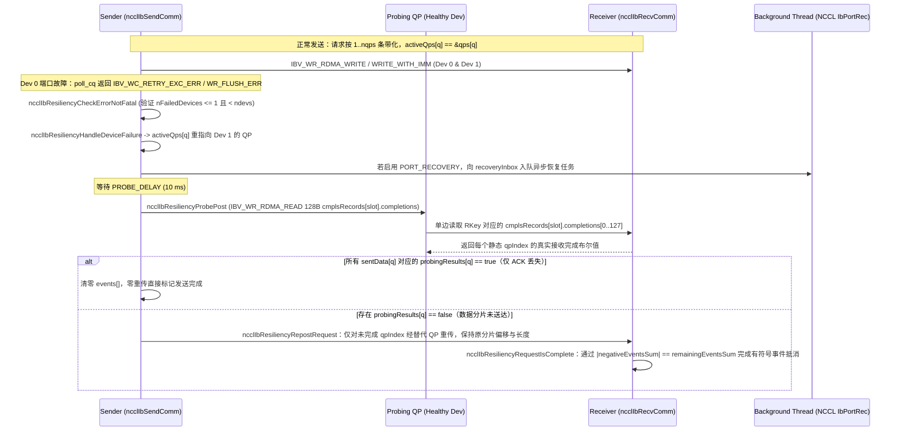

# NCCL IB Port-Failover 与异步端口恢复（Port Recovery）正确性不变量

本文基于固定 commit `NVIDIA/nccl@3e46c089f4ae4732722a419eb6096aead7e47a30`（`v2.29.7-1`）中的
`src/transport/net_ib/p2p_resiliency.h`、`src/transport/net_ib/p2p_resiliency.cc`、`src/transport/net_ib/p2p_resiliency_recovery.h`、`src/transport/net_ib/p2p_resiliency_recovery.cc`、`src/transport/net_ib/common.h` 与 `src/transport/net_ib/p2p.cc`，
回答研究队列中的 `nccl-port-recovery-invariants` 问题：

> 在 `NCCL_IB_RESILIENCY_PORT_FAILOVER` 与 `NCCL_IB_RESILIENCY_PORT_RECOVERY` 下，错误完成（Error WC）、`IBV_WR_RDMA_READ` 完成记录探测、基于 `activeQps[]` 间接表的选择性重传、跨设备有符号完成计数以及异步 `IBV_QPT_UC` 端口恢复线程，如何保证单端口故障时不丢包、不重复覆盖也不死锁？其不可恢复硬边界（如双设备同时故障与重传期间二次故障）在哪里？

## 1. 证据状态与边界声明

| 证据项 | 来源 / 路径 | 证据等级 | 最新源码/发布日期 | 边界说明 |
|---|---|---|---|---|
| IB Port-Failover 探测、QP 替换、选择性重传与有符号完成判据 | `NVIDIA/nccl@3e46c089f4ae4732722a419eb6096aead7e47a30` `src/transport/net_ib/p2p_resiliency.h`、`p2p_resiliency.cc`、`common.h`、`p2p.cc` | `implementation` | `2026-03-07`（`v2.29.7-1` tag） | 仅代表静态源码实现，不声称在真实 IB HCA/交换机上做过拔线或端口闪断注入测试 |
| 异步端口恢复（`IBV_QPT_UC` Keep-Alive 状态机、QP 重置与线程安全回收） | `NVIDIA/nccl@3e46c089f4ae4732722a419eb6096aead7e47a30` `src/transport/net_ib/p2p_resiliency_recovery.h`、`p2p_resiliency_recovery.cc` | `implementation` | `2026-03-07`（`v2.29.7-1` tag） | 仅代表静态源码状态机与并发原语分析 |
| 合成故障转移、CQ/RQ 容量放大与有符号完成计数算例 | [`experiments/ib_failover_invariants/`](../../experiments/ib_failover_invariants/README.md) | `own-offline` | `N/A`（本项目合成模型） | Python 标准库 CPU/offline 确定性算例；不包含真实 Verbs 驱动、PFC 暂停帧或线程调度抖动 |

## 2. 两级韧性架构与控制参数

NCCL `net_ib` 插件将多 NIC 端口韧性拆分为两层独立但递进的机制（默认均关闭，需显式开启）：

| 机制层级 | 控制参数（`p2p_resiliency.cc:9-14` / `p2p_resiliency_recovery.cc:13-22`） | 默认值 | 职责与触发路径 |
|---|---|---|---|
| **Tier 1: Port Failover（同步内联故障转移）** | `NCCL_IB_RESILIENCY_PORT_FAILOVER` | `0` | 捕获单端口 WC 错误 $\to$ 将 `activeQps[]` 迁移至存活 NIC $\to$ 通过 `probingQp` 发起 `IBV_WR_RDMA_READ` 读取对端完成位图 $\to$ 选择性重传未送达分片 |
| 探测重试与延迟 | `NCCL_IB_RESILIENCY_PORT_FAILOVER_MAX_ATTEMPTS` / `PROBE_DELAY` | `1` 次 / `10 ms` | 给对端 NIC 留出将飞行中 DMA 写入落盘并更新 `cmplsRecords` 的时间窗口 |
| **Tier 2: Port Recovery（后台线程异步恢复）** | `NCCL_IB_RESILIENCY_PORT_RECOVERY` | `0`（依赖 `PORT_FAILOVER=1`） | 后台线程 `NCCL IbPortRec` 在 `200 ms` 延迟后通过专用 `IBV_QPT_UC` QP 周期性发送 `IBV_WR_SEND_WITH_IMM` Keep-Alive 帧，连续收到 `> 5` 个保序帧后重建 Data/Flush QP 并切回 `activeQps[]` |
| 恢复窗口参数 | `START_DELAY` / `ALIVE_BATCH_INTERVAL` / `ALIVE_BATCH_SIZE` / `ALIVE_TIMEOUT` / `ACK_TIMEOUT` / `MAX_ATTEMPTS` | `200 ms` / `500 ms` / `5`（上限 `10`）/ `4000 ms` / `5000 ms` / `20` 次 | 控制链路闪断恢复探测频率与超时上限 |



## 3. 五条核心正确性不变量与源码路径

### 3.1 不变量 I：单设备故障硬门槛（`ncclIbResiliencyCheckErrorNotFatal`）

在 `p2p.cc:827-848` 的 CQ 轮询循环中，一旦遇到 `wc->status != IBV_WC_SUCCESS`，首先调用 `ncclIbResiliencyCheckErrorNotFatal`（`p2p_resiliency.cc:21-60`）：

1. **可恢复状态白名单**：仅当 `wc->status == IBV_WC_WR_FLUSH_ERR` 或 `wc->status == IBV_WC_RETRY_EXC_ERR` 时才可能进入恢复分支；任何诸如 `IBV_WC_REM_ACCESS_ERR`、`IBV_WC_LOC_PROT_ERR` 的内存保护/RKey 错误直接触发 `ncclRemoteError`。
2. **单故障设备硬约束**：遍历 `resCtx->devs[0..ndevs-1]`，统计处于 `ncclIbResiliencyDevStateError`（或正在恢复）的设备数 `nFailedDevices`：
   $$\text{FailoverPermitted} \iff \bigl(\text{status} \in \{\texttt{WR\_FLUSH\_ERR}, \texttt{RETRY\_EXC\_ERR}\}\bigr) \land (N_{\text{failed}} \le 1) \land (N_{\text{failed}} < N_{\text{devs}})$$
   若 `nFailedDevices > 1`（源码注释明确写道：`"No support for more than a single failed device"`，`p2p_resiliency.cc:46`）或 `nFailedDevices == resCtx->ndevs`（例如单 NIC `ndevs = 1` 通信域），函数立即返回 `ncclRemoteError` 中止训练。

### 3.2 不变量 II：CQ/RQ 预分配容量放大与全信号化 CTS（`DataCqSizeGet` / `ncclIbPostFifo`）

当故障设备 Dev 0 的全部流量切换到存活设备 Dev 1 时，如果 Dev 1 的 CQ 与 RQ 仍按正常双设备均摊大小分配，就会在重传叠加正常流量时发生 **CQ Overrun（完成队列溢出）** 或 **RNR（Receiver Not Ready，接收队列耗尽）**。`p2p_resiliency.cc:439-493` 与 `p2p.cc:402-405` 通过两项静态预留解决该问题：

1. **CQ 与 RQ 容量放大公式**：
   - 发送端每个设备的 CQ 深度（`p2p_resiliency.cc:446`）：
     $$\text{CQ}_{\text{send, resiliency}} = \texttt{NET\_IB\_MAX\_REQUESTS} \times N_{\text{qps}} \times N_{\text{devs}}$$
     相比无韧性基线（$\texttt{NET\_IB\_MAX\_REQUESTS} \times N_{\text{qps}}$）放大了 **$N_{\text{devs}}$ 倍**。
   - 接收端每个设备的 CQ 深度（`p2p_resiliency.cc:444`）：
     $$\text{CQ}_{\text{recv, resiliency}} = \texttt{NET\_IB\_MAX\_REQUESTS} \times 2 \times N_{\text{qps}} \times N_{\text{devs}}$$
   - 接收端每个データ QP 的 RQ 深度（`p2p_resiliency.cc:479`）：
     $$\text{RQ}_{\text{recv, resiliency}} = \texttt{NET\_IB\_MAX\_REQUESTS} \times N_{\text{qps}}$$
     保证即便所有请求全部挤压到单条存活 QP，接收端 posted recv WR 也不会耗尽。
2. **CTS（Clear-To-Send）FIFO 强制全信号化（`p2p.cc:402-405`）**：
   正常路径下，接收端通过 `ncclIbPostFifo` 发送 CTS `IBV_WR_RDMA_WRITE` 时，仅当 `slot == ctsQp->devIndex` 才挂 `IBV_SEND_SIGNALED`（摊销 CQE 开销）。但在启用 Resiliency 时：
   ```c
   if (slot == ctsQp->devIndex || comm->base.resiliency) wr.send_flags |= IBV_SEND_SIGNALED;
   wr.wr_id = slot;
   ```
   **架构原因**：如果某次未挂 `IBV_SEND_SIGNALED` 的 CTS 写入落在故障端口上，硬件仅产生一条不带有效 `slot` 语义的 Flush 错误或静默丢失，发送端将永远等不到该 `slot` 的 CTS；强制每次 CTS 均携带 `IBV_SEND_SIGNALED` 与 `wr_id = slot` 后，`ncclIbResiliencyHandleCompletionError`（`p2p_resiliency.cc:983-989`）可直接从错误 CQE 提取 `slot = wc->wr_id`，立即经迁移后的 `activeQps[]` 重新调用 `ncclIbPostFifo(recvComm, slot)`。

### 3.3 不变量 III：`qps[]` 与 `activeQps[]` 物理/逻辑解耦及固定分块偏移

`ncclIbNetCommBase`（`common.h:357-360`）维护两套长度均为 `NCCL_IB_MAX_QPS`（`128`）的数组：
- `ncclIbQp qps[NCCL_IB_MAX_QPS]`：静态物理 QP 表，索引 `qpIndex` 永久固定；
- `ncclIbQp* activeQps[NCCL_IB_MAX_QPS]`：动态路由指针表，正常时 `activeQps[q] == &qps[q]`。

当设备 `failedDevIndex` 故障时，`ncclIbResiliencyReplaceQps`（`p2p_resiliency.cc:74-103`）执行环形查找：对每个归属故障设备的 `failedQpIndex`，按 `offset = 1 .. nqps-1` 扫描 `candidateIdx = (failedQpIndex + offset) % nqps`，一旦找到所属设备状态为 `ncclIbResiliencyDevStateOk` 的 `qps[candidateIdx]`，即将 `activeQps[failedQpIndex]` 指向该存活 QP。

最精妙的不变量位于 `ncclIbMultiSend`（`p2p.cc:154-200`）：
- **路由与密钥使用存活设备**：通过 `ncclIbCommBaseGetQpForRequest` 取出替代后的 `qp = activeQps[qpIndex]`，并使用 `devIndex = qp->devIndex` 选择本地 `lkeys[devIndex]` 与远端 `rkeys[qp->remDevIdx]`；
- **分块长度严格锚定原设备 `origDevIndex`**：
  ```c
  int origDevIndex = comm->base.qps[qpIndex].devIndex;
  chunkSize = DIVUP(DIVUP(reqs[r]->send.size * weights[origDevIndex], 100) / qpsPerDev[origDevIndex], IB_WRITE_CHUNK_ALIGNMENT) * IB_WRITE_CHUNK_ALIGNMENT;
  ```
  **为什么不能用新设备的 `devIndex` 计算 `chunkSize`？** 因为在非对称链路权重（`weights[origDevIndex]`）或不同设备 QP 数不同的场景下，第 `qpIndex` 个逻辑分片在接收端缓冲区中的起始偏移 `offset` 和字节长度是由初始分片计划唯一决定的。锚定 `origDevIndex` 保证了重传分片与初次发送分片的 `[offset, offset + length)` 字节区间 **100% 重合**。

### 3.4 不变量 IV：`IBV_WR_RDMA_READ` 完成位图探测与选择性重传

当发送端在某个 `qpIndex` 上收到 `IBV_WC_RETRY_EXC_ERR` 时，发送端并不能凭本地状态判断：究竟是数据分片在网络中丢失，还是数据早已通过远端 PCIe 写入接收端 GPU HBM、仅仅是返回方向的 RC ACK 报文丢失？

NCCL 通过 `cmplsRecords` + `probingQp` 消除这一二义性：
1. **接收端按物理 `qp_num` 记录完成位图**：
   接收端维护注册内存 `struct ncclIbRequestCompletionRecord cmplsRecords[NET_IB_MAX_REQUESTS]`（`p2p_resiliency.h:42-45`），每槽包含 `int sizes[NCCL_NET_IB_MAX_RECVS]` 和 `bool completions[NCCL_IB_MAX_QPS]`（`128 B`）。当接收端收到 `IBV_WC_RECV_RDMA_WITH_IMM` 时（`p2p_resiliency.cc:926-966`），通过 `ncclIbCommBaseGetQpByQpNum(baseComm, wc->qp_num, &qpIndex)` 在静态 `qps[]` 中反查出物理 `qpIndex`，置 `cmplsRecords[slot].completions[qpIndex] = true`。
2. **发送端单边 `RDMA_READ` 探测（`ncclIbResiliencyProbePost`，`p2p_resiliency.cc:131-189`）**：
   发送端在故障发生并等待 `10 ms`（`PROBE_DELAY`）后，选用存活设备上的专用 RC QP `probingQp[devIndex]`，向接收端发起一条 `128 B` 的 `IBV_WR_RDMA_READ`，将远端 `cmplsRecords[slot].completions` 读入本地 `sendResCtx->probingResults[slot]`。
3. **重传决策分叉（`ncclIbResiliencyHandleProbeCompleted` & `ncclIbResiliencyRepostRequest`，`p2p_resiliency.cc:250-356`）**：
   - **分支 A（全送达 / 仅 ACK 丢失）**：若对所有 `sentData[qpIndex] == true` 的分片，探测结果 `probingResults[slot][qpIndex] == true`，说明接收端已完整收齐该请求！发送端直接将 `sendReqs[r]->events[]` 全部清零，**重传 0 字节**即宣告请求完成；
   - **分支 B（部分或全部未送达）**：调用 `ncclIbResiliencyRepostRequest`：先将 `request->events[]` 清零，仅对 `probingResults[slot][qpIndex] == false` 的分片重置 `sentData[qpIndex] = false` 并在替代后的 `qp->devIndex` 上调用 `ncclIbAddEvent`；随后再次进入 `ncclIbMultiSend` 时（`p2p.cc:190`），对于 `sentData[qpIndex] == true` 的已完成分片，代码**只递增 `sendOffsets[r] += length` 与 `sge.addr += length`，但跳过 `wrap_ibv_post_send`**，从而只重传真正缺失的分片。
4. **防陈旧 CQE 二次触发（Slot Generation ID）**：
   `failedRequests[slot].id` 在登记时被赋值为 `request->id + 1`（`p2p_resiliency.cc:1032`），且在 `ncclIbResiliencySendRequestFree`（`p2p_resiliency.cc:616-621`）释放请求槽时**故意不清零 `failedRequests[slot].id`**。这样当同一请求第二个 QP 的晚到 Flush CQE 稍后被轮询出来时，`request->id < failedRequests[slot].id` 成立，直接忽略该陈旧错误而不重复发起探测。

### 3.5 不变量 V：接收端跨设备有符号事件守恒律（`ncclIbResiliencyRequestIsComplete`）

这是阅读源码才能发现的最关键同步机制（`p2p_resiliency.cc:626-667` 与 `p2p.cc:799-825`）：

- 在 `ncclIbIrecv` 投递接收请求时，NCCL 尚不知道发送端会在途中发生故障转移，因此按正常静态路由在每个设备上登记期望事件数（例如双设备、`nqps=4` 时，`req->events[0] = +2, req->events[1] = +2`）。
- 当发送端 Dev 0 故障并将剩余 1 个分片通过 Dev 1 的替代 QP 重传过来时，该重传分片的 CQE 会出现在接收端 **Dev 1 的 CQ** 上！接收端每在 Dev $d$ 收到一个 CQE，就执行 `req->events[d]--`。
- 结果是：接收端 Dev 0 少收 1 个 CQE（`events[0] = +1`），而 Dev 1 多收 1 个 CQE（`events[1] = 2 - 3 = -1`）。
- 如果使用无韧性路径的完成判据 `(events[0] == 0 && events[1] == 0)`，或者在 `ncclIbTest` 中像常规路径一样跳过 `events[d] <= 0` 的 CQ（`p2p.cc:800`：`if (!resiliency && r->events[i] <= 0) continue;`），接收端将**永远死锁**！
- 因此，NCCL 启用 Resiliency 时强制轮询所有非故障设备 CQ，并在 `ncclIbResiliencyRequestIsComplete` 中采用**有符号事件守恒判据**：
  $$\Sigma_{+} = \sum_{d:\,\text{events}[d] \ge 0} \text{events}[d], \qquad \Sigma_{-} = \sum_{d:\,\text{events}[d] < 0} \text{events}[d]$$
  $$\text{RequestComplete} \iff (\Sigma_{+} == 0) \lor \bigl(|\Sigma_{-}| == \Sigma_{+}\bigr)$$
  当 `events = [+1, -1]` 时，$\Sigma_{+} = 1, |\Sigma_{-}| = 1$，守恒式成立，接收请求安全完成。

## 4. 异步端口恢复状态机（`p2p_resiliency_recovery.cc`）与并发清理不变量

当 `NCCL_IB_RESILIENCY_PORT_RECOVERY=1` 时，`ncclIbPortRecoveryThreadMain` 驱动故障端口经历 6 个状态（`p2p_resiliency_recovery.h:59-67`）：

| 状态 | 源码核心动作（`p2p_resiliency_recovery.cc`） | 关键恢复门槛 / 超时保护 |
|---|---|---|
| `Init` | 将故障设备上的所有 Data QPs 显式 `ibv_modify_qp` 至 `IBV_QPS_ERROR`（排空残留硬件状态）；等待 `START_DELAY = 200 ms`；将 `probingQp` 与专用 `IBV_QPT_UC` `portRecoveryQp` 依次执行 `RESET -> INIT -> ECE -> RTR -> RTS` | 若本地端口仍非 `IBV_PORT_ACTIVE`，按 `500 ms` 间隔最多重试 `20` 次 |
| `AliveMessages` | 发送端每隔 `500 ms` 经 `IBV_QPT_UC` QP 连续发送 `5` 条零字节 `IBV_WR_SEND_WITH_IMM`（`imm_data = nextSeqNum++`）；接收端检查收到的 `wc.imm_data == aliveMsgNextId` | 接收端必须收到 **严格连续保序的 `> 5` 条**（即至少 6 条）UC 立即数消息；若失序则 `aliveMsgCounter` 归零重计；总超时 `4000 ms` |
| `Ack` | 接收端验证连续帧达标后，排空 Data CQ，调用 `ncclIbPortRecoveryQpsRestore` 将 Data QPs 及本地回环 `flushQp` 重置回 `RTS` 并重新补齐 Recv WRs，随后经 UC QP 发送 `imm_data = 0x1234` ACK | 发送端等待 `0x1234` ACK，超时 `5000 ms` |
| `PostAck` | 发送端收到 `0x1234` 后，排空发送端 Data CQ，将发送端 Data QPs 重置回 `RTS`，再向接收端回发一条 `0x1234` Final ACK | 确保收发双端 Data QPs 均已就绪后才重新开放数据面 |
| `Success` | 原子置位 `dev.state = ncclIbResiliencyDevStateRecovered`；主数据线程在下次进入 `ncclIbResiliencyProgress` 时调用 `ncclIbResiliencyActiveQpsRestore` 恢复 `activeQps[q] = &qps[q]` | 读写指针切回在主线程内执行，避免后台线程与 `ncclIbMultiSend` 竞争 `activeQps[]` |

**跨线程清理不变量（`ncclIbPortRecoveryClose`，`p2p_resiliency_recovery.cc:976-1027`）**：
主线程通过 `recoveryInbox.splice` 在持锁状态下以 $O(1)$ 将任务移交后台线程私有队列 `recoveryQueue`。当通信域销毁调用 `ncclIbPortRecoveryClose` 时，主线程投递 `CloseComm` 请求并在条件变量 `ncclIbPortRecoveryCloseCond` 上等待；后台线程清理完该 `baseComm` 的所有挂起条目后，**必须在持有 `ncclIbPortRecoveryMutex` 锁的临界区内设置 `closeReq->completed = true` 再调用 `notify_all()`**，防止条件变量虚假唤醒或丢失唤醒导致的 Use-After-Free。

## 5. 合成 CPU/offline 实验验证与反例分析

通过本仓库原创算例 [`experiments/ib_failover_invariants/`](../../experiments/ib_failover_invariants/README.md)（`S = 1 MiB, nqps = 4, max_requests = 64`），我们定量验证了上述五条不变量与两条明确反例：

| 算例场景 (`case_id`) | 故障配置 | Send/Recv CQ 深度 | 盲目全量重传 vs 选择性重传 | 接收端 `events[]` 终态 | 结论与架构解释 |
|---|---|---:|---:|---|---|
| `lost_ack_all_delivered_zero_retransmit` | `ndevs=2`, Dev 0 报 `RETRY_EXC_ERR`，但远端 4 个 QP 均已收齐 | `512` / `1024` | `1,048,576 B` vs **`0 B`** | `[0, 0]` | `128 B` `RDMA_READ` 探测识别出仅 ACK 丢失，节省 `100%` 冗余带宽并避免覆盖接收端已完成缓冲区 |
| `partial_loss_selective_retransmit_and_signed_events` | `ndevs=2`, Dev 0 的 `qpIndex=2` 未送达，其余 3 个 QP 已送达 | `512` / `1024` | `1,048,576 B` vs **`262,144 B`** | `[1, -1]` | 仅重传缺失的 `256 KiB`（省 `75%`）；接收端靠 `|-1| == 1` 完成有符号抵消，朴素无符号计数会永久死锁 |
| `full_dev0_loss_redirected_to_dev1` | `ndevs=2`, Dev 0 上 2 个 QP 均报 `WR_FLUSH_ERR` 未送达 | `512` / `1024` | `1,048,576 B` vs **`524,288 B`** | `[2, -2]` | Dev 0 的两个分片经 Dev 1 替代 QP 重传，接收端 `events=[2, -2]` 满足 `|-2| == 2` |
| `dual_device_failure_fatal_ceiling` | `ndevs=2`, Dev 0 与 Dev 1 同时故障 | `512` / `1024` | 拒绝恢复（`failover_permitted=False`） | `[2, 2]` | 触发 `nFailedDevices > 1` 硬边界，必须上抛给训练框架执行 Communicator 重建或 Checkpoint 恢复 |
| `single_nic_comm_cannot_failover` | `ndevs=1`, 单 NIC 故障 | `128` / `256` | 拒绝恢复（`failover_permitted=False`） | `[2]` | 单 NIC 通信域无存活替代设备，若未启用 `NCCL_IB_MERGE_NICS` 将多物理端口合并进同一 `net_ib` 设备上下文，Port Failover 无法生效 |

### 源码显式标注的二次故障反例（`p2p_resiliency.cc:219-225`）

在 `ncclIbResiliencyHandleProbeCompleted` 中，NCCL 源码留有一段极其坦诚的 `TODO` 警告：
> `"TODO: Notice that using ncclIbCommBaseGetQpForRequest() is problematic in case a request had to be retransmitted more than once. Currently only a single failure is supported, so a request will never be retransmitted more than once. When adding support for multiple failures, this function should be updated to return the correct QP index and not the replacement QP."`

**根因剖析**：在第一次重传时，`ncclIbMultiSend` 通过 `activeQps[qpIndex]` 把原本属于 `qpIndex=0`（Dev 0）的请求投递到了 `qps[1]`（Dev 1）。如果此时 Dev 1 也发生错误（或端口恢复后切换瞬间发生第二次错误），完成队列里的错误 CQE 携带的是替代 QP `qps[1].qp_num`。此时反查静态表会把错误归因到 `qpIndex=1` 而不是它正在代传的 `qpIndex=0`，正如 `p2p_resiliency.cc:213` 注释所言，这会导致 **"data corruption or a hang"**。这就是为什么 `ncclIbResiliencyCheckErrorNotFatal` 必须严格把并发故障设备数锁死在 `nFailedDevices <= 1`。

## 6. 解决方案架构师（SA）设计、拓扑与运维决策指南

1. **多 NIC 合并是 Port Failover 的前置拓扑条件**：
   Port Failover 工作在单个 `ncclIbSendComm` / `ncclIbRecvComm` 内部的 `ndevs` 个子设备之间。如果集群每 GPU 配有 1 张单端口 CX-7（`ndevs = 1`），即使整机有 8 张 CX-7，单个 P2P/Ring 通道默认只绑定 1 张 NIC，此时 `NCCL_IB_RESILIENCY_PORT_FAILOVER=1` **完全无法容忍单网卡断链**（对应算例 `single_nic_comm_cannot_failover`）。只有在双端口 HCA（如 ConnectX-7 双 200G 口合并为 `ndevs=2`）或显式通过 `NCCL_IB_MERGE_NICS=1` 将相邻物理 NIC 合并为多设备虚拟 NIC 时，单通道才具备 `ndevs >= 2` 的切换目标。
2. **HCA 内存占用与 CQ/RQ 深度权衡**：
   开启 Resiliency 后，数据 CQ 深度乘以 $N_{\text{devs}}$，且所有 CTS 均开启 `IBV_SEND_SIGNALED`。在大规模 AlltoAll（每个 Rank 与数百个对端建立 P2P 连接）场景下，应在容量规划中核算 HCA Doorbell / CQE 内存增长。
3. **故障降级期间的 Rail 木桶效应**：
   Port Failover 将故障端口上的 QP 流量折叠到同通信域的存活端口，存活端口负载瞬间翻倍（2 设备时吞吐减半）。因此 `PORT_FAILOVER` 解决的是**训练作业不崩溃（Job Survival）**，而若物理链路只是光模块闪断（Flap），应配合 `NCCL_IB_RESILIENCY_PORT_RECOVERY=1` 让后台 UC 探测在秒级内将 `activeQps[]` 切回原端口，恢复满带宽。

## 7. 架构师练习与后续可证伪问题

- **计算练习**：见 [docs/learning/exercises.md](../learning/exercises.md) 练习 12（计算 `ndevs=2, nqps=4` 下 CQ/RQ 放大倍数、选择性重传字节数与接收端有符号事件数组终态）。
- **后续可证伪问题**：
  - 当 `NCCL_IB_SPLIT_DATA_ON_QPS=0`（按请求轮转 QP 而非按消息分片）时，`ncclIbResiliencyRepostRequest` 的偏移推进逻辑与 `SPLIT_DATA_ON_QPS=1` 有何差异？
  - 在 RoCEv2 无损网络下，PFC 死锁超时触发的 `IBV_WC_RETRY_EXC_ERR` 是否会同时波及同一交换机下联的多张 NIC，从而直接击穿 `nFailedDevices <= 1` 假设？
