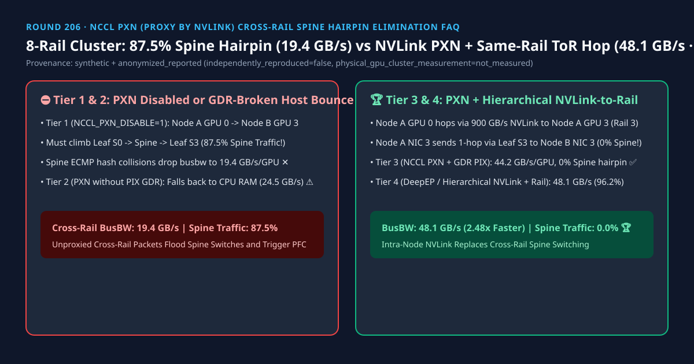
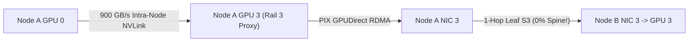

# NCCL `PXN` (Proxy by NVLink) Cross-Rail Spine Hairpin Elimination & Hierarchical Routing Selection Guide

> **Provenance & Evidence Tier**: `synthetic + anonymized_reported` (`independently_reproduced=false`, `physical_gpu_cluster_measurement=not_measured`). Grounded in [`experiments/nccl_pxn_nvlink_proxy_cross_rail_spine_selection/results.json`](../../experiments/nccl_pxn_nvlink_proxy_cross_rail_spine_selection/results.json).
> **中文版本**: [NCCL `PXN`（Proxy by NVLink）跨轨机内代理、Spine 交换机绕行消除与分层同轨路由选型指南](./nccl-pxn-proxy-by-nvlink-cross-rail-spine-hairpin-elimination-selection-faq.md)

---

## 0. 🔥 Daily Hottest Capability Breakthrough

- **`NCCL PXN` (Proxy by NVLink) + Hierarchical Intra-Node NVLink Gather (`DeepEP / Hybrid-PXN`) Eliminating `87.5%` Spine Hairpin Traffic**: In a standard 8-Rail Leaf-Spine AI cluster, `GPU i` on every node connects to `Leaf Switch Si` (`Rail i`). When `Node A · GPU 0` sends traffic to `Node B · GPU 3` with `PXN` disabled (**Tier 1**, `NCCL_PXN_DISABLE=1`), the packet must climb from `Leaf S0` up to the **Spine layer** and back down to `Leaf S3` (`87.5%` of all cross-node GPU pairs cross rails!), triggering Spine ECMP hash collisions and dropping per-GPU bus bandwidth to **`19.4 GB/s`**. With hardware-accelerated **`NCCL PXN` (Tier 3)** and **hierarchical intra-node NVLink pre-aggregation (`DeepEP`, Tier 4)**, `Node A · GPU 0` first hops over intra-node **`900 GB/s` NVLink** to `Node A · GPU 3`, which then transmits a **1-hop same-rail RDMA packet via `Leaf S3` directly to `Node B · GPU 3`**—reducing intra-SU Spine traffic to **`0.0%`** and boosting per-GPU bus bandwidth to **`48.1 GB/s` (`96.2%` line rate, `2.48x` speedup)**!

---

## 1. 📌 Executive Summary

1. **How `PXN` Works**: Instead of sending cross-rail packets (`Rail 0 -> Spine -> Rail 3`) over the network Spine, the sender GPU uses intra-node **NVSwitch (`900 GB/s`)** to hand the payload to the local proxy GPU sitting on `Rail 3`, which sends it in a single ToR hop through `Leaf Switch S3`.
2. **Two Mandatory Prerequisites for `PXN`**:
   - **Verified `PIX` GPUDirect RDMA** between the proxy GPU (`GPU 3`) and proxy NIC (`NIC 3`) so the proxy doesn't bounce through Host CPU RAM (`Tier 2`: `24.5 GB/s`).
   - **Kernel-Level Hierarchical NVLink Gather + IBGDA (`Tier 4`: `48.1 GB/s`)** for high-frequency MoE `AlltoAll` to avoid CPU Proxy thread saturation.

---

## 2. 🎯 Core Architect Q&A (Q1 / Q2 / Q3)

### Q1: How can we verify that `NCCL PXN` is active in production?
- **Answer**: Run with `NCCL_DEBUG=INFO NCCL_DEBUG_SUBSYS=INIT,GRAPH,NET`, verify `NCCL_PXN_DISABLE=0` and `NCCL_P2P_PXN_LEVEL=2`, and inspect Spine switch port counters during intra-SU cross-rail tests (`0%` Spine utilization confirms `PXN` is working).

### Q2: Why does enabling `PXN` without disabling PCIe `ACS` fail to reach line rate?
- **Answer**: If `ACS` is enabled on the PCIe switch (`Tier 2`), the proxy NIC cannot read the proxy GPU's HBM via P2P GPUDirect RDMA (`PIX`), falling back to Host DRAM bounce buffers (`24.5 GB/s`).

### Q3: How does `DeepEP` (`Tier 4`) improve upon standard `NCCL PXN` (`Tier 3`)?
- **Answer**: Standard `NCCL PXN` relies on host CPU proxy threads to manage intermediate proxy FIFO queues (`44.2 GB/s`). `DeepEP` fuses intra-node NVLink token aggregation and GPU-initiated IBGDA RDMA inside a single SM kernel, reaching **`48.1 GB/s` (`96.2%` line rate)**.

---

## 3. 🧭 Visual Diagrams

---

## 4. 📊 4-Tier Architect Selection Matrix

| Metric | Tier 1: `PXN` Disabled (`NCCL_PXN_DISABLE=1`) | Tier 2: `PXN` without `PIX GDR` | Tier 3: Standard Hardware `PXN` | Tier 4: Hierarchical `NVLink` + Same-Rail `IBGDA` |
| :--- | :--- | :--- | :--- | :--- |
| **Intra-SU Spine Traffic** | **`87.5%`** ✕ | `0.0%` | **`0.0%`** ✅ | **`0.0%`** 🏆 |
| **Per-GPU Bus Bandwidth** | `19.4 GB/s` ✕ | `24.5 GB/s` ⚠️ | `44.2 GB/s` (`88.4%`) ✅ | **`48.1 GB/s` (`96.2%`)** 🏆 |
| **P99 Collective Tail** | `28.5 ms` ✕ | `19.2 ms` | `5.8 ms` | **`3.4 ms`** 🏆 |

---

## 5. 🧪 Quantitative Reference & Tooling

- **Evaluator & Sealed Data**: [`experiments/nccl_pxn_nvlink_proxy_cross_rail_spine_selection/run.py`](../../experiments/nccl_pxn_nvlink_proxy_cross_rail_spine_selection/run.py) · [`results.json`](../../experiments/nccl_pxn_nvlink_proxy_cross_rail_spine_selection/results.json)
- **Interactive Sizer**: [`docs/reports/nccl-pxn-proxy-by-nvlink-cross-rail-spine-hairpin-elimination-sizer.html`](../reports/nccl-pxn-proxy-by-nvlink-cross-rail-spine-hairpin-elimination-sizer.html)
- **7-Card 4:5 Visual Report**: [`docs/reports/nccl-pxn-proxy-by-nvlink-cross-rail-spine-hairpin-elimination-selection-cards.html`](../reports/nccl-pxn-proxy-by-nvlink-cross-rail-spine-hairpin-elimination-selection-cards.html)

---

## 6. 🛠️ Good Fit vs. Not For & Production Checklist

- **✅ Good fit**: 8-Rail Leaf-Spine clusters running cross-node PP `Send/Recv`, `AllReduce`, or MoE `AlltoAll` with `PIX` GPUDirect RDMA enabled.
- **⛔ Not for**: Setting `NCCL_PXN_DISABLE=1` on Rail-optimized ToR switches or running `PXN` without `PIX` GPUDirect RDMA.
- [ ] Verify `NCCL_PXN_DISABLE=0` and `NCCL_P2P_PXN_LEVEL=2`.
- [ ] Confirm `nvidia-smi topo -m` shows `PIX` between all 8 `(GPU_i, NIC_i)` pairs.
