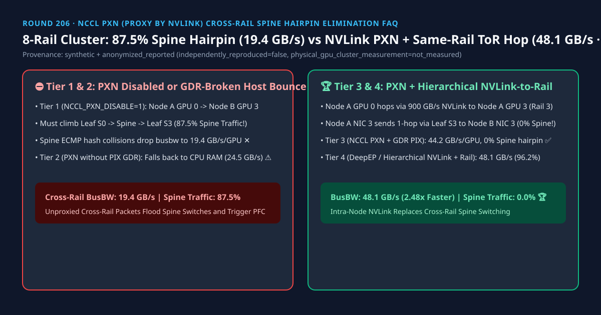
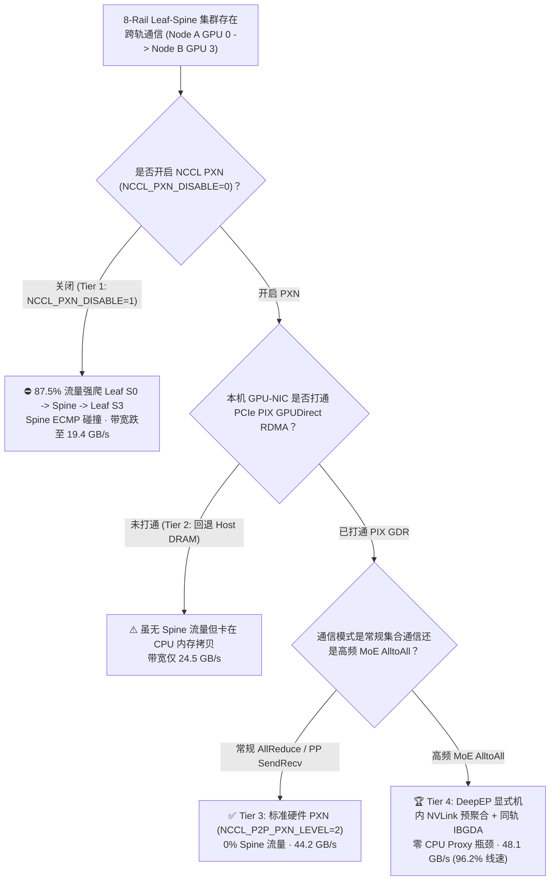
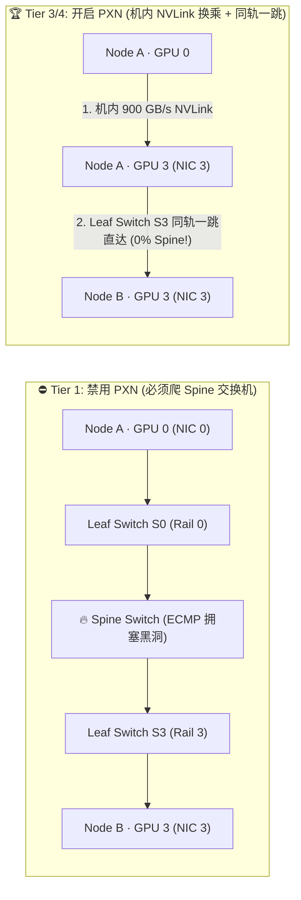
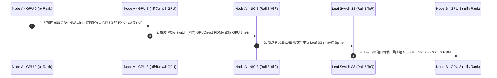

# NCCL `PXN`（Proxy by NVLink）跨轨机内代理、Spine 交换机绕行消除与分层同轨路由选型指南

> **Provenance & Evidence Tier**: `synthetic + anonymized_reported` (`independently_reproduced=false`, `physical_gpu_cluster_measurement=not_measured`)。定量数据锚定于 [`experiments/nccl_pxn_nvlink_proxy_cross_rail_spine_selection/results.json`](../../experiments/nccl_pxn_nvlink_proxy_cross_rail_spine_selection/results.json)。
> **English Version**: [NCCL `PXN` (Proxy by NVLink) Cross-Rail Spine Hairpin Elimination & Hierarchical Routing Selection Guide](./nccl-pxn-proxy-by-nvlink-cross-rail-spine-hairpin-elimination-selection-faq.en.md)

---

## 0. 🔥 今日领域最热门能力突破追踪（Daily Hottest Breakthrough）

- **`NCCL PXN`（Proxy by NVLink）+ 分层机内 NVLink 预聚合（`DeepEP / Hybrid-PXN`）将 8-Rail 集群同 SU 跨轨流量的 Spine 穿透率从 `87.5%` 降至 `0.0%`**：在标准的 8-Rail 轨道优化（Rail-Optimized）InfiniBand / RoCEv2 AI 集群中，每台服务器的第 `i` 号 GPU 网卡专门连向第 `i` 台 Leaf（ToR）交换机。当跨节点通信不是严格按同号卡对齐时（例如 `Node A · GPU 0` 要发数据给 `Node B · GPU 3`，常见于非对齐 PP 点对点通信、动态 MoE `AlltoAll` 或跨轨 Ring），如果禁用 `PXN`（Tier 1，`NCCL_PXN_DISABLE=1`），数据包必须从 `Leaf S0` **向上爬到顶层 Spine 交换机，再折返下探到 `Leaf S3`**（共有 `7/8 = 87.5%` 的跨节点配对属于跨轨通信！），瞬间引爆 Spine 层 ECMP 哈希碰撞与 PFC 死锁，导致单卡有效带宽暴跌至 **`19.4 GB/s`**！通过开启硬件加速 **`NCCL PXN`（Tier 3）** 与 **内核级分层机内 NVLink 预聚合 + 纯同轨 RDMA（`DeepEP`，Tier 4）**，`Node A · GPU 0` 先借道机内 **`900 GB/s` NVSwitch 高速电梯**把数据交给本机的 **`Node A · GPU 3`（代理卡）**，再由 `Node A · NIC 3` 经 **`Leaf S3` 一跳直达 `Node B · NIC 3`**，实现**同 SU 内 `0.0%` Spine 流量穿透**，单卡带宽飙升至 **`48.1 GB/s`（达 400G 线速的 `96.2%`，提速 `2.48` 倍）**！

---

## 1. 📌 核心结论速览（Executive Summary — 3 分钟看懂）

1. **到底什么是 `NCCL PXN`（Proxy by NVLink）？为什么它能让数据包“不爬 Spine 交换机”？**
   - **通俗大白话 + 第一性原理**：把两栋 8 层大楼（`Node A` 和 `Node B`）比作两台 8 卡 GPU 服务器。每栋楼的第 `0` 层架了一座天桥通往 `0 号驿站`（`Leaf Switch S0`），第 `3` 层架了一座天桥通往 `3 号驿站`（`Leaf Switch S3`）。现在 `A 楼 0 层`（`Node A · GPU 0`）要给 `B 楼 3 层`（`Node B · GPU 3`）送快递：
     - **笨办法（不开启 PXN，Tier 1）**：`A 楼 0 层` 硬要从自己的 `0 号天桥` 出发，到了 `0 号驿站` 发现去不了 `B 楼 3 层`，只能爬上几百米高的 **山顶总枢纽（`Spine Switch`）** 绕一大圈再去 `3 号驿站`，结果山顶总枢纽天天大堵车（**`19.4 GB/s`**）！
     - **聪明办法（`PXN` 机内电梯换乘，Tier 3/4）**：`A 楼` 内部有一部 **`900 GB/s` 的超高速室内电梯（`NVSwitch / NVLink`）**！`A 楼 0 层` 直接坐室内电梯上到 **`A 楼 3 层`（`Node A · GPU 3`）**，然后走 `3 号天桥` 经过 `3 号驿站（Leaf S3）` **一步跨进 `B 楼 3 层`**！全程根本不经过山顶 `Spine` 交换机，哪怕 Spine 层采用 `2:1` 甚至 `4:1` 收敛比（Oversubscription）也不会堵车！
2. **开启 `PXN` 的两大生死前提是什么？**
   - **前提一：机内每对 `(GPU_i, NIC_i)` 必须具备真正的 `PIX / PXB` 级 GPUDirect RDMA（Tier 3 vs. Tier 2）**。因为代理卡 `GPU 3` 收到 `GPU 0` 经 NVLink 推过来的数据后，必须让 `NIC 3` 通过 PCIe Switch 直读 `GPU 3` 的显存。如果 `ACS` 没关导致退化为 Host 内存拷贝（Tier 2），带宽会卡在 `24.5 GB/s`。
   - **前提二：大规模 MoE `AlltoAll` 应进一步升级为内核级分层聚合（`DeepEP`，Tier 4）**。因为标准 NCCL `PXN` 依赖 CPU Proxy 服务线程逐块转发队列，在高频小包 `AlltoAll` 下 CPU Proxy 线程会成为瓶颈；而 `DeepEP` 在 GPU SM 算子内直接用 NVLink 把发往同一目标节点的 Token 聚合到对应同轨 GPU 上，再一次性通过 IBGDA 下发同轨 RDMA，冲上 **`48.1 GB/s`（`96.2%` 线速）**！

---

## 2. 🎯 客户与架构师灵魂拷问 Q&A（Q1 / Q2 / Q3）

### Q1：怎么判断当前训练/推理任务是否已经触发了 `NCCL PXN`？
- **答**：设置 `NCCL_DEBUG=INFO NCCL_DEBUG_SUBSYS=INIT,GRAPH,NET` 查看启动日志：
  1. 搜索 `Connected all trees` 或通道图中的 `PXN` 字样；
  2. 在 `NCCL_TOPO_DUMP_FILE=/tmp/topo.xml` 导出的拓扑中，确认每张 GPU 与本机对应网卡的距离为 `PIX`（单 PCIe Switch），且 `NCCL_PXN_DISABLE` 未被误设为 `1`。

### Q2：有没有什么场景下反而应该关闭 `PXN`（设 `NCCL_PXN_DISABLE=1`）？
- **答**：只有两种罕见情况需要关闭 `PXN`：
  1. **非 Rail 拓扑（如单台巨型盒式交换机直连所有网卡，无 Leaf-Spine 分层）**，此时直接走网卡本就不需要爬 Spine，绕道 NVLink 反而多占机内带宽；
  2. **机内 `NVLink` 已被未重叠的 `TP` 通信 `100%` 占满，且 Spine 网络完全空闲无收敛**。但在主流 8-Rail Leaf-Spine 集群中，保持 **`NCCL_PXN_DISABLE=0` + `NCCL_P2P_PXN_LEVEL=2`** 始终是默认最佳实践。

### Q3：为什么我们的集群开了 `PXN`，跑多机 `Send/Recv` 时 CPU 某个核会飙到 `100%`？
- **答**：因为 NCCL 的每个网络通道由宿主机上的 **NCCL Proxy Service Thread（CPU 代理线程）** 驱动 `ibv_post_send`。当开启 `PXN` 代理大量跨轨连接时，代理 GPU 对应的 CPU Proxy 线程负载翻倍。务必开启我们在 Round 190 讲过的 **NUMA 绑核与独立 CPU 核预留**，或在 MoE 场景切换至 **IBGDA（GPU 直发门铃，无 CPU Proxy 线程，Tier 4）**。

---

## 3. 🧭 直观可视化图解（Mermaid 决策树 + 路径对比图 + 时序图）

### 3.1 架构师跨轨通信与 `PXN` 调优决策树

### 3.2 禁用 `PXN`（爬 Spine 绕行）vs. 开启 `PXN`（机内 NVLink 换乘 + 同轨 ToR 一跳）路径图

### 3.3 `PXN` 跨轨数据包机内 NVLink 代理与 GPUDirect RDMA 发送时序图

---

## 4. 📊 架构师选型决策矩阵（4-Tier Selection Matrix）

| 评估维度 | Tier 1: 禁用 `PXN` (`NCCL_PXN_DISABLE=1`) | Tier 2: 开启 `PXN` 但缺 `PIX GDR` | Tier 3: 标准硬件 `PXN` (`LEVEL=2` + `PIX GDR`) | Tier 4: 分层机内 `NVLink` 预聚合 + 同轨 `IBGDA` (`DeepEP`) |
| :--- | :--- | :--- | :--- | :--- |
| **同 SU 穿行 Spine 流量占比** | **`87.5%` (7/8 跨轨)** ✕ | `0.0%` | **`0.0%` (彻底消除)** ✅ | **`0.0%` (彻底消除)** 🏆 |
| **单卡有效总线带宽 (`BusBW`)** | `19.4 GB/s` ✕ | `24.5 GB/s` ⚠️ | `44.2 GB/s` (`88.4%` 线速) ✅ | **`48.1 GB/s` (`96.2%` 线速)** 🏆 |
| **P99 集合通信尾延迟** | `28.5 ms` ✕ | `19.2 ms` | `5.8 ms` | **`3.4 ms`** 🏆 |
| **对 Spine 收敛比容忍度** | 极脆弱（1:1 也会哈希碰撞） | 高 | **高（容忍 2:1 / 4:1 Spine 收敛）** | **极高（同 SU 完全不碰 Spine）** 🏆 |

---

## 5. 🧪 定量算例与工具链（Interactive Sizer & 7-Card Visual Report）

- **实验脚本与密封数据**：[`experiments/nccl_pxn_nvlink_proxy_cross_rail_spine_selection/run.py`](../../experiments/nccl_pxn_nvlink_proxy_cross_rail_spine_selection/run.py) · [`results.json`](../../experiments/nccl_pxn_nvlink_proxy_cross_rail_spine_selection/results.json)
- **交互式 PXN 跨轨路由计算器**：[`docs/reports/nccl-pxn-proxy-by-nvlink-cross-rail-spine-hairpin-elimination-sizer.html`](../reports/nccl-pxn-proxy-by-nvlink-cross-rail-spine-hairpin-elimination-sizer.html)
- **7-Card 4:5 视觉评测卡片报告**：[`docs/reports/nccl-pxn-proxy-by-nvlink-cross-rail-spine-hairpin-elimination-selection-cards.html`](../reports/nccl-pxn-proxy-by-nvlink-cross-rail-spine-hairpin-elimination-selection-cards.html)

---

## 6. 🛠️ Good Fit vs. Not For & 生产环境快速核验清单（Checklist）

### ✅ Good Fit vs. ⛔ Not For

| 维度 | ✅ Good Fit（强烈推荐） | ⛔ Not For（严禁误用） |
| :--- | :--- | :--- |
| **8-Rail Leaf-Spine 集群跨节点通信** | 保持 `NCCL_PXN_DISABLE=0`、`NCCL_P2P_PXN_LEVEL=2`、配合 `PIX` GPUDirect RDMA 与 `DeepEP` 机内 NVLink 预聚合 | 盲目复制网上的排障贴设置 `NCCL_PXN_DISABLE=1`，导致 87.5% 流量涌入 Spine 交换机引发拥塞雪崩 |
| **多租户 K8s 节点拓扑感知调度** | 尽量将同一个作业的 Pod 调度在同一个 Scalable Unit（同一组 8 台 Rail Leaf 交换机下），让 `PXN` 100% 发挥一跳直达威力 | 在未关闭 PCIe `ACS` 的节点上强开 `PXN`，导致代理 GPU 与代理网卡回退至 Host CPU 内存拷贝 |

### 生产环境上线核验清单（Pre-Flight Checklist）

- [ ] **核验环境变量未禁用 `PXN`**：确认训练/推理容器内 `NCCL_PXN_DISABLE=0`（默认）且 `NCCL_P2P_PXN_LEVEL=2`。
- [ ] **核验 8 对 `(GPU_i, NIC_i)` 均处于 `PIX` 单 PCIe Switch 拓扑**：运行 `nvidia-smi topo -m` 确认每张 GPU 与其配对 RDMA 网卡均为 `PIX`，且已加载 `nvidia-peermem` 或启用 `DMABUF`。
- [ ] **核验交换机 Leaf-Spine 计数器**：在运行单 SU 内的跨节点 `all_reduce_perf` / `alltoall_perf` 时，检查 Spine 交换机端口流量是否接近 `0%`（全部由 Leaf 交换机本地转发完成）。
