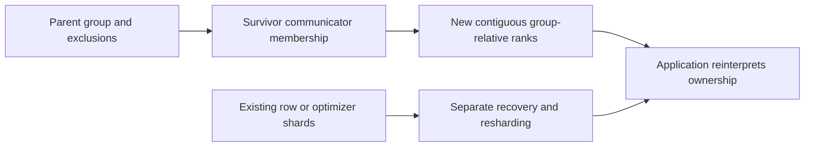
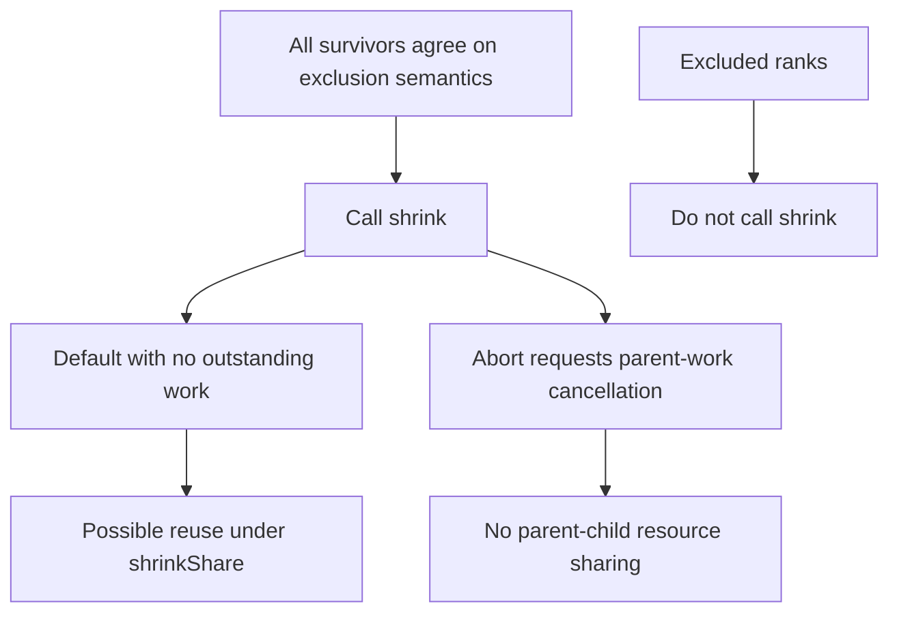
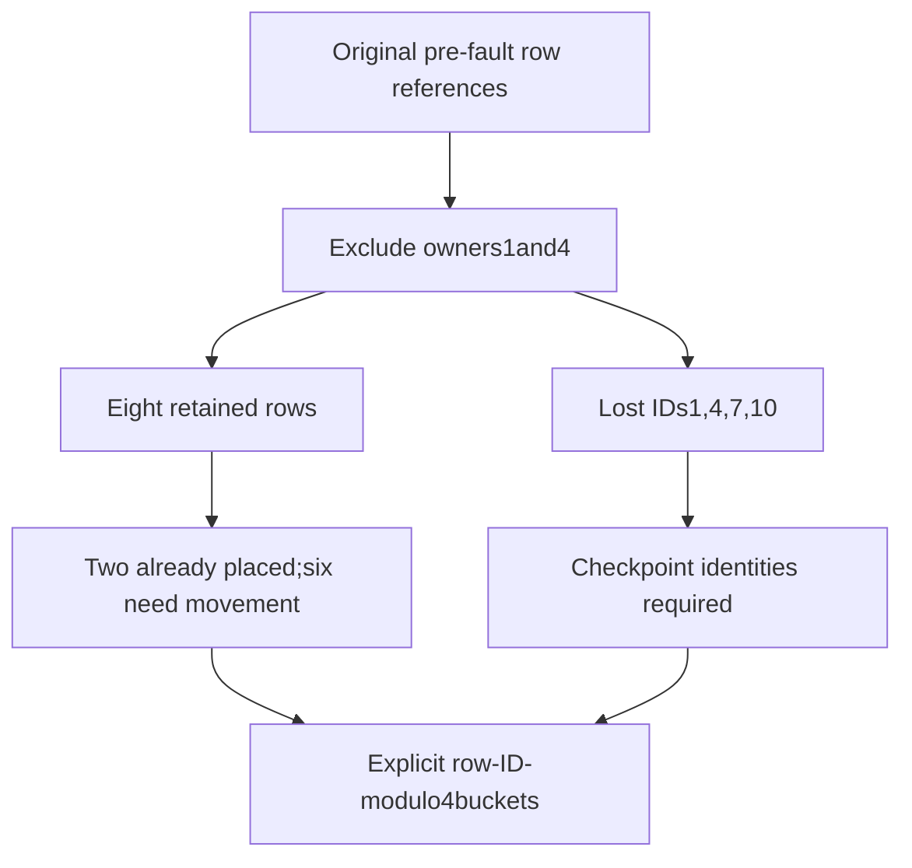

# AI Infra membership FAQ: NCCL shrink survivor-rank remapping and shard ownership

> **Language**: English | [中文](nccl-shrink-survivor-rank-shard-ownership-selection-faq.md)  
> **Round 146 · 2026-11-14 daytime**: group-relative rank contracts and an original cyclic-row ledger—not cluster recovery SLAs or native NCCL measurements.

**Executive finding:** Survivors`[0,2,3,5]`become new ranks`[0,1,2,3]`, but old shards do not automatically satisfy new-world ownership. In the original6→4rank/12row case, eight rows remain and four need checkpoints. Only2/8retained rows already match the new cyclic target; six need explicit movement. **Excluded ranks must not call shrink—not call and wait for NULL.**

**Artifacts**: [H5 ledger](../reports/nccl-shrink-survivor-rank-shard-ownership-sizer.html) · [seven cards](../reports/nccl-shrink-survivor-rank-shard-ownership-selection-cards.html) · [1600px SVG](../../assets/svg/nccl-shrink-survivor-rank-shard-ownership-selection-faq-summary.svg) · [sealed report](../../experiments/nccl_shrink_ownership_selection/report.json)

## Q1: What does shrink change, and why is it not training-state recovery?

The NVIDIA API builds a communicator excluding specified parent ranks and compresses survivor IDs into a contiguous set. It does not supply automatic model, optimizer, dataloader or checkpoint recovery. Earlier repository guidance covers cluster fault strategies; this independent study checks **concrete rank associations and row ownership**.



The pinned Nov14PyTorch change inherits child options and handles child-construction cleanup; it did not invent shrink or automatic recovery. The pinned wrapper requires NCCL2.27or later. Actual deployment still needs version, backend-support and initialization checks; native conditions were not executed here.

## Q2: How are survivor ranks calculated, and can global IDs be sorted instead?

Pinned C++ uses`new_rank=parent_rank−count(excluded_rank<parent_rank)`. Original parent global labels are`[7,2,19,5,11,17]`; exclusions1and4are **parent-relative**:

| Parent-relative rank | New-relative rank | Preserved global association label |
| ---: | ---: | ---: |
| 0 | 0 | 7 |
| 2 | 1 | 19 |
| 3 | 2 | 5 |
| 5 | 3 | 17 |

Sorting labels into`[5,7,17,19]`does not establish native group order. These labels are original association-ledger metadata, not a claim that every PyTorch child metadata field was measured updating. Only parent rank0happens to retain its ID; old rank5cannot directly index a new length-four rank array.

## Q3: Who calls, and how do default, abort and sharing differ?

NVIDIA specifies **all survivors call, excluded ranks do not**. The Split API's NOCOLOR→NULL convention cannot be applied to excluded Shrink callers. H5 checks that callers equal the survivor set; real cross-rank consistency and scheduling need separate coordination.



Pinned default code checks pending work. NVIDIA default requires no outstanding operations to avoid deadlock and permits sharing under shrinkShare. ABORT requests cancellation of parent outstanding work without sharing parent resources. The model records **requests only**, not actual abort completion or resource reuse. Revocation, errors and full asynchronous completion are outside its state machine.

The pinned PyTorch entry also rejects empty/all-excluded lists, duplicates, out-of-bounds ranks and excluded callers. H5 adopts that nonempty wrapper boundary, not a universal empty-list return contract for every NCCL API version.

## Q4: Why are only2/8retained rows already placed, and why cannot four lost rows be fabricated?

The original application chooses cyclic owner`row_ID modulo world_size`; **NCCL does not prescribe this layout**. At6→4, row6remains at old0/new0but targets new2. Rows2and8remain at old2/new1but target2and0.



Without the four lost identities, H5 retains membership but exposes`data_ready=false`, a`data_error`, and`resharded=null`. **It neither fills zeros nor fabricates values from communicator metadata.** Checkpoints must match the original pre-fault oracle reference; that reference is teaching ground truth, not a free live replica replacing lost tensors or an implemented checkpoint-checksum protocol.

Explicit recovery/movement verifies all12identities exactly once, not optimizer consistency, rollback or resumed training. No warm spare is added; grow/reinitialization is a separate membership action.

## Q5: Which payloads and CPU timings are actually quantified?

The selected12rows×3features×2Bpayload is72B. Six retained rows changing owner represent36B; four checkpoint-restored rows represent24B. These are **different logical-stage selected feature payloads**, not a sum claiming wire traffic; checkpoint staging, Python heap, NCCL metadata and GPU peak are excluded. The scalar ledger does not execute feature tensors.

| Standalone parent-rank entries | Prebuilt prefix lookup (ms) | Repeated lower-excluded counts (ms) |
| ---: | ---: | ---: |
| 64 | 0.002300 | 0.042600 |
| 256 | 0.010400 | 0.571000 |
| 1024 | 0.039333 | 9.130000 |
| 4096 | 0.221133 | 154.420133 |

One in four entries is excluded; both paths return the same complete association list. Prefix/exclusion/survivor construction is excluded. Two warmups, seven alternating repeats and three operations per sample yield median repeat means. This is an **original global CPU planner**, not native per-rank C++ or4096running ranks; standalone timer sizes exceed the16-rank UI bound. Native shrink, abort, checkpoint I/O, movement and network latency were not measured.

## Q6: How can the study be reproduced without confusing membership and recovery?

```powershell
python -m unittest discover -s tests -p test_nccl_shrink_ownership_selection.py -q
python -m experiments.nccl_shrink_ownership_selection.run --check
# --measure replaces original CPU planner samples;no NCCL invocation.
```

Eight tests cover40independent compression/cyclic-slice oracle cases, missing-row gates, caller/exclusion errors, default/abort/share requests, order/global-label/checkpoint integrity, selected payloads, Node/Python parity and all seven sealed matrix cases. Reversed exclusion/caller traversal preserves four associations. SVG is an original60-solid parcel-cabinet metaphor. Prior browser refusal remains respected; visual browser acceptance was not performed.

Sources: [NVIDIA shrink/split/flag definitions](https://docs.nvidia.com/deeplearning/nccl/user-guide/docs/api/comms.html), [pinned PyTorch ShrinkNCCL.cpp](https://github.com/pytorch/pytorch/blob/0a95a45a42fbec1ab15a5c8ad9b6f03ac2e225ef/torch/csrc/distributed/c10d/nccl2/ShrinkNCCL.cpp), [dated commit](https://github.com/pytorch/pytorch/commit/0a95a45a42fbec1ab15a5c8ad9b6f03ac2e225ef), [PyTorch LICENSE](https://github.com/pytorch/pytorch/blob/0a95a45a42fbec1ab15a5c8ad9b6f03ac2e225ef/LICENSE). PyTorch BSD-style rights are preserved; NVIDIA API facts are paraphrased; no implementation is mirrored.

Production needs group/global associations, survivor protocol agreement, actual pending/error/abort status, resource configuration, checkpoint provenance and tensor/optimizer/step consistency. Report provenance is `synthetic`, `independently_reproduced=false`; original CPU is separately `measured`. Native shrink/abort/sharing/recovery/wire/peak remain unknown/null.
