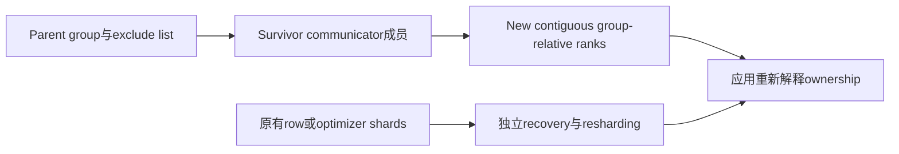
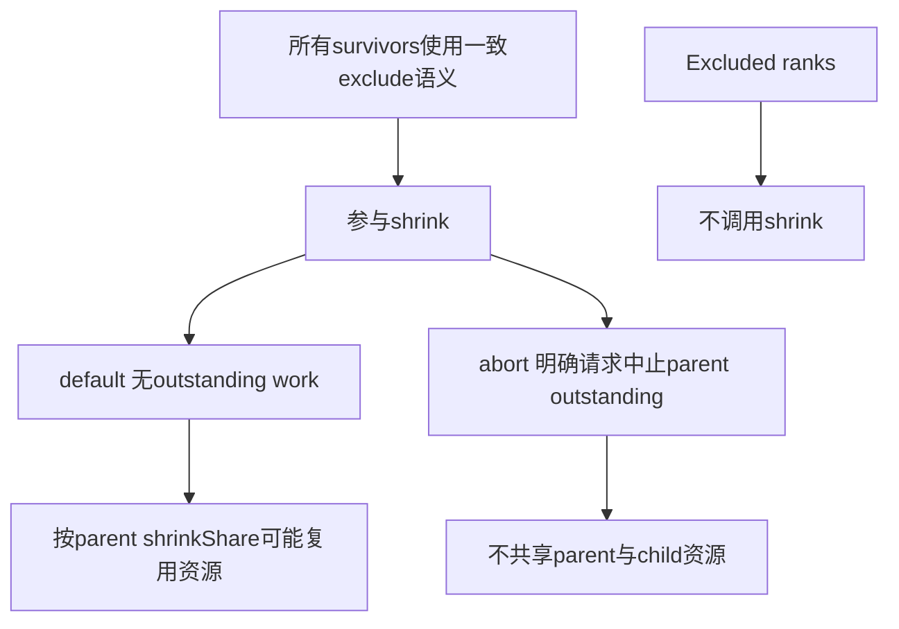
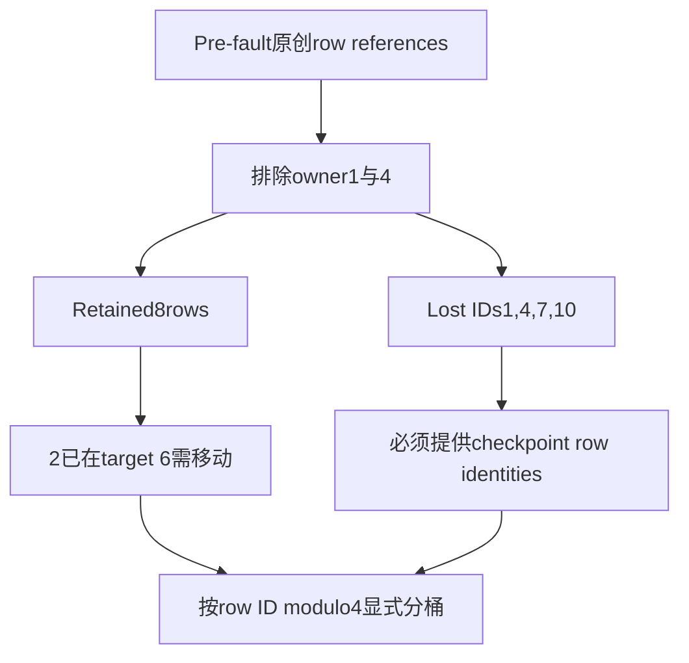

# AI Infra 成员变更 FAQ：NCCL Shrink Survivor Rank 重编号与 Shard Ownership

> **语言**：中文 | [English](nccl-shrink-survivor-rank-shard-ownership-selection-faq.en.md)  
> **Round 146 · 2026-11-14 白班**：group-relative rank contract与原创cyclic-row ledger；不是集群恢复SLA或native NCCL评测。

**结论速览**：parent ranks`[0,2,3,5]`留下后成为new ranks`[0,1,2,3]`，并不把旧shards自动变成新world ownership。原创6→4rank/12row例中，8rows留存、4rows需checkpoint；留存rows也仅2/8已在新cyclic target，另6需显式移动。**Excluded ranks不应调用shrink，不是调用后等待NULL**。

**交付**：[H5 ledger](../reports/nccl-shrink-survivor-rank-shard-ownership-sizer.html) · [7-Card](../reports/nccl-shrink-survivor-rank-shard-ownership-selection-cards.html) · [1600px SVG](../../assets/svg/nccl-shrink-survivor-rank-shard-ownership-selection-faq-summary.svg) · [封存数据](../../experiments/nccl_shrink_ownership_selection/report.json)

## Q1：shrink改变的是什么，为什么不等于训练状态恢复？

NVIDIA API创建排除指定parent ranks的新communicator，并将survivor IDs压成连续集合。它不提供模型tensor、optimizer、dataloader或checkpoint内容的自动恢复逻辑。旧指南侧重集群故障策略；本轮独立检查**具体rank association与row ownership**。



source chronology：11月14日固定PyTorch shrink集成增加child-option继承/构造失败清理；并不是当天发明shrink或自动恢复算法。固定wrapper要求NCCL2.27或更新，实际部署还要验证版本、backend支持和初始化状态；本轮没有运行这些native条件。

## Q2：survivor新rank如何计算，global rank可以直接排序吗？

固定C++group-relative公式为`new_rank=parent_rank−count(excluded_rank<parent_rank)`。原创parent global labels为`[7,2,19,5,11,17]`，排除的是**parent-relative**1与4：

| parent-relative rank | new-relative rank | 保留的global association label |
| ---: | ---: | ---: |
| 0 | 0 | 7 |
| 2 | 1 | 19 |
| 3 | 2 | 5 |
| 5 | 3 | 17 |

global labels不能排序为`[5,7,17,19]`后当作native group次序。它们是本model保留的关联ledger，不是声称所有PyTorch child metadata字段已被实测更新。只有parent rank0在本例恰好不变；旧rank5更不能直接索引长度4的新rank数组。

## Q3：谁调用、default/abort与资源共享有哪些边界？

NVIDIA明确：**全部survivor参与，exclude list中的rank不要调用**。`ncclCommSplit`的NOCOLOR→NULL约定不能套到`ncclCommShrink` excluded caller。原创H5检查caller集合是否恰好等于survivors；实际跨rank一致性与调度仍需另行协调。



source default路径检查pending work；NVIDIA default需要无outstanding以避免deadlock，且允许按shrinkShare复用资源。ABORT请求终止parent outstanding并不共享parent资源。本model仅记录**request metadata**，不宣称abort完成或共享已发生；revoked/error/asynchronous completion等完整状态机不建模。

固定PyTorch入口另外拒绝empty、all-excluded、duplicate、越界与excluded caller。H5采用该nonempty入口边界，不把它宣传为所有NCCL API版本的通用empty-list返回语义。

## Q4：重编号后为何2/8留存rows已就位，四个lost rows不能凭空补齐？

原创应用选择`row_ID modulo world_size`作为cyclic owner；**这不是NCCL自带的数据布局规则**。world6→4后，row6原在old0/new0，但新target为2；row2、8原在old2/new1，新target分别为2、0。



H5若不提供四个lost identities，保留membership ledger但明确`data_ready=false`、`data_error`与`resharded=null`，**不填0、不借communicator metadata虚构值**。checkpoint必须与原创pre-fault oracle reference一致；这个reference只用于教学真值验证，不是生产中可替代丢失tensor的免费副本，也不是实际checkpoint checksum协议。

显式恢复/移动后可以验证12row identities各一次，但不能外推optimizer一致性、step rollback或训练恢复。模型也不会加入warm spare；membership grow/re-init是另外的动作。

## Q5：哪些payload与CPU时延是本轮真实可计量的？

选择12rows×3features×2B=72B feature payload；6个retained rows需改变owner，对应36B，4个lost rows从checkpoint恢复对应24B。它们是**不同逻辑阶段的selected feature payload**，不相加冒充网络wire bytes，亦不含checkpoint staging、Python heap、NCCL metadata或GPU peak。scalar ledger没有执行真实feature tensors。

| standalone parent-rank entries | 预建prefix lookup（ms） | 重复lower-excluded计数（ms） |
| ---: | ---: | ---: |
| 64 | 0.002300 | 0.042600 |
| 256 | 0.010400 | 0.571000 |
| 1024 | 0.039333 | 9.130000 |
| 4096 | 0.221133 | 154.420133 |

每四个entry排除一个，两路返回同一完整association list。prefix/exclude/survivor构造排除，2warmups、7轮交替repeat、每sample3操作取中位数。它是**全局原创CPU planner**，不是native每rank C++调用或运行4096ranks；大尺寸独立timer超过H5的16rank原型边界。native shrink、abort、checkpoint I/O、row movement与network latency均未测。

## Q6：如何复现并避免混淆成员契约与生产恢复？

```powershell
python -m unittest discover -s tests -p test_nccl_shrink_ownership_selection.py -q
python -m experiments.nccl_shrink_ownership_selection.run --check
# --measure 主动替换原创 CPU planner samples；无NCCL调用
```

八项测试覆盖40组独立rank compression/cyclic-slice oracle、missing-row gate、caller/exclude errors、default/abort/share request、顺序/global-label/checkpoint完整性、selected payload、Node/Python parity与全部七case封存矩阵。反转exclude/caller遍历不改变四个survivor associations。SVG为原创60-solid parcel-cabinet metaphor；此前浏览器拒绝仍受尊重，未做视觉浏览器验收。

来源：[NVIDIA shrink/split/flag原文定义](https://docs.nvidia.com/deeplearning/nccl/user-guide/docs/api/comms.html)、[固定PyTorch ShrinkNCCL.cpp](https://github.com/pytorch/pytorch/blob/0a95a45a42fbec1ab15a5c8ad9b6f03ac2e225ef/torch/csrc/distributed/c10d/nccl2/ShrinkNCCL.cpp)、[当日commit](https://github.com/pytorch/pytorch/commit/0a95a45a42fbec1ab15a5c8ad9b6f03ac2e225ef)、[PyTorch LICENSE](https://github.com/pytorch/pytorch/blob/0a95a45a42fbec1ab15a5c8ad9b6f03ac2e225ef/LICENSE)。PyTorch BSD-style rights保留，NVIDIA API事实改写，无实现镜像。

生产须单独核验group-relative/global association、所有survivor协议、真实pending/error/abort状态、resource config、checkpoint来源与数据/optimizer/step一致性。主报告`synthetic`、`independently_reproduced=false`，CPU单独`measured`；native shrink/abort/sharing/state recovery/wire/peak均未知/null。
