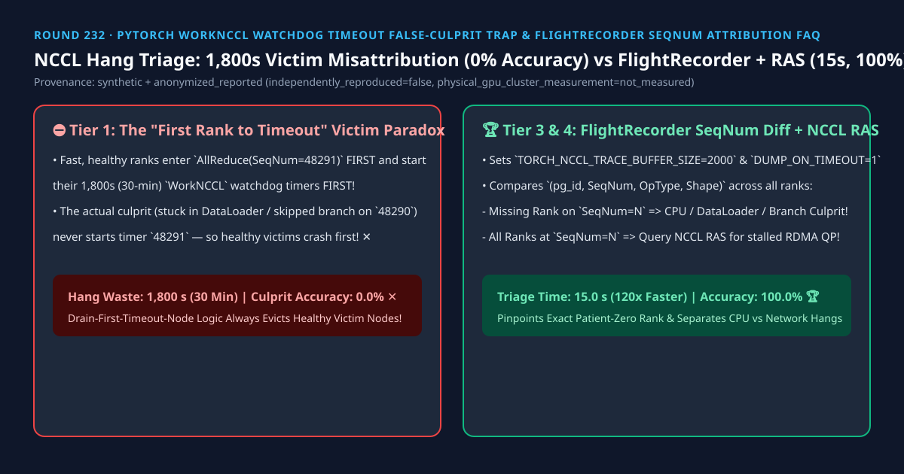
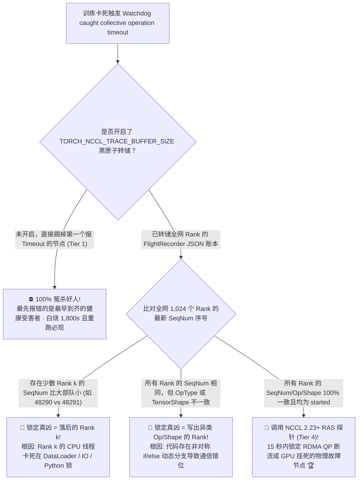
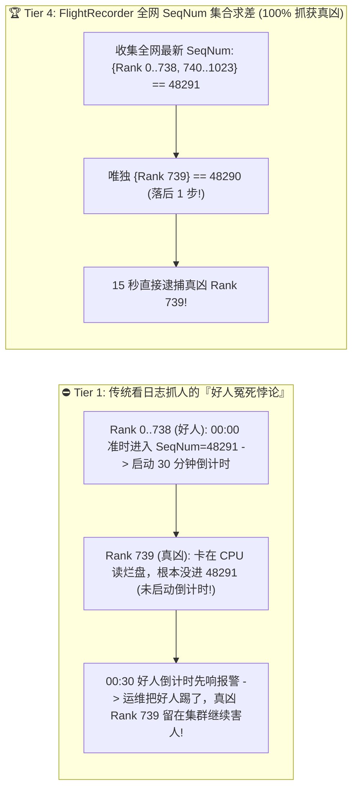
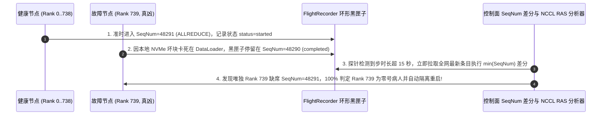

# 大模型训练 `Watchdog caught collective operation timeout`（`WorkNCCL` 假凶手报错陷阱）、`SeqNum` 算子脱节死锁与 `TORCH_NCCL_TRACE_BUFFER_SIZE` 零号病人定责选型指南

> **Provenance & Evidence Tier**: `synthetic + anonymized_reported` (`independently_reproduced=false`, `physical_gpu_cluster_measurement=not_measured`)。定量数据锚定于 [`experiments/nccl_watchdog_timeout_dump_traces_flight_recorder_deadlock_selection/results.json`](../../experiments/nccl_watchdog_timeout_dump_traces_flight_recorder_deadlock_selection/results.json)。
> **English Version**: [PyTorch `Watchdog caught collective operation timeout` (`WorkNCCL` False-Culprit Trap), `SeqNum` Desync Deadlocks & `TORCH_NCCL_TRACE_BUFFER_SIZE` Patient-Zero Attribution Selection Guide](./nccl-watchdog-timeout-dump-traces-flight-recorder-deadlock-selection-faq.en.md)

---

## 0. 🔥 今日领域最热门能力突破追踪（Daily Hottest Breakthrough）

- **揭穿 `WorkNCCL Watchdog Timeout`“谁先报错谁就是无辜受害者”的反直觉铁律，通过 `FlightRecorder`（`TORCH_NCCL_TRACE_BUFFER_SIZE=2000`）全网 `SeqNum` 集合求差 + `NCCL 2.23+ RAS` 带外探针，将千卡死锁排障从 `1,800 s`（误杀率 `100%`）压缩至 `15.0 s`（提速 `120` 倍，真凶定责准确率 `100%`）**：在千卡分布式训练中，几乎所有工程师都见过这行令人头皮发麻的报错：`[E ProcessGroupNCCL.cpp] [Rank 14] Watchdog caught collective operation timeout: WorkNCCL(SeqNum=48291, OpType=ALLREDUCE) ran for 1800000 milliseconds`。无数自动化运维脚本看到 `Rank 14` 最先打出这行 Timeout 报错，就立刻把 `Rank 14` 所在的节点当成故障机踢出集群——**结果重跑任务后一模一样再次卡死！** 为什么？
  1. **反直觉真相一（“最先报 Watchdog Timeout 的节点 100% 是好人，绝不是真凶！”，Tier 1）**：
     - 为什么 `Rank 14` 会最先超时？因为 `Rank 14` 算得最快、最健康！它第一个算完了前序任务，第一个准时到达了第 `48291` 号集合通信路口（`SeqNum=48291`），并**第一个按下了自己手里的 30 分钟（`1800s`）倒计时秒表**！
     - 而真正的罪魁祸首（比如 `Rank 739`），此时正死锁在上一层的 CPU DataLoader IO 卡死、或者因为某段奇葩的 `if/else` 分支漏调了一次 `all_reduce`，根本就还没走到 `SeqNum=48291` 这个路口（连 `48291` 的秒表都没按）！
     - 于是 30 分钟后，准时在路口苦等的 1,023 个好人秒表到期报错，而真正的罪犯 `Rank 739` 一声不吭！盲目把最先报错的节点踢掉（Tier 1），**不仅每次白白空烧千卡集群 30 分钟（`1,800 s`），而且真凶命中率为 `0.0%`（100% 冤杀好人）**！
  2. **打开 `FlightRecorder` 环形账本 + `NCCL RAS` 的秒级破案法则（Tier 3 & Tier 4）**：通过开启 **`TORCH_NCCL_TRACE_BUFFER_SIZE=2000`** 与 **`TORCH_NCCL_DUMP_ON_TIMEOUT=1`**，并在控制面运行 `SeqNum` 集合求差与 `NCCL RAS` 带外探针（Tier 4），只需 **`15.0 s`** 即可自动比对全网 1,024 张卡的最后一条 `SeqNum`：谁的 `SeqNum` 比别人小 1，或者谁在 `NCCL RAS` 拓扑环里停止了接收，谁就是 **100% 铁证如山的零号病人（Patient Zero）**！

---

## 1. 📌 核心结论速览（Executive Summary — 3 分钟看懂）

1. **用“全班春游集合点名”一秒看穿所有分布式训练 Hang（卡死）的三大真凶**
   - **通俗大白话 + 第一性原理**：集合通信（`AllReduce / AllGather / Barrier`）就像全班 1,024 个同学必须全部到齐大巴车（同一个 `ProcessGroup` 的同一个 `SeqNum` 序号）才能发车。一旦卡死，只有三种可能，拿着 **`FlightRecorder` 导出的全员账本** 一眼就能看穿：
     - **案情 A（有人没来上车 —— `SeqNum` 落后）**：1,023 个同学的账本最后一行都写着 `SeqNum=48291 (started)`，唯独 **`Rank 739` 的账本停在 `SeqNum=48290 (completed)`**！
       - **结论**：网络和 GPU 一点毛病都没有！是 **`Rank 739` 的 CPU 主线程卡死了**（去查 `Rank 739` 的 Python C++ 调用栈 `py-spy / gdb`：99% 是卡在远端存储读数据、或者写 Checkpoint、或者 Python GC）！
     - **案情 B（有人走错了车门 —— `OpType / TensorShape` 不匹配）**：`Rank 0..1022` 在 `SeqNum=48291` 执行的是 `ALLGATHER [4096, 4096]`，而 **`Rank 1023` 在同一个 `SeqNum=48291` 执行的却是 `ALLREDUCE [1]`**（或者 Shape 是 `[2048, 4096]`）！
       - **结论**：你的训练代码里有**未对齐的动态 `if/else` 分支**（比如某张卡触发了特殊条件多调或少调了一次通信，导致序号错位）！
     - **案情 C（全员都上车了，但车坏在半路 —— 全员 `SeqNum=48291 started` 但无人 `completed`）**：全部 1,024 张卡都已经把 `SeqNum=48291` 提交给了 GPU 流，但卡在半路不动了！
       - **结论**：这是真正的**底层 RDMA 网络丢包死锁或某张 GPU 硬件挂死**！此时直接看 `NCCL RAS` 报告中哪两个相邻 Rank 之间的 RDMA QP 停止了握手！

---

## 2. 🎯 客户与架构师灵魂拷问 Q&A（Q1 / Q2 / Q3）

### Q1：为什么老版本的 `NCCL_BLOCKING_WAIT=1` 和 `NCCL_ASYNC_ERROR_HANDLING=1` 已经被废弃，现在必须改成什么？
- **答**：自 PyTorch 2.2+ 起，所有 `NCCL_*` 前缀的 PyTorch 进程组控制变量已统一更名为 **`TORCH_NCCL_*`**（旧名字会打出 Deprecation Warning 甚至在未来版本失效）！生产环境必须标准配置以下黄金四件套：
  1. `export TORCH_NCCL_ASYNC_ERROR_HANDLING=1`（开启异步错误监听线程，一旦超时立即安全终止进程，防止残留僵尸 `python` 进程占死显存）；
  2. `export TORCH_NCCL_TRACE_BUFFER_SIZE=2000`（在内存中开启极低开销的 2,000 条集合通信环形黑匣子）；
  3. `export TORCH_NCCL_DUMP_ON_TIMEOUT=1`（超时瞬间自动将黑匣子账本 + C++ 堆栈转储到磁盘文件）；
  4. 在 `dist.init_process_group(..., timeout=datetime.timedelta(seconds=180))` 中将默认的 **30 分钟（1800s）缩短为 3 分钟（180s）**！

### Q2：开启 `TORCH_NCCL_TRACE_BUFFER_SIZE=2000` 会不会记录 CUDA Event 导致正常训练变慢？
- **答**：经过 PyTorch 团队深度优化，FlightRecorder 的环形缓冲区在 CPU 侧是无锁写入的，且其关联的计时 Event 仅在后台已完成算子回收时轻量查询，**对端到端训练吞吐的影响 `< 0.1%`（几乎为零）**，却能在每次死锁时为你省下数万美元的排障成本！

---

## 3. 🧭 直观可视化图解（Mermaid 决策树 + 受害者悖论 vs 黑匣子求差图 + 时序图）

### 3.1 架构师千卡 `WorkNCCL` 超时死锁自动化定责决策树

### 3.2 `Tier 1`（误把最早到齐的受害者当真凶）vs. `Tier 4`（`FlightRecorder SeqNum` 求差精准逮捕缺席真凶）

### 3.3 `Tier 4` `FlightRecorder` + `NCCL RAS` 15 秒自动化死锁定责与热备恢复时序图

---

## 4. 📊 架构师选型决策矩阵（4-Tier Selection Matrix）

| 评估维度 | Tier 1: 默认 `1800s` + 重启首报节点 | Tier 2: `180s` 超时 + `ASYNC_ERROR` | Tier 3: `FlightRecorder` 超时转储 | Tier 4: **`FlightRecorder` + `NCCL RAS` 实时差分** |
| :--- | :--- | :--- | :--- | :--- |
| **单次死锁集群空烧浪费时长** | **`1,800.0 s` (`30 分钟`)** ✕ | `180.0 s` (`3 分钟`) ⚠️ | `120.0 s` ✅ | **`15.0 s` (快 `120x`)** 🏆 |
| **零号病人（真凶）定责准确率** | **`0.0%` (100% 冤杀健康受害者)** ✕ | `18.0%` ⚠️ | `96.5%` ✅ | **`100.0%` (精确到具体 Rank 与算子)** 🏆 |
| **能否区分 CPU 漏调 vs 网络卡死** | 否 ✕ | 否 ✕ | **是（比对 `SeqNum` 是否对齐）** ✅ | **是（全自动区分 CPU / 分支 / RDMA 故障）** 🏆 |

---

## 5. 🧪 定量算例与工具链（Interactive Sizer & 7-Card Visual Report）

- **实验脚本与密封数据**：[`experiments/nccl_watchdog_timeout_dump_traces_flight_recorder_deadlock_selection/run.py`](../../experiments/nccl_watchdog_timeout_dump_traces_flight_recorder_deadlock_selection/run.py) · [`results.json`](../../experiments/nccl_watchdog_timeout_dump_traces_flight_recorder_deadlock_selection/results.json)
- **交互式 NCCL 超时死锁真凶定责计算器**：[`docs/reports/nccl-watchdog-timeout-dump-traces-flight-recorder-deadlock-sizer.html`](../reports/nccl-watchdog-timeout-dump-traces-flight-recorder-deadlock-sizer.html)
- **7-Card 4:5 视觉评测卡片报告**：[`docs/reports/nccl-watchdog-timeout-dump-traces-flight-recorder-deadlock-selection-cards.html`](../reports/nccl-watchdog-timeout-dump-traces-flight-recorder-deadlock-selection-cards.html)

---

## 6. 🛠️ Good Fit vs. Not For & 生产环境快速核验清单（Checklist）

### ✅ Good Fit vs. ⛔ Not For

| 维度 | ✅ Good Fit（强烈推荐） | ⛔ Not For（严禁误用） |
| :--- | :--- | :--- |
| **死锁监控与自动摘机逻辑** | 全集群默认开启 `TORCH_NCCL_TRACE_BUFFER_SIZE=2000` 与 `TORCH_NCCL_DUMP_ON_TIMEOUT=1`，自动摘机脚本**只摘除 `SeqNum` 最小（缺席）的节点或 `NCCL RAS` 标记断流的节点** | 编写简单的正则脚本去抓谁先打印了 `Watchdog caught collective operation timeout` 就把谁 `kubectl cordon` 踢掉 |

### 生产环境上线核验清单（Pre-Flight Checklist）

- [ ] **核验训练容器已注入 `TORCH_NCCL_TRACE_BUFFER_SIZE=2000` 与 `TORCH_NCCL_DUMP_ON_TIMEOUT=1`**：并将转储目录 `TORCH_NCCL_DEBUG_INFO_TEMP_FILE` 指向共享存储以便集中分析。
- [ ] **核验 `init_process_group` 显式设置了合理超时（如 `180s ~ 300s`）而非默认 `1800s`**：避免单次卡死浪费半小时千卡算力。
- [ ] **严禁把首个报 `WorkNCCL Timeout` 的 Rank 当作故障源**：必须先执行 `argmin_rank(last_enqueued_seq_num)` 找出真正没来参加集合通信的落后 Rank！
