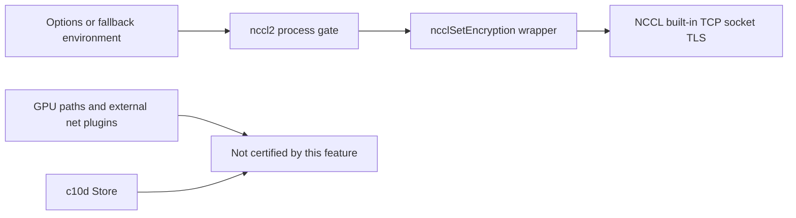
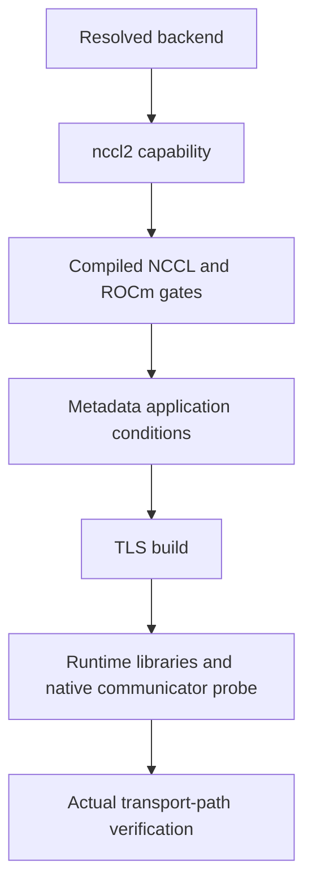
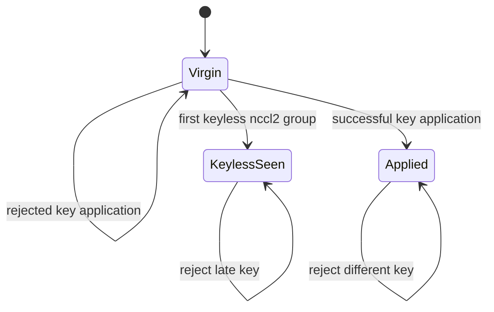

# AI Infra transport FAQ: NCCL2 TCP TLS, process-wide PSKs and first-group capability gates

> **Language**: English | [中文](nccl2-tcp-tls-process-key-capability-gates-selection-faq.md)  
> **Round 145 · 2026-11-14 daytime**: today's build/runtime and lifecycle contracts; metadata only, with no accepted or generated real keys.

**Executive finding:** The Nov14nccl2socket-PSK feature does not make a new Python property proof of TLS support. Check compiled NCCL≥2.32.3, non-ROCm, TLS build/runtime libraries, and **process-wide configuration before the first nccl2group**. Destroying groups does not clear the key. Options win; fallback environment is not reread after application. TCP coverage is not certification of GPU paths, external net plugins or the c10d Store.

**Artifacts**: [metadata H5](../reports/nccl2-tcp-tls-process-key-capability-gates-sizer.html) · [seven cards](../reports/nccl2-tcp-tls-process-key-capability-gates-selection-cards.html) · [1600px SVG](../../assets/svg/nccl2-tcp-tls-process-key-capability-gates-selection-faq-summary.svg) · [sealed report](../../experiments/nccl2_process_key_gate_selection/report.json)

## Q1: What changed today, and which paths are outside its scope?

Pinned source adds`Options.encryption_psk`, an nccl2API wrapper, process-global gate and native tests. This is an actual dated feature change, not merely a newer tree SHA.



Source describes built-in TCP sockets for bootstrap, proxy, RAS, Socket transport and InfiniBand connection setup under TLS1.3. Protected connection setup does not imply protected IB/RDMA GPU data paths; Store rendezvous is not covered either. Deployment needs path inventory and verification. This is not a formal security assessment or cryptographic data-plane certification.

## Q2: Why are version, backend and TLS runtime separate gates?

The wrapper's compile gate requires NCCL≥2.32.3and excludes ROCm. Option documentation separately requires an OPENSSL3TLS build and runtime`libcrypto.so.3`/`libssl.so.3`. A new PyTorch version or successful model metadata application cannot replace these checks.



Environment documentation applies to`nccl`/`nccl-lazy`when resolved to nccl2; the environment does not provide the same behavior when resolved to legacy or torchcomms. Explicit PSK options are rejected in those paths. H5 uses **resolved backend labels**, not a claim that every installation maps`nccl`identically.

The model treats TLS build=false as blocked readiness and null as requiring a probe. It does not predict the exact native group-versus-communicator failure stage. Upstream tests force Socket transport and skip missing TLS builds; these native tests were not run locally.

## Q3: Why do first group, precedence and destroy form a process-wide latch?

The default original timeline carries only synthetic-A/B, byte length and NUL metadata:

```text
Explicit A + environment B → model applies A
Unset option + environment B → inherit A;no environment reread
Destroy groups → preserve process state
Explicit B → reject different_process_key
```



A keyless first group also closes the opportunity to apply an initial key later. Rejected31byte/NUL application and injected API failure leave original state unchanged; this **does not mean every later group/communicator failure rolls back an already applied key**.

Source disallows concurrent group construction while setting the key. Its guard tracks earlier nccl2groups, not every earlier communicator from other NCCL users. Verify that broader deployment precondition separately; this model has no real native communicator registry.

## Q4: Why must byte length, rank agreement and synthetic cohort labels stay separate?

The source minimum is **at least32bytes**, not exactly32or32visible characters. Original32and64byte cases are eligible;31is rejected. The0..256UI bound is original, **not a native maximum**. Length does not establish randomness or entropy, and a passphrase is not equivalent key material.

Every rank needs consistent real configuration. Source warns a mismatch may hang rather than return a clean error; no hang was reproduced here. Synthetic-A/A versus synthetic-A/B tests label agreement only—not hashes, secret equality, authentication or proof of actual rank-key agreement.

H5 accepts four fixed synthetic labels and rejects arbitrary labels or extra`psk`/other fields. **Never paste a real PSK.** Local exceptions do not echo rejected cohort values; this is not an audit of the deployment-wide secret/logging system.

## Q5: Does CPU metadata preflight measure TLS performance?

No. Both paths check prebuilt homogeneous synthetic rank labels: set agreement versus all unordered pairs. They return the same result, with no early mismatch exit.

| Synthetic rank labels | Set agreement (ms) | All pair comparisons (ms) |
| ---: | ---: | ---: |
| 8 | 0.000333 | 0.003067 |
| 32 | 0.000533 | 0.039367 |
| 128 | 0.002200 | 0.686600 |
| 512 | 0.006633 | 10.241467 |

Two warmups, seven alternating repeats and three operations per sample yield median repeat means. Label collection, real secret comparison, group initialization, NCCL, TLS, GPUs and network are excluded.512labels are not512running ranks; microsecond results are not portable thresholds. Native handshake, crypto throughput and path verification remain unknown/null, not zero or CPU lookup proxies.

## Q6: How should the study be reproduced and deployment readiness assessed?

```powershell
python -m unittest discover -s tests -p test_nccl2_process_key_gate_selection.py -q
python -m experiments.nccl2_process_key_gate_selection.run --check
# --measure replaces original local CPU label samples;never invokes NCCL.
```

Eight tests cover2,801independent four-state declarative-oracle traces, length/NUL/injected-failure rollback, precedence, version/backend/unknown readiness, invalid secret fields/types, label/pairwise oracle, Node/Python traces and sealed records. Fifteen report scenarios separate constructor policy from readiness. The60-solid original figure is a process-latch cabinet. Prior browser refusal remains respected; visual browser acceptance was not performed.

Sources: [Nov14feature commit](https://github.com/pytorch/pytorch/commit/0a95a45a42fbec1ab15a5c8ad9b6f03ac2e225ef), [process gate](https://github.com/pytorch/pytorch/blob/0a95a45a42fbec1ab15a5c8ad9b6f03ac2e225ef/torch/csrc/distributed/c10d/nccl2/ProcessGroupNCCLBackend.cpp), [API wrapper](https://github.com/pytorch/pytorch/blob/0a95a45a42fbec1ab15a5c8ad9b6f03ac2e225ef/torch/csrc/distributed/c10d/nccl2/NcclApi.cpp), [option requirements](https://github.com/pytorch/pytorch/blob/0a95a45a42fbec1ab15a5c8ad9b6f03ac2e225ef/torch/csrc/distributed/c10d/init.cpp), [native tests](https://github.com/pytorch/pytorch/blob/0a95a45a42fbec1ab15a5c8ad9b6f03ac2e225ef/test/distributed/test_c10d_nccl2.py), [LICENSE](https://github.com/pytorch/pytorch/blob/0a95a45a42fbec1ab15a5c8ad9b6f03ac2e225ef/LICENSE). PyTorch BSD-style source rights are preserved; no implementation is mirrored.

Deployment still needs actual version/build/runtime checks, backend resolution, path inventory, consistent rank configuration, earlier-communicator and concurrency checks, secret supply/log governance, and real TLS/performance validation. `injected_api_ok`is an original stub, not a native observation. Report provenance is `synthetic`, `independently_reproduced=false`; CPU records are separately `measured`. No real keys are generated, read or transmitted.
