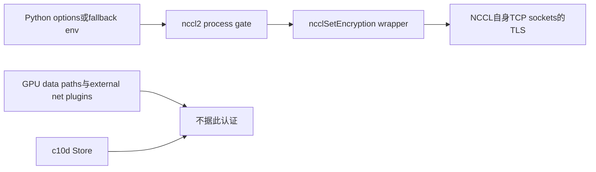
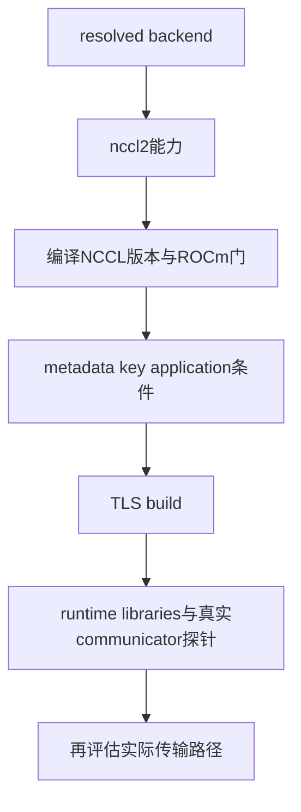
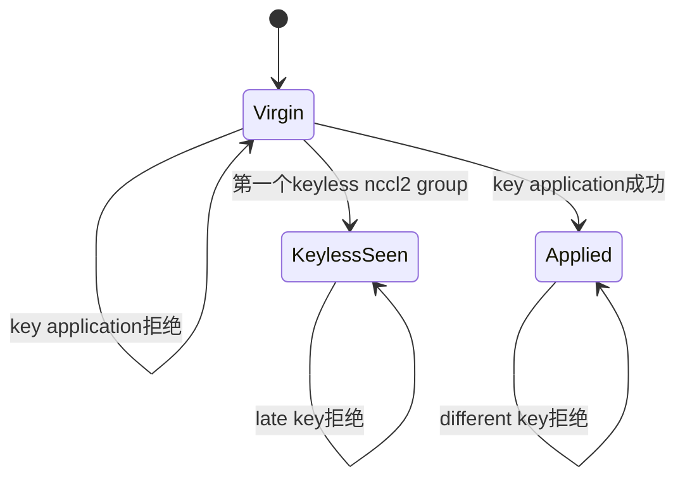

# AI Infra 传输选型 FAQ：NCCL2 TCP TLS、进程级 PSK 与 First-Group 能力门控

> **语言**：中文 | [English](nccl2-tcp-tls-process-key-capability-gates-selection-faq.en.md)  
> **Round 145 · 2026-11-14 白班**：当日新增能力的编译/运行时与生命周期契约；纯metadata，不接收或生成真实密钥。

**结论速览**：11月14日PyTorch新增nccl2 socket PSK选项，但“有新Python属性”不代表部署支持TLS。须核对NCCL编译版本≥2.32.3、非ROCm、TLS build和运行时库，以及**第一个nccl2 group前的进程级配置**。destroy groups不会清除已设置key；options优先，key已应用后不再读取fallback环境变量。TCP覆盖不等于GPU data paths、external net plugins或c10d Store全面加密。

**交付**：[metadata H5](../reports/nccl2-tcp-tls-process-key-capability-gates-sizer.html) · [7-Card](../reports/nccl2-tcp-tls-process-key-capability-gates-selection-cards.html) · [1600px SVG](../../assets/svg/nccl2-tcp-tls-process-key-capability-gates-selection-faq-summary.svg) · [封存数据](../../experiments/nccl2_process_key_gate_selection/report.json)

## Q1：当日新增能力到底在哪一层，哪些路径不覆盖？

固定source新增`Options.encryption_psk`、nccl2 API wrapper、process-global gate及native测试。这是当日真实feature change，而不是仅更新tree SHA。



source将bootstrap、proxy、RAS、Socket transport及InfiniBand connection setup的内建TCP sockets纳入TLS1.3范围；不能从connection setup受保护推导IB/RDMA GPU数据流也受本开关保护，更不能把Store rendezvous当作已加密。必须分开做路径清点与部署验证，本轮不是正式安全评估或数据面密码学认证。

## Q2：版本、backend与TLS运行时为何是不同门？

wrapper的编译门是NCCL≥2.32.3且非ROCm。options文档另外要求TLS backend为OPENSSL3，以及runtime可用的`libcrypto.so.3`/`libssl.so.3`。新PyTorch版本或成功设置model metadata不能替代这些检查。



源码env文档适用于`nccl`/`nccl-lazy`解析到nccl2的情况；若解析为nccl-legacy或torchcomms，env没有相同效果。显式PSK option在legacy/torchcomms路径被拒绝。H5使用**resolved backend标签**，不声称字符串`nccl`在每个安装中都等于同一backend。

本model把TLS build=false视为readiness阻塞、null视为待probe；构造/communicator具体失败时机不预测。upstream测试专门强制Socket路径并在TLS缺失时skip；本机未运行该native测试。

## Q3：为什么第一组、env precedence与destroy形成进程级锁？

原创默认timeline只记录`synthetic-A/B`、byte_length与NUL boolean：

```text
显式 A + env B → model应用A
显式 unset + env B → 继承A，不再读env
destroy groups → 进程状态保留
显式 B → different_process_key 拒绝
```



keyless first group同样会关闭“以后再首次设置key”的机会。31byte或NUL key application被拒绝、以及原型注入API失败时，原状态不推进；这**不是声称任何后续group/communicator失败都会回滚已设置key**。

source要求设置时不与其他group construction并发。guard只追踪早先nccl2 groups，不代表它能够发现所有其他NCCL用户的既有communicator。此前任何NCCL communicator都应在部署前置条件中核验；model不维护真实native registry。

## Q4：32bytes、同rank配置与synthetic cohort为什么不能混淆？

source要求**至少32bytes**，不是恰好32，也不是32个视觉字符。model的32与64byte cases均eligible，31byte case被拒绝；0..256byte是原创UI有界输入，**不是native最大key长度**。字节数只描述长度，不证明随机性或entropy，不应把口令当作等价密钥。

所有rank必须采用一致真实配置。source警告mismatch可能hang而非清晰error，但本轮未复现hang。两rank的`synthetic-A/A`与`synthetic-A/B`只验证原创label一致性；它们不是hash、secret比较、authentication或跨rank密钥匹配证明。

H5拒绝任意cohort字串与`psk`/其他额外字段，只接受四个固定synthetic标签。**不要粘贴真实PSK**。本地测试验证异常不回显非法cohort；这不构成整个部署日志体系的secret审计。

## Q5：metadata preflight的CPU时延能说明TLS性能吗？

不能。下表对预建、全部相同的synthetic rank labels做set一致性检查与所有unordered pair比较；两路都返回相同结果，后者没有早期mismatch退出。

| synthetic rank labels | set一致性（ms） | 所有pair比较（ms） |
| ---: | ---: | ---: |
| 8 | 0.000333 | 0.003067 |
| 32 | 0.000533 | 0.039367 |
| 128 | 0.002200 | 0.686600 |
| 512 | 0.006633 | 10.241467 |

2warmups、7轮交替repeat、每sample3操作，取repeat means中位数。排除label collection、真实key比较、group init、NCCL、TLS、GPU与network。512labels不是运行512ranks；微秒级结果也不应用作环境独立阈值。native handshake、crypto throughput、路径覆盖验证均未知/null，不以0或CPU lookup替代。

## Q6：如何复现、核验来源并决定是否可以上线？

```powershell
python -m unittest discover -s tests -p test_nccl2_process_key_gate_selection.py -q
python -m experiments.nccl2_process_key_gate_selection.run --check
# --measure 主动替换原创本机 CPU label samples；绝不调用NCCL
```

八项测试覆盖2,801个独立四状态declarative-oracle traces、minimum/NUL/注入API失败回滚、option/env precedence、版本/backend/unknown capability、非法secret字段与类型、label/pairwise oracle、Node/Python traces与封存数据。15个报告scenario区分constructor policy与readiness，视觉图为60-solid原创process latch柜。此前浏览器拒绝仍受尊重，未做视觉浏览器验收。

来源：[11月14日feature commit](https://github.com/pytorch/pytorch/commit/0a95a45a42fbec1ab15a5c8ad9b6f03ac2e225ef)、[process gate](https://github.com/pytorch/pytorch/blob/0a95a45a42fbec1ab15a5c8ad9b6f03ac2e225ef/torch/csrc/distributed/c10d/nccl2/ProcessGroupNCCLBackend.cpp)、[API wrapper](https://github.com/pytorch/pytorch/blob/0a95a45a42fbec1ab15a5c8ad9b6f03ac2e225ef/torch/csrc/distributed/c10d/nccl2/NcclApi.cpp)、[option requirements](https://github.com/pytorch/pytorch/blob/0a95a45a42fbec1ab15a5c8ad9b6f03ac2e225ef/torch/csrc/distributed/c10d/init.cpp)、[native tests](https://github.com/pytorch/pytorch/blob/0a95a45a42fbec1ab15a5c8ad9b6f03ac2e225ef/test/distributed/test_c10d_nccl2.py)、[LICENSE](https://github.com/pytorch/pytorch/blob/0a95a45a42fbec1ab15a5c8ad9b6f03ac2e225ef/LICENSE)。PyTorch BSD-style source权利保留，无实现镜像。

上线前仍需实际版本/build/runtime、backend解析、路径清点、all-rank配置、此前communicators、并发约束、secret供给/日志治理及真实TLS/性能验证。`injected_api_ok`是原创stub，不是原生API观察值。主报告`synthetic`、`independently_reproduced=false`，CPU单独`measured`，不生成/读取/发送真实key。
