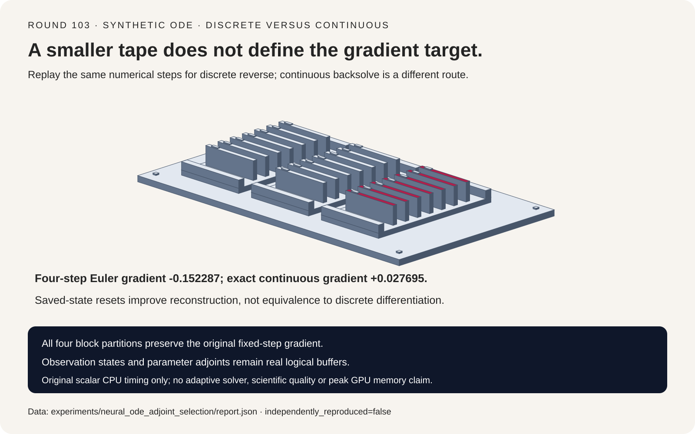
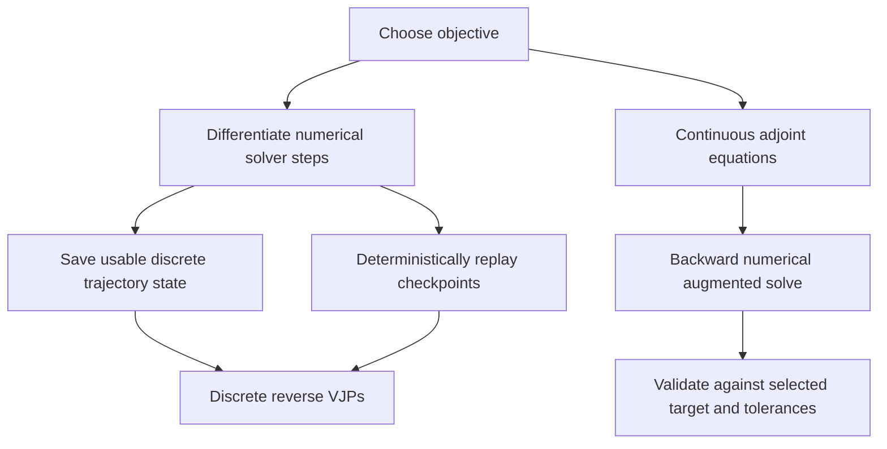
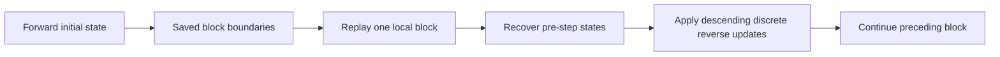
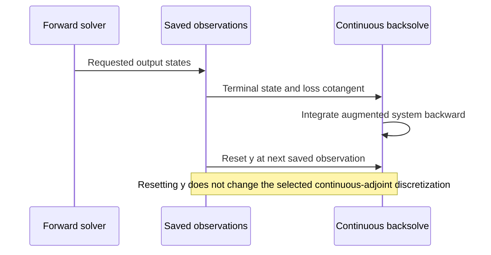

# Neural ODE FAQ: discrete gradients, continuous backsolve and checkpoint replay

> **Language**: [中文](neural-ode-discrete-continuous-adjoint-checkpoint-selection-faq.md) | English
>
> **Round 103 · 2026-11-14 (twelfth round of the November 13 night)** · [SVG](../../assets/svg/neural-ode-discrete-continuous-adjoint-checkpoint-selection-faq-summary.svg) · [7-card report](../reports/neural-ode-discrete-continuous-adjoint-checkpoint-selection-cards.html) · [H5 workbench](../reports/neural-ode-discrete-continuous-adjoint-checkpoint-sizer.html) · [Sealed report](../../experiments/neural_ode_adjoint_selection/report.json)
>
> **Synthetic, `independently_reproduced=false`.** Timing alone measures original scalar CPU functions. No Diffrax/torchdiffeq/JAX/PyTorch execution, adaptive solver, scientific-quality benchmark or GPU result.



## 1. Executive summary: choose the derivative target before the memory strategy

A neural ODE training system can differentiate its **numerical solver
computation** or numerically solve a **continuous adjoint equation**.
These do not automatically produce the same finite-precision gradient.
Checkpointing is a storage/recomputation strategy, not a definition of
which objective is differentiated.

Original scalar fixture:

```text
dy/dt = theta*y; y(0)=1; theta=.7; duration=1
loss = .5*(terminal_y - 2)^2
fixed explicit Euler: four steps
```

Euler ends at `1.906125390625`; the exact continuous flow ends at
`2.013752707470`. They lie on opposite sides of target 2.
The numerical objective's theta gradient is **`-.152286618268`**,
while the exact continuous objective's is **`+.027694551904`**.
Opposite signs here are a consequence of different objectives, not a
claim that the correct analytic derivative is buggy.

| Route | Derivative contract | Memory implication |
| :--- | :--- | :--- |
| Discrete reverse | Selected numerical step sequence | Needs usable pre-step information |
| Deterministic checkpoint replay | Same discrete computation | Stores boundaries and recomputes steps |
| Continuous backsolve | Numerically integrated continuous adjoint | Reconstructs states, still has other buffers |
| Exact analytic flow | Continuous toy objective | A reference, not a production solver |

Pinned Diffrax describes recursive checkpointing as its preferred default
for most problems and warns that continuous backsolve gradients are
approximate. The inspected February 2026 change was infrastructure
standardization, not a new adjoint capability or daily popularity claim.

## 2. Architect Q&A: when is a low-memory gradient the right gradient?

### Q1: What exactly does discrete reverse differentiate?

For Euler `y_next = y + h*theta*y`, the reverse update is:

```text
theta_gradient += adjoint_next * h * y_pre_step
adjoint_previous = adjoint_next * (1 + h*theta)
```

The pre-step state matters. An independent polynomial reference is
`y_N=y0*(1+h*theta)^N`, and central finite differences of that same
numerical computation agree with both theta and initial-state reverse
gradients within `8.21e-11` in the default fixture.

This tests the fixed Euler computation. It does not certify derivatives
of adaptive step choices, event times, interpolation or a framework's
complete solver implementation.

### Q2: How does block checkpointing preserve the gradient?

The original block algorithm saves every selected boundary, including the
last partial block. During reverse it regenerates that block with the
same forward step function, verifies its endpoint, then applies the same
reverse updates in the same descending order.

All block sizes 1/2/3/4 reproduce the four-step gradient exactly; tests
also cover every block size of a seven-step problem. Each step is replayed
once, adding N forward evaluations. This is a simple fixed-block scheme,
**not Diffrax's online/binomial schedule**.

Determinism is part of the contract. Stochastic vector fields, changed
parameters, nondeterministic kernels and changed adaptive decisions
require additional replay state or a different method; they are excluded.

### Q3: Why does restoring saved states not guarantee the discrete gradient?

The continuous augmented system, in forward physical time, is:

```text
dy/dt = theta*y
da/dt = -theta*a
dg/dt = -a*y
```

It is integrated backward from the terminal state and terminal
cotangent. Our control uses **explicit Euler stepping backward in time**,
not the implicit method conventionally called backward Euler.

Without observation resets it returns theta gradient
`-.170883406525` and reconstructs initial state `.883013331787`.
Resetting y to its saved forward value after every step lowers maximum
pre-reset state mismatch from `.116986668213` to `.049680927734`,
but gives gradient `-.178936776465`, **farther** from the discrete
reference `-.152286618268` on this fixture.

That is not a universal ordering of methods. It demonstrates that better
state reconstruction alone does not equate two differently discretized
gradient systems.

### Q4: Is an exact backsolve from the numerical terminal the exact continuous loss?

No. The numerical terminal is already an approximation.
An exact continuous augmented backsolve initialized with that terminal
would yield `(y_N-target)*y_N*duration`; reconstructing its initial state
gives `y_N*exp(-theta*duration)`, generally not the supplied y0.

The analytic true-forward continuous objective instead starts at the
actual y0 and uses `y0*exp(theta*duration)`. The report records both
references separately. Refining Euler from 4 to 256 steps reduces the
continuous-gradient gap from `.179981170172` to `.003959689716`;
this is numerical convergence, not learned-model quality.

### Q5: Does adjoint mean constant total memory?

Only a qualified internal-step statement is defensible. The inspected
torchdiffeq path saves requested times, output states and adjoint
parameters; it initializes augmented state/initial-state/parameter VJPs,
integrates backward and resets y at saved observation times. Separate
adjoint tolerances/options and norm/seminorm behavior are explicit.

Requested observation states scale with their count and state dimension;
parameter adjoints scale with parameter dimension. Solver stages and
network activation workspace remain additional costs. Saved parameter
references are not automatically duplicate parameter allocations.

Diffrax recursive checkpointing has its own checkpoint bound and
forward/reverse-mode restrictions. Its documented default schedule is
not the block heuristic implemented here. Neither source supports
ignoring all these dimensions and declaring constant peak HBM.

## 3. Visual architecture: gradient objective and trajectory lifecycle







## 4. Selection matrix and selected-buffer calculator

| Requirement | Check | Do not substitute |
| :--- | :--- | :--- |
| Numerical training gradient | Finite differences of the same solver computation | Analytic different-objective derivative |
| Replay storage | Identical steps and required replay state | A changed forward computation |
| Continuous backsolve | Forward/backward error and gradient target | State reconstruction error alone |
| Many observations/parameters | Explicit saved/augmented buffers | O(1) total-memory slogan |
| Production adoption | Actual solver, precision and model tests | Scalar CPU numbers |

For N fixed steps, block size C, state dimension D and element width b:

```text
Euler state tape = (N+1)*D*b
saved block boundaries = ceil(N/C)+1
largest local replay buffer = C+1 states
selected block-state upper bound = (ceil(N/C)+1+C+1)*D*b
additional forward evaluations = N
```

Boundary duplication is deliberately included in the selected-buffer
upper bound. This is not a full framework autograd tape or measured
Python object memory. Extreme blocks C=1 or C=N can exceed the simple
state tape; checkpointing is not automatically storage-saving.

Default N=1000, C=32, D=1,048,576, FP32, two observations and
1,048,576 parameter-adjoint elements:

| Logical selected buffer | Bytes |
| :--- | ---: |
| Euler state tape | `4,198,498,304` |
| Block boundaries plus largest replay buffer | `276,824,064` |
| Saved observation states | `8,388,608` |
| y, state adjoint and parameter adjoint | `12,582,912` |

These are separate scenarios/components, not automatically additive
simultaneous lifetimes. Excluded: solver stages, model activations,
parameter/optimizer storage, allocator behavior and actual peak HBM.
The scalar timing fixture has D=1 and is not extrapolated to this budget.

## 5. Worked evaluation and seven-card report

| Route | Theta gradient | Difference from discrete reference |
| :--- | ---: | ---: |
| Full discrete reverse | `-.152286618268` | `0` |
| Block replay | `-.152286618268` | `0` |
| True continuous objective | `+.027694551904` | `.179981170172`, different objective |
| Coarse continuous backsolve | `-.170883406525` | `.018596788257` |
| Backsolve with every-step state reset | `-.178936776465` | `.026650158197` |

Sealed scalar CPU timings include forward/reverse validation, two
warmups and seven alternating repeats:

| Steps | Full state tape median ms | Block replay median ms |
| ---: | ---: | ---: |
| 32 | `.0128` | `.0273` |
| 128 | `.0441` | `.0806` |
| 512 | `.1685` | `.3001` |
| 2,048 | `.6544` | `1.1897` |

Windows ARM64, Python 3.12.10; CPU identity is recorded in `latency.json`.
Replay is slower in all four measured cases, consistent with exchanging
work for selected state storage. These are not adaptive-library or GPU
timings and do not predict model throughput.

Card 2 bars show **absolute gradient magnitudes**, with signed values
printed separately; negative gradients never become negative CSS widths
or probabilities. All coordinates derive from sealed data. The original
sorter represents saved/replayed trajectory cards, not solver hardware.
Browser visual verification was not performed; the earlier refusal
remains respected.

## 6. Reproduction, provenance and readiness boundaries

```powershell
python -m experiments.neural_ode_adjoint_selection.run
python -m experiments.neural_ode_adjoint_selection.run --check
python -m unittest tests.test_neural_ode_adjoint_selection
python scripts\validate_research.py
```

Only explicit `--measure` replaces CPU samples; `--check` never
remeasures. Eight tests cover polynomial/finite-difference references,
all block sizes including partial blocks, continuous/discrete signs,
explicit backward-time state controls, memory extremes and invalid
inputs, sealed samples, strict CSP/SVG and Python/Node integer parity.

First-party sources:
[Diffrax adjoints](https://github.com/patrick-kidger/diffrax/blob/6321f02fbd6d65a95f745ed9a05245394023fb08/diffrax/_adjoint.py),
[Diffrax Apache-2.0](https://github.com/patrick-kidger/diffrax/blob/6321f02fbd6d65a95f745ed9a05245394023fb08/LICENSE),
[torchdiffeq adjoint](https://github.com/rtqichen/torchdiffeq/blob/c6fac08a0397a595707ae949d2eb78fa1277ccd0/torchdiffeq/_impl/adjoint.py),
[torchdiffeq MIT](https://github.com/rtqichen/torchdiffeq/blob/c6fac08a0397a595707ae949d2eb78fa1277ccd0/LICENSE).
Upstream rights remain with their holders; no implementation or weights
were copied. Script-free cards use
`default-src 'none'; style-src 'unsafe-inline'`.

**Ready for:** discussing gradient targets and deterministic replay
tradeoffs. **Not ready for:** adaptive/event/stochastic solver parity,
scientific-model quality, production throughput or peak GPU memory claims.
