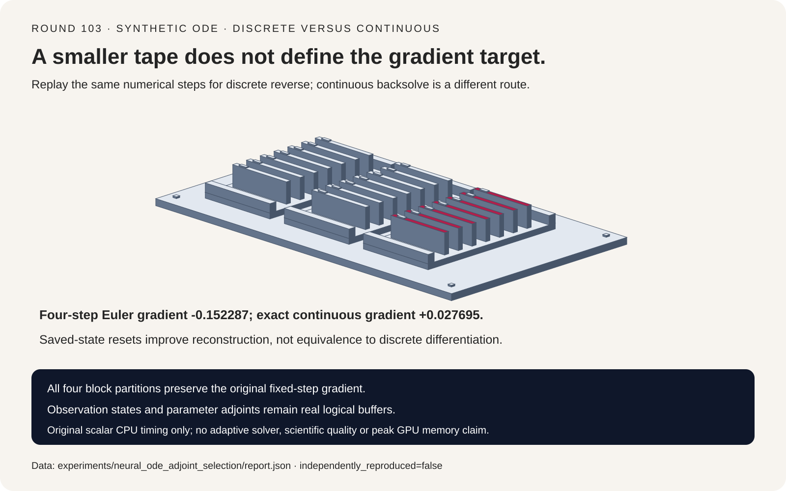
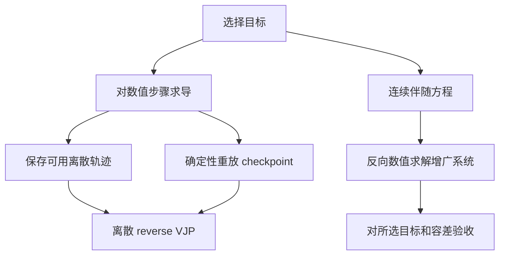
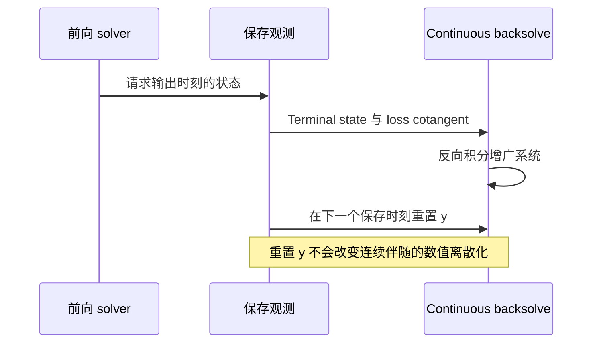

# Neural ODE 选型 FAQ：离散梯度、连续伴随与 Checkpoint 重放

> **语言**：中文 | [English](neural-ode-discrete-continuous-adjoint-checkpoint-selection-faq.en.md)
>
> **Round 103 · 2026-11-14（11 月 13 日夜班第十二轮）** · [高清 SVG](../../assets/svg/neural-ode-discrete-continuous-adjoint-checkpoint-selection-faq-summary.svg) · [七卡报告](../reports/neural-ode-discrete-continuous-adjoint-checkpoint-selection-cards.html) · [H5 工作台](../reports/neural-ode-discrete-continuous-adjoint-checkpoint-sizer.html) · [封存数据](../../experiments/neural_ode_adjoint_selection/report.json)
>
> **Synthetic，`independently_reproduced=false`。** 仅 timing 是原创标量 CPU 函数实测；未运行 Diffrax/torchdiffeq/JAX/PyTorch，不含 adaptive solver、科学模型质量或 GPU 结果。



## 1. 执行摘要：先确定对谁求导，再选择省内存策略

Neural ODE 可以对**数值 solver 的计算步骤**求导，也可以数值求解
**连续伴随方程**。在有限精度、有限步长下，两者不自动相同。
Checkpoint 是存储与重算策略，不是梯度目标本身。

原创标量 fixture：

```text
dy/dt = theta*y；y(0)=1；theta=.7；duration=1
loss = .5*(terminal_y - 2)^2
固定 explicit Euler：四步
```

Euler 终点 `1.906125390625`，精确连续终点 `2.013752707470`，
恰好位于 target=2 两侧。数值目标的 θ 梯度 **`-.152286618268`**，
精确连续目标则为 **`+.027694551904`**。符号相反体现目标不同，
不能把正确解析导数也叫作程序 bug。

| 路径 | 梯度契约 | 内存含义 |
| :--- | :--- | :--- |
| Discrete reverse | 所选数值计算步骤 | 需要可用的 pre-step 信息 |
| 确定性 checkpoint replay | 相同离散计算 | 保存边界并重算步骤 |
| Continuous backsolve | 数值积分连续伴随 | 反向重建状态，但仍有其他 buffer |
| 解析连续流 | 连续 toy 目标 | 参照，不是生产 solver |

固定 Diffrax 文档将 recursive checkpoint 作为多数问题的默认优选，
并警告 continuous backsolve 的近似梯度。所查 2026 年 2 月变更是
基础设施标准化，不能宣称为新的伴随能力或每日热度排名。

## 2. 架构师 Q&A：省内存得到的是否是想要的梯度？

### Q1：Discrete reverse 究竟对什么求导？

Euler `y_next=y+h*theta*y` 的反传为：

```text
theta_gradient += adjoint_next * h * y_pre_step
adjoint_previous = adjoint_next * (1 + h*theta)
```

Pre-step state 不能替换为另一个时刻的状态。独立多项式参照为
`y_N=y0*(1+h*theta)^N`；对相同数值计算做 central finite differences，
默认 θ 与 initial-state 梯度最大误差 `8.21e-11` 以内。

这里只验证固定 Euler；没有认证 adaptive step 决策、事件时刻、
插值或框架完整 solver 的导数。

### Q2：Block checkpoint 为什么能保持同一梯度？

原创算法保存选定块边界及最后不完整块终点；反传时使用相同 step 函数
重新生成本块，检查终点完全一致，再按相同倒序执行离散 VJP。

四步问题的 block=1/2/3/4 都完全一致；测试还覆盖七步问题所有 block
大小。每一步额外 replay 一次，即增加 N 次前向求值。
这是简单固定分块，**不是 Diffrax 的 online/binomial schedule**。

确定性是契约的一部分。随机向量场、参数改变、非确定 kernel 和不同
adaptive decision 需要更多 replay state 或其他方案；本轮均不模拟。

### Q3：把状态重置回正确观测值，为什么仍不是离散梯度？

连续增广系统在正向物理时间中的方程：

```text
dy/dt = theta*y
da/dt = -theta*a
dg/dt = -a*y
```

从 terminal state 与 terminal cotangent 反向积分。原创对照使用的是
**explicit Euler 沿时间反向推进**，不是通常称为 backward Euler 的
隐式方法。

不重置时 θ 梯度 `-.170883406525`，重建初态 `.883013331787`。
每步将 y 重置为保存的 forward 值，可将最大 pre-reset 状态误差从
`.116986668213` 降到 `.049680927734`；但梯度成为
`-.178936776465`，反而离离散参照 `-.152286618268` 更远。

这不是普适性能排序，而是说明“状态重建更好”并不自动消除两套梯度
系统的离散化差异。

### Q4：从数值 Terminal 精确 Backsolve，就等于精确连续 Loss 吗？

不等于，数值终点已带近似。若从它初始化精确连续增广反解，θ 梯度为
`(y_N-target)*y_N*duration`，重建初态为
`y_N*exp(-theta*duration)`，一般不再是给定 y0。

真正 continuous objective 从实际 y0 出发，终点为
`y0*exp(theta*duration)`。封存数据分别保留两种参照。
将 Euler 从四步细化到 256 步，连续梯度差由 `.179981170172` 降至
`.003959689716`；这是数值收敛，不是模型任务质量。

### Q5：Adjoint 是否意味着总内存 O(1)？

只能附带限定地谈 internal-step 存储。所读 torchdiffeq 保存请求
时刻、输出状态和 adjoint 参数；构造 state/initial-state/parameter
VJP 增广系统，反向积分，并在保存时刻重置 y。它还显式区分 adjoint
容差/options 和 norm/seminorm。

Observation 数量、状态维度、参数伴随维度都影响 buffer；solver stages
和网络激活仍需要 workspace。保存参数引用也不自动代表重复分配整份权重。

Diffrax recursive checkpoint 另有 checkpoint bound、正反模式限制；
其默认 schedule 不是本轮固定分块。不能忽略这些维度后声称 constant
total memory 或 constant peak HBM。

## 3. 可视化架构：梯度目标与轨迹生命周期






## 4. 选型矩阵与 Selected-Buffer 计算器

| 需求 | 应验证 | 不可替代 |
| :--- | :--- | :--- |
| 数值训练梯度 | 同一 solver 计算的有限差分 | 另一个连续目标的解析导数 |
| Replay 存储 | 相同步骤及所需状态 | 改过的前向计算 |
| 连续反解 | Forward/backward 误差与梯度目标 | 仅看 state reconstruction |
| 大量观测/参数 | 明列 saved/augmented buffers | 总内存 O(1) 口号 |
| 生产使用 | 实际 solver、精度、模型验证 | 标量 CPU 结果 |

N 步、block C、状态维度 D、元素字节 b：

```text
Euler 状态 tape = (N+1)*D*b
保存边界数 = ceil(N/C)+1
最大 local replay buffer = C+1 个状态
selected block-state 上界 = (ceil(N/C)+1+C+1)*D*b
额外前向求值 = N
```

上界刻意包含边界重复计数，不是框架完整 Autograd tape 或 Python 对象
实测。C=1 或 C=N 极端分块可比原始状态 tape 更大，不能默认 checkpoint
总能省存储。

默认 N=1000、C=32、D=1,048,576、FP32、两个 observations、
1,048,576 个 parameter-adjoint 元素：

| 逻辑 selected buffer | 字节 |
| :--- | ---: |
| Euler state tape | `4,198,498,304` |
| Block boundaries 加最大 replay buffer | `276,824,064` |
| 保存 observation states | `8,388,608` |
| y、state adjoint 与 parameter adjoint | `12,582,912` |

这些是不同场景/分量，不自动同时存活或可相加为 peak HBM。
排除 solver stages、网络激活、参数/优化器、allocator 和真实峰值。
CPU timing 的 D=1，不能按维度比例外推这个预算的延迟。

## 5. 案例评测与七卡报告

| 路径 | θ 梯度 | 与离散参照之差 |
| :--- | ---: | ---: |
| Full discrete reverse | `-.152286618268` | `0` |
| Block replay | `-.152286618268` | `0` |
| 真正连续目标 | `+.027694551904` | `.179981170172`，目标不同 |
| Coarse continuous backsolve | `-.170883406525` | `.018596788257` |
| 每步 observation reset | `-.178936776465` | `.026650158197` |

CPU 封存 timing 计入 forward/reverse 与 validation，每函数两次 warmup、
七次交替重复：

| 步数 | Full state tape 中位数 ms | Block replay 中位数 ms |
| ---: | ---: | ---: |
| 32 | `.0128` | `.0273` |
| 128 | `.0441` | `.0806` |
| 512 | `.1685` | `.3001` |
| 2,048 | `.6544` | `1.1897` |

Windows ARM64、Python 3.12.10，CPU 身份保存在 `latency.json`。
四档 replay 都更慢，体现用工作量换 selected-state 存储；这不是
adaptive library/GPU timing，也不预测模型吞吐。

Card 2 用**梯度绝对值**绘制条形，另印 signed value，不把负梯度变成
负 CSS width 或概率。坐标均来自 sealed data。原创实体分拣器表示保存/
重放轨迹，不是 solver 硬件。此前浏览器拒绝保持有效，未做浏览器视觉验收。

## 6. 复现、出处与就绪边界

```powershell
python -m experiments.neural_ode_adjoint_selection.run
python -m experiments.neural_ode_adjoint_selection.run --check
python -m unittest tests.test_neural_ode_adjoint_selection
python scripts\validate_research.py
```

只有显式 `--measure` 替换 CPU samples，`--check` 不重新测量。
八项测试覆盖多项式/有限差分、所有 block 及 partial block、连续/离散
符号差、显式反向时间状态对照、内存极端/非法输入、封存数据、
严格 CSP/SVG 和 Python/Node 整数一致性。

一手资料：
[Diffrax adjoints](https://github.com/patrick-kidger/diffrax/blob/6321f02fbd6d65a95f745ed9a05245394023fb08/diffrax/_adjoint.py)、
[Diffrax Apache-2.0](https://github.com/patrick-kidger/diffrax/blob/6321f02fbd6d65a95f745ed9a05245394023fb08/LICENSE)、
[torchdiffeq adjoint](https://github.com/rtqichen/torchdiffeq/blob/c6fac08a0397a595707ae949d2eb78fa1277ccd0/torchdiffeq/_impl/adjoint.py)、
[torchdiffeq MIT](https://github.com/rtqichen/torchdiffeq/blob/c6fac08a0397a595707ae949d2eb78fa1277ccd0/LICENSE)。
上游权利保留，未复制实现或权重。七卡无脚本，使用
`default-src 'none'; style-src 'unsafe-inline'`。

**适合**：审查梯度目标与确定性重放权衡。**不适合**：
adaptive/event/stochastic solver 一致性、科学模型质量、
生产吞吐或 peak GPU memory 结论。
