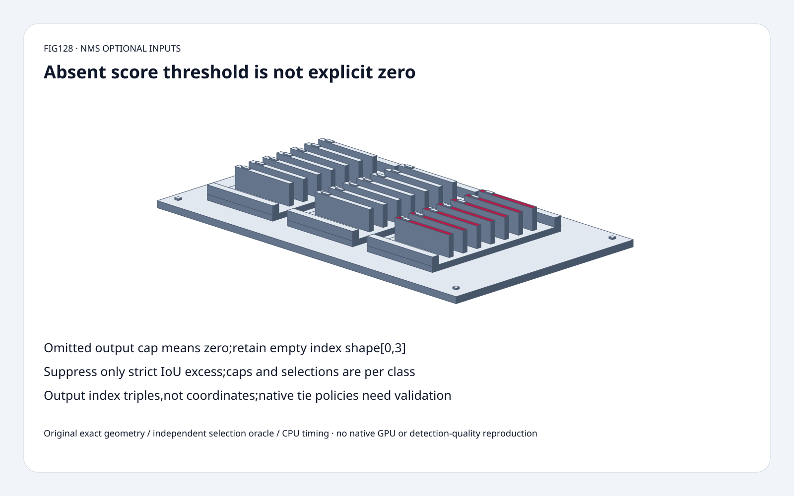
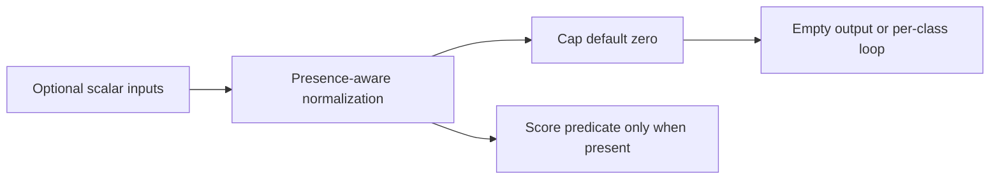
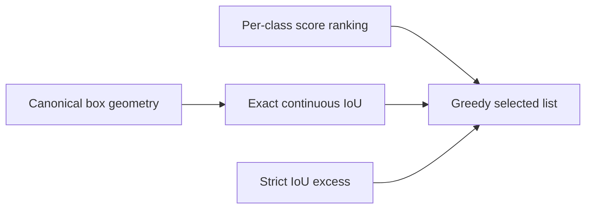
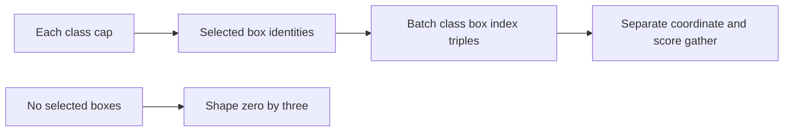

# Detector NMS FAQ: optional scalar presence,per-class caps and exact IoU boundaries

> **Language**: [中文](nms-optional-scalars-per-class-iou-boundary-selection-faq.md) | English
>
> **Round128 · 2026-11-14 · Day round5** · [SVG](../../assets/svg/nms-optional-scalars-per-class-iou-boundary-selection-faq-summary.svg) · [H5](../reports/nms-optional-scalars-per-class-iou-boundary-sizer.html) · [7 cards](../reports/nms-optional-scalars-per-class-iou-boundary-selection-cards.html) · [Data](../../experiments/nms_optional_contract_selection/report.json)
>
> **Synthetic, `independently_reproduced=false`.** Original exact rational IoU/class-aware greedy NMS,candidate-removal and integer-cell area oracles,separately measured original CPU float geometry. No native ONNX/GPU/detection-quality reproduction.



## 1. Executive summary: absent optional inputs are not interchangeable with explicit zero

Pinned ONNX reference's **October28** fix accepts scalar and omitted
optional NMS inputs. Omitted per-class output cap defaults to **0**,
yielding an empty int64 tensor of shape **[0,3]**,not unlimited output.

In the pinned reference,omitting score threshold means **no score
filter**;supplying0 uses a **strict score>0** predicate.
Selected disjoint signed scores`[-1/10,0,1/10]` retain **3** versus **1** boxes.
This identifies the pinned reference code's behavior,not a blanket
certificate for every operator version or backend threshold interpretation.

IoU suppression is **strict IoU>threshold**. Exact equality1/3 is
retained in our Fraction fixture. Output cap1 with two classes produces
**two** index triples,not a global top1.
November12 tree provenance is not a new NMS algorithm launch.

## 2. Architect Q&A: optional tensors,geometry,scope and output contracts

### Q1: What did the October reference fix actually address?

The previous reference indexed optional arrays with`[0]` and mishandled
0-D or missing inputs. The fix normalizes present nonempty values
and treats missing/empty inputs as absent,then returns `[0,3]` when
the resolved cap is zero.

Our original scalar wrapper accepts a rational scalar,one-element
list,empty list or None;unsupported multi-element lists explicitly fail.
It models the scalar/one-element-vector distinction without importing
NumPy or executing native0-D tensors.
Negative integer caps resolve to0 as in the pinned reference;
fractional caps are rejected by the original model.

Do not silently replace an absent cap with a large number.
Shape-preserving empty output is an intentional operator result,
not a success-shaped fallback for malformed input.

### Q2: Why does absent score threshold differ from0?

The inspected candidate loop filters only when the optional input is
present,and then tests **score>threshold**.
With absence,negative and zero scores can remain candidates.
Explicit0 removes both the negative and equal-zero fixture entries.

The semantics here are explicitly **pinned-reference observations**.
Do not infer universal equality handling from loose “low score removed”
wording or assume production GPU kernels have identical thresholds.
Export/runtime qualification should include exact-boundary inputs.

Our H5 uses bounded integer scores with an optional blank threshold.
Blank remains absent;it is not coerced into0.
Likewise blank cap means omitted/default0.

### Q3: Which boxes and IoU definition are selected?

Original corner format is `[y1,x1,y2,x2]`;opposite corners may be
reversed and are canonicalized with min/max.
Selected center format is `[x_center,y_center,width,height]`,
with nonnegative widths/heights in our stricter original model.

Continuous rectangle area uses coordinate differences,**not pixel-
inclusive `+1` lengths**. Touching edges have zero intersection.
Degenerate/zero-union cases use selected IoU0.
The exact model verifies integer-coordinate cases by enumerating unit
cells and measuring set intersection/union independently.

Two boxes `[0,0,2,2]`,`[0,1,2,3]` have intersection2,union6,
IoU **1/3**. Strict suppression retains the second;
changing `>` to`>=` changes selected box identities.
At threshold0,the pinned strict rule suppresses positive overlap,
not disjoint boxes.

### Q4: Why class-aware rather than global suppression?

Scores have a class axis,while boxes can be shared across classes.
Each class has its own greedy ranking,selected list and cap.
The same physical box can be selected in multiple classes.

Original score-descending/index-ascending ties match the inspected
reference ordering. Native/GPU tie equivalence is **not established**.
Tie policy is a reproducibility decision,not proof that all compliant
implementations must choose identical same-score indices.

An independent candidate-removal oracle selects the best remaining
candidate and removes its excessive-overlap neighbors.
The main implementation instead checks candidates against an already
selected list;their exact selected triples agree.
This proves the bounded model,not every acceleration algorithm.

### Q5: Does NMS return box coordinates and a global cap?

No. ONNX selected rows are **[batch_index,class_index,box_index]**,
dtype int64. The original model fixes one batch/index0;
payload budgeting separately supports multiple batch assumptions.
Callers gather boxes/scores separately and retain class identity.

Selected batch1/classes80/boxes8400/cap100/float32:
box payload **134,400 bytes**,scores **2,688,000 bytes**,
selected rows upper bound **8,000**,int64 triples upper bound
**192,000 bytes**.
The row bound is `B*C*min(N,K)`,not a guaranteed actual count.
These are logical buffers,not native workspace/peak HBM.

## 3. Visual architecture: optional normalization,per-class selection,index output







## 4. Selection matrix: preserve presence and class scope across detector exports

| Choice | Good fit | Gate |
| :--- | :--- | :--- |
| Optional scalar normalization | Scalar/one-element export compatibility | Missing and present zero differ |
| Per-class greedy NMS | Declared class-aware suppression | Cap/ranking per class |
| Continuous IoU | ONNX-style coordinate geometry | No inclusive-pixel +1 |
| Exact tie/boundary tests | Cross-runtime qualification | Pinned reference not universal tie guarantee |
| Index-triple output | Separate downstream gather | Keep batch/class/box axes |
| Geometry cache | Unchanged box coordinates/format | Workspace/cached setup are separate |

## 5. Hands-on evidence: cell oracle,greedy oracle,optional presence and CPU geometry

```powershell
python -m experiments.nms_optional_contract_selection.run --check
python -m unittest discover -s tests -p test_nms_optional_contract_selection.py -q
```

Eight tests cover integer-cell IoU,candidate-removal equivalence,
absent versus zero score,optional wrappers/caps,class scope,IoU equality,
formats/ties,invalid data,budget,Node parity and sealed samples.

| Disjoint boxes | Cached canonical coordinates (ms) | Normalize every pair (ms) |
| :--- | ---: | ---: |
| 16 | 0.080233 | 0.156533 |
| 32 | 0.348100 | 0.677833 |
| 64 | 1.406633 | 2.782600 |
| 128 | 5.329867 | 10.858800 |

Original Python float greedy geometry,all boxes selected.
Cached canonicalization setup,sorting,score thresholding,native ONNX,
GPU and detection quality excluded. Two warmups,seven alternating
repeats,three operations/sample,median repeat means.
H5 bounded exact-integer geometry,visible errors;native performance
and arbitrary input robustness are not inferred.
Browser visual inspection not performed.

## 6. Sources,provenance and readiness

- [October28 optional-input fix](https://github.com/onnx/onnx/commit/70f6a89920a3a17d0ea1cd84c0812a90d1e566e2): scalar/omitted inputs and empty-output shape.
- [Pinned NMS reference](https://github.com/onnx/onnx/blob/3c41120b9c69657a1dd13407b080bd451ed06c9c/onnx/reference/ops/op_non_max_suppression.py): strict score/IoU predicates,per-class loops,ties and index triples.
- [Apache-2.0 license](https://github.com/onnx/onnx/blob/3c41120b9c69657a1dd13407b080bd451ed06c9c/LICENSE): upstream rights retained.
- [Original experiment](../../experiments/nms_optional_contract_selection/README.md): exact geometry,independent oracles,CPU records and exclusions.

No upstream implementation copied. Original one-batch exact model
does not certify every backend's tie/equality behavior.
Native latency,detection quality,GPU tie equivalence and peak HBM remain null.
