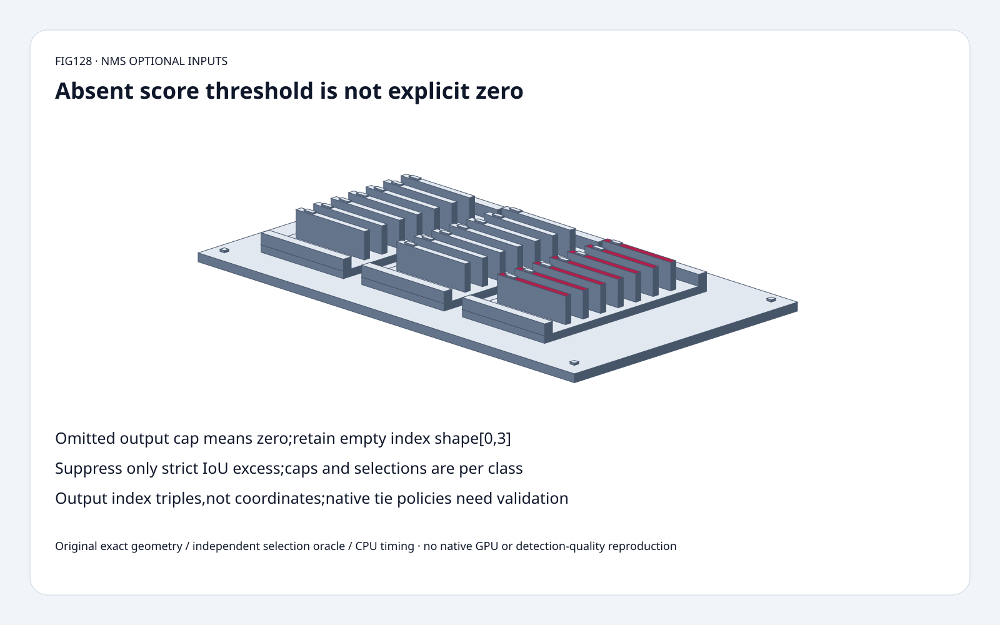
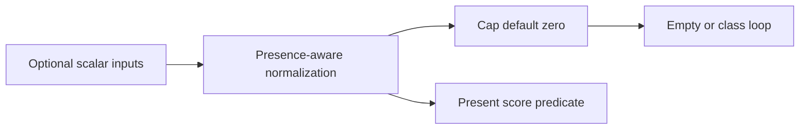
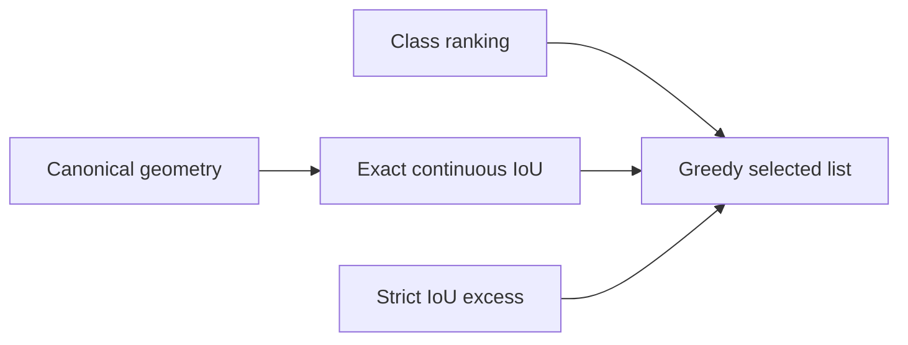
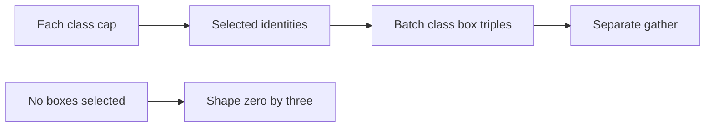

# Detector NMS FAQ：Optional Scalar、Per-class Cap 与 Exact IoU Boundary

> **语言**：中文 | [English](nms-optional-scalars-per-class-iou-boundary-selection-faq.en.md)
>
> **Round128 · 2026-11-14 · 白班第5轮** · [SVG](../../assets/svg/nms-optional-scalars-per-class-iou-boundary-selection-faq-summary.svg) · [H5](../reports/nms-optional-scalars-per-class-iou-boundary-sizer.html) · [七卡](../reports/nms-optional-scalars-per-class-iou-boundary-selection-cards.html) · [Data](../../experiments/nms_optional_contract_selection/report.json)
>
> **Synthetic，`independently_reproduced=false`。** 原创 exact rational IoU、
> class-aware greedy、独立 candidate-removal/cell-area oracles、
> 单独 CPU float geometry；非 native ONNX/GPU/detection quality 复现。



## 一、结论速览：Absent 不能随便替换 Explicit Zero

固定 ONNX reference **10月28日**修复 scalar/omitted optional inputs。
Omitted per-class cap 默认 **0**，
返回 int64 **[0,3]**，不是 unlimited。

Pinned reference 中 score threshold absent 是 **不筛 score**，
explicit0 用 **strict score>0**。
Disjoint scores`[-1/10,0,1/10]` 分别保留 **3 vs1**。
这里明确描述 pinned code，非所有 operator versions/backends 的阈值认证。

IoU suppression 用 **strict>**，
exact1/3 equality不抑制；
cap1/two classes 返回 **两条** index triples，不是globaltop1。
11月12日tree不包装为新NMS算法。

## 二、架构师 Q&A：Optional、Geometry、Class Scope、Output

### Q1：10月Reference Fix究竟修了什么？

旧实现对 optional arrays直接`[0]`，
0-D或omitted inputs会失败；
修复后 normalize present nonempty、
missing/empty视为absent，resolved cap0返回[0,3]。

原创 wrapper 接受 rational scalar、
one-element list、empty list、None；
multi-element显式拒绝。
不用NumPy，不声称实际执行0-D tensor。
Negative integer cap按pinned reference归0；
fractional cap原创拒绝。

不能把absent cap默认为巨大值；
empty shape是正常operator结果，
不是错误输入的静默success fallback。

### Q2：Absent Score Threshold为何不同于0？

所读candidate loop仅在input present时筛选，
使用 **score>threshold**；
absent时negative/zero也可入candidate，
explicit0去掉negative与equalzero。

这是 **pinned-reference observation**，
不能仅凭模糊“低分移除”文字推断所有runtime equality行为。
Export/runtime qualification应包含exact-boundary cases。

H5 bounded integer scores，
score空白保持absent、不coerce0；
cap空白则omitted/default0。

### Q3：选定哪种Box与IoU？

Corner`[y1,x1,y2,x2]`支持反向oppositecorners，
用min/max归一；
center`[x_center,y_center,width,height]`，
原创更严格要求width/height非负。

Continuous area用coordinate difference，
**没有inclusive-pixel +1**；
touching edge intersection0，
degenerate/zero-union用selected IoU0。
独立integer-cell oracle枚举unit cells求set交并，
不重复primitive rectangle formula。

`[0,0,2,2]`与`[0,1,2,3]`交2并6、
IoU **1/3**；strict>保留equal，
误用>=改变selectedidentity。
Threshold0只抑制positiveoverlap，不抑制disjoint。

### Q4：为什么是Per-class，不是Global？

Scores有class轴，boxes可跨classes共享；
每class独立ranking、selectedlist、cap。
同physicalbox可在多个class选中。

原创score降序/index升序ties匹配所读reference；
native/GPUtie equivalence **未建立**，
不宣称所有实现必须同tieindex。

独立candidate-removal oracle每次取best、
移除excessiveoverlap剩余candidate；
主实现对already-selectedlist检查，
exactselectedtriples相同。
这是bounded model证据，非全部acceleration认证。

### Q5：NMS返回Coordinates还是GlobalCap？

不是coordinates。Selectedrows是
**[batch_index,class_index,box_index]**、int64。
原创固定onebatch/index0；
budget可单独假设multiplebatches。
Coordinates/scores另行gather，保留classidentity。

选定batch1/classes80/boxes8400/cap100/float32：
boxes **134,400bytes**、
scores **2,688,000bytes**、
rows上界 **8,000**、
int64triples上界 **192,000bytes**。
`B*C*min(N,K)`只是上界，非实际输出数。
Logicalbuffers非workspace/peakHBM。

## 三、三张架构图：Optional、Classwise Selection、Index Output







## 四、选型矩阵：跨Detector Export保留Presence与Scope

| 选择 | 适合 | Gate |
| :--- | :--- | :--- |
| Optional normalize | Scalar/vector compatibility | Missing非zero |
| Per-class greedy | 明确class-aware | Ranking/cap分class |
| Continuous IoU | ONNX-style geometry | 无pixel+1 |
| Boundary/tie tests | Cross-runtime qualification | Reference非universal |
| Index triples | 下游separate gather | 保batch/class/box |
| Geometry cache | Boxes/format不变 | Setup/workspace另算 |

## 五、动手证据：Cell Oracle、Greedy Oracle、Optional与CPU

```powershell
python -m experiments.nms_optional_contract_selection.run --check
python -m unittest discover -s tests -p test_nms_optional_contract_selection.py -q
```

8tests：cellIoU、candidate-removal、
absent-vs-zero、scalar/vector/caps、
classscope、IoUequality/formats/ties、
invalid/budget、Nodeparity、sealedsamples。

| DisjointBoxes | CachedCanonical（ms） | NormalizeEveryPair（ms） |
| :--- | ---: | ---: |
| 16 | 0.080233 | 0.156533 |
| 32 | 0.348100 | 0.677833 |
| 64 | 1.406633 | 2.782600 |
| 128 | 5.329867 | 10.858800 |

原创Pythonfloatgeometry/allselected，
排除cachedsetup/sorting/scorepredicate/nativeONNX/GPU/quality；
2warmups、7alternatingrepeats、3ops/sample，
medianrepeatmeans。
H5 boundedintegergeometry/visibleerrors，
未做浏览器视觉验收。

## 六、来源、许可、溯源与Readiness

- [10月28日optional fix](https://github.com/onnx/onnx/commit/70f6a89920a3a17d0ea1cd84c0812a90d1e566e2)：scalar/omitted、emptyshape。
- [固定NMSreference](https://github.com/onnx/onnx/blob/3c41120b9c69657a1dd13407b080bd451ed06c9c/onnx/reference/ops/op_non_max_suppression.py)：strictscore/IoU、classloops/ties/indices。
- [Apache-2.0LICENSE](https://github.com/onnx/onnx/blob/3c41120b9c69657a1dd13407b080bd451ed06c9c/LICENSE)：上游权利保留。
- [原创实验](../../experiments/nms_optional_contract_selection/README.md)：exactmodel/oracles/CPU/exclusions。

未复制upstreamimplementation；one-batch model不认证全部backend
tie/equality；nativelatency/quality/GPUties/HBM保持null。
