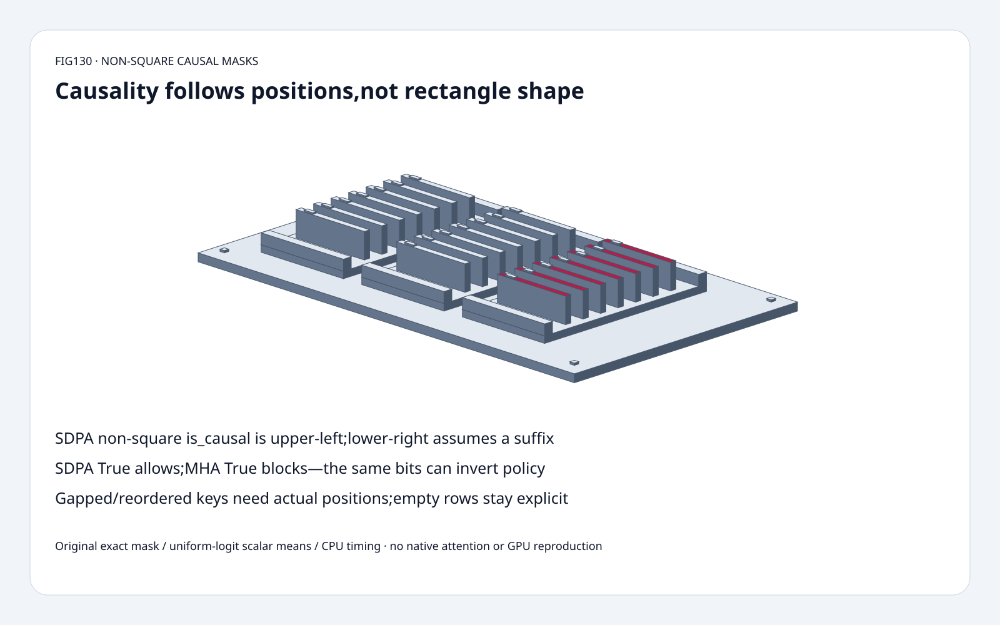
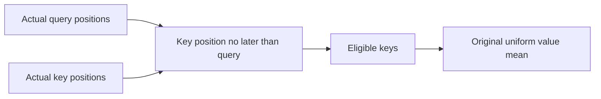
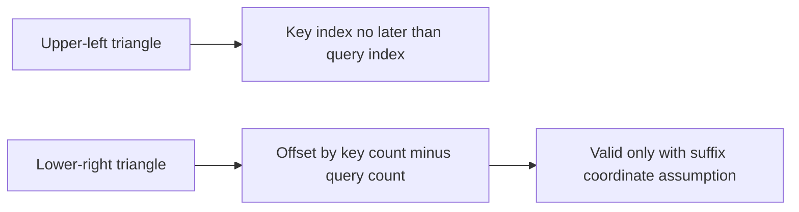
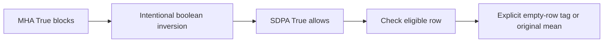

# Attention FAQ: non-square causal masks,cache positions and boolean polarity

> **Language**: [中文](non-square-causal-mask-cache-position-polarity-selection-faq.md) | English
>
> **Round130 · 2026-11-14 · Day round7** · [SVG](../../assets/svg/non-square-causal-mask-cache-position-polarity-selection-faq-summary.svg) · [H5](../reports/non-square-causal-mask-cache-position-polarity-sizer.html) · [7 cards](../reports/non-square-causal-mask-cache-position-polarity-selection-cards.html) · [Data](../../experiments/causal_mask_position_selection/report.json)
>
> **Synthetic, `independently_reproduced=false`.** Original exact positional masks and uniform-zero-logit scalar value means;separately measured original CPU toy paths. No native SDPA/GPU,softmax,dropout,cache kernel or model-quality reproduction.

## 1. Executive summary: one causal flag does not identify a cache position

Pinned PyTorch SDPA `is_causal=True` uses **upper-left** alignment for
non-square query/key axes. One query and five keys therefore allow
only the first key. A query representing the final position in a
contiguous five-key cache instead needs all five eligible keys.

For values `[1,2,4,8,16]`,queries at positions3 and4 and keys0..4,
the original uniform-logit means are **15/4 and31/5**.
Upper-left yields **1 and3/2**.
The lower-right offset`S-L` matches this contiguous-suffix fixture,
but is not a universal positional-causality certificate.

Boolean APIs also differ: **SDPA True means participate;MHA True means
block**. Passing the same blocked-mask bits without conversion exposes
future value16 for the first query and leaves no allowed keys for the
second. The model tags the latter null instead of inventing a numeric output.

## 2. Architect Q&A: alignment,mask meaning and real cache coordinates

### Q1: What are upper-left and lower-right causal masks?

With zero-based query indexi,key indexj,query lengthL and key lengthS:
upper-left permits`j<=i`;lower-right permits`j<=i+(S-L)`.
The pinned `CausalBias` materializers and SDPA documentation explicitly
distinguish these alignments.

ForL2,S5,the permitted counts are1/2 versus4/5.
ForL=S,the two triangles coincide.
ForL1,S5,upper-left permits one key,lower-right permits five.
Neither shape says which absolute token the query actually represents.

### Q2: When is lower-right correct for cached decoding?

When query rows correspond,in order,to the finalL positions of the
same contiguous orderedS-key sequence and no additional padding,
window,segment or ownership constraints apply.
Under that assumption,query positioni isS-L+i and the usual positional
predicate reduces to the lower-right triangle.

For a single latest-token query with all retained valid keys in its
past,an unmasked key axis can also be causally eligible;that does not
remove padding,sliding-window or other policy requirements.
Specify the intended coordinates and valid-key contract rather than
blindly replacing one flag.

### Q3: Why does a gapped cache invalidate the shape-only argument?

KeepL2,S5,queries at3/4,but change key positions to`[0,2,4,6,8]`.
The actual predicate `key_position<=query_position` now permits
two and three keys,with uniform means **3/2 and7/3**.
Shape-only lower-right still permits four/five keys and returns
15/4 and31/5,including future positions6/8.

Physical cache order can be permuted as well.
The original oracle sorts key identities by their actual positions;
jointly permuting key positions and matching values preserves results.
This models causal eligibility,not physical paged-cache addressing,
eviction policy,Rope offsets or a native attention kernel.

### Q4: Can the same boolean mask be reused across MHA and SDPA?

Not without checking meaning.
Pinned SDPA boolean True indicates participation.
Pinned `MultiheadAttention.attn_mask` boolean True indicates a position
is **not** allowed to attend;its boolean key-padding mask also uses
True for positions to ignore.
An intentional blocked-mask to allow-mask conversion therefore inverts
the boolean bits after confirming axis/broadcast conventions.

Floating masks are different:values are added to attention scores,
not interpreted as boolean flags. A numeric0/1 mask is not the same
thing as a boolean allow mask.
The inspected SDPA documentation also rejects combining explicit
`attn_mask` with`is_causal=True`;do not generalize this one API contract
to every backend/wrapper.

### Q5: What happens when every key is masked?

The original teaching model returns
`{"kind":"no_allowed_keys","value":null}`.
It does not coerce missing output to0 and does not compute a softmax
on an empty set. WhenL>S,the lower-right triangle can fully mask
its early rows;the focused fixtureL4,S2 tags its first two rows.

This is an explicit **original policy**,not a guarantee about native
NaN/zero/error behavior. Backend,dtype,version and execution path must
be verified separately. We did not execute those paths.

SelectedB4,H32,L2,S8192 budgets:
shared2D boolean mask **16,384B**;
if aB×H mask is actually materialized **2,097,152B**;
sharedfloat32 additive mask **65,536B**;
two original int64 prefix limits **16B**.
These are different logical representations,not additive peak allocations.
Broadcast/expand views need not allocateB×H copies;implicit native masks
need not materialize this toy mask at all.

## 3. Visual architecture: positions,API contracts and empty-row gates

## 4. Selection matrix: decide from positions before selecting an API

| Choice | Good fit | Gate |
| :--- | :--- | :--- |
| SDPA upper-left causal flag | Query index shares key-origin coordinates | Not arbitrary latest-token suffix |
| Lower-right bias | Contiguous ordered query suffix | Explicit position/validity assumption |
| Positional allow predicate | Gapped/permuted key axes | Additional padding/window/segment policy |
| Boolean inversion | MHA blocked to SDPA allowed semantics | Confirm dtype,axes and broadcast |
| Implicit kernel mask | Supported native backend | Measure actual dispatch and correctness |
| Original prefix means | Uniform-zero-logit scalar teaching fixture | Not general attention optimization |

## 5. Workbench and evidence: eight focused tests,not an SDPA speed claim

The [H5](../reports/non-square-causal-mask-cache-position-polarity-sizer.html)
accepts1..64 exact bounded scalar values and position coordinates.
It displays actual positional,upper-left,lower-right and wrong-polarity
outputs. Budget fields are independent selected dimensions.
Invalid inputs have visible errors;empty rows retain null tags.

Independent sorted-position accumulation checks exact Fraction outputs;
tests cover rectangular/square alignment,polarity,gapped/permuted keys,
L>S rows,invalid contracts,Node/Python parity and sealed CPU records.
CPU comparison rebuilds prefix sums on every operation versus repeated
dense eligible-coordinate filtering,for eight queries:

| Keys | Original prefix mean ms | Original dense-filter mean ms |
| :--- | ---: | ---: |
|128|0.007900|0.086733|
|512|0.030833|0.380333|
|2048|0.113633|1.577200|
|8192|0.442067|7.382167|

Two warmups,seven alternating repeats,three operations per sample;
reported medians of repeat means.
This shortcut relies on uniform logits and prefix eligibility.
QK matmul,softmax,general attention,native SDPA/GPU,quality and HBM
remain unmeasured. Browser inspection was not performed because the
prior browser approval refusal remains binding.

## 6. References,provenance and readiness

Pinned PyTorch tree `7bbc31dd45f4e43a5e3899e7e328aedfd967f2ff`,
2026-11-14T00:44:56Z,BSD-style:
[causal bias](https://github.com/pytorch/pytorch/blob/7bbc31dd45f4e43a5e3899e7e328aedfd967f2ff/torch/nn/attention/bias.py),
[SDPA contract](https://github.com/pytorch/pytorch/blob/7bbc31dd45f4e43a5e3899e7e328aedfd967f2ff/torch/nn/functional.py),
[MHA contract](https://github.com/pytorch/pytorch/blob/7bbc31dd45f4e43a5e3899e7e328aedfd967f2ff/torch/nn/modules/activation.py).
The day's regional-AOTI tree update is not evidence that these established
mask rules were newly invented onNovember14;no popularity ranking is claimed.

[Original code and sealed artifacts](../../experiments/causal_mask_position_selection/README.md).
No upstream implementation copied.
The static Figure-tier sixty-solid ticket cabinet is an original metaphor:
base,four feet,three trays,six rails,21cards,21tabs,four fasteners.
This is ready for contract teaching and regression fixtures,
not production kernel certification.
