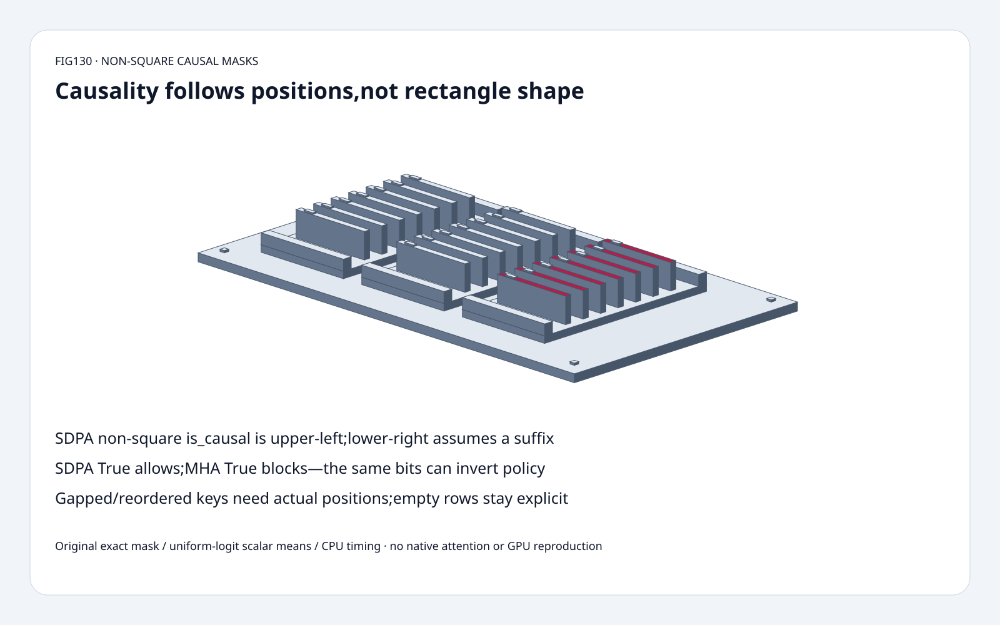
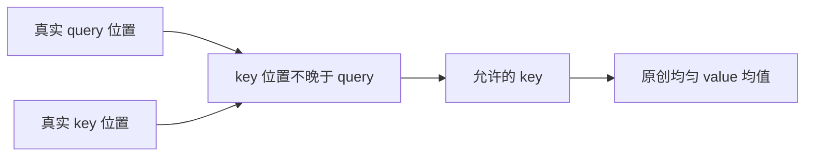
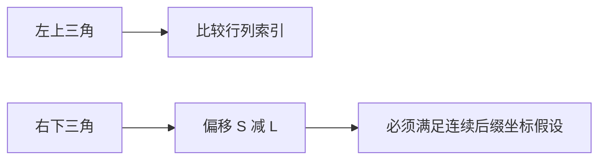
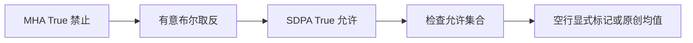

# 注意力选型 FAQ：非方形因果掩码、缓存位置与布尔极性

> **语言**：中文 | [English](non-square-causal-mask-cache-position-polarity-selection-faq.en.md)
>
> **Round130 · 2026-11-14 · 白班第7轮** · [高清 SVG](../../assets/svg/non-square-causal-mask-cache-position-polarity-selection-faq-summary.svg) · [H5 工作台](../reports/non-square-causal-mask-cache-position-polarity-sizer.html) · [七卡报告](../reports/non-square-causal-mask-cache-position-polarity-selection-cards.html) · [封存数据](../../experiments/causal_mask_position_selection/report.json)
>
> **synthetic，`independently_reproduced=false`。** 原创精确位置掩码、零 logits 均匀注意力标量均值及独立 oracle；CPU 原创路径另标 measured。未执行原生 SDPA/GPU、softmax、dropout、缓存 kernel 或模型质量评测。

## 1. 结论：一个 causal 开关不能替代缓存位置

固定版本的 PyTorch SDPA 在非方形情况下，`is_causal=True`
采用 **upper-left 左上对齐**。一个 query、五个 key，只保留第一个 key；
若 query 实际代表连续缓存最后位置，则应允许全部五个有效历史 key。

值 `[1,2,4,8,16]`，query 位置3/4，key 位置0..4：
原创零 logits 均值为 **15/4、31/5**；
错误使用左上三角则得到 **1、3/2**。
lower-right 右下对齐的偏移 `S-L` 在本例成立，
但它不是任意缓存位置的因果正确性证明。

布尔极性同样不能照搬：**SDPA True 允许参与，MHA True 禁止参与**。
将 blocked mask 原样传成 allow mask，本例首行读到未来值16，
次行没有任何允许 key。模型显式标记 null，不伪造为0。

## 2. 架构师问答：对齐、极性与真实缓存坐标

### Q1：左上和右下因果三角分别是什么？

query 索引 i、key 索引 j、长度 L/S：
左上允许 `j<=i`，右下允许 `j<=i+(S-L)`。
固定源码的 `CausalBias` materializer 与 SDPA 文档明确区分两者。
L2/S5 时行计数分别1/2与4/5；L=S时相同；
L1/S5 时分别1与5。矩阵形状自身不包含绝对 token 位置。

### Q2：cached decoding 何时适合右下对齐？

仅在 query 顺序对应同一有序、连续 S-key 序列的最后 L 个位置，
且没有额外 padding、滑窗、segment 或有效性限制时，
绝对位置判断才化简为右下三角。
最新单 query 的全部有效保留 key 若都位于其过去，
可以全部具有因果资格，但仍不能忽略 padding 等其他策略。
先声明坐标和有效 key，再选 API，不要盲换标志。

### Q3：带间隙、乱序的缓存为什么不能只看形状？

保持 L2/S5 和 query 位置3/4，将 key 改为 `[0,2,4,6,8]`。
真实 `key_position<=query_position` 只允许2/3个 key，
均值 **3/2、7/3**。形状右下三角仍允许4/5个，
错误得到15/4、31/5并包含未来位置6/8。

物理缓存也可能重排。独立 oracle 按真实位置排序 key 身份，
同步重排 key 位置与匹配 value 后结果不变。
这里只研究因果资格，不复现 paged-cache 地址、淘汰、RoPE 或原生 kernel。

### Q4：MHA 与 SDPA 可以复用同一布尔 mask 吗？

必须先检查语义。固定 SDPA 的 True 表示参与；
`MultiheadAttention.attn_mask` 的 True 表示禁止；
boolean key-padding mask 的 True 也表示忽略。
从 blocked 转 allow 需要在确认轴、广播和 dtype 后有意取反。
float mask 是加到分数的偏置，不是布尔资格；数字0/1不等于 bool mask。

所查 SDPA 文档还约束显式 `attn_mask` 与 `is_causal=True`
不能同时设置；这不自动代表所有 wrapper/backend 都有相同约定。

### Q5：全部 key 都被屏蔽时返回0吗？

原创模型返回 `{"kind":"no_allowed_keys","value":null}`，
不在空集合上求 softmax，不把缺失结果变成成功形状的0。
L>S时右下三角可能出现全屏蔽行；L4/S2 fixture 的前两行被显式标记。
这不是原生 NaN/0/异常的承诺；实际行为需逐 backend、dtype、版本和路径验证。

默认 B4/H32/L2/S8192：共享二维 bool mask **16,384B**；
若真正实体化 B×H 副本则 **2,097,152B**；
共享 float32 additive mask **65,536B**；
原创两项 int64 前缀上界 **16B**。
这些是不同逻辑表示，不能相加宣称峰值显存。
broadcast/expand view 不必分配 B×H 副本，原生隐式掩码也不必实体化此矩阵。

## 3. 可视化架构：先位置，再 API，最后检查空行

## 4. 选型矩阵：因果资格先于实现便利

| 选择 | 适用 | 门槛 |
| :--- | :--- | :--- |
| SDPA 左上 causal | query/key 共享索引起点 | 非任意最新 token 后缀 |
| 右下 bias | 连续有序 query 后缀 | 声明位置与有效性假设 |
| 真实位置 predicate | 间隙、重排 key 轴 | 还需 padding/window/segment |
| boolean 取反 | MHA blocked 转 SDPA allow | 检查 dtype、轴和广播 |
| 隐式原生 mask | backend 支持的实际路径 | 实测 dispatch 与正确性 |
| 原创前缀均值 | 零 logits 教学 fixture | 不是一般注意力优化 |

## 5. 工作台与证据：八项测试不等于 SDPA 提速证明

[H5](../reports/non-square-causal-mask-cache-position-polarity-sizer.html)
支持1..64项有界精确整数 value 和位置，显示真实位置、左上、右下、
错误极性四种结果。预算输入是独立维度；无效输入可见报错，空行保留 null。

测试覆盖精确 Fraction 与排序位置 oracle、方形/矩形、极性反转、
间隙/重排、L>S、无效合同、Node/Python parity 和封存记录。
CPU 固定8 queries，每次重建 prefix sums，对比逐行 dense 资格过滤：

| Keys | 原创 prefix 均值 ms | 原创 dense-filter 均值 ms |
| :--- | ---: | ---: |
|128|0.007900|0.086733|
|512|0.030833|0.380333|
|2048|0.113633|1.577200|
|8192|0.442067|7.382167|

2次 warmup、7次交替 repeat、每样本3次操作，取 repeat 均值的中位数。
捷径依赖零 logits 和前缀资格，不含 QK matmul、softmax、一般 attention、
原生 SDPA/GPU、模型质量或 HBM。此前 browser approval 被拒，未绕过或声称视觉验收。

## 6. 来源、许可与就绪边界

PyTorch 固定树 `7bbc31dd45f4e43a5e3899e7e328aedfd967f2ff`，
2026-11-14T00:44:56Z，BSD-style：
[bias](https://github.com/pytorch/pytorch/blob/7bbc31dd45f4e43a5e3899e7e328aedfd967f2ff/torch/nn/attention/bias.py)、
[SDPA](https://github.com/pytorch/pytorch/blob/7bbc31dd45f4e43a5e3899e7e328aedfd967f2ff/torch/nn/functional.py)、
[MHA](https://github.com/pytorch/pytorch/blob/7bbc31dd45f4e43a5e3899e7e328aedfd967f2ff/torch/nn/modules/activation.py)。
当日 tree 的 regional AOTI 变更不证明这些既有掩码语义在当日新发明，
不虚构热门排名。

[原创代码与数据](../../experiments/causal_mask_position_selection/README.md)，
未复制上游实现。静态 Figure-tier 分拣柜60 solids：
底座、4脚、3托盘、6导轨、21票卡、21标签、4紧固件；
它是位置票据隐喻，不是原生硬件。
成果适合合同教学与回归 fixture，不是生产 kernel 认证。
