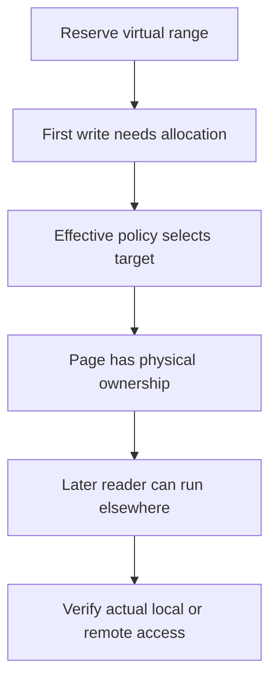
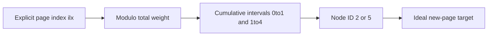
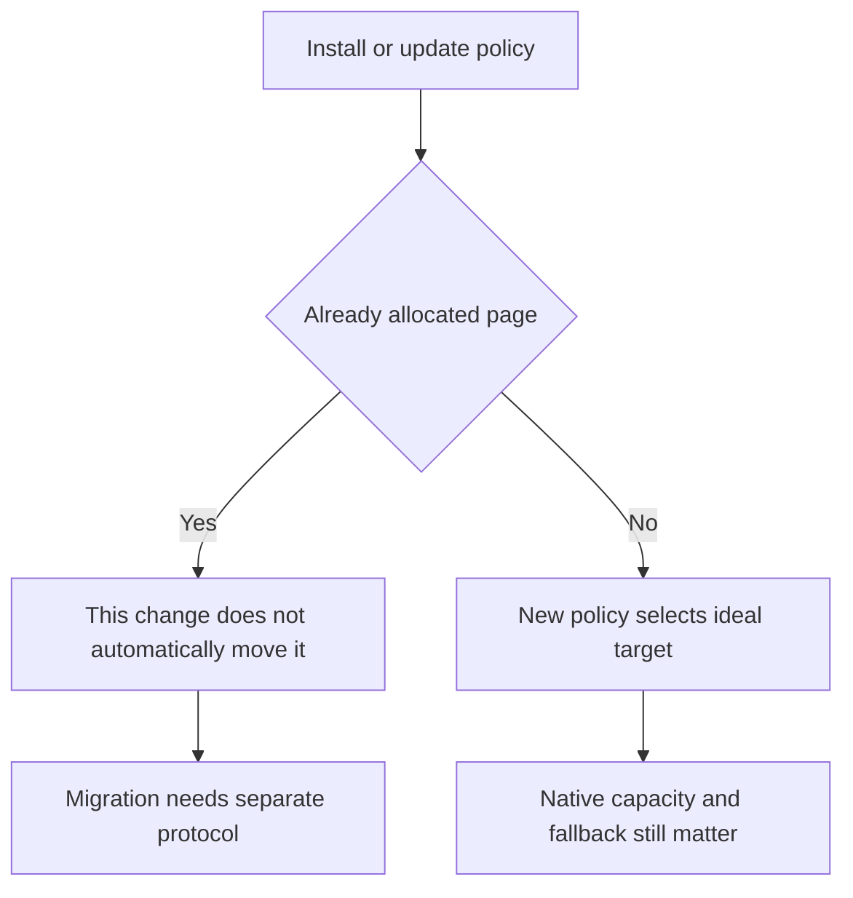

# AI Infra NUMA FAQ: first-write placement, weighted interleave and existing page ownership

> **Language**: English | [中文](numa-first-write-weighted-interleave-page-placement-selection-faq.md)  
> **Round 141 · 2026-11-14 daytime**: anonymous-page placement for CPU offload, training inputs and shared weights—not physical NUMA bandwidth.  
> **Related**: [Hybrid GPU/CPU MoE](hybrid-gpu-cpu-moe-inference-ktransformers-amx-numa-selection-faq.en.md) · [Async-I/O buffer lifetime](io-uring-ring-credits-wraparound-buffer-lifetime-selection-faq.en.md)

**Executive finding:** **The allocating thread, later reader and memory policy are separate**. In our original12-page model, node0 serial initialization followed by3node0 readers/9node1 readers causes9/12remote accesses. Future-owner first writes give0/12, uniform interleave5/12 and weights1:3give4/12. Matching node-count ratios is not the same as matching individual page readers. Policy changes also do not automatically relocate allocated pages.

**Artifacts**: [H5 workbench](../reports/numa-first-write-weighted-interleave-page-placement-sizer.html) · [seven cards](../reports/numa-first-write-weighted-interleave-page-placement-selection-cards.html) · [1600px SVG](../../assets/svg/numa-first-write-weighted-interleave-page-placement-selection-faq-summary.svg) · [sealed report](../../experiments/numa_page_policy_selection/report.json)

## Q1: Why can correctly pinned threads still access remote memory?

Pinning a worker to node1 does not automatically move anonymous pages previously allocated on node0. The original model starts from **ideal allocation caused by the first write**, not virtual reservation or every read touch. Actual anonymous read faults can use a shared zero page; THP and existing mappings also change granularity. Those paths are not simulated.



“First touch” does not mean every initial read necessarily allocates an exclusive local page. Our ideal local path assigns the first writer's node, assuming allocation succeeds there with no fallback. No numactl, mbind or host memory policy was executed or changed.

## Q2: What index drives uniform and weighted interleave?

The pinned implementation separates page-index selection from per-task dynamic allocation. Our model only chooses ideal targets for explicit base-page indexes `ilx=0..11`: uniform uses `ilx mod node_count`; weighted maps `ilx mod sum(weights)` into cumulative intervals. It is not the complete virtual-address/VMA offset/order-to-ilx transformation, nor the per-task allocation-order counter used by other paths.

For nodes `[2,5]`, weights `[1,3]`, the cycle is `[2,5,5,5]`; results are node IDs, not array positions `[0,1]`. The read sysfs ABI specifies weights1..255. Our1..16sorted unique IDs are a bounded original input contract, not discovered topology.



Reversing faults preserves12/12individual targets because this path is page-indexed. Not all Linux interleave paths are allocation-order independent: `weighted_interleave_nodes` maintains dynamic task state and is not modeled here.

## Q3: Why does a1:3page ratio still cause four remote reads?

| Original policy | node0/node1 pages | Remote / total reads | Interpretation |
| :--- | :--- | ---: | :--- |
| Serial first writes onnode0 | 12 / 0 | 9 / 12 | Later node1 readers did not migrate pages |
| Future-owner first writes | 3 / 9 | 0 / 12 | Ideal stable owner/local model,not a native guarantee |
| Uniform interleave | 6 / 6 | 5 / 12 | Balanced counts do not match page readers |
| Weighted1:3 | 3 / 9 | 4 / 12 | Same totals can conceal individual mismatches |

Readers are `[0,0,0,1,1,1,1,1,1,1,1,1]`, while weighted targets repeat `[0,1,1,1]`. Two of the first three pages and two of the remaining nine are remote. A3:9node total is therefore not a per-page ownership match.

A counterexample changes every reader to node0: serial initialization gives zero remote reads while weighted gives nine. Interleave is not universally faster. Fractions count **one explicit access per equal-size modeled page**, without heat, byte or time weighting.

## Q4: How do policy, weight and cpuset changes differ?

The original ledger first writes pages0..5onnode0, switches to weighted1:3, then visits pages6..11and old pages in reverse. Zero of six old pages migrate; new owners are `[1,1,0,1,1,1]`. Policy or sysfs weight changes alone affect new allocations. Explicit migration and automatic NUMA balancing are separate mechanisms and were not executed.



Cpuset restrictions take priority over application memory policy; STATIC_NODES/RELATIVE_NODES and rebinding add semantics. Our helper only demonstrates a **fixed nonempty intersection**: nodes `[2,5]` with allowed `[5]` select5only. An empty intersection is explicitly rejected as outside this model—not a claim that Linux necessarily errors rather than applying its fallback/remapping.

The ABI also distinguishes auto/manual weights. Auto can recompute weights when boot/hotplug supplies new bandwidth data; writing a valid nodeN weight switches to manual mode. Sealed manual1:3weights are not a live automatic bandwidth estimate.

## Q5: What do payload budgets and CPU timings actually establish?

All four paths conserve49152B of selected payload for12equal-size synthetic pages. Uniform assigns24576B per node; weighted assigns12288B/36864B. These are page payloads, not RSS/PSS, page tables, allocation, pinning or THP overhead, and not replicated copies of weights.

| Original node-ID lookups | Prebuilt prefix + bisect (ms) | Per-query weight walk (ms) |
| ---: | ---: | ---: |
| 64 | 0.005767 | 0.022000 |
| 256 | 0.023967 | 0.088700 |
| 1024 | 0.098367 | 0.355600 |
| 4096 | 0.395300 | 1.456900 |

Both return complete ID lists over eight synthetic nodes; preprocessing and validation are excluded. Two warmups, seven alternating repeats and three operations per sample yield median repeat means. These are original CPU target-selection paths: C-backed bisect and Python walking do not establish a kernel speedup. Native bandwidth, remote-access latency and migration cost remain unknown/null.

## Q6: How can the study be reproduced and production boundaries checked?

```powershell
python -m unittest discover -s tests -p test_numa_page_policy_selection.py -q
python -m experiments.numa_page_policy_selection.run --check
# --measure deliberately replaces original local CPU samples.
```

Eight tests cover an independent expanded-cycle oracle across30random weight sets×128offsets, reader-distribution counterexamples, fault order, no policy-triggered migration, sparse IDs/intersection/payload conservation, invalid inputs, Node/Python parity and sealed timing. H5 accepts editable JSON and displays errors. Prior browser refusal remains respected; visual browser inspection was not performed.

Sources: [pinned policy documentation](https://github.com/torvalds/linux/blob/067c5c24cef23d913b67eaaf71ae67e7169a6620/Documentation/admin-guide/mm/numa_memory_policy.rst), [actual mempolicy.c](https://github.com/torvalds/linux/blob/067c5c24cef23d913b67eaaf71ae67e7169a6620/mm/mempolicy.c), [weighted auto/manual ABI](https://github.com/torvalds/linux/blob/067c5c24cef23d913b67eaaf71ae67e7169a6620/Documentation/ABI/testing/sysfs-kernel-mm-mempolicy-weighted-interleave). Read source is GPL-2.0-only; this repository links facts and provides original models/art rather than mirroring implementation. The Nov10 watch item is allocator/zonelist/hotplug race fixes, **not** a newly invented weighted mode; the auto ABI is dated May2025.

Production needs kernel features, real topology/allowed nodes, CPU pinning, page size/THP, anonymous versus file-backed paths, fallback, initialization order, read/write heat and measured placement. Provenance is `synthetic`, `independently_reproduced=false`, with original CPU records separately `measured`. This does not certify CXL/DRAM throughput, affinity effectiveness or automatic migration.
