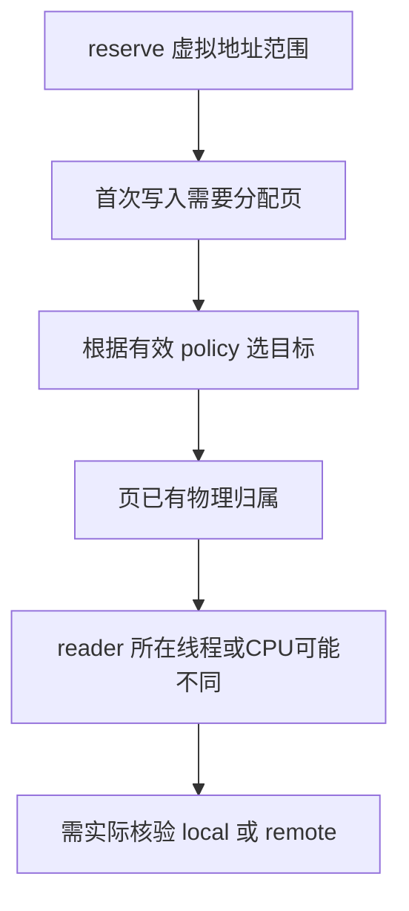
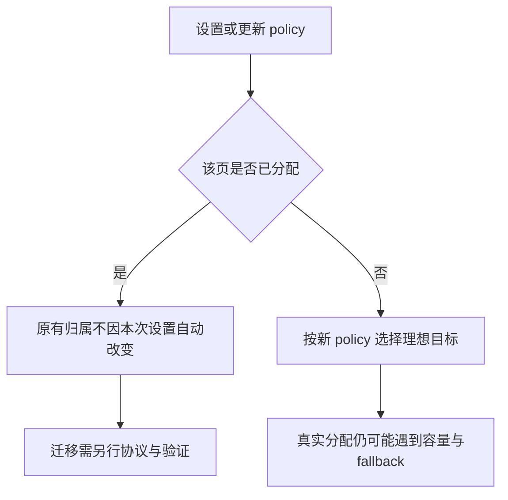

# AI Infra NUMA 选型 FAQ：First Write、Weighted Interleave 与已分配页的归属

> **语言**：中文 | [English](numa-first-write-weighted-interleave-page-placement-selection-faq.en.md)  
> **Round 141 · 2026-11-14 白班**：CPU offload、训练输入和共享权重的匿名页放置；不是物理 NUMA bandwidth benchmark。  
> **关联**：[混合 GPU/CPU MoE](hybrid-gpu-cpu-moe-inference-ktransformers-amx-numa-selection-faq.md) · [异步 I/O buffer 生命周期](io-uring-ring-credits-wraparound-buffer-lifetime-selection-faq.md)

**结论速览**：**分配页的线程、之后读页的线程、NUMA policy 是三件事**。原创12页模型中，node0串行初始化、随后3页由node0读/9页由node1读，产生9/12远端访问；逐页由未来owner首次写入为0/12；均匀interleave为5/12；weights1:3为4/12。后两者不会因为页数比例相同就等同于“按reader归属放置”。更改policy也不会自动搬迁已经分配的页。

**交付**：[H5工作台](../reports/numa-first-write-weighted-interleave-page-placement-sizer.html) · [7-Card](../reports/numa-first-write-weighted-interleave-page-placement-selection-cards.html) · [1600px SVG](../../assets/svg/numa-first-write-weighted-interleave-page-placement-selection-faq-summary.svg) · [封存数据](../../experiments/numa_page_policy_selection/report.json)

## Q1：为什么线程亲和性正确，内存仍可能在远端？

把worker绑到node1，不会自动把之前由node0分配的匿名页搬过去。原型从**首次写入引起理想分配**出发，而不是把reserve虚拟地址或只读触碰当作实际独占页分配。真实Linux匿名只读fault可能走shared zero page，THP与已有映射又会改变分配粒度；本模型不模拟这些路径。



“First touch”不能简化为“第一次任何read就一定分配在reader本地”。本文local理想路径以首次writer所在node为owner，假定目标可满足分配、不发生fallback；没有执行numactl、mbind或操作本机内存policy。

## Q2：均匀和加权 interleave 到底按什么索引？

固定源代码将page-index路径与per-task动态分配路径分开。原创模型仅选择显式base-page index `ilx=0..11` 的理想目标：均匀按 `ilx mod node_count`；加权按 `ilx mod sum(weights)`落入累积区间。它不是完整的virtual-address/VMA offset/order到ilx转换，也不是page-cache/slab使用的每task进度计数器。

例如nodes `[2,5]`、weights `[1,3]`，周期为 `[2,5,5,5]`；返回的是node ID，不是数组位置 `[0,1]`。源码权重上下限1..255来自所读sysfs ABI；模型限定1..16个排序唯一ID，非系统拓扑发现。


逆序fault仍保留12/12逐页目标，因为本路径由page index决定。这不表示所有Linux interleave调用路径都对分配顺序不敏感。源码 `weighted_interleave_nodes` 的动态路径有自身状态，不能用本模型替代。

## Q3：为什么1:3页数比例仍会产生4次远端访问？

| 原创策略 | node0/node1页数 | 远端 / 总访问 | 判断 |
| :--- | :--- | ---: | :--- |
| node0串行首次写 | 12 / 0 | 9 / 12 | 后续node1 reader并未迁走旧页 |
| 各未来owner首次写 | 3 / 9 | 0 / 12 | 理想稳定owner/local模型，不是实机保证 |
| 均匀interleave | 6 / 6 | 5 / 12 | 均衡页数不等于贴合reader |
| weighted1:3 | 3 / 9 | 4 / 12 | 比例相同，逐页归属仍可错位 |

reader列表是 `[0,0,0,1,1,1,1,1,1,1,1,1]`，加权目标是周期 `[0,1,1,1]`。前3页中的两页错位，后9页中又有两页错位。因此node总量3:9不等于每页都在预期reader本地。

反例测试把所有reader改为node0：串行初始化变为0远端，weighted变为9远端。没有通用的“开启interleave必然更快”。本比例按**每页一次显式访问**计数，没有访问热度、字节量或时间权重。

## Q4：改 policy、改 weights 和改 cpuset，分别意味着什么？

原型先在node0写入页0..5，然后切换weighted1:3，再逆序首次写页6..11及重复写旧页；6个旧页迁移数为0，新页owner为 `[1,1,0,1,1,1]`。修改policy或sysfs weights本身只影响新分配；显式migration、自动NUMA balancing等是其他机制，本文未执行。



cpuset是管理约束，优先于应用memory policy；STATIC_NODES/RELATIVE_NODES及rebind有额外语义。独立helper只演示**固定、非空交集**：nodes `[2,5]` 与allowed `[5]`后，全选5；空交集显式拒绝，**不是**声称真实Linux此时必定报错，原型未模拟其default fallback/remapping。

所读ABI另区分auto/manual：auto可根据boot/hotplug的新bandwidth数据重算权重；写nodeN有效weight会切manual。不能把封存的手工1:3当作实时自动带宽估计。

## Q5：内存预算和CPU timing能说明什么？

四路都只为12个等大synthetic page保留49152B selected payload。均匀为每node24576B，weighted为12288B/36864B；这是页payload守恒，不是RSS/PSS、page table、allocator、pinning或THP开销，也不是跨node复制多份权重。

| 原创node-ID查找次数 | 预建prefix + bisect（ms） | 逐query weight walk（ms） |
| ---: | ---: | ---: |
| 64 | 0.005767 | 0.022000 |
| 256 | 0.023967 | 0.088700 |
| 1024 | 0.098367 | 0.355600 |
| 4096 | 0.395300 | 1.456900 |

两路对8个synthetic节点产生完整ID列表，预处理和validation排除，2次warmup/7轮交替repeat/每样本3操作，取repeat均值的中位数。测的是原始CPU选目标算法；C-backed bisect与Python逐项walk不等工作底层，不能据此宣传kernel加速倍数。native bandwidth、remote latency、migration cost均未知/null。

## Q6：如何复现并决定生产是否适用？

```powershell
python -m unittest discover -s tests -p test_numa_page_policy_selection.py -q
python -m experiments.numa_page_policy_selection.run --check
# --measure 主动替换本机原创 CPU samples
```

八项测试覆盖30组随机weights×128offset的独立expanded-cycle oracle、reader分布反转反例、fault顺序、policy改变不迁移、稀疏ID/交集/payload守恒、错误输入、Node/Python parity与sealed timing。H5可改JSON并显式显示错误。此前浏览器拒绝仍受尊重，未执行视觉浏览器检查。

来源：[固定内核policy说明](https://github.com/torvalds/linux/blob/067c5c24cef23d913b67eaaf71ae67e7169a6620/Documentation/admin-guide/mm/numa_memory_policy.rst)、[实际mempolicy.c](https://github.com/torvalds/linux/blob/067c5c24cef23d913b67eaaf71ae67e7169a6620/mm/mempolicy.c)、[weighted auto/manual ABI](https://github.com/torvalds/linux/blob/067c5c24cef23d913b67eaaf71ae67e7169a6620/Documentation/ABI/testing/sysfs-kernel-mm-mempolicy-weighted-interleave)。所读source为GPL-2.0-only；本仓库只链接事实、原创模型/图，不镜像实现。11月10日近期watch点是allocator/zonelist/hotplug竞态修正，**不是**当日新发明weighted interleave；auto ABI日期为2025年5月。

生产需核验内核feature、实际NUMA拓扑/允许nodes、CPU pinning、page size/THP、anonymous/file-backed路径、分配fallback、初始化顺序、读写热度与真实placement。`synthetic`、`independently_reproduced=false`；原创CPU记录单独`measured`。不能从本原型认证CXL/DRAM吞吐、线程亲和性效果或自动迁移能力。
