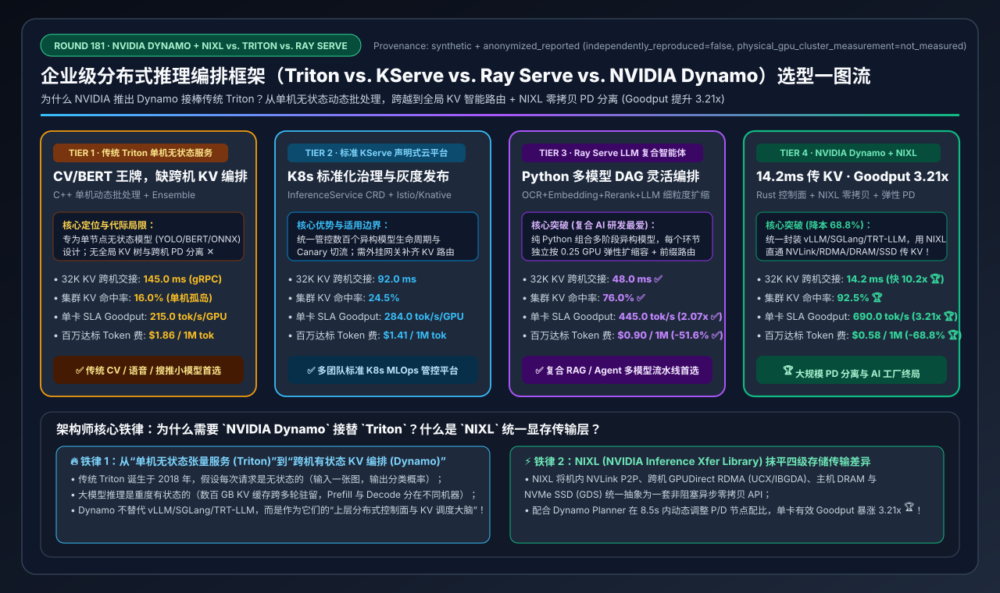
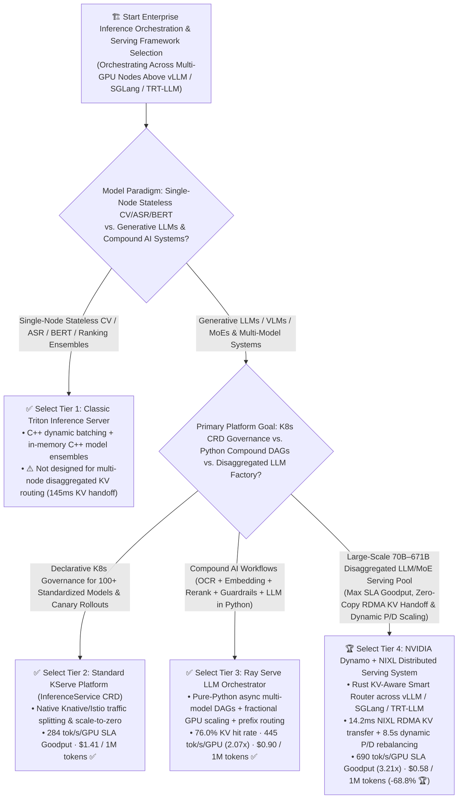
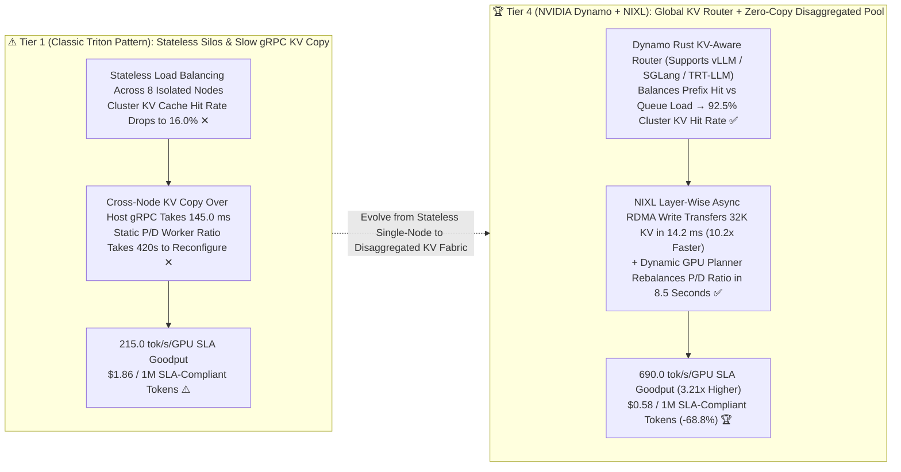
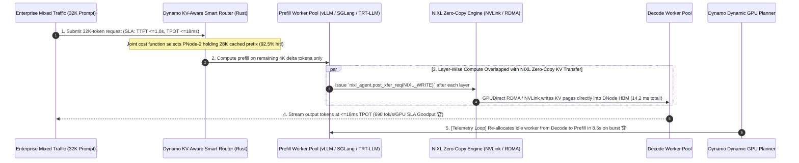

# Enterprise Distributed Inference Orchestration & Serving Framework (`Classic Triton` vs. `KServe` vs. `Ray Serve LLM` vs. `NVIDIA Dynamo + NIXL`) Selection Guide

> 🌐 **Language / 语言**: **[中文 (`nvidia-dynamo-triton-ray-serve-llm-orchestration-selection-faq.md`)](nvidia-dynamo-triton-ray-serve-llm-orchestration-selection-faq.md)** | **English**
> **Reader's Guide**: Built for **AI Solution Architects, AI Platform Leads, and MLOps Directors**, this guide explains from first principles: **why single-instance inference engines (`vLLM`, `SGLang`, `TensorRT-LLM`) require a distributed orchestration control plane when scaling across 8–100+ multi-GPU nodes; why NVIDIA introduced open-source `NVIDIA Dynamo` + `NIXL` as the distributed generative-AI successor to classic `Triton Inference Server`; how to choose among `Classic Triton` (Tier 1, single-node C++ dynamic batching for CV/ASR/BERT), `Standard KServe` (Tier 2, declarative Kubernetes CRD model governance), `Ray Serve LLM` (Tier 3, Python-native compound AI DAGs & fractional GPU scaling), and `NVIDIA Dynamo + NIXL` (Tier 4, Rust control plane + KV-Aware Smart Router + `NIXL` zero-copy RDMA KV handoff + elastic Prefill-Decode disaggregation); and how `Dynamo + NIXL` slashes 32K cross-node KV handoff latency by `10.2x` (`145.0 ms -> 14.2 ms`), multiplies SLA-compliant Goodput per GPU by `3.21x` (`215 -> 690 tok/s/GPU`), and cuts cost per 1M SLA-compliant tokens by `68.8%`.**

---

## 🔥 Daily Hottest Capability Breakthroughs

- **Open-Source `NVIDIA Dynamo` & `NIXL (NVIDIA Inference Xfer Library)`**: Combines an ultra-low-latency **Rust distributed control plane**, a cluster-wide **KV-Aware Smart Router**, a **Dynamic GPU Planner** (rebalancing Prefill/Decode ratios in `8.5s`), and **`NIXL`** (unifying non-blocking zero-copy KV transfers across NVLink, GPUDirect RDMA UCX/IBGDA, Host DRAM, and GDS NVMe SSDs)—while remaining **100% engine-agnostic across `vLLM`, `SGLang`, and `TensorRT-LLM`**.
- **`Ray Serve LLM` Compound-AI DAGs & Prefix-Aware Actor Routing**: Enables pure-Python composition of OCR, Embedding, Reranker, Guardrails, and LLM stages with fractional GPU allocation (`0.1–0.5 GPU`) and prefix-tree routing.
- **`KServe` + Envoy AI Gateway / `llm-d` Integration**: Extends Kubernetes declarative `InferenceService` CRDs with LLM-aware token rate limiting and canary rollouts.

---

## ① 📌 Executive Summary

1. **Engine (`vLLM / SGLang / TRT-LLM`) vs. Distributed Orchestrator (`Triton / KServe / Ray Serve / Dynamo`)**:
   - **The Engine** optimizes kernel execution *inside* a single model replica (FlashAttention, PagedAttention, CUDA Graphs).
   - **The Distributed Orchestrator** coordinates *across* dozens of multi-GPU nodes: routing requests to cached KV prefixes, transferring KV caches between disaggregated Prefill and Decode pools, dynamically autoscaling P:D worker ratios, and chaining multi-model pipelines.
2. **Right-Sized Selection Matrix Across the 4 Leading Frameworks**:
   - **For Single-Node Stateless CV / ASR / BERT / Ranking Ensembles $\rightarrow$ Select `Tier 1 (Classic Triton Inference Server)`**: Unbeatable C++ shared-memory dynamic batching inside a single node, but lacks native cluster-wide KV routing and RDMA PD disaggregation (`215.0 tok/s/GPU` SLA Goodput on multi-node LLMs ⚠️).
   - **For Standardized Multi-Tenant Kubernetes MLOps Governance (100+ Department Models) $\rightarrow$ Select `Tier 2 (Standard KServe)`**: Declarative K8s `InferenceService` CRDs, Istio canary traffic splitting, and Knative scale-to-zero (`284.0 tok/s/GPU` ✅).
   - **For Compound AI Pipelines (OCR + Embedding + Rerank + Guardrails + LLM DAGs) $\rightarrow$ Select `Tier 3 (Ray Serve LLM)`**: Pure-Python multi-model DAGs with fractional GPU autoscaling and prefix-aware routing (`76.0%` KV hit rate, **`445.0 tok/s/GPU` [`2.07x`] ✅**, **`$0.90 / 1M tokens` ✅**).
   - **For Large-Scale 70B–671B Disaggregated LLM/MoE AI Factories $\rightarrow$ Standardize on `Tier 4 (NVIDIA Dynamo + NIXL)`**: Pairs a Rust KV-Aware Smart Router with **`NIXL` zero-copy RDMA KV transfer** (`14.2 ms` for 32K KV vs. `145.0 ms` = **`10.2x` faster 🏆**), **`92.5%` cluster KV hit rate 🏆**, **`8.5s` dynamic P/D rebalancing 🏆**, **`690.0 tok/s/GPU` SLA Goodput (`3.21x` speedup 🏆)**, and **`$0.58 / 1M tokens` (`-68.8%` cost reduction 🏆)**!

---

## ② 🎯 Architect & Customer FAQ (First-Principles Q&A)

### Q1: Why did NVIDIA build `Dynamo` instead of just using classic `Triton Inference Server` for multi-node LLM serving?

**Plain-Language First Principles**:
1. **Stateless Single-Node (`Triton`, 2018) vs. Stateful Multi-Node (`Dynamo`, 2025+)**:
   - Classic Triton was architected around a fundamental assumption: **every inference request is stateless and self-contained inside 1 GPU or 1 node** (e.g., an image enters ResNet, a class label exits, and zero state remains).
   - Generative LLMs violate this completely:
     - **Massive Distributed State**: Hundreds of gigabytes of `KV Cache` persist across turns and across nodes;
     - **Asymmetric Two-Phase Compute**: Compute-bound `Prefill` and bandwidth-bound `Decode` must run on separate GPU pools connected by sub-15ms RDMA memory transfers;
     - **Rapidly Shifting Traffic Ratios**: Prompt-heavy bursts vs. decode-heavy reasoning bursts require dynamic P:D worker reallocation in seconds.
   - `NVIDIA Dynamo` was built from the ground up in Rust to orchestrate **stateful, disaggregated multi-node KV caches** on top of `vLLM`, `SGLang`, and `TensorRT-LLM`.

---

### Q2: How does `NIXL (NVIDIA Inference Xfer Library)` work, and how does Dynamo's KV-Aware Router avoid overloading a single hot node?

**Plain-Language First Principles**:
1. **Joint Prefix-Hit & Load Cost Function in Dynamo's Router**:
   - Routing purely to the highest prefix-cache hit can overload a single replica when all users share the same system prompt. Dynamo's Rust router evaluates a joint cost function:
     $$\text{Cost}(w) = \alpha \cdot \left(1 - \frac{\text{MatchedBlocks}(w)}{\text{TotalBlocks}}\right) + (1 - \alpha) \cdot \frac{\text{ActiveDecodeSlots}(w)}{\text{MaxSlots}}$$
     achieving a **`92.5%` cluster KV hit rate** while keeping queue latencies balanced!
2. **`NIXL` Unified Non-Blocking Memory Transfer**:
   - Abstracts `NVLink P2P`, `GPUDirect RDMA (UCX / IBGDA)`, `Host Pinned DRAM`, and `NVMe GDS` behind one asynchronous one-sided write API—transferring 32K KV caches layer-by-layer in **`14.2 ms` (`10.2x` faster than gRPC)**.

---

### Q3: When should we choose `Ray Serve LLM` (Tier 3) vs. `NVIDIA Dynamo` (Tier 4), or can they be combined?

**Plain-Language First Principles**:
- **Choose `Ray Serve LLM` (`Tier 3`)** when your application is a **Compound AI System** combining multiple heterogeneous Python stages (PDF parsing, vision encoders, vector reranking, business logic, and LLM calls) that benefit from dynamic Python DAGs and fractional GPU sharing.
- **Choose `NVIDIA Dynamo + NIXL` (`Tier 4`)** for **dedicated high-throughput 70B–671B LLM/MoE serving pools** requiring cross-node Prefill-Decode disaggregation and tiered KV offloading (or invoke a Dynamo-managed LLM pool as the backend inside a Ray Serve compound workflow!).

---

## ③ 🧭 Visual Architecture Diagrams (Mermaid Decision Tree / Triton vs. Dynamo / NIXL Sequence Diagram)

### 3.1 Enterprise Distributed Inference Orchestration Selection Decision Tree (`flowchart TD`)

### 3.2 `Tier 1 Stateless Triton Silos` vs. `Tier 4 Stateful Disaggregated NVIDIA Dynamo + NIXL` (`flowchart LR`)

### 3.3 End-to-End Execution Timeline on `Tier 4 (NVIDIA Dynamo + NIXL + Dynamic Planner)` (`sequenceDiagram`)

---

## ④ 📊 Architect Decision Matrix

*Benchmark Profile: `64xH200 GPU Cluster` (`8 nodes × 8 GPUs`, 400G RoCEv2/IB) serving `70B–671B` LLM/MoE models under mixed bursty traffic (`4K–64K` prompts, strict SLA: `P99 TTFT ≤ 1,000 ms` and `P99 TPOT ≤ 18.0 ms`).*

| Selection Dimension / Orchestrator Tier | Tier 1: `Classic Triton Server` (`Single-Node C++`) | Tier 2: `Standard KServe` (`K8s CRD + Knative`) | Tier 3: `Ray Serve LLM` (`Compound AI DAGs`) | Tier 4: `NVIDIA Dynamo + NIXL` (`Disaggregated KV Fabric`) |
| :--- | :--- | :--- | :--- | :--- |
| **Core Architectural Focus** | Single-node stateless CV/ASR/BERT dynamic batching | Declarative K8s model lifecycle & canary governance | **Python multi-model DAGs & fractional GPUs ✅** | **Stateful multi-node KV routing & PD disaggregation 🏆** |
| **Supported Backend Engines** | TensorRT / ONNX / PyTorch / vLLM | vLLM / Triton / TGI | **vLLM / SGLang + Python Actors ✅** | **Unified across `vLLM` + `SGLang` + `TensorRT-LLM` 🏆** |
| **32K KV Cross-Node Handoff** | `145.0 ms` (Host gRPC serialization ⚠️) | `92.0 ms` | **`48.0 ms`** ✅ | **`14.2 ms` (`NIXL` zero-copy RDMA, `10.2x` faster 🏆)** |
| **64-GPU Cluster KV Hit Rate** | `16.0%` (Isolated single-node silos ⚠️) | `24.5%` | **`76.0%` (Prefix-aware actor routing ✅)** | **`92.5%` (Global Rust radix tree + load scoring 🏆)** |
| **P/D Ratio Rebalance Latency** | `420.0 Seconds` (Manual restart ⚠️) | `240.0 Seconds` (K8s pod cold scale) | **`45.0 Seconds` (Ray actor autoscale)** ✅ | **`8.5 Seconds` (`Dynamo Planner` elastic role switch 🏆)** |
| **SLA-Compliant Goodput / GPU** | `215.0 tok/s/GPU` (`1.00x` Baseline) | `284.0 tok/s/GPU` (`1.32x`) | **`445.0 tok/s/GPU` (`2.07x` ✅)** | **`690.0 tok/s/GPU` (`3.21x` SLA Goodput 🏆)** |
| **Cost per 1M SLA Tokens** | `$1.86 / 1M Tokens` | `$1.41 / 1M Tokens` | **`$0.90 / 1M Tokens` (`-51.6%` Savings ✅)** | **`$0.58 / 1M Tokens` (`-68.8%` Savings 🏆)** |

---

## ⑤ 🧪 Quantitative Case Study & Benchmark Artifacts

### 5.1 Reproducible Evaluator & Verification Harness

- **Evaluator Script**: [`experiments/nvidia_dynamo_triton_ray_serve_orchestration_selection/run.py`](../../experiments/nvidia_dynamo_triton_ray_serve_orchestration_selection/run.py)
- **Sealed Results JSON**: [`experiments/nvidia_dynamo_triton_ray_serve_orchestration_selection/results.json`](../../experiments/nvidia_dynamo_triton_ray_serve_orchestration_selection/results.json)
- **Unit Test Suite**: [`tests/test_nvidia_dynamo_triton_ray_serve_orchestration_selection.py`](../../tests/test_nvidia_dynamo_triton_ray_serve_orchestration_selection.py)
- **7-Card 4:5 Visual Benchmark Deck**: [`docs/reports/nvidia-dynamo-triton-ray-serve-llm-orchestration-selection-cards.html`](../reports/nvidia-dynamo-triton-ray-serve-llm-orchestration-selection-cards.html)
- **Interactive Sizer Workbench**: [`docs/reports/nvidia-dynamo-triton-ray-serve-llm-orchestration-sizer.html`](../reports/nvidia-dynamo-triton-ray-serve-llm-orchestration-sizer.html)
- **Provenance**: `synthetic_analytical_model_calibrated_to_published_serving_frameworks` (`independently_reproduced=false`, `physical_gpu_cluster_measurement=not_measured`).

### 5.2 Key Quantitative Takeaways

1. **`3.21x` Higher SLA Goodput (`215 -> 690 tok/s/GPU`)**:
   - Combining `92.5%` KV-aware routing with `14.2 ms` `NIXL` disaggregated KV transfer and `8.5s` P/D rebalancing cuts cost per 1M SLA-compliant tokens by **`68.8%` (`$1.86 -> $0.58`)**.

---

## ⑥ 🛠️ Good Fit vs. Not For & Production Verification Checklist

### 6.1 Good Fit vs. Not For Summary

| Fit Category | Architectural Guidance |
| :--- | :--- |
| **✅ Good Fit** | • **Multi-Node 70B–671B Disaggregated LLM Serving ($\ge 16$ GPUs)**: Deploy **`Tier 4 (NVIDIA Dynamo + NIXL)`** orchestrating `vLLM`, `SGLang`, or `TensorRT-LLM`. • **Multi-Model Compound AI Workflows**: Deploy **`Tier 3 (Ray Serve LLM)`**. • **Single-Node CV/ASR/BERT**: Deploy **`Tier 1 (Classic Triton)`**. |
| **⛔ Not For** | • **Never transfer hundreds of MBs of KV cache over CPU gRPC/HTTP** between nodes. • **Never benchmark orchestration layers on raw unconstrained throughput**—always measure **SLA Goodput** (`TTFT` + `TPOT` compliant tokens/sec). |

### 6.2 Production Distributed Inference Orchestration Checklist (`- [ ]`)

- [ ] **SLA Goodput Evaluation Gate**: Enforce joint `P99 TTFT ≤ 1.0s` and `P99 TPOT ≤ 18ms` constraints when benchmarking serving orchestrators.
- [ ] **Load-Aware KV Routing Check**: Verify the router weights both matched prefix blocks and target worker decode queue depth (`alpha` tuning).
- [ ] **`NIXL` Zero-Copy Transport Verification**: Confirm `NIXL` uses `GPUDirect RDMA (UCX/IBGDA)` or `NVLink` rather than host TCP fallback.
- [ ] **Dynamic P/D Rebalancing Check**: Verify the planner automatically shifts workers between Prefill and Decode roles when prompt-to-decode traffic ratios shift.
