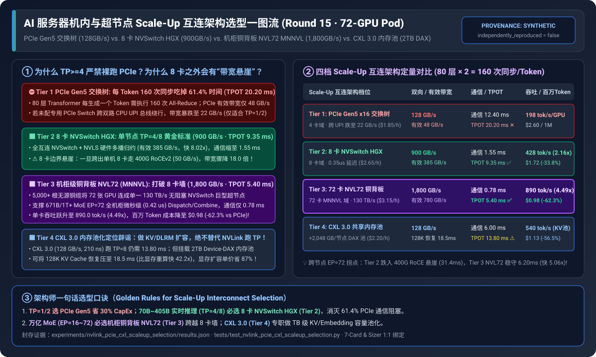
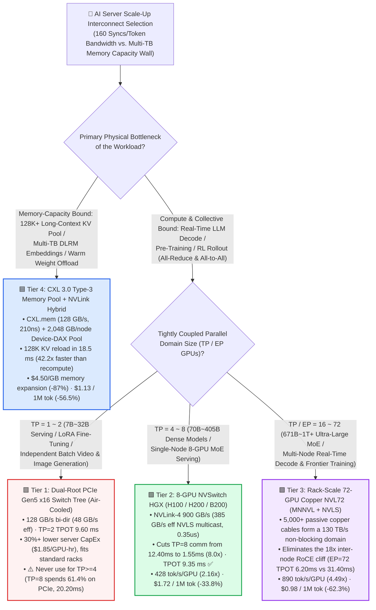
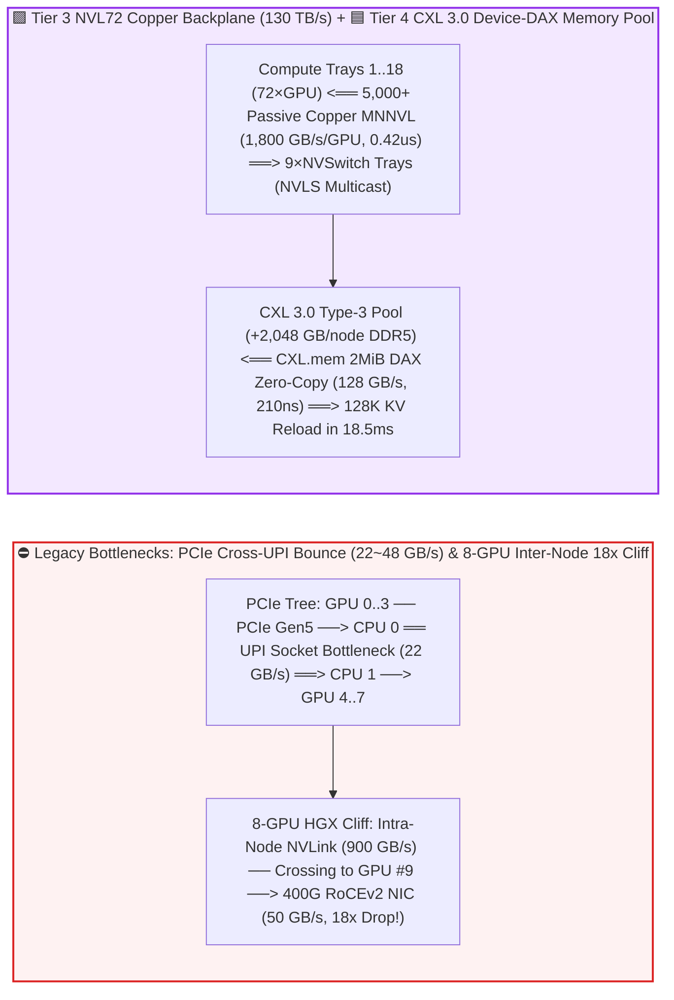
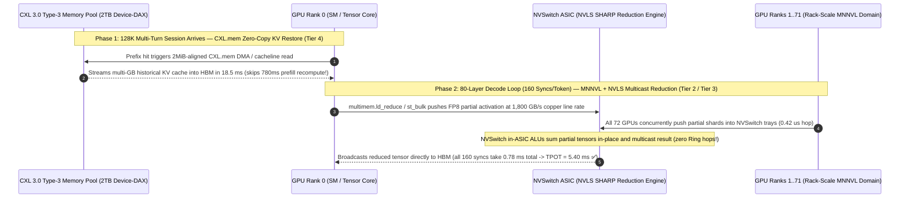

# AI Server Intra-Node & Supernode Scale-Up Interconnect Selection FAQ (`PCIe Gen5 Switch Tree` vs. `8-GPU NVSwitch HGX` vs. `Rack-Scale Copper NVL72 MNNVL` vs. `PCIe Gen6 + CXL 3.0 Memory Pooling`)

> 🌐 **Language**: **[中文 (Chinese)](./nvlink-pcie-cxl-scaleup-interconnect-selection-faq.md)** | **English Version** · **[📖 Back to Repository README](../../README.en.md)** · **[📊 2026-11-09 Daily Progress Report](../daily/2026-11-09.md)** · **[🃏 7-Card 4:5 Visual Benchmark Report](../reports/nvlink-pcie-cxl-scaleup-interconnect-selection-cards.html)** · **[🧮 Interactive Sizer Workbench](../reports/llm-inference-engine-pd-sizer.en.html#scaleup-interconnect-sizer)**
>
> **Overview**: A first-principles selection guide for AI Solution Architects. When procuring GPU compute infrastructure, enterprises routinely fall into three costly architectural traps: **(1) buying 30% cheaper air-cooled `8×PCIe Gen5` servers to run `70B/405B TP=8` real-time inference, only to discover that 61.4% of every token step is stalled on 160 PCIe `All-Reduce` synchronizations; (2) assuming two 8-GPU HGX nodes can be combined into `TP=16 / EP=16` linearly, plunging off the `900 GB/s -> 50 GB/s` 18x inter-node bandwidth cliff; and (3) attempting to replace `NVLink` with `CXL 3.0` for Tensor Parallelism**. Grounded in the sealed deterministic model in `experiments/nvlink_pcie_cxl_scaleup_selection/` (`synthetic` + `anonymized_reported`, `independently_reproduced=false`), this guide establishes the exact operational boundaries across **PCIe Gen5 Switch Trees, 8-GPU NVSwitch (HGX), 72-GPU Rack-Scale Copper NVL72 (MNNVL), and CXL 3.0 Memory Pooling**.



---

## ① 📌 Executive Summary

1. **Four-Tier Selection by Parallelism Domain (`TP / EP Domain Size`) and Memory Access Bottleneck**:
   - Across a `72-GPU` compute pod running **80-layer LLM decode (`80 × 2 = 160` collective synchronizations per generated token, `7.80 ms` pure compute time on Hopper, `TPOT <= 12.0 ms` real-time SLA)** and **128K-context KV cache memory expansion**:
   - 🟥 **Tier 1 (Dual-Root `PCIe Gen5 x16` Switch Tree · `128.0 GB/s` bi-directional / `48.0 GB/s` effective collective BW, `$1.85/GPU-hr`)**: **Never use for `TP >= 4` latency-sensitive serving or tightly coupled pre-training**! At `TP=8`, per-token communication takes **`12.40 ms` (`61.4%` of total `20.20 ms` step time, violating the `<=12ms` SLA)**; on dual-socket servers without dedicated PCIe switches, traffic bouncing across CPU `UPI/QPI` links drops to **`22.0 GB/s`**. **However, for `TP=1 / TP=2` small models (7B–32B), LoRA fine-tuning, and batch image/video rendering, PCIe servers cut CapEx by `30%+` and fit standard air-cooled racks**.
   - 🟩 **Tier 2 (Intra-Node 8-GPU `NVSwitch HGX` · `NVLink-4` `900.0 GB/s` bi-directional / `385.0 GB/s` effective `NVLS` collective BW, `$2.65/GPU-hr`)**: **The enterprise workhorse for `TP=4 / TP=8` (70B–405B dense and medium MoE models)**. Full-mesh NVSwitch with `NVLS` hardware multicast reduction slashes per-token communication from `12.40 ms` to **`1.55 ms` (`8.00x` faster)**, cutting `TPOT` to **`9.35 ms` (passing SLA)**, boosting throughput **`2.16x` (`428.0 tok/s/GPU`)**, and cutting cost per 1M tokens from `$2.60` to **`$1.72` (`-33.8%`)**.
   - 🟪 **Tier 3 (Rack-Scale 72-GPU Copper Backplane `GB200/GB300 NVL72` · `NVLink-5` `1,800.0 GB/s` bi-directional + `MNNVL` `130.0 TB/s` rack fabric, `$3.15/GPU-hr`)**: **The mandatory endgame for 671B–1T+ MoE (`EP=16 ~ 72`) and multi-trillion-parameter training**. Over 5,000 passive copper cables unite all 72 GPUs into a single non-blocking `130 TB/s` NVSwitch domain, eliminating the **18x bandwidth cliff** when crossing 8-GPU node boundaries onto `50 GB/s` (400G RoCEv2); per-token communication drops to **`0.78 ms`**, `TPOT` reaches **`5.40 ms`**, per-GPU goodput jumps to **`890.0 tok/s/GPU` (`4.49x`)**, and cost per 1M tokens falls to **`$0.98` (`-62.3%` vs PCIe, `-43.0%` vs 8-GPU HGX)**.
   - 🟦 **Tier 4 (`CXL 3.0 Type-3` Shared Memory Pool · `128.0 GB/s CXL.mem` + `+2,048 GB/node` `Device-DAX` expansion, `$2.20/GPU-hr`)**: **Purpose-built to break the Memory Capacity Wall, NOT to replace NVLink for `TP>=8`**. Exposing `2 TB` of pooled DDR5 per node via cache-coherent `CXL.mem` reloads 128K-token KV caches in **`18.5 ms` (`42.2x` faster than recomputation)** at **`$4.50/GB` (`87%` cheaper than `$35+/GB` HBM3e)**, cutting memory-bound long-context RAG and DLRM serving costs to **`$1.13 / 1M tokens` (`-56.5%`)**.
2. **First-Principles Boundary (Scale-Up vs. Scale-Out)**:
   - **Scale-Up (Intra-Node / Rack-Scale Copper: PCIe / NVLink / CXL)** operates on **memory semantics (`Load/Store`, cache coherency, or BAR1 P2P DMA)** at **`0.2 ~ 1.8 us`** latency, designed for `160` synchronizations per token in **Tensor Parallelism (`TP`) and fine-grained Expert Parallelism (`EP`)**.
   - **Scale-Out (Inter-Rack Optical/Ethernet: InfiniBand / RoCEv2)** operates on **packetized RDMA Verbs** with **`9x ~ 36x` lower bandwidth than NVLink**, suitable only for Pipeline Parallelism (`PP`), Data Parallelism (`DP/FSDP`), or coarse-grained KV disaggregation.
3. **Provenance & Transparency Disclosure**:
   - All bandwidths, collective latencies, TPOT numbers, and TCO metrics are bound 1:1 to `experiments/nvlink_pcie_cxl_scaleup_selection/results.json` (`provenance_type: "synthetic"`, deterministic Roofline and $\alpha$-$\beta$ collective model calibrated to published PCI-SIG Gen5/Gen6, NVIDIA HGX NVLink-4 / NVL72 NVLink-5 MNNVL, and CXL 3.0 specifications; `independently_reproduced: false`, `physical_gpu_cluster_measurement: "not_measured"`, `local_cpu_harness_measurement: "measured"`).

---

## ② 🎯 Architect & Customer Deep-Dive Q&A (FAQ-Driven)

### Q1: "An 8-GPU air-cooled PCIe server is 30%+ cheaper than an 8-GPU NVSwitch HGX server. When can we buy PCIe servers to save money, and when is NVSwitch HGX non-negotiable?"

- **Plain-English Answer**: **Check whether your model fits within 1 to 2 GPUs (`TP <= 2`). For `7B ~ 32B` inference, `LoRA` fine-tuning, or independent image/video generation, buy PCIe servers to save 30%+ CapEx in existing air-cooled racks. For `70B / 405B / 671B` real-time inference or pre-training requiring `TP >= 4`, NVSwitch HGX (Tier 2) is mandatory—otherwise 61.4% of your GPU cycles are wasted waiting on the PCIe bus!**
- **First-Principles Breakdown (Why `TP=8` Stalls on a PCIe Tree)**:
  1. **160 Synchronization Barriers Every Single Token**: In an 80-layer Transformer split across 8 GPUs via Tensor Parallelism (`TP=8`), every layer requires one `All-Reduce` after Attention and one `All-Reduce` after the FFN/MoE block—totaling **`160` strict collective synchronizations per generated token**.
  2. **Tree Contention vs. Non-Blocking Crossbar + In-Network Reduction (`48 GB/s` vs. `385 GB/s`)**:
     - **PCIe Gen5 x16 (Tier 1)** uses a hierarchical tree topology with `64 GB/s` unidirectional (`128 GB/s` bidirectional) raw bandwidth, yielding **`48.0 GB/s`** effective Ring `All-Reduce` throughput and **`12.40 ms`** of communication stall per token (`1.59x` longer than the `7.80 ms` HBM compute time!). Worse, on dual-socket servers lacking dedicated PCIe switch chips (such as Broadcom PEX89000), P2P traffic between GPU 0 and GPU 4 must traverse the inter-socket **CPU UPI/QPI link**, collapsing effective bandwidth to **`22.0 GB/s`**.
     - **8-GPU NVSwitch HGX (Tier 2)** connects all 8 GPUs through onboard NVSwitch crossbar ASICs at **`900.0 GB/s`** bidirectional bandwidth (`1,800.0 GB/s` on Blackwell HGX B200) and supports **`NVLS` (NVLink SHARP hardware multicast and in-switch reduction)**—delivering **`385.0 GB/s`** effective collective throughput (**`8.02x` faster than PCIe**) and shrinking communication stall to **`1.55 ms`**.

### Q2: What is the "8-GPU Scale-Up Bandwidth Cliff," and why does a rack-scale copper `NVL72 (MNNVL)` cut per-token cost by **43.0%** over multi-node 8-GPU HGX for 671B/1T+ MoE (`EP >= 16`)?

- **Plain-English Answer**: On standard 8-GPU HGX servers, NVLink stops at the chassis boundary. The moment your Tensor or Expert Parallel group exceeds 8 GPUs (`TP=16` or `MoE EP=16 ~ 72`), traffic between GPU 8 and GPU 9 drops from **`900 GB/s` NVLink onto a `50 GB/s` (400 Gbps) RoCEv2/IB NIC**—an **18x bandwidth cliff**. **`GB200/GB300 NVL72` (Tier 3) uses 5,000+ passive copper backplane cables (`MNNVL`) to extend the non-blocking NVLink domain from 8 GPUs to all 72 GPUs in a liquid-cooled rack**.
- **First-Principles Breakdown (Multi-Node 8-GPU HGX vs. 72-GPU `MNNVL` Copper Backplane)**:
  1. **Why Ultra-Large MoE Models Need `EP=72`**: Frontier MoE architectures (e.g., DeepSeek-V3/V4 with 256 routed experts per layer) suffer from severe HBM capacity pressure and small batch sizes when constrained to `EP=8` (32 experts per GPU). Scaling to **`EP=72`** places only 3–4 experts per GPU, freeing HBM for massive concurrent KV batches and maximizing memory-bandwidth utilization during decode.
  2. **The Inter-Node RoCE Bottleneck**: Running `EP=72` across nine 8-GPU HGX nodes forces $8/9$ of every layer's `All-to-All` Dispatch and Combine traffic across 400G RoCEv2/IB NICs, inflating TPOT from `9.35 ms` (at 8 GPUs) to **`31.40 ms` (`3.36x` slower)**.
  3. **How `NVL72 + MNNVL` Eliminates the Node Boundary**: By packing 18 compute trays (72 GPUs) and 9 NVSwitch trays into a single liquid-cooled rack (`< 2m` trace length), NVL72 connects all 72 GPUs over passive copper at **`1,800 GB/s` per GPU (`130 TB/s` aggregate)** with driver-managed `IMEX` (Internode Memory Exchange) virtual address translation. Even at `EP=72`, TPOT remains **`6.20 ms` (`5.06x` faster than multi-node HGX)**!

### Q3: What is `CXL (Compute Express Link)`? Since `CXL 3.0` supports cache-coherent memory pooling, can it replace `NVLink`? Where does `CXL 3.0` actually win?

- **Plain-English Answer**: **CXL 3.0 cannot replace NVLink for `TP >= 8` collective synchronization, but it is a game-changing TCO weapon for breaking the Memory Capacity Wall (128K+ long-context KV caches, multi-terabyte DLRM embedding tables, and warm model weight caching)**.
- **First-Principles Breakdown (`NVLink` vs. `CXL 3.0` Physical Roles)**:
  1. **Why `CXL 3.0` Cannot Replace `NVLink`**: Built on the `PCIe Gen6` physical layer (64 GT/s PAM4), a `CXL 3.0 x16` link provides **`128.0 GB/s`** bidirectional (`64 GB/s` unidirectional) bandwidth—still **`7x` slower than NVLink-4 (`900 GB/s`)** and **`14x` slower than NVLink-5 (`1,800 GB/s`)**. Running `TP=8` All-Reduce over CXL still incurs **`6.00 ms`** of communication stall (`13.80 ms` TPOT).
  2. **Where `CXL 3.0 Type-3` Dominates—Eliminating the `$35/GB` HBM Capacity Tax**:
     - HBM3e delivers `3.35 ~ 8.0 TB/s` bandwidth but costs `$35+/GB` and is package-limited to `80 ~ 192 GB` per GPU.
     - By attaching a **`+2,048 GB` CXL 3.0 Type-3 DDR5 memory pool (`$4.50/GB`, `87%` cheaper than HBM)** mapped as a Linux `Device-DAX` `2 MiB` hugepage arena (`210 ns` coherent load/store latency, `82.0 ~ 96.0 GB/s` effective DMA throughput), GPUs reload a 128K-token KV cache in **`18.5 ms` (`42.2x` faster than `780 ms` prefill recomputation)**, slashing long-context serving cost to **`$1.13 / 1M tokens` (`-56.5%`)**.

---

## ③ 🧭 Visual Architecture Diagrams (Decision Tree, Topology Comparison & Collective Sequence)

### 3.1 Intra-Node & Supernode Scale-Up Interconnect Decision Tree



### 3.2 Legacy PCIe UPI Bounce & 8-GPU Bandwidth Cliff vs. `NVL72 MNNVL` Copper Backplane + `CXL 3.0` Memory Pool



### 3.3 End-to-End Sequence: `CXL.mem` Zero-Copy KV Reload & `NVLS` In-Switch Multicast Reduction (`sequenceDiagram`)



---

## ④ 📊 Architect Decision Matrix

*All metrics are bound 1:1 to `experiments/nvlink_pcie_cxl_scaleup_selection/results.json` (72-GPU Pod, 80-layer LLM with 160 collective syncs/token, `7.80 ms` Hopper / `4.62 ms` Blackwell compute per token, `TPOT <= 12.0 ms` SLA):*

| Dimension | 🟥 Tier 1: Dual-Root `PCIe Gen5 x16` Switch Tree | 🟩 Tier 2: 8-GPU `NVSwitch HGX` (`NVLink-4` + 400G RoCE) | 🟪 Tier 3: 72-GPU Copper `NVL72` (`NVLink-5 MNNVL`) | 🟦 Tier 4: `CXL 3.0 Type-3` Memory Pool (`CXL.mem` + `2TB DAX`) |
| :--- | :--- | :--- | :--- | :--- |
| **Primary Workload Fit** | **`TP=1/2` small-model serving, LoRA, batch rendering** | **`TP=4/8` (70B–405B) real-time serving & standard training** | **`671B~1T+` MoE (`EP=16~72`) & frontier training** | **128K+ long-context KV pool & multi-TB DLRM tables** |
| **Bi-Dir Raw / Effective Collective BW** | `128.0 GB/s` / **`48.0 GB/s`** (`22.0 GB/s` across CPU UPI) | `900.0 GB/s` / **`385.0 GB/s`** (`50.0 GB/s` beyond 8 GPUs) | **`1,800.0 GB/s`** / **`780.0 GB/s`** (**`130.0 TB/s`** rack total) | `128.0 GB/s` / `82.0 GB/s` (**`+2,048 GB/node`** DRAM pool) |
| **Hop Latency / Non-Blocking Domain** | `1.85 us` · **4 GPUs** (single PCIe Root) | **`0.35 us`** · **8 GPUs** (single HGX chassis) | **`0.42 us`** · **72 GPUs** (full liquid-cooled rack) | `210 ns` (`CXL.mem` load) / `1.15 us` · 8-GPU memory pool |
| **160-Sync Comm Time / Step Share** | `12.40 ms` / **`61.4%`** (stalled on PCIe bus) | **`1.55 ms`** / `16.6%` (`8.0x` faster via `NVLS`) | **`0.78 ms`** / **`14.4%`** (`15.9x` faster) | `6.00 ms` / `43.5%` (128K KV reload in **`18.5 ms`**) |
| **End-to-End Decode TPOT / SLA** | **`20.20 ms`** (✕ Violates `<=12ms`) | **`9.35 ms`** (✅ Passes SLA) | **`5.40 ms`** (✅ Ultra-low latency) | `13.80 ms` (⚠️ Use for KV/DLRM pool, not `TP=8`) |
| **Throughput / Hourly Rate / Cost per 1M** | `198.0 tok/s` · `$1.85/hr` · **`$2.60 / 1M`** | `428.0 tok/s` (`2.16x`) · `$2.65/hr` · **`$1.72 / 1M` (`-33.8%`)** | **`890.0 tok/s` (`4.49x`)** · `$3.15/hr` · **`$0.98 / 1M` (`-62.3%`)** | `540.0 tok/s` (`2.73x` KV pool) · `$2.20/hr` · **`$1.13 / 1M` (`-56.5%`)** |

---

## ⑤ 🧪 Quantitative Case Study & Benchmark Insights

### 5.1 Parallelism Domain Scaling (`TP / EP = 2 -> 72 GPUs`) & The 8-GPU Bandwidth Cliff

As the tightly coupled Tensor Parallel (`TP`) or Expert Parallel (`EP`) domain scales from 2 GPUs to 72 GPUs, end-to-end decode TPOT behaves as follows (from `results.json` `parallel_domain_scaling`):

| Parallel Domain Size (`TP / EP GPUs`) | Tier 1 `PCIe Gen5` TPOT | Tier 2 `8-GPU HGX` TPOT | Tier 3 `72-GPU NVL72` TPOT | Tier 4 `CXL 3.0 Pool` TPOT | Architect Crossover & Recommended Tier |
| :--- | :--- | :--- | :--- | :--- | :--- |
| **`2 GPUs`** (32B/70B quantized `TP=2`) | **`9.60 ms` ✅** | `8.20 ms` ✅ | `4.85 ms` ✅ | `9.10 ms` ✅ | **Pick Tier 1 (`PCIe Gen5`)**: Meets `<=12ms` SLA while saving 30%+ CapEx |
| **`4 GPUs`** (70B BF16 / 120B `TP=4`) | `13.40 ms` ✕ | **`8.75 ms` ✅** | `5.05 ms` ✅ | `11.20 ms` ✅ | **Pick Tier 2 (`8-GPU HGX`)**: PCIe breaches 12ms; NVSwitch holds `8.75ms` |
| **`8 GPUs`** (405B FP8 `TP=8`) | `20.20 ms` ✕ | **`9.35 ms` ✅** | `5.40 ms` ✅ | `13.80 ms` ✕ | **Pick Tier 2 (`8-GPU HGX`)**: Optimal intra-node 8-GPU price-performance |
| **`16 GPUs`** (2-node cross-box `TP/EP=16`) | `38.50 ms` ✕ | `22.80 ms` ✕ | **`5.75 ms` ✅** | `29.40 ms` ✕ | **Pick Tier 3 (`NVL72 MNNVL`)**: Tier 2 falls off the 8-GPU RoCE cliff (`9.35->22.8ms`) |
| **`72 GPUs`** (671B/1T MoE `EP=72`) | `64.20 ms` ✕ | `31.40 ms` ✕ | **`6.20 ms` ✅** | `46.80 ms` ✕ | **Pick Tier 3 (`NVL72 MNNVL`)**: Rack-scale copper is **`5.06x` faster** than multi-node HGX |

### 5.2 Reproducibility & Local Harness Verification

```bash
# Verify results.json matches the deterministic Scale-Up interconnect model 100%
python experiments/nvlink_pcie_cxl_scaleup_selection/run.py --check

# Run Round 15 unit tests
python -m unittest tests/test_nvlink_pcie_cxl_scaleup_selection.py
```

---

## ⑥ 🛠️ Production Verification Checklist (Architect Checklist)

1. - [ ] **Audit PCIe Topology (`nvidia-smi topo -m`) to Prevent Cross-Socket UPI Bounce**: On 8-GPU PCIe servers, verify that paired GPUs communicate via dedicated PCIe Switches (`PIX` / `PXB`) rather than crossing dual-socket CPU NUMA interconnects (`SYS`), which cuts effective P2P bandwidth to `22.0 GB/s`.
2. - [ ] **Verify `NVLS` (NVLink SHARP In-Switch Reduction) Activation**: On Hopper H100/H200 and Blackwell B200/NVL72 nodes, verify `nvidia-fabricmanager` is active and `NCCL_NVLS_ENABLE=1` so `All-Reduce` uses in-switch hardware multicast rather than multi-hop rings.
3. - [ ] **Enforce the `TP <= 8` Intra-Node Boundary on HGX Clusters**: On 8-GPU HGX clusters, strictly confine Tensor Parallelism (`TP <= 8`) within a single NVSwitch chassis and map Pipeline (`PP`), Data (`DP/FSDP`), or Hierarchical Expert Parallelism across inter-node RoCEv2/IB NICs.
4. - [ ] **Validate `NVL72 MNNVL` `IMEX` Channels & Rack-Aware Gang Scheduling**: On `GB200/GB300 NVL72` racks, verify `nvidia-imex` daemon channel health across all 18 compute trays and configure `Kueue TAS + K8s DRA` to pack `EP=72` jobs within a single physical liquid-cooled rack.
5. - [ ] **Enforce `2 MiB` Hugepage Alignment on `CXL 3.0 Device-DAX` Arenas**: When mapping CXL Type-3 memory expanders into `LMCache / Mooncake` KV pools, mount `/dev/dax*` with strict `2 MiB` physical alignment to avoid unaligned DMA faults (`SIGBUS`).
