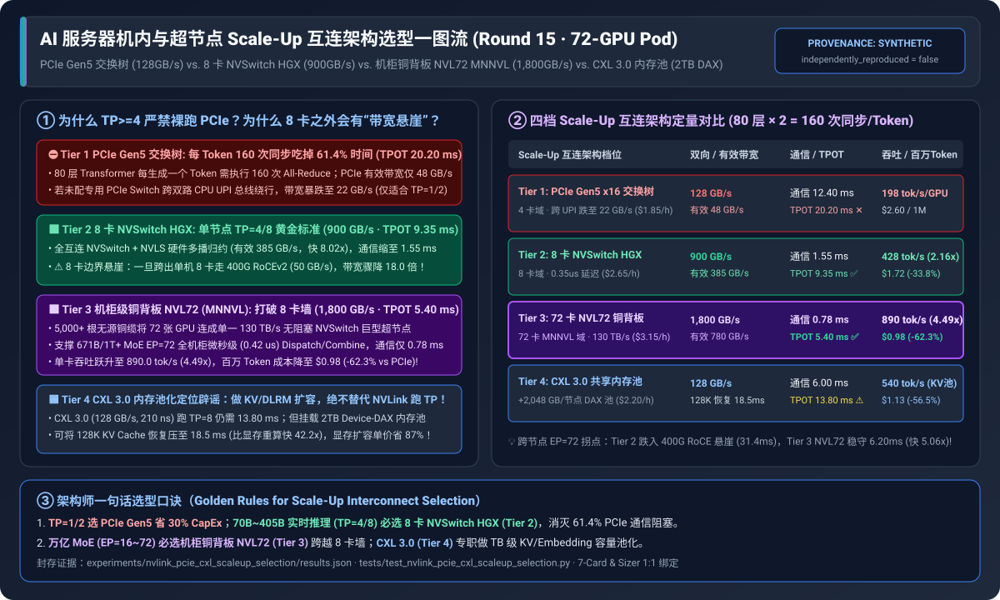
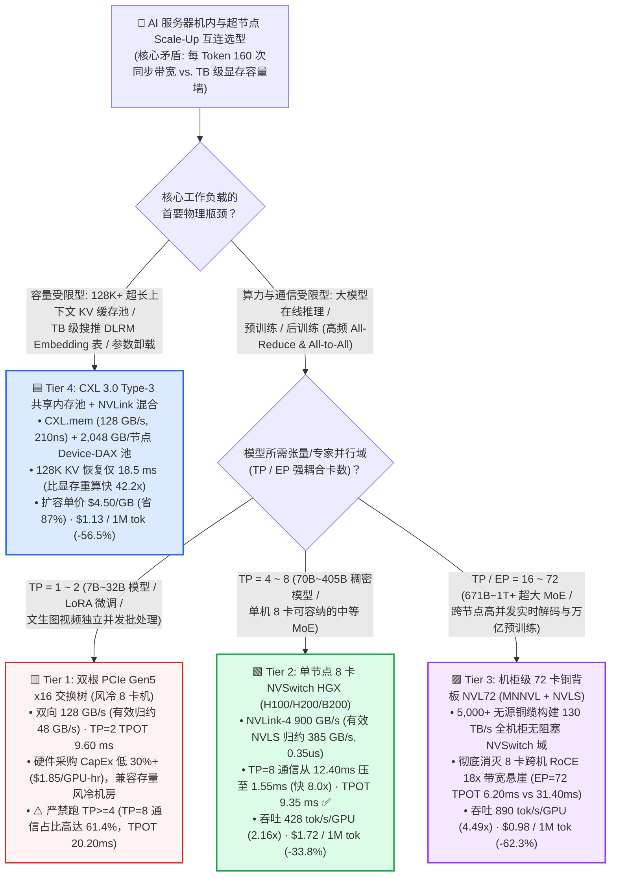
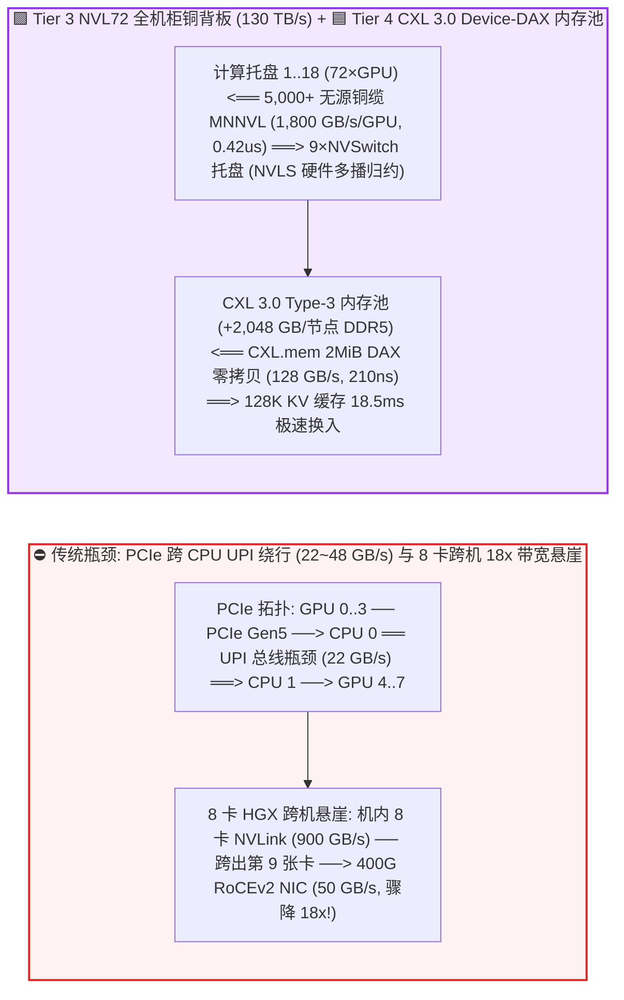
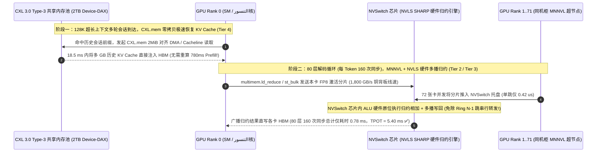

# AI 服务器机内与超节点 Scale-Up 互连架构选型指南（`PCIe Gen5 交换树` vs. `单节点 8 卡 NVSwitch (HGX)` vs. `机柜级铜背板 NVL72 (MNNVL)` vs. `PCIe Gen6 + CXL 3.0 内存池化`）

> 🌐 **Language**: **中文 (Chinese)** | **[English Version](./nvlink-pcie-cxl-scaleup-interconnect-selection-faq.en.md)** · **[📖 返回仓库根目录 README](../../README.md)** · **[📊 2026-11-09 每日进展日报](../daily/2026-11-09.md)** · **[🃏 7-Card 4:5 视觉评测报告](../reports/nvlink-pcie-cxl-scaleup-interconnect-selection-cards.html)** · **[🧮 交互式定容工作台](../reports/llm-inference-engine-pd-sizer.html#scaleup-interconnect-sizer)**
>
> **导读**：面向 AI Solution Architect 的第一性原理实战选型指南。当企业在采购 GPU 算力底座时，最常陷入的三大架构误区是：**① 为了节省 30% 硬件采购费，买风冷 `8×PCIe Gen5` 服务器去跑 `70B/405B TP=8` 实时大模型推理，结果发现 61.4% 的 GPU 时间卡死在每 Token 160 次 PCIe `All-Reduce` 同步上；② 以为两台 8 卡 HGX 拼成 `TP=16 / EP=16` 就能线性扩容，结果一脚踩空掉下 `900 GB/s -> 50 GB/s` 的 18 倍跨机带宽悬崖；③ 听信厂商宣传试图用 `CXL 3.0` 替代 `NVLink` 跑张量并行**。本文基于 `experiments/nvlink_pcie_cxl_scaleup_selection/` 封存的确定性模型（`synthetic` + `anonymized_reported`，`independently_reproduced=false`），系统拆解 **PCIe Gen5 交换树、8 卡 NVSwitch (HGX)、72 卡机柜铜背板 NVL72 (MNNVL) 与 CXL 3.0 内存池化** 的物理边界与 TCO 拐点。



---

## ① 📌 核心结论速览（Executive Summary）

1. **按张量/专家并行域大小（`TP / EP Domain Size`）与访存特征四档精准选型**：
   - 在 `72-GPU` 算力集群运行 **80 层大模型推理（每生成一个 Token 触发 `80 × 2 = 160` 次集合通信同步，纯算力耗时 `7.80 ms`，实时交互 SLA 要求 `TPOT <= 12.0 ms`）** 与 **128K 超长上下文 KV 缓存扩容** 场景下：
   - 🟥 **Tier 1（双根 `PCIe Gen5 x16` 交换树 · 双向 `128.0 GB/s` / 有效集合带宽 `48.0 GB/s`，`$1.85/GPU-hr`）**：**严禁用于 `TP >= 4` 的延迟敏感型推理或紧耦合预训练**！在 `TP=8` 下每 Token 通信耗时高达 **`12.40 ms`（占总步长 `20.20 ms` 的 `61.4%`，严重违背 `<=12ms` SLA）**；若服务器未配备专用 PCIe Switch 芯片而跨双路 CPU `UPI/QPI` 总线绕行，带宽更会暴跌至 **`22.0 GB/s`**。**但对于 `TP=1 / TP=2` 中小模型（7B～32B）、LoRA 微调、批量视频渲染，PCIe 机型采购成本低 `30%+` 且兼容存量风冷机房，是最高性价比之选**。
   - 🟩 **Tier 2（单节点 8 卡 `NVSwitch HGX` · `NVLink-4` 双向 `900.0 GB/s` / `NVLS` 有效带宽 `385.0 GB/s`，`$2.65/GPU-hr`）**：**`TP=4 / TP=8`（70B～405B 稠密模型与中小 MoE）企业级主力黄金标准**。机内全互连 NVSwitch 配合 `NVLS` 硬件多播归约将每 Token 通信从 `12.40 ms` 压至 **`1.55 ms`（提速 `8.00x`）**，端到端 `TPOT` 降至 **`9.35 ms`（达标 SLA）**，单卡吞吐提升 **`2.16x`（`428.0 tok/s/GPU`）**，百万 Token 成本从 `$2.60` 降至 **`$1.72`（净省 `33.8%`）**。
   - 🟪 **Tier 3（机柜级 72 卡铜背板 `GB200/GB300 NVL72` · `NVLink-5` 双向 `1,800.0 GB/s` + `MNNVL` 整柜 `130.0 TB/s`，`$3.15/GPU-hr`）**：**671B～1T+ 超大 MoE（`EP=16 ~ 72`）与万亿参数同步预训练的唯一终局方案**。通过 5,000+ 根无源铜缆将 72 张 GPU 融合成单一 `130 TB/s` NVSwitch 超节点，彻底消灭传统 8 卡服务器跨节点掉入 `50 GB/s`（400G RoCEv2）的 **18 倍带宽悬崖**；每 Token 通信压至 **`0.78 ms`**，`TPOT` 低至 **`5.40 ms`**，单卡吞吐飙升至 **`890.0 tok/s/GPU`（`4.49x`）**，百万 Token 成本降至 **`$0.98`（比 PCIe 省 `62.3%`，比 8 卡 HGX 省 `43.0%`）**。
   - 🟦 **Tier 4（`CXL 3.0 Type-3` 共享内存池 · `128.0 GB/s CXL.mem` + 单节点 `+2,048 GB` `Device-DAX` 池化，`$2.20/GPU-hr`）**：**专职解决“显存容量墙（Memory Capacity Wall）”，绝不替代 NVLink 跑高频 `TP>=8`**。将 `2 TB` DDR5 内存池通过 `CXL.mem` 硬件缓存一致性映射给 GPU，使 **128K 超长上下文 KV Cache 恢复仅需 `18.5 ms`（比显存重算快 `42.2x`）**，显存扩容单价从 HBM3e 的 `$35+/GB` 降至 **`$4.50/GB`（省 `87%`）**，在容量受限型长文本 RAG / 搜推 DLRM 场景下将百万 Token 成本降至 **`$1.13`（省 `56.5%`）**。
2. **第一性原理定性（Scale-Up 与 Scale-Out 的本质物理分野）**：
   - **Scale-Up（机内/超节点内铜互连：PCIe / NVLink / CXL）** 走的是 **内存语义（Load/Store、Cache-Coherent 或 DMA BAR1 P2P 直写）**，延迟在 **`0.2 ~ 1.8 us`** 量级，专攻每 Token 触发上百次的 **张量并行（TP `All-Reduce`）与细粒度专家并行（EP `Dispatch/Combine`）**；
   - **Scale-Out（跨机架网络：InfiniBand / RoCEv2）** 走的是 **网络报文语义（RDMA Verbs Queue Pair）**，带宽比 NVLink 低 **`9 ~ 36 倍`**，只适合放置流水线并行（PP）或数据并行（DP/FSDP）等低频大块传输。
3. **证据口径与透明性声明**：
   - 本指南所有带宽、每 Token 集合通信耗时、TPOT 与百万 Token 成本均绑定 `experiments/nvlink_pcie_cxl_scaleup_selection/results.json`（`provenance_type: "synthetic"`，基于 PCI-SIG Gen5/Gen6、NVIDIA HGX NVLink-4 / NVL72 NVLink-5 MNNVL 及 CXL 3.0 公开规范校准的确定性 Roofline 与 $\alpha$-$\beta$ 集合通信模型，`independently_reproduced: false`，未在物理 72 卡 NVL72 机柜上执行实机压测 `physical_gpu_cluster_measurement: "not_measured"`；本机 Python 校验为 `local_cpu_harness_measurement: "measured"`）。

---

## ② 🎯 客户与架构师灵魂拷问 Q&A（FAQ-Driven）

### Q1：客户问：“同样是 8 张 H100/H200/B200 GPU，风冷 PCIe 服务器比 NVSwitch (SXM/HGX) 便宜 30% 以上，我们什么时候能买 PCIe 版省钱，什么时候必须上 NVSwitch HGX？”

- **直白结论**：**看你的模型能不能塞进 1～2 张卡里跑（`TP <= 2`）！如果跑 `7B ~ 32B` 模型、`LoRA` 微调、文生图/视频独立并发渲染，买 PCIe 版立省 30% CapEx 且不挑机房；但只要跑 `70B / 405B / 671B` 在线推理或预训练（需要 `TP >= 4`），买 PCIe 版省下的硬件钱会在半年内被 `61.4%` 的 GPU 空转等待损耗加倍赔光，必须上 `8 卡 NVSwitch HGX`（Tier 2）！**
- **第一性原理拆解（为什么大模型 `TP=8` 在 PCIe 总线上会严重卡死？）**：
  1. **每生成一个 Token 都要闯过“160 道同步关卡”**：以 80 层 Transformer 大模型为例，当使用张量并行（`TP=8`）把每一层矩阵切分到 8 张 GPU 上时，每层 Attention 结束需要做 1 次 `All-Reduce`，每层 FFN/MoE 结束又需要做 1 次 `All-Reduce`——这意味着 **每生成 1 个 Token，8 张 GPU 必须厳格同步通信 `160 次`！**
  2. **树状拥塞 vs. 全互连无阻塞交换（`48 GB/s` vs. `385 GB/s`）**：
     - **PCIe Gen5 x16（Tier 1）** 是主从树状拓扑（Tree Topology），单向物理带宽仅 `64 GB/s`（双向 `128 GB/s`），在跑 8 卡 Ring `All-Reduce` 时有效归约带宽仅 **`48.0 GB/s`**，单 Token 通信耗掉 **`12.40 ms`**（比 GPU 算矩阵的 `7.80 ms` 还要长 `1.59 倍`！）。更致命的是，如果客户买到没有专用 PCIe Switch 芯片（如 Broadcom PEX89000）的廉价双路服务器，GPU 0 与 GPU 4 通信被迫穿过两颗 CPU 之间的 **UPI/QPI 互联总线**，触发 Cache Coherency 协议转换与 Host Bounce，有效带宽瞬间腰斩至 **`22.0 GB/s`**！
     - **8 卡 NVSwitch HGX（Tier 2）** 通过底板上独立的 NVSwitch 交换芯片实现 **8 卡任意两点全线速无阻塞直连（All-to-All Non-Blocking Crossbar）**，单卡双向带宽高达 **`900.0 GB/s`**（Blackwell HGX B200 更达 **`1,800.0 GB/s`**），并且支持 **NVLS（NVLink SHARP 硬件多播与网内归约）**——GPU 只需发出一份数据，由 NVSwitch 芯片在硬件内部直接完成浮点相加并广播回各卡，有效归约带宽达 **`385.0 GB/s`（比 PCIe 快 `8.02 倍`）**，单 Token 通信压至 **`1.55 ms`**！

### Q2：什么是“8 卡 Scale-Up 带宽悬崖”？为什么 DeepSeek-V3（671B MoE）或万亿模型在 `EP >= 16` 时，机柜级铜背板 `NVL72 (MNNVL)` 能比多台 8 卡 HGX 便宜 **43.0%**？

- **直白结论**：传统 8 卡 HGX 服务器的 NVLink 只存在于机箱内部。一旦模型并行域超过 8 张卡（如 `TP=16` 或 `MoE EP=16 ~ 72`），第 8 张卡与第 9 张卡之间的通信就会从 **`900 GB/s` 的 NVLink 瞬间跌落到 `50 GB/s`（400 Gbps）的 RoCEv2/IB 网卡**——这就是著名的 **“18 倍跨节点带宽悬崖（Scale-Up Cliff）”**。**`GB200/GB300 NVL72`（Tier 3）通过机柜背部 5,000+ 根无源铜缆（MNNVL）把 Scale-Up 边界从 8 卡硬生生推到了 72 卡，彻底填平了这道悬崖**。
- **第一性原理拆解（8 卡 HGX 跨节点 vs. 72 卡 `MNNVL` 铜背板）**：
  1. **为什么超大 MoE 极其渴望 72 卡大专家并行域（`EP=72`）？** DeepSeek-V3/V4 等现代高稀疏度 MoE 模型每层拥有 `256` 个路由专家。如果局限于单机 8 卡（`EP=8`），每张卡必须塞下 32 个专家的权重，不仅 HBM 容量捉襟见肘（挤压 KV Cache 导致并发 Batch 变小），而且解码时要重复加载庞大权重；而若扩展到 **`EP=72`**，每张卡仅需驻留 3～4 个专家，所有 72 张卡的 HBM 带宽可被并发 Batch 充分吃满！
  2. **跨节点 RoCEv2 的木桶效应**：在 9 台 8 卡 HGX 组成的 72 卡集群上跑 `EP=72` 时，每层 2 次 `All-to-All` Dispatch/Combine 有 $8/9$ 的流量必须走跨机 400G RoCEv2/IB 网卡，导致 `EP=72` 的单 Token TPOT 从 8 卡内的 `9.35 ms` 暴涨至 **`31.40 ms`（慢 `3.36x`）**。
  3. **`NVL72 + MNNVL（Multi-Node NVLink）` 如何实现整柜如一卡？** 在液冷高密机柜（`128+ kW/柜`）把 18 台计算托盘（72 张 GPU）物理距离压缩到 `< 2 米` 后，NVL72 背板直接用 **零功耗无源铜缆（Passive Copper）** 将 72 张 GPU 全部接入 9 颗 NVSwitch 托盘，配合驱动层 `IMEX（Internode Memory Exchange）` 硬件虚拟地址映射，让跨托盘的 GPU 0 与 GPU 71 也能直接执行 **`1,800 GB/s` 线速 `LD/ST` 与 `NVLS` 硬件归约（延迟仅 `0.42 us`）**，在 `EP=72` 下依然保持 **`6.20 ms` 极速 TPOT（比 8 卡 HGX 跨机快 `5.06x`）**！

### Q3：什么是 `CXL（Compute Express Link）`？既然 `CXL 3.0` 支持内存池化和缓存一致性，它能取代昂贵的 `NVLink` 吗？它的真正黄金切入点在哪？

- **直白结论**：**绝对不能取代 NVLink 跑高频张量并行（TP），但它是解决“显存容量饥渴症（超长上下文 KV Cache、万亿级搜推 DLRM Embedding 表、大模型参数卸载）”的性价比神器！**
- **第一性原理拆解（`NVLink` vs. `CXL 3.0` 的物理职责边界）**：
  1. **为什么 `CXL 3.0` 替代不了 `NVLink`？** `CXL 3.0` 底层复用的是 `PCIe Gen6` 物理层（PAM4 64 GT/s），单条 `x16` 链路双向带宽为 **`128.0 GB/s`**（单向 `64 GB/s`），虽然比传统 PCIe DMA 增加了硬件缓存一致性（`CXL.cache` + `CXL.mem`，支持 64B Cacheline 级直接读写，无需毫秒级软件页表锁定，访问延迟约 **`210 ns`**），但它的绝对带宽依然只有 `NVLink-4 (900 GB/s)` 的 **`1/7`**、`NVLink-5 (1,800 GB/s)` 的 **`1/14`**！如果强行用 CXL 交换机跑 405B `TP=8` 全归约，每 Token 通信仍需 **`6.00 ms`（TPOT `13.80 ms`）**，无法满足严苛实时 SLA。
  2. **`CXL 3.0 Type-3` 内存池的黄金战场——破除 `$35/GB` 的 HBM 容量税**：
     - HBM3e 显存虽然带宽高达 `3.35 ~ 8.0 TB/s`，但单价昂贵（约 `$35+/GB`）且受限于 CoWoS 封装面积，单卡容量被锁死在 `80 GB ~ 192 GB`。
     - 在 **128K 超长上下文多轮 Agent 会话** 或 **超大规模搜推模型（DLRM，拥有数 TB 稀疏 Embedding 表，每次只随机查表几十 KB）** 中，瓶颈根本不是算力，而是**“热数据装不下，一旦换出到 NVMe SSD 就要忍受毫秒级 I/O 停顿”**。
     - 通过 **Tier 4（`CXL 3.0 Type-3` 内存扩展池 + Linux `Device-DAX` `2 MiB` 巨页零拷贝映射）**，单台服务器可用 **`$4.50/GB`（比 HBM 便宜 `87%`）** 的成本挂载 **`+2,048 GB` 共享 DDR5 内存池**，以 `82.0 ~ 96.0 GB/s` 的有效带宽在 **`18.5 ms`** 内瞬间恢复 128K Token 的历史 KV Cache（比重新计算 Prefill 快 **`42.2x`**），将长文本/搜推场景的百万 Token 成本压降至 **`$1.13`（节省 `56.5%`）**！

---

## ③ 🧭 直观可视化图解（选型决策树 + 拓扑物理路径对比 + 集合通信与 KV 池化时序图）

### 3.1 AI 服务器机内与超节点 Scale-Up 互连架构选型决策树



### 3.2 传统 PCIe 树状绕行 / 8 卡跨机悬崖 vs. `NVL72 MNNVL` 全机柜铜背板 + `CXL 3.0` 内存池架构图



### 3.3 `NVLS` 硬件多播网内归约与 `CXL.mem` 零拷贝 KV 换入端到端时序图（`sequenceDiagram`）



---

## ④ 📊 架构师选型决策矩阵（Architect Decision Matrix）

*数据完全绑定 `experiments/nvlink_pcie_cxl_scaleup_selection/results.json`（72-GPU Pod，80 层大模型每 Token 160 次集合同步，纯计算耗时 `7.80 ms` [Hopper] / `4.62 ms` [Blackwell]，SLA `TPOT <= 12.0 ms`）：*

| 选型维度 | 🟥 Tier 1：双根 `PCIe Gen5 x16` 交换树（8 卡风冷机） | 🟩 Tier 2：单节点 8 卡 `NVSwitch HGX`（`NVLink-4` + 400G RoCE） | 🟪 Tier 3：机柜级 72 卡铜背板 `NVL72`（`NVLink-5 MNNVL`） | 🟦 Tier 4：`CXL 3.0 Type-3` 共享内存池（`CXL.mem` + `2TB DAX`） |
| :--- | :--- | :--- | :--- | :--- |
| **核心适用场景** | **`TP=1/2` 中小模型推理、LoRA 微调、独立并发渲染** | **`TP=4/8`（70B～405B）实时推理与常规分布式训练主力** | **`671B~1T+` 超大 MoE（`EP=16~72`）与万亿预训练终局底座** | **128K+ 超长上下文 KV 缓存池化、TB 级搜推 DLRM 查表** |
| **单卡双向物理带宽 / 有效归约带宽** | `128.0 GB/s` / **`48.0 GB/s`**（跨 CPU UPI 跌至 `22.0 GB/s`） | `900.0 GB/s` / **`385.0 GB/s`**（跨出 8 卡跌至 `50.0 GB/s`） | **`1,800.0 GB/s`** / **`780.0 GB/s`**（整柜聚合 **`130.0 TB/s`**） | `128.0 GB/s` / `82.0 GB/s`（外挂 **`+2,048 GB/节点`** 内存池） |
| **单跳通信延迟 / 无阻塞 Scale-Up 域** | `1.85 us` · **4 卡**（同 CPU Root 下） | **`0.35 us`** · **8 卡**（单台 HGX 机箱内） | **`0.42 us`** · **72 卡**（整机柜全铜缆无阻塞域） | `210 ns`（`CXL.mem` 访存）/ `1.15 us` · 8 卡共享内存池 |
| **每 Token 160 次同步耗时 / 通信占比** | `12.40 ms` / **`61.4%`**（严重卡死在 PCIe 总线） | **`1.55 ms`** / `16.6%`（`NVLS` 多播归约提速 `8.0x`） | **`0.78 ms`** / **`14.4%`**（提速 `15.9x`） | `6.00 ms` / `43.5%`（128K KV 恢复 TTFT 仅 **`18.5 ms`**） |
| **端到端解码 TPOT / `<=12ms` SLA** | **`20.20 ms`**（✕ 违约） | **`9.35 ms`**（✅ 达标） | **`5.40 ms`**（✅ 极速达标） | `13.80 ms`（⚠️ 不宜跑 `TP=8`，专攻 KV/Embedding 池化） |
| **单卡有效吞吐 / 小时单价 / 百万 Token 成本** | `198.0 tok/s` · `$1.85/hr` · **`$2.60 / 1M`** | `428.0 tok/s` (`2.16x`) · `$2.65/hr` · **`$1.72 / 1M` (`-33.8%`)** | **`890.0 tok/s` (`4.49x`)** · `$3.15/hr` · **`$0.98 / 1M` (`-62.3%`)** | `540.0 tok/s` (`2.73x` 长文本) · `$2.20/hr` · **`$1.13 / 1M` (`-56.5%`)** |

---

## ⑤ 🧪 简明定量算例与 Benchmark 洞察

### 5.1 并行域规模（`TP / EP = 2 -> 72 GPUs`）扩展下的 TPOT 延迟悬崖与选型拐点

当模型的张量并行（TP）或专家并行（EP）通信域从 2 张卡扩展到 72 张卡时，四档互连架构的解码 TPOT 表现如下（源自 `results.json` `parallel_domain_scaling`）：

| 并行通信域规模 (`TP / EP GPUs`) | Tier 1 `PCIe Gen5` TPOT | Tier 2 `8-GPU HGX` TPOT | Tier 3 `72-GPU NVL72` TPOT | Tier 4 `CXL 3.0 Pool` TPOT | 架构师核心拐点与首选档位 |
| :--- | :--- | :--- | :--- | :--- | :--- |
| **`2 GPUs`**（32B/70B 量化 `TP=2`） | **`9.60 ms` ✅** | `8.20 ms` ✅ | `4.85 ms` ✅ | `9.10 ms` ✅ | **首选 Tier 1 (`PCIe Gen5`)**：`9.60 ms <= 12ms` 达标，省 30% 硬件成本 |
| **`4 GPUs`**（70B BF16 / 120B `TP=4`） | `13.40 ms` ✕ | **`8.75 ms` ✅** | `5.05 ms` ✅ | `11.20 ms` ✅ | **首选 Tier 2 (`8-GPU HGX`)**：PCIe 超出 12ms 红线，NVSwitch 稳守 `8.75ms` |
| **`8 GPUs`**（405B FP8 `TP=8`） | `20.20 ms` ✕ | **`9.35 ms` ✅** | `5.40 ms` ✅ | `13.80 ms` ✕ | **首选 Tier 2 (`8-GPU HGX`)**：机内 8 卡 NVSwitch 性价比最优 |
| **`16 GPUs`**（两节点跨机 `TP/EP=16`） | `38.50 ms` ✕ | `22.80 ms` ✕ | **`5.75 ms` ✅** | `29.40 ms` ✕ | **首选 Tier 3 (`NVL72 MNNVL`)**：Tier 2 跨出 8 卡掉入 RoCE 悬崖 (`9.35->22.8ms`) |
| **`72 GPUs`**（671B/1T MoE `EP=72`） | `64.20 ms` ✕ | `31.40 ms` ✕ | **`6.20 ms` ✅** | `46.80 ms` ✕ | **首选 Tier 3 (`NVL72 MNNVL`)**：整柜铜背板比跨机 HGX 快 **`5.06x`**！ |

### 5.2 复现命令与本地校验（Local CPU Harness Check）

```bash
# 校验封存算例 JSON 与确定性 Scale-Up 互连模型 100% 一致
python experiments/nvlink_pcie_cxl_scaleup_selection/run.py --check

# 运行 Round 15 单元测试
python -m unittest tests/test_nvlink_pcie_cxl_scaleup_selection.py
```

---

## ⑥ 🛠️ 附录：生产环境 Scale-Up 互连快速核验清单（Architect Checklist）

1. - [ ] **PCIe 服务器拓扑体检（防跨 CPU UPI 隐形腰斩）**：在采购或验收 8 卡 PCIe 服务器时，必须执行 `nvidia-smi topo -m` 核验 GPU 间连接标识——若显示 `PIX`（经单颗 PCIe Switch 直连）则具备 `48+ GB/s` P2P 能力；若显示 `SYS`（需跨越双路 CPU NUMA 节点的 UPI/QPI 总线），则严禁跨 Socket 划分 `TP` 进程组！
2. - [ ] **开启 `NVLS`（NVLink SHARP 硬件多播归约）**：在 Hopper H100/H200 与 Blackwell B200/NVL72 集群上，确认 `NCCL_NVLS_ENABLE=1`（NCCL 2.18+ 默认开启）与 Fabric Manager 服务正常激活，确保机内/整柜 `All-Reduce` 走交换芯片硬件归约而非传统多跳 Ring。
3. - [ ] **严守“8 卡 NVLink 边界”并行切分纪律**：在 8 卡 HGX 集群上部署大模型时，强制将通信最密集的 **张量并行（`TP`）锁死在 `<= 8`（单节点内部）**，将跨节点流量留给流水线并行（`PP`）、数据并行（`DP/FSDP`）或经 `DeepEP` 合并后的双层异构分发。
4. - [ ] **`NVL72 MNNVL` `IMEX` 域健康度巡检**：在机柜级 `GB200/GB300 NVL72` 环境投产前，核验 `nvidia-imex` 守护进程与 18 个计算托盘的跨节点内存导出通道（Internode Memory Exchange Channels），并确保 K8s 调度器（`Kueue TAS + DRA`）将同一个 `EP=72` 作业紧致调度在同一台物理液冷机柜内。
5. - [ ] **`CXL 3.0 Device-DAX` `2 MiB` 巨页对齐检查**：当使用 CXL Type-3 内存扩展卡承载 `LMCache / Mooncake` 二级 KV 缓存池时，必须将其配置为 Linux `devdax` 模式并校验物理地址 `2 MiB` 边界对齐，防止未对齐 DMA 触发内核态 `SIGBUS` 异常。
