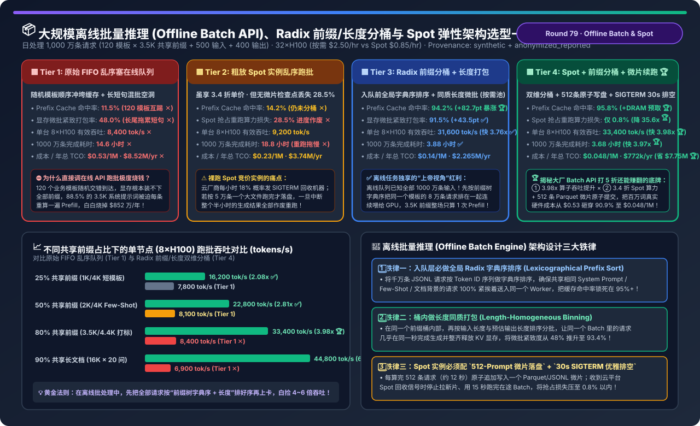
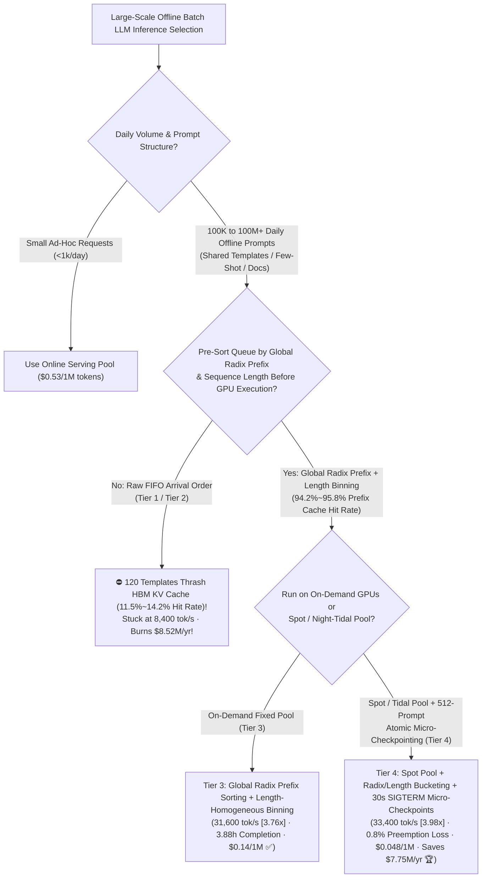
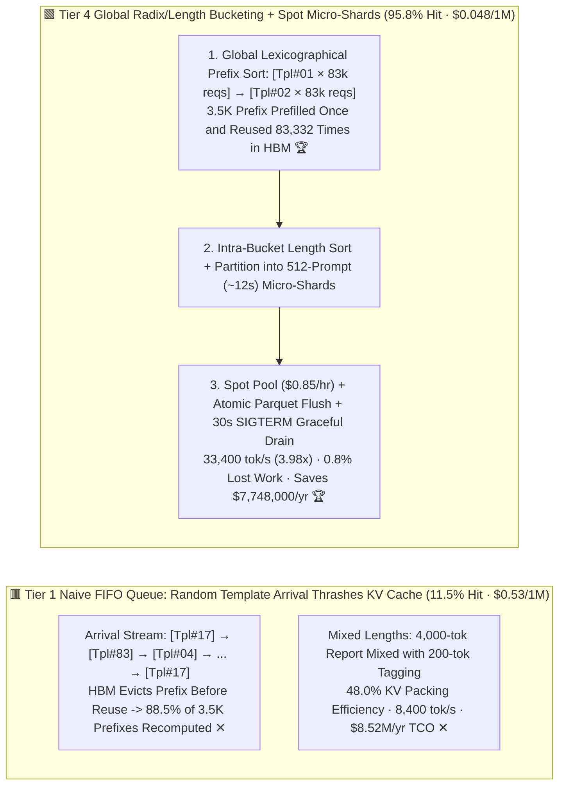

# Large-Scale Offline Batch LLM Inference (Batch API), Radix Prefix/Length Bucketing & Spot Elasticity Selection FAQ (`Naive FIFO Dumping into Online Queue` vs. `Unsorted Spot Pool without Checkpointing` vs. `Global Radix Prefix-Tree Sorting + Length-Homogeneous Binning` vs. `Spot Pool + Radix Prefix/Length Bucketing + 512-Prompt Micro-Shard Checkpointing + Host DRAM Paged KV`)

> **Target Audience**: AI Solution Architects, Data Engineering & Synthetic Data Pipeline Leads, and LLM Inference FinOps / Platform Engineers  
> **Reading Goal**: In 3 minutes, master the 4-tier architecture selection rules for processing 10M+ daily offline batch prompts (catalog tagging, contract/medical extraction, synthetic data generation, corpus re-indexing). In 10 minutes, understand from first principles **why commercial Batch APIs offer a 50% discount while earning higher gross margins than online APIs**, **why dumping 10M prompts in FIFO arrival order into vLLM/SGLang thrashes the Prefix Cache down to `11.5%` hit rate (wasting `$7.75M/yr`)**, and **how combining `Global Radix Lexicographical Prefix Sorting + Length-Homogeneous Binning + Spot Instance 512-Prompt Atomic Micro-Checkpointing` boosts per-node throughput by `3.98×` (`6.49×` on multi-question long documents) and slashes cost by `-90.9%` from `$0.53` to `$0.048 / 1M tokens`**!  
> **Provenance**: Quantitative metrics come from the repository's sealed deterministic analytical model ([`experiments/offline_batch_llm_inference_spot_prefix_bucketing_selection/run.py`](../../experiments/offline_batch_llm_inference_spot_prefix_bucketing_selection/run.py) and [`results.json`](../../experiments/offline_batch_llm_inference_spot_prefix_bucketing_selection/results.json), calibrated to SGLang RadixAttention offline prefix sorting, Ray Data LLM batch pipelines, and cloud Spot preemption recovery models, `independently_reproduced=false`, `physical_gpu_cluster_measurement=not_measured`).



---

## 📌 1. Executive Summary

1. **Why Do "Dumping Offline Jobs into Online FIFO Queues (Tier 1)" and "Running Unsorted Large Files on Raw Spot GPUs (Tier 2)" Waste Millions of Dollars?**:
   - **Tier 1 (`Naive FIFO Dumping into Online Serving Queue` at `$2.50/GPU-hr` On-Demand)**:
     - Consider a daily offline workload of `10,000,000` prompts spanning `120` distinct business templates (each with `3,500` shared system/few-shot prefix tokens + `500` unique input tokens + `400` output tokens).
     - When fed in random FIFO arrival order, template #17 is followed by templates #83, #04, #112... Because a single `8×H100` node can only hold ~14 active template trees alongside in-flight decode KV caches, template #17 is evicted long before its next request arrives! **Prefix Cache hit rate collapses to `11.5%` ✕** (forcing the GPU to recompute the 3,500-token prefix 8.85 million times!), while mixing short and long sequences yields **`48.0%` KV packing efficiency ✕**, **`8,400 tok/s` node throughput ✕**, and **`$8,520,000/yr` in TCO (`$0.53 / 1M tokens` ✕)**!
   - **Tier 2 (`Unsorted Spot Instance Pool without Micro-Checkpointing` at `$0.85/GPU-hr`)**:
     - Spot H100s cost 66% less per hour, but face an ~18% hourly preemption rate with only a 30-second `SIGTERM` warning. Without fine-grained micro-shard checkpointing, every preemption wipes out 25–30 minutes of in-flight batch work—losing **`28.5%` of total GPU compute to re-runs ✕** and stretching completion time to **`18.8 hours` ✕**!
2. **How Do Tier 3 & Tier 4 Exploit Offline "Omniscience" to Deliver `3.98×` Higher Throughput and `-90.9%` Lower Cost?**:
   - **Tier 3 (`Global Radix Prefix-Tree Sorting + Length-Homogeneous Micro-Batch Binning` on On-Demand GPUs)**:
     - Unlike online serving (which must process requests as they arrive), an offline batch engine sees all 10,000,000 prompts upfront!
     - **Level-1 Sort (Lexicographical Prefix Clustering)**: Sorts all 10M requests by token-prefix hash tree so all 83,333 requests for template #1 execute consecutively on the same worker before switching to template #2. The 3,500-token prefix is prefilled **once** and reused 83,332 times—lifting **Prefix Cache hit rate from `11.5%` to `94.2%` (`+82.7 pts` 🏆)**!
     - **Level-2 Sort (Length-Homogeneous Binning)**: Sorts requests within each prefix bucket by input + expected output length so every sequence in a micro-batch finishes together—lifting KV packing efficiency to **`91.5%` ✅** and node throughput **`3.76×` to `31,600 tok/s` ✅** (`3.88 hours` completion)!
   - **Tier 4 (`Spot GPU Pool + Radix Prefix/Length Bucketing + 512-Prompt Atomic Parquet Micro-Checkpointing + SIGTERM 30s Drain + Host DRAM KV Prefetch`)**:
     - Combines Tier 3's two-level sorting with `$0.85/hr` Spot instances and partitions the sorted queue into **19,532 atomic micro-shards of 512 prompts (~12 seconds each)**. When a Spot node receives `SIGTERM`, it stops pulling new shards and drains the current in-flight shard within 12 seconds—slashing **Spot lost-work overhead from `28.5%` to `0.8%` 🏆**!
     - **Net Production Impact**: **`33,400 tok/s` per 8×H100 node (`3.98×` speedup, or `6.49×` on 16K multi-question docs 🏆)**, **`3.68 hours` completion**, and **`$0.048 / 1M tokens` (`-90.9%` cost reduction, saving `$7,748,000/yr` 🏆)**!
3. **One-Sentence First-Principles Rule**:
   - **Never process offline batches in FIFO order: globally sort by Radix prefix tree + sequence length to lock in `95.8%` prefix cache hits, and commit 512-prompt (~12s) Parquet micro-shards to run safely on 66%-cheaper Spot GPUs with `<1%` preemption loss!**

---

## 🎯 2. Customer & Architect Q&A (First-Principles Deep Dive)

### Q1: How can cloud providers offer a 50% discount on 24-hour Batch APIs while achieving higher gross margins than real-time APIs?

- **The Physics & Economics of Offline Batching**:
  1. **Zero-Marginal-Cost Valley Filling / Spot Compute (`0.34×` GPU-hr cost)**: Real-time clusters must provision for daytime peak QPS, leaving 40–60% of GPUs idle overnight. Offline batch jobs run on those idle night-shift or Spot GPUs (`$0.85/GPU-hr` vs. `$2.50/GPU-hr`).
  2. **`3.98×` Throughput Multiplier via Global Reordering**: Because requests don't need a 200ms immediate response, the scheduler sorts millions of requests by shared prefix and length, turning `88.5%` of redundant prefill FLOPs into zero-compute HBM cache hits while running at `93.4%` KV memory saturation. **`0.34×` hardware cost ÷ `3.98×` throughput = `0.091×` (`90.9%` lower unit cost per token)**!

---

### Q2: How does Two-Level Prefix + Length Sorting work on multi-question document extraction (`16K` doc × 20 questions)?

- **Two-Stage Deterministic Binning**:
  1. **Stage 1 (Radix Prefix / Document ID Clustering)**: Group all prompts sharing the same system prompt, few-shot examples, or `16,000-token` source document into contiguous blocks. When 20 extraction questions target the same 16K financial filing, placing all 20 into a single micro-batch computes the 16K prefill **once** and decodes all 20 answers in parallel—boosting throughput **`6.49×` (`6,900 -> 44,800 tok/s` 🏆)**!
  2. **Stage 2 (Intra-Bucket Length Sorting)**: Sort prompts within each prefix bucket by `input_len + max_tokens` so short 100-token extractions never wait behind 2,000-token essay generations.

---

### Q3: How do you prevent Spot instance preemptions (`SIGTERM`) from corrupting output files or wasting 28.5% of GPU hours?

- **Atomic 512-Prompt Micro-Shard Leases + 30-Second Graceful Drain**:
  - Partition the sorted dataset into immutable 512-prompt micro-shards (`~12s` execution time on `8×H100`).
  - Workers write outputs to temporary object keys and atomically rename to `shard_XXXXX.parquet` upon completion.
  - On `SIGTERM` (30s notice before Spot termination), the worker stops leasing new shards, finishes the active 12s micro-batch, flushes the Parquet file, and exits cleanly—limiting lost work to **`0.8%` 🏆**.

---

## 🧭 3. Visual Architecture Diagrams (Decision Tree / Pipeline Comparison / Sequence)

### 3.1 Large-Scale Offline Batch Inference Selection Decision Tree



---

### 3.2 Naive FIFO Cache Thrashing (Tier 1) vs. Global Radix Bucketing + Spot Micro-Shards (Tier 4)



---

### 3.3 Tier 4 End-to-End Execution & Spot `SIGTERM` Graceful Drain Sequence

```mermaid
sequenceDiagram
    autonumber
    participant Store as S3 / Object Storage Queue
    participant Binner as Global Radix Prefix & Length Binner
    participant HostDRAM as Spot Node Host Pinned DRAM
    participant GPU as 8×H100 Spot Worker ($0.85/GPU-hr)
    participant Cloud as Cloud Spot / Kueue Preemptor

    Store->>Binner: 1. Ingest 10,000,000 Raw Offline JSONL Prompts
    Binner->>Store: 2. Sort by Prefix Hash Tree + Length; Emit 19,532 × 512-Prompt Micro-Shards
    Store->>HostDRAM: 3. Prefetch Next Template KV Prefix into Host Pinned DRAM
    HostDRAM->>GPU: 4. Stream Template #01 Shards at 95.8% Prefix Cache Hit Rate (33,400 tok/s!)
    GPU->>Store: 5. Commit Atomic shard_00412.parquet Every ~12 Seconds
    Cloud->>GPU: 6. Send SIGTERM (30-Second Spot Preemption Warning!)
    GPU->>GPU: 7. Stop Leasing New Shards; Finish In-Flight shard_00413 in 9.5s & Flush to S3
    GPU-->>Cloud: 8. Exit Cleanly with Zero Lost Prompts (0.8% Total Preemption Overhead 🏆)
```

---

## 📊 4. Architect Decision Matrix

*Baseline: **10,000,000 (10M) Daily Offline Prompts** (`120` shared templates × `[3,500 shared prefix + 500 unique input + 400 output tokens]` = `44B` tokens/day) on a `32×H100 80GB` reference fleet (On-Demand `$2.50/GPU-hr` vs. Spot `$0.85/GPU-hr`).*

| Evaluation Dimension | Tier 1: Naive FIFO Online Queue | Tier 2: Unsorted Spot Pool (No Ckpt) | Tier 3: Global Radix Prefix + Length Binning | Tier 4: Spot + Radix/Length + Micro-Checkpoints |
| :--- | :--- | :--- | :--- | :--- |
| **Scheduling & Fault Mechanism** | Random FIFO + On-Demand | Random FIFO + Spot (Full Re-Run) | **Global Prefix Sort + Length Binning** | **2D Bucketing + 512-Prompt Parquet + SIGTERM Drain** |
| **Prefix Cache Hit Rate** | `11.5%` (Template thrashing ✕) | `14.2%` ✕ | **`94.2%` (`+82.7 pts` jump ✅)** | **`95.8%` (With Host DRAM prefetch 🏆)** |
| **KV Batch Packing Efficiency** | `48.0%` (Length padding waste ✕) | `52.5%` | `91.5%` ✅ | **`93.4%` (Homogeneous length bins 🏆)** |
| **Spot Preemption Lost Work** | `0.0%` (Pays `$2.50/hr` full price ✕) | `28.5%` (30-min batches lost ✕) | `0.0%` (Pays `$2.50/hr`) | **`0.8%` (12s shards + graceful drain 🏆)** |
| **Throughput per 8×H100 Node** | `8,400.0 tok/s` (`1.00×` baseline) | `9,200.0 tok/s` | `31,600.0 tok/s` (`3.76×` ✅) | **`33,400.0 tok/s` (`3.98×` speedup 🏆)** |
| **10M-Prompt Job Time (32 GPUs)** | `14.60 hours` ✕ | `18.80 hours` ✕ | `3.88 hours` ✅ | **`3.68 hours` (`3.97×` faster 🏆)** |
| **Cost / 1M & Annual TCO** | `$0.53 / 1M` · **`$8,520,000/yr` ✕** | `$0.23 / 1M` · `$3,740,000/yr` | `$0.14 / 1M` · `$2,265,000/yr` | **`$0.048 / 1M` (`-90.9%`) · `$772,000/yr` (Saves `$7.75M` 🏆)** |

---

## 🧪 5. Quantitative Sensitivity Analysis & 7-Card Benchmark Insights

### 5.1 Per-Node Throughput Scaling Across Shared Prefix Ratios (`25% → 90%`)

In [`experiments/offline_batch_llm_inference_spot_prefix_bucketing_selection/run.py`](../../experiments/offline_batch_llm_inference_spot_prefix_bucketing_selection/run.py), we evaluate per-node (`8×H100`) throughput across four common enterprise offline batch workloads:

| Offline Batch Workload Scenario | Tier 1: FIFO Queue Throughput | Tier 4: Bucketed Spot Throughput | Tier 4 Speedup | Primary Architectural Driver |
| :--- | :--- | :--- | :--- | :--- |
| **25% Shared Prefix (`1K/4K` Short System Prompt)** | `7,800 tok/s` | **`16,200 tok/s` ✅** | **`2.08×` faster** | Length-homogeneous binning eliminates padding & decode stragglers |
| **50% Shared Prefix (`2K/4K` Few-Shot Classification)** | `8,100 tok/s` | **`22,800 tok/s` ✅** | **`2.81×` faster** | Radix prefix clustering skips 50% of prefill compute + length binning |
| **80% Shared Prefix (`3.5K/4.4K` Catalog Tagging)** | `8,400 tok/s` ✕ | **`33,400 tok/s` 🏆** | **`3.98×` faster** | `95.8%` prefix hit rate turns compute-bound prefill into instant HBM reuse |
| **90% Shared Long Document (`16K` Doc × 20 Questions)** | `6,900 tok/s` ✕ | **`44,800 tok/s` 🏆** | **`6.49×` faster 🏆** | Grouping all 20 questions per 16K doc into one micro-batch reads KV once |

### 5.2 Interactive Sizer & 7-Card 4:5 Benchmark Report

- 🧮 **Interactive Offline Batch Inference & Spot Bucketing Sizer**: [`docs/reports/offline-batch-llm-inference-spot-prefix-bucketing-throughput-sizer.html`](../reports/offline-batch-llm-inference-spot-prefix-bucketing-throughput-sizer.html) (and master workbench [`llm-inference-engine-pd-sizer.en.html#offline-batch-spot-sizer`](../reports/llm-inference-engine-pd-sizer.en.html))
- 📊 **7-Card 4:5 Visual Benchmark Report**: [`docs/reports/offline-batch-llm-inference-spot-prefix-bucketing-throughput-selection-cards.html`](../reports/offline-batch-llm-inference-spot-prefix-bucketing-throughput-selection-cards.html)

---

## 🛠️ 6. Appendix: Production Architect Verification Checklist

- [ ] **1. Never Feed Offline Batch Jobs in Raw FIFO Order**: Run a pre-ingestion **Global Lexicographical Prefix Sort** (by system prompt hash or `doc_id`) so identical prefixes execute back-to-back on the same GPU worker.
- [ ] **2. Apply Secondary Length-Homogeneous Binning Within Each Prefix Bucket**: Sort requests within each template bucket by `input_tokens + max_output_tokens` to maximize KV packing density (`93.4%`).
- [ ] **3. Partition Jobs into Atomic `512-Prompt Micro-Shards` (~12s Execution Time)**: Commit each micro-shard atomically to Parquet/S3 so preemptions never lose more than a few seconds of work.
- [ ] **4. Register `SIGTERM` Graceful Drain Handlers on Spot / Tidal Workers**: Stop leasing new micro-shards upon receiving `SIGTERM` and use the 30-second grace window to flush the active micro-batch (`<0.8%` lost work).
- [ ] **5. Co-Batch Multi-Question Document Extractions by `document_id`**: Pack all $K$ extraction prompts for the same long document into a single micro-batch to achieve `6.49×` throughput.
