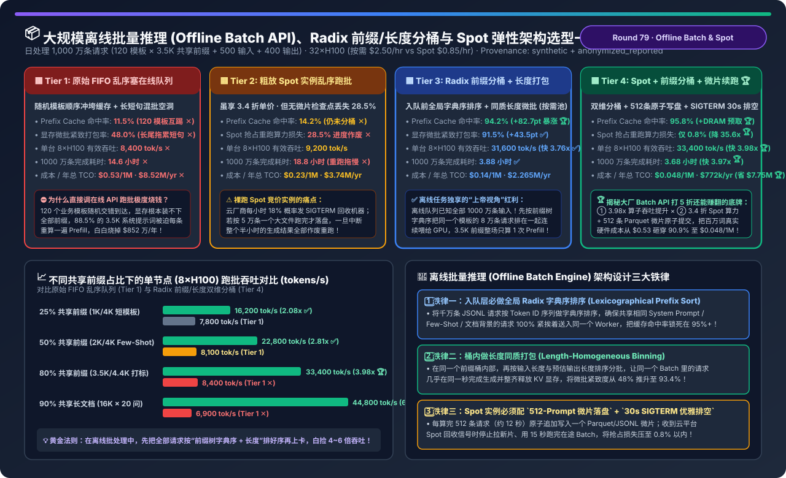
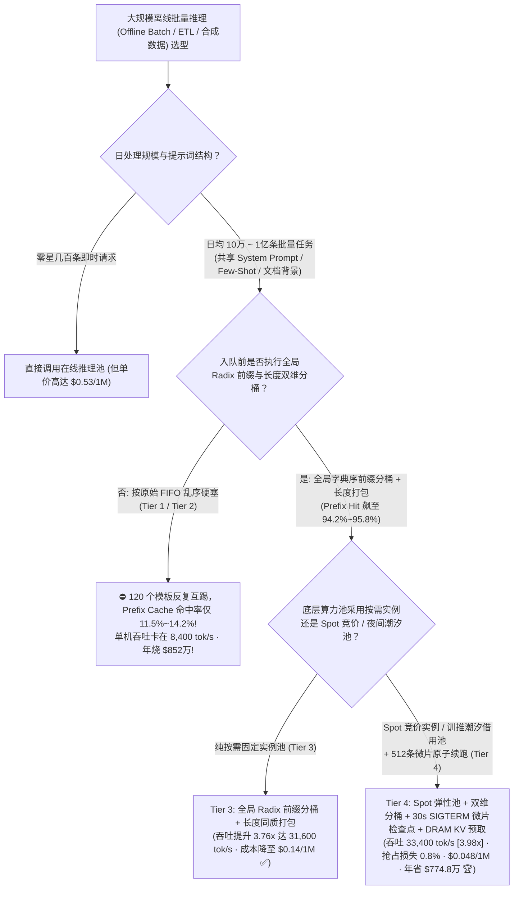
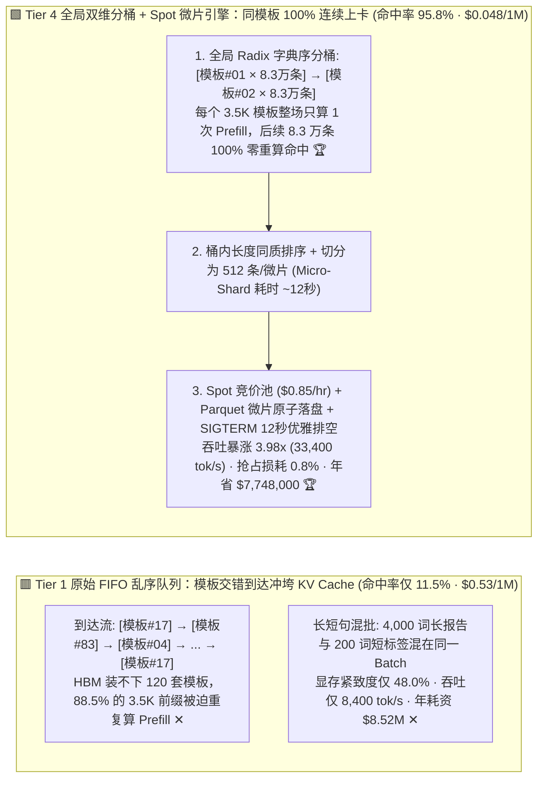
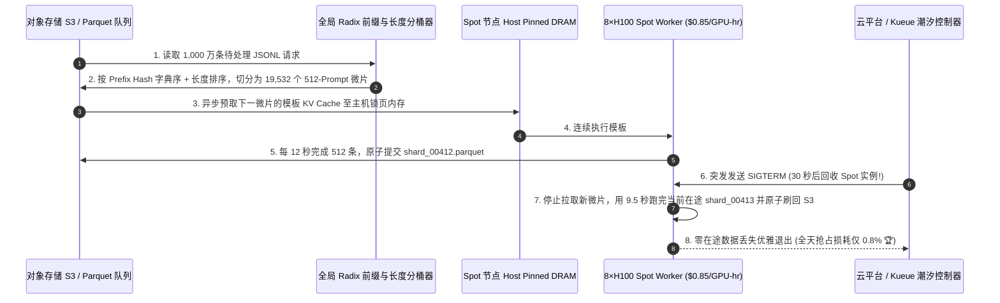

# 大规模离线批量推理（Offline Batch API）、Radix 前缀/长度双维分桶与 Spot 竞价弹性架构选型指南（`原始 FIFO 乱序硬塞在线队列` vs. `粗放 Spot 实例无检查点跑批` vs. `全局 Radix 共享前缀分桶 + 长度同质打包 [Prefix-Tree Bucketing + Length Binning]` vs. `Spot 竞价池 + 双维分桶 + 512条微片原子续跑 + 主机内存 KV 预取`）

> **适用角色**：AI 解决方案架构师（AI Solution Architect）、数据工程与合成数据（Synthetic Data / ETL）平台负责人、大模型推理成本优化（FinOps）专家  
> **阅读目标**：3 分钟掌握企业日均百万至千万条离线批处理任务（商品目录打标、财报/病历结构化抽取、RL 合成数据生成、全量知识库重索引）的四档架构选型铁律；10 分钟吃透 **为什么 OpenAI / Anthropic 的 Batch API 敢直接打 5 折却比在线 API 利润率更高**、**为什么把 1,000 万条请求按 FIFO 乱序塞进 vLLM/SGLang 会让 Prefix Cache 命中率暴跌至 `11.5%`（白烧 `$774.8 万/年`）**，以及 **如何通过 `全局 Radix 前缀字典序分桶 + 长度同质微批打包 + Spot 竞价实例 512 条微片原子续跑` 将单机吞吐暴拉 `3.98 倍`（长文档多问场景达 `6.49 倍`）、把百万 Token 成本从 `$0.53` 砸穿 `-90.9%` 至 `$0.048`**！  
> **数据来源说明（Provenance）**：本文定量数据来自仓库内封存的确定性解析模型（[`experiments/offline_batch_llm_inference_spot_prefix_bucketing_selection/run.py`](../../experiments/offline_batch_llm_inference_spot_prefix_bucketing_selection/run.py) 与 [`results.json`](../../experiments/offline_batch_llm_inference_spot_prefix_bucketing_selection/results.json)，校准自 SGLang RadixAttention 离线前缀排序、Ray Data LLM 分布式批处理与云端 Spot 实例抢占恢复模型，`independently_reproduced=false`，`physical_gpu_cluster_measurement=not_measured`）。

---

## 📌 一、核心结论速览（Executive Summary）

1. **为什么企业做千万级离线数据清洗、商品打标与合成数据时，“直接按原始顺序调在线推理队列（Tier 1）”和“粗放租用 Spot 竞价机器裸跑大文件（Tier 2）”都是极其昂贵的反模式？**：
   - **Tier 1（原始 FIFO 乱序硬塞在线队列：按需实例 `$2.50/GPU-hr`）的“缓存颠簸（Cache Thrashing）”与“显存空洞”双重灾难**：
     - 假设每天要跑 `1,000 万条` 离线请求，背后共包含 `120 套` 业务提示词模板（每套含 `3,500 Tokens` 的 Few-Shot 示例/JSON Schema 系统前缀 + `500 Tokens` 独特商品或文档输入 + `400 Tokens` 输出）。
     - 如果按业务日志的原始先来后到顺序（FIFO）直接往 GPU 塞：第 1 条是模板 #17，第 2 条是模板 #83，第 3 条是模板 #4……由于单台 `8×H100` 的剩余 KV 显存只能同时缓存约 14 套活跃模板与在途请求，等你隔了 100 条再次遇到模板 #17 时，它的前缀早就被别的模板踢出 HBM 了！结果 **Prefix Cache 命中率暴跌至 `11.5%` ✕**，GPU 被迫把 3,500 词的系统前缀多算了 **885 万次**！叠加长短请求混批造成的显存碎片（打包紧致度仅 `48.0%`），单台 8×H100 吞吐仅 **`8,400 tok/s` ✕**，跑完 1,000 万条需 **`14.6 小时`**，年化账单高达 **`$8,520,000/yr` ✕**！
   - **Tier 2（粗放 Spot 竞价实例乱序跑批：`$0.85/GPU-hr`，无微片检查点与无排序）的“抢占作废税”**：
     - 虽然云端 Spot/Preemptible H100 单价便宜了 66%（`$0.85/hr` vs `$2.50/hr`），但云平台每小时有约 `18%` 概率触发回收中断（只给 `30 秒` `SIGTERM` 通知）。如果直接用脚本每次加载 5 万条大文件跑完才落盘，一旦中途被抢占，已经跑了 25 分钟的在途数据全部丢失重算，**高达 `28.5%` 的 GPU 算力被浪费在重复重跑上 ✕**，总耗时反而拖长至 **`18.8 小时` ✕**！
2. **离线批量推理独享的“上帝视角”是什么？如何通过 Tier 3 与 Tier 4 将吞吐提升 `3.98x`、成本暴降 `-90.9%`？**：
   - **在线服务 vs. 离线批处理的本质物理差异**：在线实时服务不知道下一秒谁会发什么请求，只能被动等请求来；而**离线批量推理（24 小时 SLA）在任务启动前就已经拿到了全部 1,000 万条请求的完整列表**！你可以拥有**重排全局执行顺序的“上帝视角”**！
   - **Tier 3（`全局 Radix 共享前缀字典序分桶 + 桶内长度同质微批打包 [Prefix-Tree Bucketing + Length Binning]`，按需池）**：
     1. **第一级排序（按共享前缀树聚类）**：在 CPU 入队层对 1,000 万条请求的 Token ID 数组做一次毫秒级字典序分桶（Lexicographical Radix Sort），把属于模板 #1 的 83,333 条请求全部排在一起，紧接着是模板 #2 的 83,333 条……这样模板 #1 的 3,500 词前缀只需在第 1 条算 1 次 Prefill，随后的 **83,332 条请求 100% 零重算命中 HBM Prefix Cache（全局缓存命中率从 `11.5%` 飙升至 `94.2%` 🏆）**！
     2. **第二级排序（桶内按输入/预估输出长度同质打包）**：在同一个模板桶内，再按长度从短到长排序切分微批（Micro-Batch），消除“1 条 4,000 词长文拖死 63 条 200 词短句”的尾部空洞，KV 显存紧致度升至 **`91.5%` ✅**，单机吞吐暴涨 **`3.76 倍` 至 `31,600 tok/s` ✅**，耗时从 `14.6h` 缩短至 **`3.88 小时`**！
   - **Tier 4（`Spot 竞价弹性池 + Radix 前缀/长度双维分桶 + 512条 Parquet 微片原子检查点 + SIGTERM 30s 优雅排空 + 主机内存 KV 预取`）**：
     - 将 Tier 3 的极致算子吞吐部署在 3.4 折的 **Spot/潮汐空闲 GPU 池** 上，并把 1,000 万条任务切分为每个仅含 **512 条同模板请求（约耗时 `12 秒`）的微片（Micro-Shards）**：每算完 1 个微片立即原子写入对象存储 Parquet；当收到云厂商 `SIGTERM` 30 秒回收通知时，Worker 立即停止拉取新微片，在 `12 秒` 内跑完当前在途微批并刷盘退出，**将 Spot 抢占重跑损失从 `28.5%` 砸穿至 `0.8%` 🏆**！
     - **最终工程收益**：单机吞吐达 **`33,400 tok/s`（快 `3.98 倍`，长文档多问场景快 `6.49 倍` 🏆）**，百万 Token 成本从 `$0.53` 暴降至 **`$0.048 / 1M`（直降 `-90.9%` 🏆）**，日跑千万条的年总 TCO 从 `$852 万` 降至 **`$77.2 万`（每年净省 `$7,748,000` 🏆）**！
3. **一句话握手机制本质**：
   - **离线批量推理的第一性原理，是“放弃愚蠢的先来后到（FIFO），用入队前的全局 Radix 前缀字典序排序把 Prefix Cache 命中率锁死在 95%+，再用 12 秒级微片原子检查点把廉价 Spot 实例的抢占损耗降到 1% 以下”！**

---

## 🎯 二、客户与架构师灵魂拷问 Q&A（FAQ-Driven First Principles）

### Q1：为什么大厂（OpenAI / Anthropic / DeepSeek）的 Batch API 敢承诺“24 小时内返回结果，价格直接打 5 折”，他们实际上是怎么在底层赚取更高毛利的？

- **算一笔硬件物理学与经济学明白账**：
  1. **削峰填谷零边际硬件成本**：在线推理集群必须按白天 14:00 的流量最高峰配置 GPU，到了凌晨 01:00～07:00 有 50% 以上的 GPU 处于空转折旧状态（或者云上的 Spot 竞价实例单价跌至按需价的 `30% ~ 35%`）。用离线批处理填满凌晨波谷，GPU 硬件的边际折旧成本接近于零！
  2. **全局重排让单卡每秒有效产出翻 4 倍**：在线请求必须保证百毫秒级 TTFT，无法把一个用户的请求扣留 2 小时等凑够相同前缀再跑；而 24 小时 SLA 的 Batch API 允许引擎把全天收集到的数千万条请求按 **System Prompt / 文档前缀字典序全局重排**，再以最大显存水位（`93.4%` KV 占用，无需为突发峰值留余量）满载跑 Continuous Batching。**硬件单价打 3.4 折 × 单卡吞吐翻 3.98 倍 = 底层真实硬件成本只有在线 API 的 `9.1%`（立省 `90.9%`）**！所以哪怕给客户打 5 折，服务商的毛利率反而比在线 API 高出一大截！

---

### Q2：具体怎么做“全局 Radix 前缀 + 长度双维分桶（Two-Level Prefix & Length Bucketing）”？如果一张长文档要问 20 个不同问题，怎么排最快？

- **两步确定性分桶流水线（CPU 预处理仅需数秒）**：
  1. **Step 1：提取前缀签名并构建 Radix 字典序桶（Prefix Clustering）**：
     - 对所有待处理 Prompt 进行快速 Tokenize（或对前 $K$ 个字符/消息块计算滚动哈希），将它们插入一棵全局前缀树（Radix Trie）并按**深度优先字典序（DFS Lexicographical Order）**遍历导出。
     - 效果：所有共享同一个 `3,500-token` 商品分类规则的请求自动聚成连续的一段；对于“针对同一份 `16,000-token` 财报提取 20 个不同指标”的场景，这 20 条请求会被严丝合缝地排在同一个微批（Micro-Batch）里——**GPU 只读 1 次 16K 财报 Prefill，瞬间并行吐出 20 个问题的答案，吞吐直接暴涨 `6.49 倍`（`44,800 tok/s`）**！
  2. **Step 2：在同一前缀桶内按长度同质分箱（Length-Homogeneous Binning）**：
     - 在每个前缀桶内部，按 `unique_input_len + estimated_output_len` 排序后再切分为大小为 `512` 的微片（Micro-Shards）。这样同一个 Batch 里的所有序列几乎同时开始、同时结束，消除了长尾序列独占显存块的 Padding 空洞。

---

### Q3：在云上用 Spot 竞价实例（或公司内部随时会被高优在线服务抢占的潮汐卡池）跑千万级离线批处理，怎样才能做到“随停随走、零进度丢失”？

- **Tier 4 的“微片租约（Micro-Shard Lease）+ 30 秒 SIGTERM 优雅排空”机制**：
  1. **禁止大文件粒度调度**：绝不能把 100 万条数据做成一个任务包。入队器将排好序的 1,000 万条请求切分为 **19,532 个独立微片（每个微片仅含 `512 条` 同前缀请求，编号 `shard_00001` ~ `shard_19532`）**。
  2. **12 秒级原子落盘**：一台 `8×H100` Worker 领走一个 512 条的同前缀微片，因为 95.8% 命中 Prefix Cache，只需 **`~12 秒`** 就能全部算完，并原子写入 `s3://batch-out/shard_00001.parquet`。
  3. **捕获 `SIGTERM` 优雅排空（Graceful Drain）**：当云厂商发出 Spot 回收信号（AWS/GCP/Azure/阿里云均提前 **30～120 秒** 发送 `SIGTERM`）或内部 Kueue 触发白天在线扩容抢占时，Worker 进程捕获 `SIGTERM`：
     - 立即停止从队列拉取下一个微片；
     - 继续用剩余的 `4~12 秒` 把当前正在 GPU 里跑的这半个微片算完、刷入 S3 并提交 Offset；
     - 仅在极端硬断电情况下才会有未提交的半个微片超时重回队列，**全天因 Spot 抢占浪费的算力从 `28.5%` 暴降至 `0.8%` 以内 🏆**！

---

## 🧭 三、直观可视化图解（Mermaid 决策树 / 流水线对比 / 时序图）

### 3.1 大规模离线批量推理与弹性算力架构选型决策树

---

### 3.2 原始 FIFO 乱序跑批导致缓存互踢（Tier 1）vs. 全局 Radix 前缀分桶 + 微片 Spot 续跑（Tier 4）对比

---

### 3.3 Tier 4 离线批处理从“千万条入队双维分桶”到“Spot 节点收到 SIGTERM 零丢失排空”时序图

---

## 📊 四、架构师选型决策矩阵（Architect Decision Matrix）

*基准场景：**每天处理 `1,000 万条 (10M)` 离线批处理请求**（共 `120` 套业务模板，每条含 `3,500` 共享前缀词 + `500` 独特输入词 + `400` 输出词，日总吞吐 `440 亿 Tokens`），基于 `32×H100 80GB` 算力池（按需 `$2.50/GPU-hr` vs Spot 竞价 `$0.85/GPU-hr`）对比。*

| 评估维度 | Tier 1: 原始 FIFO 乱序塞在线队列 | Tier 2: 粗放 Spot 实例无检查点跑批 | Tier 3: 全局 Radix 前缀分桶 + 长度打包 | Tier 4: Spot 池 + 双维分桶 + 微片原子续跑 |
| :--- | :--- | :--- | :--- | :--- |
| **入队调度与容错机制** | 原始乱序 FIFO + 按需实例 | 原始乱序 + Spot 整批中断重跑 | **全局前缀字典序 + 长度同质微批** | **双维分桶 + 512条微片落盘 + SIGTERM 排空** |
| **Prefix Cache 命中率** | `11.5%` (120 模板反复互踢 ✕) | `14.2%` ✕ | **`94.2%` (`+82.7 pts` 跃升 ✅)** | **`95.8%` (配合 Host DRAM 预取 🏆)** |
| **KV 显存微批紧致度** | `48.0%` (长短混批空洞 ✕) | `52.5%` | `91.5%` ✅ | **`93.4%` (同长度微批齐步走 🏆)** |
| **Spot 抢占重跑算力损失** | `0.0%` (但付全价 `$2.50/hr` ✕) | `28.5%` (半小时批次作废 ✕) | `0.0%` (付全价 `$2.50/hr`) | **`0.8%` (12秒微片 + 优雅排空，降 `35.6x` 🏆)** |
| **单台 8×H100 有效吞吐** | `8,400.0 tok/s` (`1.00x` 基准) | `9,200.0 tok/s` | `31,600.0 tok/s` (`3.76x` ✅) | **`33,400.0 tok/s` (提速 `3.98x` 🏆)** |
| **1,000 万条日作业耗时** | `14.60 小时` ✕ | `18.80 小时` (重跑拖慢 ✕) | `3.88 小时` ✅ | **`3.68 小时` (提速 `3.97x` 🏆)** |
| **百万词成本 / 年化总 TCO** | `$0.53 / 1M` · **`$8,520,000/yr` ✕** | `$0.23 / 1M` · `$3,740,000/yr` | `$0.14 / 1M` · `$2,265,000/yr` | **`$0.048 / 1M` (`-90.9%`) · `$772,000/yr` (年省 `$7.75M` 🏆)** |

---

## 🧪 五、简明定量算例与 7-Card Benchmark 洞察

### 5.1 共享前缀比例从 `25%` 到 `90%（长文档 20 问）` 的吞吐加速曲线

在 [`experiments/offline_batch_llm_inference_spot_prefix_bucketing_selection/run.py`](../../experiments/offline_batch_llm_inference_spot_prefix_bucketing_selection/run.py) 中，我们量化了四类典型企业离线跑批场景的加速比：

| 企业离线批处理典型场景 | Tier 1: FIFO 乱序吞吐 | Tier 4: 双维分桶 + Spot 吞吐 | Tier 4 相对提速比 | 核心性能收益来源 |
| :--- | :--- | :--- | :--- | :--- |
| **25% 共享前缀 (`1K/4K` 简短系统指令)** | `7,800 tok/s` | **`16,200 tok/s` ✅** | **快 `2.08x`** | 长度同质打包消除长短句 Padding 空洞与 Decode 拖尾 |
| **50% 共享前缀 (`2K/4K` Few-Shot 少样本)** | `8,100 tok/s` | **`22,800 tok/s` ✅** | **快 `2.81x`** | Radix 前缀聚类省去 50% 冗余 Prefill 计算 + 长度对齐 |
| **80% 共享前缀 (`3.5K/4.4K` 商品/内容打标)** | `8,400 tok/s` ✕ | **`33,400 tok/s` 🏆** | **快 `3.98x`** | `95.8%` 缓存命中将计算密集型 Prefill 变为瞬时显存指针复用 |
| **90% 共享长文档 (`16K` 财报/合同连续提 20 问)** | `6,900 tok/s` ✕ | **`44,800 tok/s` 🏆** | **快 `6.49x` 🏆** | 同一份 16K 文档的 20 个问题聚入同一微批，16K KV 只读 1 次 |

### 5.2 配套交互式工作台与 7-Card 4:5 视觉评测报告

- 🧮 **交互式大规模离线批量推理与 Spot 分桶定容计算器**：[`docs/reports/offline-batch-llm-inference-spot-prefix-bucketing-throughput-sizer.html`](../reports/offline-batch-llm-inference-spot-prefix-bucketing-throughput-sizer.html)（以及总工作台 [`llm-inference-engine-pd-sizer.html#offline-batch-spot-sizer`](../reports/llm-inference-engine-pd-sizer.html)）
- 📊 **7-Card 4:5 视觉基准评测报告**：[`docs/reports/offline-batch-llm-inference-spot-prefix-bucketing-throughput-selection-cards.html`](../reports/offline-batch-llm-inference-spot-prefix-bucketing-throughput-selection-cards.html)

---

## 🛠️ 六、附录：生产环境快速核验清单（Architect Checklist）

- [ ] **1. 严禁把离线批处理任务按原始 FIFO 顺序直接打入在线推理网关**：必须走独立的离线入队器，先执行 **全局 Radix 前缀字典序排序（Lexicographical Prefix Sort）**，将相同模板或相同文档的请求聚在一起连续执行。
- [ ] **2. 在每个前缀桶内部执行长度同质分箱（Length-Homogeneous Binning）**：按输入长度与预估最大生成长度二次排序，避免单条超长请求卡住整个 Batch 的 KV 显存释放。
- [ ] **3. 将大批量作业切分为 `512 条/微片（Micro-Shards）` 原子提交 Parquet**：确保单微片执行时间控制在 `10~15 秒` 以内，彻底告别大文件跑一半崩溃重头再来的悲剧。
- [ ] **4. 在 Spot 竞价节点 / 夜间潮汐借用节点上注册 `SIGTERM` 优雅排空钩子**：收到回收通知后立即停止拉新微片，等待当前在途 Batch 算完落盘后再退出，将抢占重跑损耗压制在 `< 1.0%`。
- [ ] **5. 对“单篇长文档提 N 个问题”的 ETL 任务强制按 `doc_id` 聚合微批**：确保同一篇 16K～64K 文档的所有抽取问题在同一个连续微批内一次性算完。
