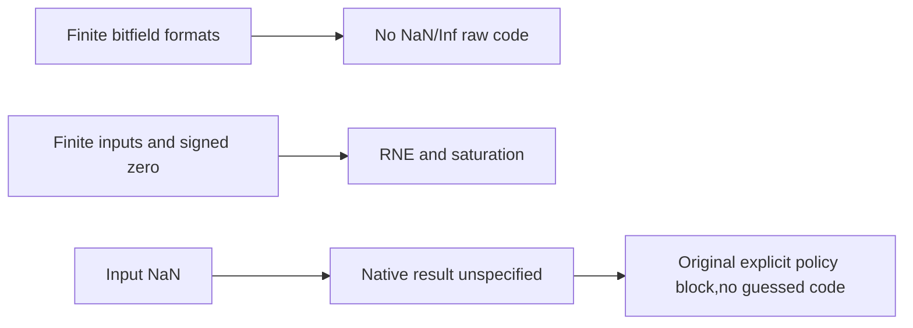
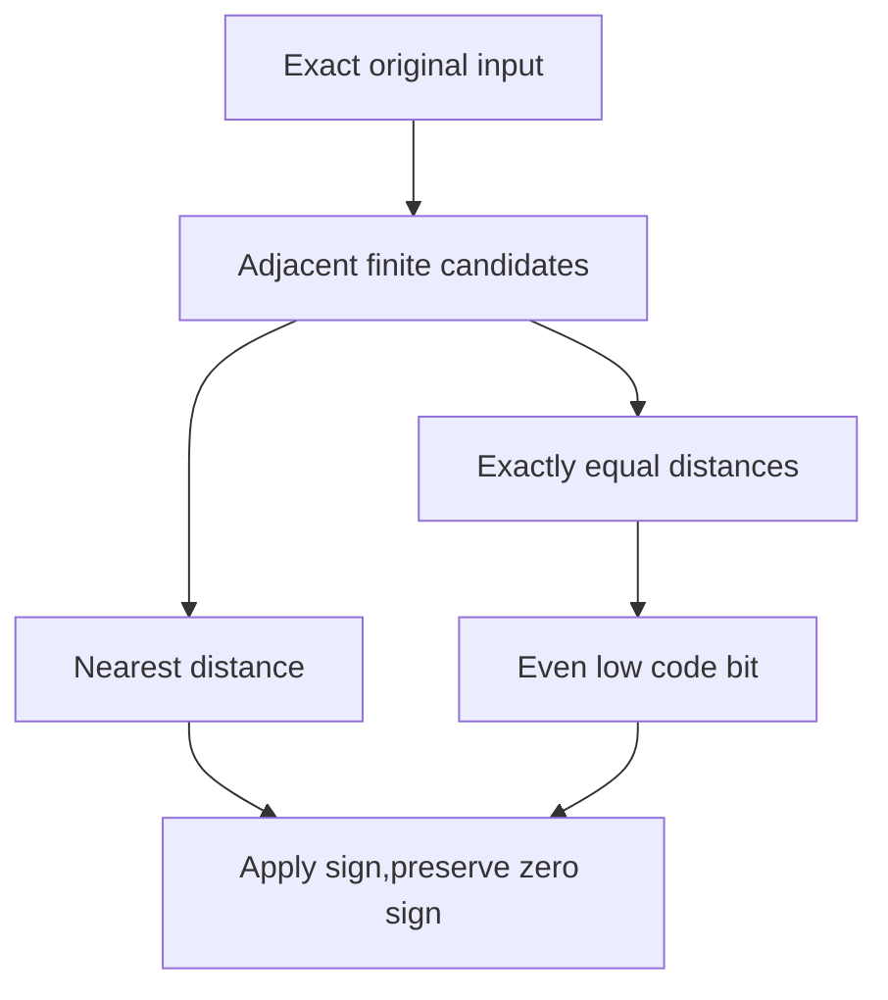
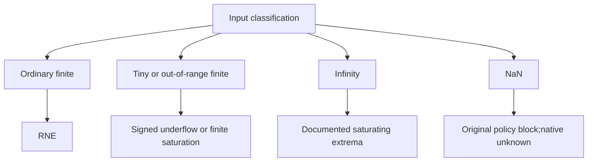

# AI Infra numerical-contract FAQ: finite ONNX FP4/FP6 Cast RNE,signed zero and NaN policy

> **Language**: English | [中文](onnx-finite-fp4-fp6-cast-rne-nan-policy-selection-faq.md)  
> **Round 148 · 2026-11-14 daytime**: exceptional-value contract clarified Nov13BJT; original exact mathematics,not model-quality or GPU Cast evaluation.

**Executive finding:** FP4E2M1's16raw patterns and FP6's64patterns have no NaN/Inf encodings, but **casting input NaN is unspecified**, not an invented zero,negative zero or maximum. Signed zero,RNE midpoints and saturation are separate defined contracts. Original0.75rounds to1inFP4via even code2;both FP6formats represent it exactly. FP6E3M2extends finite range to28without acquiring IEEE NaN semantics.

**Artifacts**: [H5 policy](../reports/onnx-finite-fp4-fp6-cast-rne-nan-policy-sizer.html) · [seven cards](../reports/onnx-finite-fp4-fp6-cast-rne-nan-policy-selection-cards.html) · [1600px SVG](../../assets/svg/onnx-finite-fp4-fp6-cast-rne-nan-policy-selection-faq-summary.svg) · [sealed report](../../experiments/finite_float_cast_policy_selection/report.json)

## Q1: What was clarified,and is it a new dtype or kernel?

At Nov12,16:05UTC=**Nov13,00:05BJT**,the pinned commit changed FP4NaN→6documentation to Unspecified,changed FP6NaN→−0examples likewise,and removed related NaN testcases. This is a **documentation/test contract clarification**,not a new FP4/FP6type or hardware-conversion algorithm.



Source identifies FP4introduction inONNX1.18.0andFP6in1.23.0;these statements do not certify installed runtime support. No ONNX/reference evaluation,GPU kernel or NVFP4/MXFP block scales were used.

## Q2: Why do range and subnormals differ?

| Format | Sign/exp/mant | Bias | Minimum subnormal | Maximum finite |
| --- | --- | ---: | ---: | ---: |
| FLOAT4E2M1 | 1/2/1 | 1 | 0.5 | 6 |
| FLOAT6E2M3 | 1/2/3 | 1 | 0.125 | 7.5 |
| FLOAT6E3M2 | 1/3/2 | 3 | 0.0625 | 28 |

Normal magnitude is`2^(exponent−bias)×(1+mantissa/2^m)`;subnormals use`2^(1−bias)×mantissa/2^m`. **All-ones exponents remain finite**,not IEEE Inf/NaN markers. Signed zeros share mathematical zero but preserve different signs:FP4raw0/8,FP6raw0/32.

Nine elements have nominal raw dtype payloads5/7/7Bwith tail padding,excluding metadata,scales,runtime allocations and GPU peak.No tensor was serialized. This numerical layer is separate from[UINT8 code-stream Pack/Unpack](onnx-pack-unpack-axis-radix-word-contract-selection-faq.en.md).

## Q3: Why cannot midpoints always round upward or toward zero?

FP4positive magnitudes are`[0,0.5,1,1.5,2,3,4,6]`. Input0.75is equally distant from0.5(code1)and1(code2);RNE chooses even code2. Input5ties4(code6)and6(code7),so chooses4. Both FP6formats exactly represent these two teaching inputs,not a complete model-accuracy evaluation.



Every adjacent positive/negative midpoint is tested. Decimal strings become exact rationals;**float32input pre-rounding is not simulated**. Decimals very near a midpoint can change first in real float32. H5mathematics is not bitwise native Cast conformance for every input dtype/backend.

## Q4: How should underflow,saturation,infinity and NaN be separated?

Original FP4`+0.25→+0`and`−0.25→−0`preserve sign;small negative values may also underflow to negative zero. Finite25saturates to6inFP4,to7.5inFP6E2M3,and rounds to24inFP6E3M2. Documented saturating conversion maps infinities to corresponding signed finite extrema.



NaN is a floating input but lacks a target encoding;**native code is not thereby required to throw**. Original H5rejects NaN explicitly,returning`blocked_nan_policy`,nullcode/value/error and an alert. This application policy is not a backend exception guarantee.Neither finite25nor infinity mappings prescribe NaN→maximum.

## Q5: How are error denominators,CPU timing and unknowns kept honest?

The primary matrix has4inputs×3formats=12rows:0.75,5,+Inf,NaN. Each format has only two **finite absolute-error observations**. FP4mean absolute error is5/8;both FP6means are0on these teaching points.Inf/NaNerrors stay null,not zeros added to denominators.With only NaN/Inf,the mean also stays null rather than a perfect0.

| Positive integer-tick queries | Bisected candidates(ms) | 32candidate scan(ms) |
| ---: | ---: | ---: |
| 64 | 0.050000 | 0.261533 |
| 256 | 0.191367 | 1.022067 |
| 1024 | 0.766467 | 4.916533 |
| 4096 | 3.753933 | 20.009667 |

Prebuilt FP6E3M2codebook/ticks produce identical even-tie codes.Excludes input/table preparation,decimal parsing,sign/NaN/Inf handling,native casts and calibration.Two warmups,seven alternating repeats and three operations/sample yield median repeat means;timer sizes exceed UI bounds.This does not measure GPU Cast,TensorCore throughput or model quality.

## Q6: How can the study be reproduced and exceptional-input policy selected?

```powershell
python -m unittest discover -s tests -p test_finite_float_cast_policy_selection.py -q
python -m experiments.finite_float_cast_policy_selection.run --check
# --measure replaces original local CPU tick-query samples;no ONNX Cast.
```

Eight tests cover independent piecewise codebooks/all signs,every positive/negative midpoint,NaN gates/denominators,signed zero/underflow/saturation,64exhaustive-nearest cases per format,invalid tokens/odd payloads,Node/Python exact-rational parity and the complete12row matrix.SVG is an original60-solid selector metaphor.Prior browser refusal remains respected;visual browser acceptance was not performed.

Sources:[clarification commit](https://github.com/onnx/onnx/commit/290eaba8185c0ed1ba6abda16f6f16d562a42da5),[FP4definitions/Cast table](https://github.com/onnx/onnx/blob/290eaba8185c0ed1ba6abda16f6f16d562a42da5/docs/docsgen/source/technical/float4.md),[FP6definitions/Cast table](https://github.com/onnx/onnx/blob/290eaba8185c0ed1ba6abda16f6f16d562a42da5/docs/docsgen/source/technical/float6.md),[Apache-2.0LICENSE](https://github.com/onnx/onnx/blob/290eaba8185c0ed1ba6abda16f6f16d562a42da5/LICENSE).Source rights are preserved;no implementation is mirrored.

Deployment needs actual input dtype/backend/saturation mode,upstream NaN monitoring,explicit rejection/bypass/human policy,scales/calibration and end-to-end quality validation.Provenance is `synthetic`, `independently_reproduced=false`;CPU is separately `measured`.Native NaN output,GPU Cast,runtime peak and model quality remain unknown/null.
