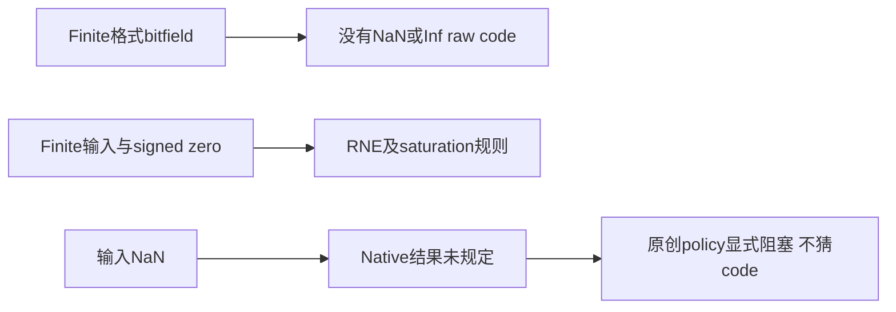
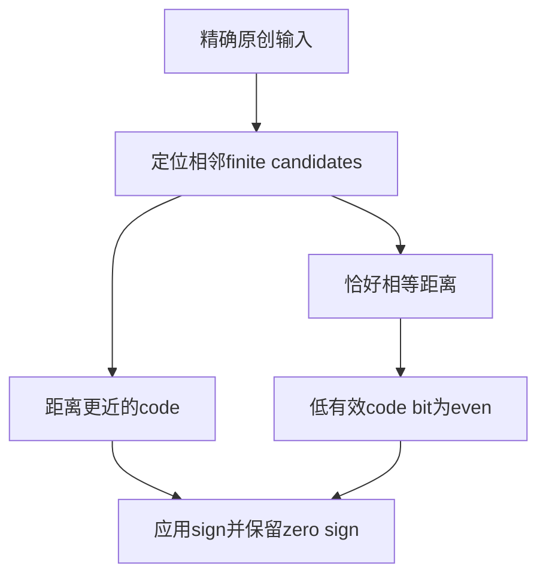
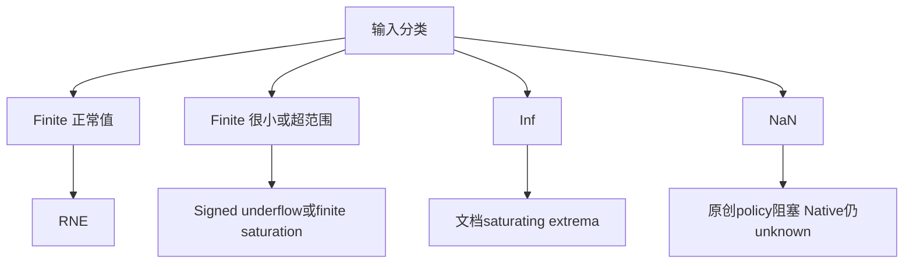

# AI Infra 数值契约 FAQ：ONNX Finite FP4/FP6 Cast 的 RNE、Signed Zero 与 NaN Policy

> **语言**：中文 | [English](onnx-finite-fp4-fp6-cast-rne-nan-policy-selection-faq.en.md)  
> **Round 148 · 2026-11-14 白班**：11月13日BJT澄清的exceptional-value契约；原创精确数学，不是模型质量或GPU Cast评测。

**结论速览**：FP4E2M1的16个raw patterns、FP6的64个raw patterns都没有NaN/Inf编码，但**输入NaN的Cast结果未规定**，不能伪造为0、−0或最大值。signed zero、RNE midpoint与saturation是另外的明确契约。原创0.75在FP4以even code2舍入到1；两个FP6格式可精确表示。FP6E3M2的finite range到28，不意味着它或其他finite格式可以继承IEEE NaN编码。

**交付**：[H5 policy](../reports/onnx-finite-fp4-fp6-cast-rne-nan-policy-sizer.html) · [7-Card](../reports/onnx-finite-fp4-fp6-cast-rne-nan-policy-selection-cards.html) · [1600px SVG](../../assets/svg/onnx-finite-fp4-fp6-cast-rne-nan-policy-selection-faq-summary.svg) · [封存数据](../../experiments/finite_float_cast_policy_selection/report.json)

## Q1：最新澄清是什么，和新dtype或新kernel有什么区别？

固定ONNX commit于11月12日16:05UTC＝**11月13日00:05BJT**修正文档：FP4的NaN→6改为Unspecified，FP6的NaN→−0示例同样改为Unspecified，并移除相关NaN testcase。它是**文档/test契约澄清**，不是当天新建FP4/FP6类型或提供新的硬件转换算法。



source文档标FP4类型从ONNX1.18.0引入，FP6从1.23.0引入；这些声明不构成本机runtime支持认证。本轮未导入ONNX/reference、执行GPU kernel或设置NVFP4/MXFP block scales。

## Q2：三个finite格式的范围与subnormal为什么不同？

| 格式 | sign/exp/mant | bias | minimum subnormal | maximum finite |
| --- | --- | ---: | ---: | ---: |
| FLOAT4E2M1 | 1/2/1 | 1 | 0.5 | 6 |
| FLOAT6E2M3 | 1/2/3 | 1 | 0.125 | 7.5 |
| FLOAT6E3M2 | 1/3/2 | 3 | 0.0625 | 28 |

normal magnitude为`2^(exponent−bias)×(1+mantissa/2^m)`，subnormal改为`2^(1−bias)×mantissa/2^m`。**全1exponent仍用于finite数值**，不能套用IEEE全1exponent=Inf/NaN判断。两个signed-zero bitpatterns对应相同数学0但保留不同sign：FP4 raw0/8，FP6 raw0/32。

九elements的nominal raw dtype payload分别5/7/7B，包含末尾padding；不计TensorProto metadata、scales、runtime allocation或GPU peak，也没有实际序列化tensor。本轮是数值契约，和[UINT8 code-stream Pack/Unpack](onnx-pack-unpack-axis-radix-word-contract-selection-faq.md)的operator表示层分开。

## Q3：RNE midpoint为什么不能统一用向上或向零舍入？

FP4 positive codebook为`[0,0.5,1,1.5,2,3,4,6]`。0.75距离0.5(code1)与1(code2)均0.25，RNE选even code2；5在4(code6)与6(code7)之间，选4。两个FP6均精确表示0.75与5，不能把这两个教学点等同完整模型accuracy评估。



原型对所有相邻code midpoint进行正负测试。decimal字符串以精确rational计算，**不仿真float32输入预舍入**；例如非常靠近midpoint的decimal在真实float32中可能先改变。本轮H5精确数学结果不是所有Cast输入dtype/backend的逐bit一致性证明。

## Q4：signed underflow、finite saturation、Inf与NaN要怎样分开？

原创FP4 `+0.25→+0`、`−0.25→−0`保留sign；小负数也可能underflow为negative zero。finite25在FP4 saturation到6，在FP6E2M3到7.5，在FP6E3M2舍入到24。文档saturating转换把±Inf映射到对应±finite extrema。



NaN是floating输入，但目标格式没有NaN编码；**这不等于native必须报错**。本H5主动采用reject-NaN policy，输出`blocked_nan_policy`、code/value/error=null，并显示alert。不能把这个应用policy推广为native Cast exception保证，更不能借finite25或Inf的映射推断NaN→max。

## Q5：error denominator、CPU时延与unknown如何避免被错误计量？

主矩阵为4inputs×3formats共12rows：0.75、5、+Inf、NaN。每format只有两个**finite absolute-error observations**。FP4 mean absolute error为5/8，两个FP6为0，均是这两个原创数学点；Inf/NaN error保留null，不作为0塞进denominator。只有NaN/Inf输入时，mean error也为null，而非完美0。

| positive integer-tick queries | bisected candidates（ms） | 32candidate scan（ms） |
| ---: | ---: | ---: |
| 64 | 0.050000 | 0.261533 |
| 256 | 0.191367 | 1.022067 |
| 1024 | 0.766467 | 4.916533 |
| 4096 | 3.753933 | 20.009667 |

预建FP6E3M2 codebook/ticks，两个CPU路径返回相同even-tie codes；排除input/table准备、decimal parsing、signed-zero/NaN/Inf处理、native casts和calibration。2warmups、7轮交替repeat、每sample3操作取中位数；timer超过UI bound。不能以CPU lookup替代GPU Cast latency、TensorCore throughput或model-quality结果。

## Q6：如何复现并决定exceptional-input上线策略？

```powershell
python -m unittest discover -s tests -p test_finite_float_cast_policy_selection.py -q
python -m experiments.finite_float_cast_policy_selection.run --check
# --measure 替换原创本机CPU tick-lookup samples；无ONNX Cast
```

八项测试覆盖独立piecewise codebook/all raw signs、全部正负midpoint、NaN gate/denominator、signed zero/underflow/saturation、64组每format exhaustive-nearest oracle、非法tokens/odd payload、Node/Python精确rational parity与完整12row封存矩阵。SVG为原创60-solid selector metaphor；此前浏览器拒绝仍受尊重，未做视觉浏览器验收。

来源：[当日附近契约澄清commit](https://github.com/onnx/onnx/commit/290eaba8185c0ed1ba6abda16f6f16d562a42da5)、[FP4定义/Cast表](https://github.com/onnx/onnx/blob/290eaba8185c0ed1ba6abda16f6f16d562a42da5/docs/docsgen/source/technical/float4.md)、[FP6定义/Cast表](https://github.com/onnx/onnx/blob/290eaba8185c0ed1ba6abda16f6f16d562a42da5/docs/docsgen/source/technical/float6.md)、[Apache-2.0 LICENSE](https://github.com/onnx/onnx/blob/290eaba8185c0ed1ba6abda16f6f16d562a42da5/LICENSE)。source rights保留，无实现镜像。

上线前核验实际Cast dtype/backend/saturation模式、上游NaN监控、policy的拒绝/旁路/人工处理、scales/calibration与端到端model quality。主报告`synthetic`、`independently_reproduced=false`，CPU单独`measured`；native NaN结果、GPU Cast、runtime peak与quality均未知/null。
