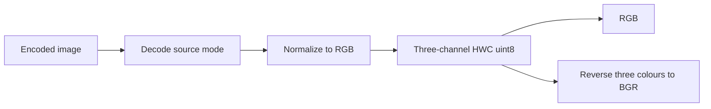
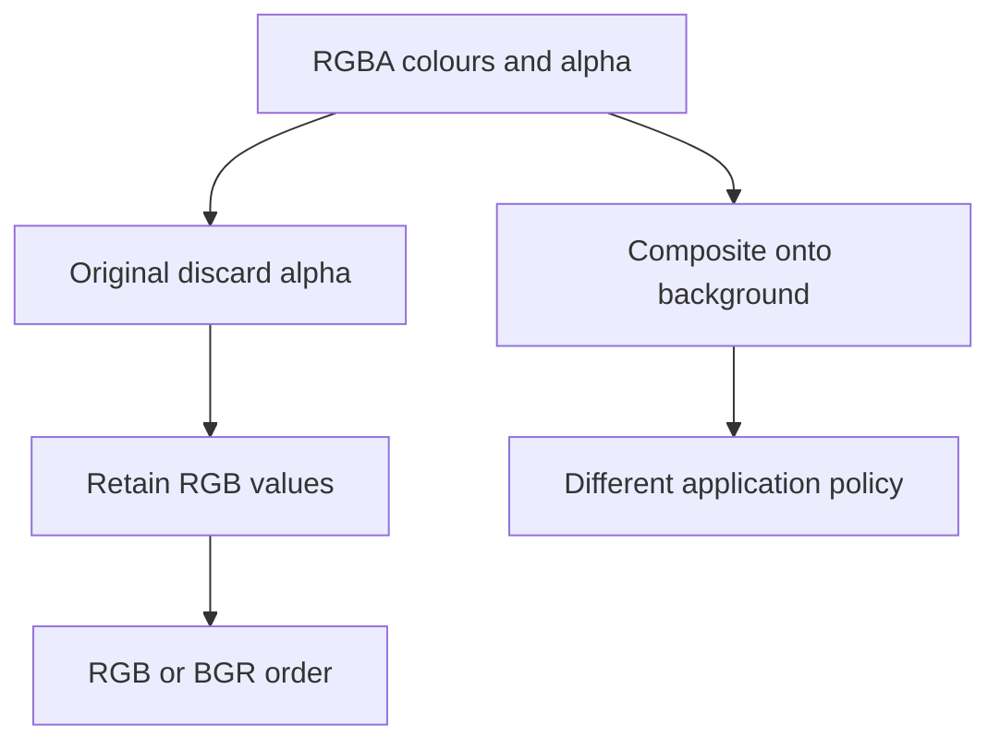
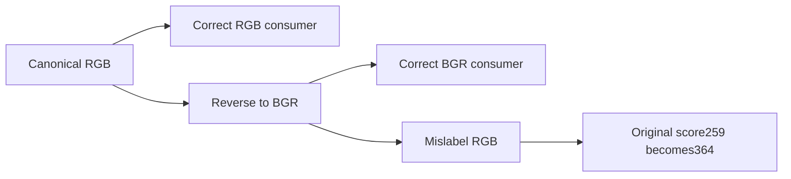

# AI Infra image-input FAQ: ONNX ImageDecoder source-mode normalization and RGB/BGR contracts

> **Language**: English | [中文](onnx-image-decoder-source-mode-rgb-bgr-contract-selection-faq.md)  
> **Round150 · 2026-11-14 daytime**: Nov13BJTreference correction;original decoded logical fixtures,not codec/GPU decode evaluation.

**Finding:** RGB/BGR requires three-channel HWCuint8;reversing an arbitrary decoded mode's last axis is insufficient.Six modes×two orders produce12original cases,with10naive raw-path misses.Two RGBApixels have8logical values and normalize to6RGB/BGRbytes.Alpha0does not mean composite onto black.Channel order and native contiguity are different contracts.

**Artifacts**: [H5workbench](../reports/onnx-image-decoder-source-mode-rgb-bgr-contract-sizer.html) · [seven cards](../reports/onnx-image-decoder-source-mode-rgb-bgr-contract-selection-cards.html) · [1600px SVG](../../assets/svg/onnx-image-decoder-source-mode-rgb-bgr-contract-selection-faq-summary.svg) · [sealed evidence](../../experiments/image_mode_channel_selection/report.json)

## Q1: How does the reference correction relate to opset/schema?

At Nov12,23:39UTC=**Nov13,07:39BJT**,the pinned correction converts both RGB/BGRsource images toRGBbefore array construction,then reverses three colour channels forBGR.Previously grayscale/palette could remain2D,bilevel bool,andRGBAalpha could remain or move into a colour position.It is a reference correction;**opset20ImageDecoder already existed**.



Schema takes1Duint8encoded stream,outputs rank3uint8and defaults toRGB;BGR/Grayscale are supported.Static inference creates three unknown dimensions,not complete H/W/Cvalues.Our prototype accepts **post-decode logical pixels**;no compressed codec is executed.Grayscale is unmodeled;UI rejection does not imply native lack of support.

## Q2: Why cannot all six source modes share one raw-channel operation?

| Original mode | Source representation | RGB normalization |
| --- | --- | --- |
| `1` | Bilevel bool | False/true→0/255,three channels |
| `L` | One intensity | Replicate intensity |
| `LA` | Intensity+alpha | Replicate intensity,discard alpha |
| `P` | Palette indices | Resolve RGB colours,not raw indices |
| `RGB` | Three colours | Retain RGB |
| `RGBA` | Four values | Retain colours,discard alpha |

Single-channel raw arrays lack the third channel axis.LA/RGBAhave an axis but reversal still does not produce three-channel RGB/BGR.Bilevel targets use0/255uint8,not0/1.Logical bool count does not establish native bitpacked storage;native source allocation is unknown.

## Q3: Why does alpha discard differ from compositing?

Original`RGBA[9,70,220,0]→RGB[9,70,220]→BGR[220,70,9]`retains colour despite alpha0,not black`[0,0,0]`.The second pixel is`[190,25,14,255]`;changing both alphas to255/0leaves six output colours unchanged.



Eight source uint8logical values become6Bnormalized payload,not proof that native peak falls8B→6B.Encoded bytes,Pillow images,array copies/views and other buffers are unmeasured.Mode conversion,compositing,ICC/gamma and model mean/std normalization need separate policies.

## Q4: Why can channel labels change consumers while gray tests miss it?

The original toy score is`Σ(2R+G−B)`,not a learned model/confidence.Canonical RGBscores259;feeding corresponding BGRunder anRGBlabel gives364,a105unit difference.GrayR=G=Bdoes not change under reversal,so gray-only fixtures cannot test consumer-channel alignment.



Two three-channel swaps restore original RGB;this tests logical permutation,not real decode.ReferenceBGRuses`[:,:,::-1]`channel-view indexing.**HWCuint8does not guarantee contiguous/positive strides**.Our copied/flat output does not certify native contiguity,DLPack compatibility or GPU-upload copy requirements.

## Q5: Where does CPU reorder timing stop short of decode throughput?

| Pre-normalized RGBpixels | Strided copies(ms) | Scalar loop(ms) |
| ---: | ---: | ---: |
| 64 | 0.000867 | 0.008967 |
| 256 | 0.001533 | 0.039567 |
| 1024 | 0.003733 | 0.159267 |
| 4096 | 0.011167 | 0.691933 |

Prebuilt RGBbuffers yield identical **copied BGRbytes**.Two warmups,seven alternating repeats and three operations/sample produce median repeat means.Excludes image opening,compressed codecs,palette/alpha/mode conversion,input preparation,Pillow/NumPy/ONNXandGPUupload.Not JPEGthroughput,native view-construction latency or GPU-kernel performance.

H5supports six original modes,RGB/BGRand dimensions1..16.Missing palettes,out-of-range indices,wrong source pixel counts/types visibly fail.Native codec/container acceptance is separate;the source correction explicitly leaves image opening/format acceptance unchanged.

## Q6: How can the study be reproduced and real pipelines accepted?

```powershell
python -m unittest discover -s tests -p test_image_mode_channel_selection.py -q
python -m experiments.image_mode_channel_selection.run --check
# --measure replaces original CPU reorder samples,no compressed decode.
```

Eight tests cover independent six-mode literals,alpha discard/input preservation,unsafe axes/channel counts,toy labels/double swap,invalid palette/shape/type/target,independent permutation/CPUpaths,44Node/Pythonfixtures and the complete12rowmatrix.Provenance is`synthetic`, `independently_reproduced=false`;CPU separately`measured`.

Sources:[reference correction](https://github.com/onnx/onnx/commit/3c41120b9c69657a1dd13407b080bd451ed06c9c),[pinned reference](https://github.com/onnx/onnx/blob/3c41120b9c69657a1dd13407b080bd451ed06c9c/onnx/reference/ops/op_image_decoder.py),[opset20schema](https://github.com/onnx/onnx/blob/3c41120b9c69657a1dd13407b080bd451ed06c9c/onnx/defs/image/defs.cc),[source regression scope](https://github.com/onnx/onnx/blob/3c41120b9c69657a1dd13407b080bd451ed06c9c/tests/python/reference_image_decoder_pixel_format_test.py),[Apache-2.0LICENSE](https://github.com/onnx/onnx/blob/3c41120b9c69657a1dd13407b080bd451ed06c9c/LICENSE).Rights preserved,no implementation mirror.

Real acceptance needs codecs,mode/shape/dtype,alpha/colour-profile policy,encoded-input preservation,strides/contiguity/GPUupload and end-to-end preprocess/quality.Native decode,encoded immutability,contiguity,peak and quality remain unknown/null.Original60-solid cabinet is not a physical decoder.Prior browser refusal remains respected;no visual browser acceptance.
