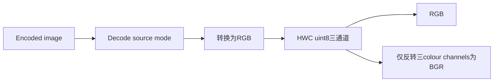
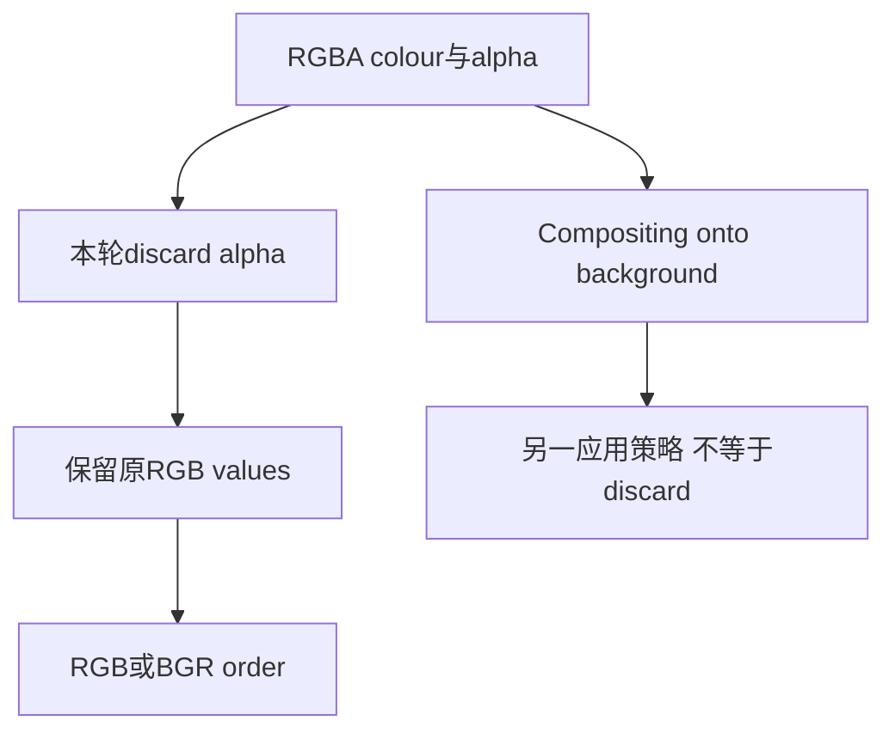
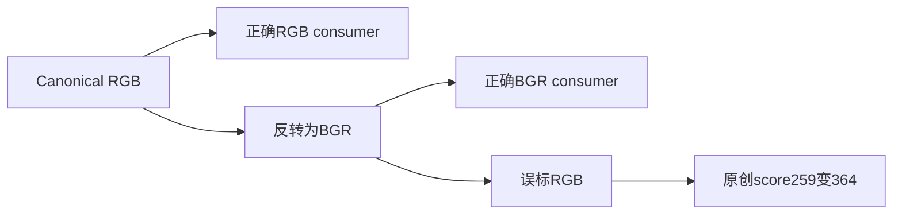

# AI Infra 图像输入 FAQ：ONNX ImageDecoder Source Mode Normalization 与 RGB/BGR 契约

> **语言**：中文 | [English](onnx-image-decoder-source-mode-rgb-bgr-contract-selection-faq.en.md)  
> **Round 150 · 2026-11-14 白班**：Nov13BJT reference修正；原创decoded logical fixtures，不是codec或GPU decode评测。

**结论速览**：RGB/BGR要求HWC三通道uint8，不能直接把任意decoded source mode的最后一维反转。六种mode×两个order的12原创cases中，naive raw path错10个。RGBA两个pixels的8logical values先丢alpha成为6RGB/BGRbytes；alpha0并不等于composite到黑背景。channel order与native contiguity是不同契约。

**交付**：[H5 mode workbench](../reports/onnx-image-decoder-source-mode-rgb-bgr-contract-sizer.html) · [7-Card](../reports/onnx-image-decoder-source-mode-rgb-bgr-contract-selection-cards.html) · [1600px SVG](../../assets/svg/onnx-image-decoder-source-mode-rgb-bgr-contract-selection-faq-summary.svg) · [封存证据](../../experiments/image_mode_channel_selection/report.json)

## Q1：最新reference修正与opset/schema有什么关系？

固定commit于Nov12 23:39UTC＝**Nov13 07:39BJT**修正reference：RGB与BGR都先`convert("RGB")`再构造array，BGR才反转colour channels。原先grayscale/palette可能保持2D、bilevel保留bool、RGBA保留alpha或把alpha反到colour位置。它是reference correction，**ImageDecoder opset20早已存在**。



schema的输入是1Duint8 encoded stream，输出uint8 rank3，pixel_format默认RGB，也支持BGR/Grayscale。static inference只创建三个unknown dimensions，没有完整推断H/W/C。本原型直接接收**post-decode logical pixels**；未执行任何compressed codec，Grayscale未建模且不能因UI拒绝推断native不支持。

## Q2：六种source modes为什么不能用同一raw-channel操作？

| 原创source mode | source表示 | RGB normalization |
| --- | --- | --- |
| `1` | bool bilevel | false/true→0/255，复制三个channels |
| `L` | 单intensity | 复制intensity |
| `LA` | intensity+alpha | 复制intensity，丢alpha |
| `P` | palette indices | 解析RGB palette，不把indices当颜色 |
| `RGB` | 三colour values | 保留RGB |
| `RGBA` | 四values | 保留前三colour values，丢alpha |

单通道raw arrays没有第三channel axis；LA/RGBA即使有channel axis，反转也不能产生正确三通道RGB/BGR。bilevel原型使用bool source而uint8目标必须0/255，不是0/1。source1的logical bool数量不等于native bitpacked storage大小；native source allocation未知。

## Q3：alpha discard为什么不同于alpha compositing？

原创`RGBA[9,70,220,0]→RGB[9,70,220]→BGR[220,70,9]`，alpha0的colour仍保留；不是composite到black的`[0,0,0]`。第二pixel为`[190,25,14,255]`；将两个alpha改成255/0后，六个output colour bytes完全相同。



两个pixels的source有8个uint8logical values，normalized payload6B，不是native peak由8B降到6B：encoded bytes、Pillow image、array copies/views与其他buffers未测量。模式转换、compositing、ICC/gamma与模型normalize/mean/std均需分别定义。

## Q4：RGB/BGR label为什么会改变下游，而灰色测试可能漏掉它？

原创toy score定义`Σ(2R+G−B)`，不是learned model或confidence。canonical RGB两pixels score259；把对应BGR错误标记为RGB后score364，相差105units。灰色R=G=B时反转不改数值，因此只测灰色不能覆盖consumer-channel alignment。



两次三通道swap恢复原RGB；这检验原创logical permutation而非真实decode结果。reference BGR源码使用`[:,:,::-1]`channel view，**HWC/uint8并不保证contiguous/positive strides**。原型返回copy/flat list，不证明native array contiguity、DLPack兼容或GPU upload是否必须额外copy。

## Q5：CPUreorder时延与decode吞吐如何分开？

| 预normalized RGBpixels | strided copies（ms） | scalar loop（ms） |
| ---: | ---: | ---: |
| 64 | 0.000867 | 0.008967 |
| 256 | 0.001533 | 0.039567 |
| 1024 | 0.003733 | 0.159267 |
| 4096 | 0.011167 | 0.691933 |

预建RGBbytebuffer，两个路径都生成相同**copied BGRbytes**。2warmups、7轮交替repeat、每sample3operations，取median repeat means；排除image opening、compressed codecs、palette/alpha/mode conversion、input准备、Pillow/NumPy/ONNX和GPU upload。不是JPEGdecode throughput、native view建立时延或GPU kernel优势。

H5只支持六种原创post-decode modes、RGB/BGR两个targets、width/height1..16。palette缺失、越界indices、wrong source pixel count/type都显式报错。native codec/container acceptance与本次source修正分开，上游commit明确未改变image opening/format acceptance。

## Q6：如何复现并完成真实输入管线验收？

```powershell
python -m unittest discover -s tests -p test_image_mode_channel_selection.py -q
python -m experiments.image_mode_channel_selection.run --check
# --measure替换原创CPU RGB/BGR copy samples，不执行compressed decode。
```

八项测试覆盖独立六mode literals、alpha discard/input不变、naive absent-axis/channel-count、toy consumer label/double swap、非法palette/shape/type/target、独立permutation与两CPU paths、44Node/Python fixtures及完整12rowsealed matrix。报告`synthetic`、`independently_reproduced=false`，CPU单独`measured`。

来源：[reference correction](https://github.com/onnx/onnx/commit/3c41120b9c69657a1dd13407b080bd451ed06c9c)、[pinned reference](https://github.com/onnx/onnx/blob/3c41120b9c69657a1dd13407b080bd451ed06c9c/onnx/reference/ops/op_image_decoder.py)、[opset20schema](https://github.com/onnx/onnx/blob/3c41120b9c69657a1dd13407b080bd451ed06c9c/onnx/defs/image/defs.cc)、[source regression scope](https://github.com/onnx/onnx/blob/3c41120b9c69657a1dd13407b080bd451ed06c9c/tests/python/reference_image_decoder_pixel_format_test.py)、[Apache-2.0LICENSE](https://github.com/onnx/onnx/blob/3c41120b9c69657a1dd13407b080bd451ed06c9c/LICENSE)。权利保留，无实现镜像。

真实上线还需codec availability、mode/shape/dtype、alpha/colour-profile policy、source encoded bytes不变、stride/contiguous/GPU upload、end-to-end preprocess与model quality验证。native decode、encoded-input immutability、contiguity、peak与quality均unknown/null。原创60-solid cabinet不是physical decoder；此前browser refusal仍尊重，未做视觉浏览器验收。
