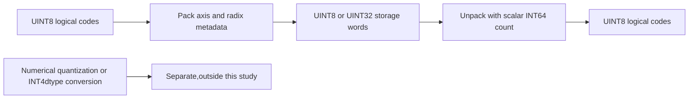
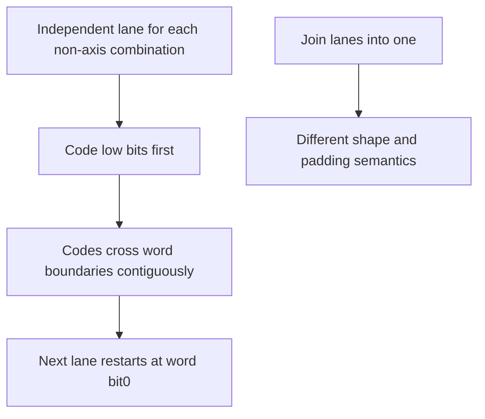
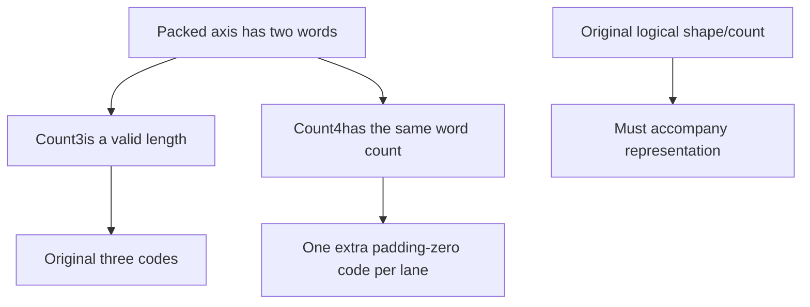

# AI Infra low-bit representation FAQ: ONNX Pack/Unpack axis, radix, word and count contracts

> **Language**: English | [中文](onnx-pack-unpack-axis-radix-word-contract-selection-faq.md)  
> **Round 147 · 2026-11-14 daytime**: opset29capability added Nov13BJT; an original strict integer-code model, not quantization accuracy or GPU evaluation.

**Executive finding:** Pack converts UINT8codes into UINT8/UINT32words. **Each fixed non-axis index combination restarts at word bit0.** Original shape[2,3]/bits3/axis1needs4B; flattening a different tensor needs3Bwith different words. Unpack needs logical count:3and4can both require two words per lane, so word count cannot recover original length. Radix3/group5packs five ternary codes into1Bversus2Bfor independent two-bit coding.

**Artifacts**: [H5](../reports/onnx-pack-unpack-axis-radix-word-contract-sizer.html) · [seven cards](../reports/onnx-pack-unpack-axis-radix-word-contract-selection-cards.html) · [1600px SVG](../../assets/svg/onnx-pack-unpack-axis-radix-word-contract-selection-faq-summary.svg) · [sealed report](../../experiments/onnx_pack_axis_selection/report.json)

## Q1: What do the new Pack/Unpack operators do—and not do?

The pinned commit added opset29Pack/Unpack, references, shape inference and context-dependent function lowering at **Nov12,22:21UTC=Nov13,06:21BJT**. This Nov14review does not misdate the feature or claim all deployed runtimes support opset29.



These represent **unsigned integer codes**, not float QuantizeLinear, scale/zero-point selection, signed ternary conversion or tensor(INT4)creation. Source supports rank≥1; original H5 is explicitly rank-two, each dimension0..16and at most128codes.

## Q2: Why does axis1need4Bwhile axis0or flatten needs3B?

Original codes are`[[0,1,7],[2,3,4]]`. Axis1has three3bit codes per lane:9bits and two UINT8words:

```text
Axis1:shape[2,2],words[200,1,26,1] → 4B
Axis0:shape[1,3],words[16,25,39] → 3B
Different flattened shape[1,6]:words[200,53,2] → 3B
```



Bit positions are numerical, independent of host endianness; ONNX raw tensors serialize little-endian. Axis0is **valid but a different layout** with an inverse. Flatten is not the same packed representation of the original shape. Non-axis dimensions, including zeros, are preserved.

## Q3: How do bits and radix/group_size relate, and why do five ternary codes fit1B?

`bits=b`means`R=2^b,G=1`, b∈1..8. The mutually exclusive alternative uses R∈2..256,G>0and`R^G≤2^63−1`. Group index is`Σ code_j×R^j`, first digit least significant; width=`bit_length(R^G−1)`:

```text
groups = ceil(N/G)
words_per_lane = ceil(groups × width / word_bits)
```

Original`[2,1,0,2,1]`,R3/G5has index140. Since`3^5=243`,width8fits1B. Independent two-bit coding yields`[134,1]`,2B. Groups **do not word-align individually**; they cross words. Partial groups zero-pad digits.

UINT32storage is not automatically smaller: seven5bit codes have35meaningful bits, two UINT32words8Bversus five UINT8words5B. Original Python integers/JS BigInt preserve exactness; R5/G27needs a63bit group width. JS Number or signed32bit shifts cannot handle every intermediate. Large radix powers are decimal strings to preserve JSON precision.

## Q4: Why must Unpack retain count, and why is padding not integrity verification?

Source count is a **nonnegative scalar INT64input tensor**, not an attribute or guessed length. H5 simulates a separate integer metadata value, not an executed tensor. With bits3/UINT8, count3and4both require two words per lane:



Default count4decodes`[0,1,7,0,2,3,4,0]`into shape[2,4], not proof of recovering original[2,3]. Count2needs one word/lane and mismatches the supplied two, so the strict model rejects it.

Pack zeroes final high word padding; Unpack ignores unused high bits and tail-group digits beyond count. Changing default second word1to129leaves all six decoded values unchanged. This is not a checksum or integrity mechanism.

## Q5: Which strict errors are original policy rather than a native-runtime guarantee?

The model rejects mixed bit/radix attributes, negative/out-of-radix codes, wrong axis/storage/count, INT64radix-power overflow and invalid grouped indices. R3/G5has243valid indices and13unused states243..255; original strict validation and the inspected reference validation reject them.

However, **the new schema leaves invalid-input results unspecified; function decompositions need not diagnose invalid codes, indices or sizes**. Strict H5 errors cannot be generalized to every native backend/function path. Validate application contracts and the actual runtime.

| Original single-lane3bit codes | Streaming reservoir (ms) | Individual bit writes (ms) |
| ---: | ---: | ---: |
| 64 | 0.017433 | 0.038100 |
| 256 | 0.068433 | 0.151867 |
| 1024 | 0.304900 | 0.626433 |
| 4096 | 1.125733 | 2.556533 |

Both output identical words and include grouping/output construction. Input/parameter preparation and matrix validation are excluded. Two warmups, seven alternating repeats and three operations per sample yield median repeat means; standalone timer sizes exceed H5 bounds. This is not ONNX/reference/function/ORT, GPU, network or numerical-quantization throughput.

## Q6: How can the study be reproduced and a deployment representation selected?

```powershell
python -m unittest discover -s tests -p test_onnx_pack_axis_selection.py -q
python -m experiments.onnx_pack_axis_selection.run --check
# --measure replaces original local CPU packing samples;imports no ONNX/ORT.
```

Eight tests cover64independent explicit-bitstream/axis oracle cases, boundaries/count ambiguity, ternary tails/strict-invalid policy, UINT32bit31and63bit groups, padding/negative axes/zero dimensions, invalid metadata, Node/Python BigInt parity and sealed records. Figure is an original60-solid code-tray metaphor. Prior browser refusal remains respected; visual browser acceptance was not performed.

Sources: [operator-addition commit](https://github.com/onnx/onnx/commit/69bf957565843052ffb46e0dc121c38456741288), [schema/function/shape definitions](https://github.com/onnx/onnx/blob/69bf957565843052ffb46e0dc121c38456741288/onnx/defs/tensor/defs.cc), [Pack reference](https://github.com/onnx/onnx/blob/69bf957565843052ffb46e0dc121c38456741288/onnx/reference/ops/op_pack.py), [Unpack reference](https://github.com/onnx/onnx/blob/69bf957565843052ffb46e0dc121c38456741288/onnx/reference/ops/op_unpack.py), [upstream tests](https://github.com/onnx/onnx/blob/69bf957565843052ffb46e0dc121c38456741288/tests/python/pack_unpack_test.py), [Apache-2.0LICENSE](https://github.com/onnx/onnx/blob/69bf957565843052ffb46e0dc121c38456741288/LICENSE). Source rights are preserved; no implementation is mirrored.

Deployment needs opset29schema/backend/kernel/function validation, rank/axis/count metadata, word type/endianness, exact group arithmetic and invalid-input policy. Provenance is `synthetic`, `independently_reproduced=false`; original CPU is separately `measured`. Native ONNX/reference/function/ORT/GPU support and runtime peak remain unknown/null. Selected word bytes are not runtime memory.
