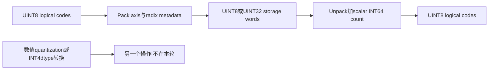
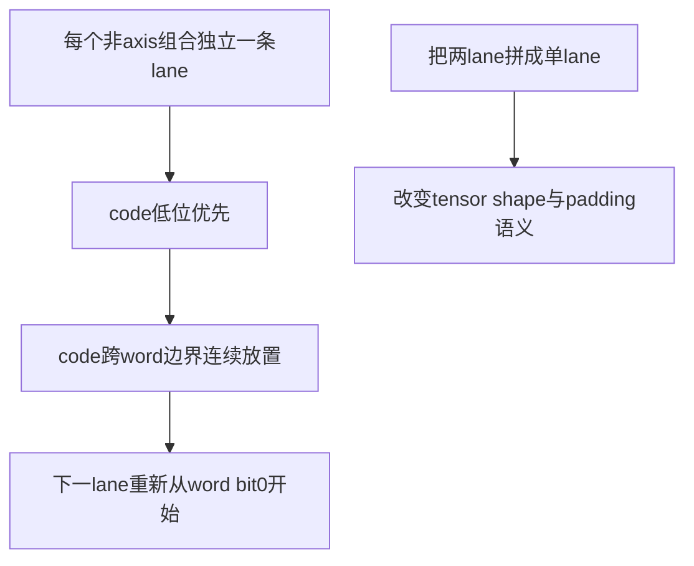
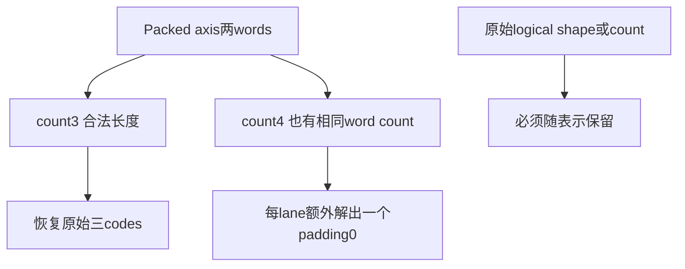

# AI Infra 低比特表示 FAQ：ONNX Pack/Unpack 的 Axis、Radix、Word 与 Count 契约

> **语言**：中文 | [English](onnx-pack-unpack-axis-radix-word-contract-selection-faq.en.md)  
> **Round 147 · 2026-11-14 白班**：11月13日BJT新增opset29能力；原创严格integer-code原型，不是量化精度或GPU评测。

**结论速览**：Pack将UINT8 codes变成UINT8/UINT32 words，**每个非axis索引组合独立从word bit0开始**。原创`[2,3]`/bits3/axis1需4B；改成另一个flatten tensor仅3B且words不同。Unpack必须提供logical count；count3与4都可能对应每lane两words，因此word数不能反推出原始长度。ternary radix3/group5可把五codes压入1B，而独立2bit方案需2B。

**交付**：[H5](../reports/onnx-pack-unpack-axis-radix-word-contract-sizer.html) · [7-Card](../reports/onnx-pack-unpack-axis-radix-word-contract-selection-cards.html) · [1600px SVG](../../assets/svg/onnx-pack-unpack-axis-radix-word-contract-selection-faq-summary.svg) · [封存数据](../../experiments/onnx_pack_axis_selection/report.json)

## Q1：最新Pack/Unpack是什么，不是什么？

固定ONNX commit于**11月12日22:21UTC＝11月13日06:21BJT**引入opset29的Pack/Unpack、reference implementation、shape inference及context-dependent function lowering。本轮11月14日复核，不虚标为14日新增，也不声称所有部署runtime已经支持opset29。



它表示**unsigned整数codes**，不是对float进行QuantizeLinear、指定scale/zero point、signed ternary数值转换或创建tensor(INT4)。source支持rank≥1；原创H5仅rank2、各维0..16且总codes≤128，属于明确的原型边界。

## Q2：为什么axis1需4B，axis0或flatten却只需3B？

原创codes为`[[0,1,7],[2,3,4]]`。axis1每行有3codes×3bits=9bits，因此每lane两UINT8words：

```text
axis1: shape[2,2], words[200,1,26,1] → 4B
axis0: shape[1,3], words[16,25,39] → 3B
flatten另一个shape[1,6]: words[200,53,2] → 3B
```



bit位置按数值定义，与host endian无关；ONNX raw tensor字节序为little-endian。axis0是**合法但不同layout**，有对应inverse；flatten不是原始shape的同一packed表示。source保持所有非axis维，包括zero dimensions。

## Q3：bits与radix/group_size如何对应，为什么五个ternary codes只需1B？

`bits=b`等价于`R=2^b,G=1`，b∈1..8。另一种互斥写法是R∈2..256、G>0、`R^G≤2^63−1`。group index为`Σ code_j×R^j`，第一digit最低有效；width=`bit_length(R^G−1)`：

```text
groups = ceil(N/G)
words_per_lane = ceil(groups × width / word_bits)
```

原创`[2,1,0,2,1]`、R3/G5得到index140；`3^5=243`、width8，正好1B。同codes用独立2bits得到`[134,1]`共2B。group之间**不单独word-align**，可跨word；partial group补零digits。

UINT32是另一种storage容器，不自动更省bytes。7个5bitcodes共35有效bits，UINT32两words8B，UINT8五words5B。原型使用精确Python整数/JS BigInt；如R5/G27需要63bit group width，不能把所有中间值交给JS Number或signed32bit shifts。large radix power以decimal string保存，避免JSON数值精度损失。

## Q4：Unpack为什么必须另带count，padding为何不是完整性校验？

source的count是**nonnegative scalar INT64 input tensor**，不是attribute或猜出来的length。H5以独立整数metadata模拟，不执行真实tensor。bits3/UINT8时，count3和4都要求每lane两words：



默认原型count4输出`[0,1,7,0,2,3,4,0]`、shape[2,4]；它不是正确恢复原始shape[2,3]的证据。count2只需一word/lane，和输入axis两words不符，严格原型拒绝。

Pack将最后word高padding bits置0；Unpack忽略unused high bits与partial group超出count的digits。把默认第二word1改成129，全部六decoded values仍相同；这不是checksum或数据完整性机制。

## Q5：哪些输入错误保证被原型拒绝，哪些不能归因于native runtime？

原型拒绝混用bits与radix/G、负code、超radix、错误axis/storage/count、radix power越INT64，以及strict grouped index。R3/G5有243个有效indices，243..255共13个unused states；原型与已读reference validation会拒绝它们。

但**新schema明确invalid input结果unspecified，function decomposition不必诊断越界codes、invalid indices或错误size**。不能把严格H5错误推广为所有后端/低层function保证抛异常。先做应用契约验证，再验证具体runtime。

| 原创single-lane3bit codes | streaming reservoir（ms） | individual-bit writes（ms） |
| ---: | ---: | ---: |
| 64 | 0.017433 | 0.038100 |
| 256 | 0.068433 | 0.151867 |
| 1024 | 0.304900 | 0.626433 |
| 4096 | 1.125733 | 2.556533 |

两路输出完全相同words，grouping/output构造计入；input/parameters准备、matrix validation排除。2warmups、7轮交替repeat、每sample3操作取中位数，standalone timer超过H5 bound。它不是ONNX/reference/function/ORT、GPU、network或数值量化throughput。

## Q6：如何复现与选择上线表示路径？

```powershell
python -m unittest discover -s tests -p test_onnx_pack_axis_selection.py -q
python -m experiments.onnx_pack_axis_selection.run --check
# --measure 替换原创本机CPU packing samples；不导入ONNX或ORT
```

八项测试覆盖64组独立explicit-bitstream axis oracle、lane boundary/count ambiguity、ternary tail/strict-invalid、UINT32bit31与63bit group、padding/negative axes/zero dims、非法metadata、Node/Python BigInt parity及封存CPU。figure为原创60-solid code-tray metaphor；此前浏览器拒绝仍受尊重，未做视觉浏览器验收。

来源：[新operator commit](https://github.com/onnx/onnx/commit/69bf957565843052ffb46e0dc121c38456741288)、[schema/function/shape definitions](https://github.com/onnx/onnx/blob/69bf957565843052ffb46e0dc121c38456741288/onnx/defs/tensor/defs.cc)、[Pack reference](https://github.com/onnx/onnx/blob/69bf957565843052ffb46e0dc121c38456741288/onnx/reference/ops/op_pack.py)、[Unpack reference](https://github.com/onnx/onnx/blob/69bf957565843052ffb46e0dc121c38456741288/onnx/reference/ops/op_unpack.py)、[upstream tests](https://github.com/onnx/onnx/blob/69bf957565843052ffb46e0dc121c38456741288/tests/python/pack_unpack_test.py)、[Apache-2.0 LICENSE](https://github.com/onnx/onnx/blob/69bf957565843052ffb46e0dc121c38456741288/LICENSE)。source rights保留，无实现镜像。

上线前核对opset29 schema、所选runtime/kernel/function路径、rank/axis/count metadata、word类型/endian、exact group arithmetic与invalid-input策略。主报告`synthetic`、`independently_reproduced=false`，CPU单独`measured`。native ONNX/reference/function/ORT/GPU支持与runtime peak均未知/null；selected word bytes不是runtime实际内存。
