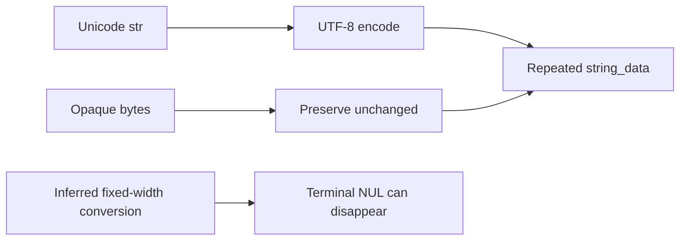
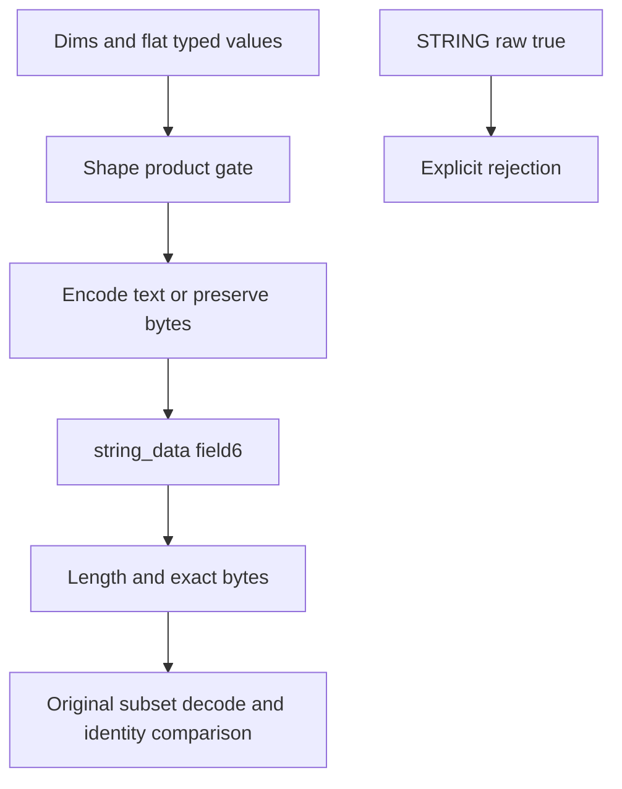
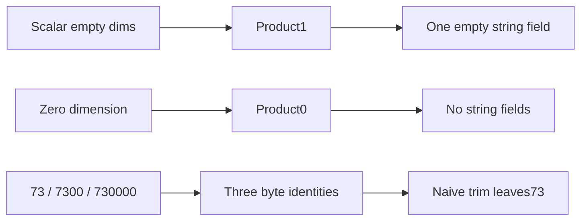

# AI Infra data-contract FAQ: ONNX STRING tensor UTF-8,opaque bytes and terminal NULs

> **Language**: English | [中文](onnx-string-tensor-utf8-opaque-bytes-nul-contract-selection-faq.md)  
> **Round149 · 2026-11-14 daytime**: Nov13BJT helper byte-identity correction,not a new format or native serialization benchmark.

**Finding:** Encode`str`as UTF-8 and preserve existing`bytes`exactly.STRING is not a null-terminated C string.Four original values retain11payload bytes;naive trim loses4B,corrupting3/4elements.Invalid UTF-8 opaque bytes must not be silently replaced before storage.Empty-string scalar and zero-sized tensor have1and0elements,even though both original wire subsets occupy4B.

**Artifacts**: [H5ledger](../reports/onnx-string-tensor-utf8-opaque-bytes-nul-contract-sizer.html) · [seven cards](../reports/onnx-string-tensor-utf8-opaque-bytes-nul-contract-selection-cards.html) · [1600px SVG](../../assets/svg/onnx-string-tensor-utf8-opaque-bytes-nul-contract-selection-faq-summary.svg) · [sealed report](../../experiments/string_tensor_bytes_selection/report.json)

## Q1: What was corrected,and why is printed text insufficient?

The pinned Nov12,16:15UTC=**Nov13,00:15BJT**commit fixes STRING`make_tensor`conversion.Inferred fixed-width NumPy string dtypes can lose terminal NULs during collection/conversion;the correction uses object dtype at both steps and documents UTF-8 for`str`,unchanged`bytes`.It is a helper correction,not a new format.



Matching visual or printed text does not prove byte identity.Our typed text/hex records avoid implicit dtype inference.The naive NUL-rstrip baseline is an original mistake model,**not complete legacy NumPy or native helper reproduction**.

## Q2: How are Unicode text,opaque bytes and normalization separated?

| Original value | Exact bytes | UTF-8 inspection | Naive trim |
| --- | --- | --- | --- |
| bytes | `00750000`,4B | Valid,includes NULs | `0075`,2B |
| Text cat+NUL | `e78cab00`,4B | Valid | `e78cab`,3B |
| bytes | `fe4100`,3B | Invalid UTF-8;bytes retained | `fe41`,2B |
| Empty bytes | Empty,0B | Valid empty text | Empty,0B |

Text`é`versus`e+combining accent`encodes to2/3B.No NFC/NFDnormalization is applied;visual equality cannot deduplicate bytes.UTF-8BOM remains present.Invalid opaque bytes produce a diagnostic,not replacement characters.Unpaired Unicode surrogates are rejected consistently in Python/JS.

## Q3: Does STRING use raw_data or string_data?

Source defines`STRING=8`,dims field1,data_type field2 and`repeated bytes string_data=6`;raw_data field9must not store STRING.Each string has its own length delimiter,so terminal NUL and empty values are not padding.Helper explicitly rejects STRING`raw=True`.



Original subset uses unpacked nonnegative dims varints,datatype8and length-delimited field6.It omits names/metadata/other fields and does not handle every legal TensorProto encoding.Selected wire`0802080210083204007500003204e78cab003203fe41003200`is25B=11payload+14framing.Not native TensorProto or network packet size.

## Q4: Why do scalar-empty,zero dimension and terminal-NUL collisions differ?

Scalar`dims=[]`has product1and requires one element.Empty-string wire is`10083200`.Zero-sized`dims=[0]`has product0,no string field,and wire`08001008`.Both subsets are4Bbut differ in bytes/meaning;length alone cannot identify shape.



Original`73/7300/730000`collapse3distinct values to1after trim,two lost identities.The primary four values still have4distinct outputs despite three corruptions.**Unchanged distinct count does not prove preservation**;compare each exact byte value and shape.

## Q5: Where does byte assembly timing stop short of serialization performance?

| Prebuilt fragments | Join(ms) | Repeated immutable concat(ms) |
| ---: | ---: | ---: |
| 64 | 0.000667 | 0.010033 |
| 256 | 0.001733 | 0.060567 |
| 1024 | 0.006367 | 0.405800 |
| 4096 | 0.025100 | 7.380833 |

Each fragment is34B,2Bfield framing+32Bpayload.Both paths create identical bytes.Two warmups,seven alternating repeats and three operations/sample yield median repeat means.Excludes UTF-8 conversion,varint/fragment preparation,shape checks,ONNX/protobuf runtime,disk/network/GPU.No native helper serialization speedup is established.

H5bounds rank0..2,dims0..16,512B/value and4096Btotal payload.Timer sizes exceed UI bounds.Parser explicitly rejects truncation,unsupported fields,duplicate datatype and shape mismatch within the original subset;**this is not general protobuf compatibility/security certification**.

## Q6: How can the study be reproduced and artifact integrity accepted?

```powershell
python -m unittest discover -s tests -p test_string_tensor_bytes_selection.py -q
python -m experiments.string_tensor_bytes_selection.run --check
# --measure replaces original CPU fragment samples,no native TensorProto.
```

Eight tests cover independent literal wire,scalar/zero distinction,NUL collisions/opaque UTF-8,normalization/BOM/surrogates,128Blength-varint boundary/truncation,invalid inputs,64independent random wire cases with Node/Python parity,and the complete sealed primary matrix.The primitive baseline does not mirror old NumPy implementation.

Sources:[helper correction](https://github.com/onnx/onnx/commit/48fc9e0b96520db0b056b74f1af09398790f2eac),[pinned helper](https://github.com/onnx/onnx/blob/48fc9e0b96520db0b056b74f1af09398790f2eac/onnx/helper.py),[TensorProto schema](https://github.com/onnx/onnx/blob/48fc9e0b96520db0b056b74f1af09398790f2eac/onnx/onnx.proto),[Apache-2.0LICENSE](https://github.com/onnx/onnx/blob/48fc9e0b96520db0b056b74f1af09398790f2eac/LICENSE).Rights preserved,no implementation mirrored.

Deployment needs actual helper/NumPy versions,shape/storage-field checks and exact bytes after real serialize/parse,and explicit treatment of invalid UTF-8 for text-only consumers.Provenance is`synthetic`, `independently_reproduced=false`;CPU separately`measured`.Native helper/protobuf roundtrip,legacy outputs and network payload remain unknown/null.Original60-solid envelope cabinet is not hardware.Prior browser refusal remains respected;no visual browser acceptance.
