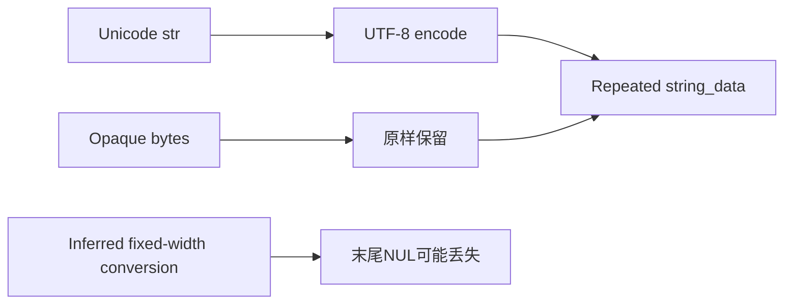
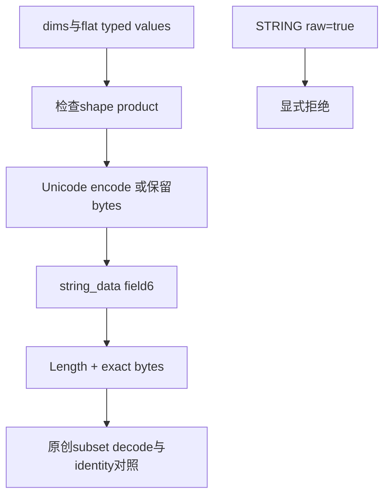
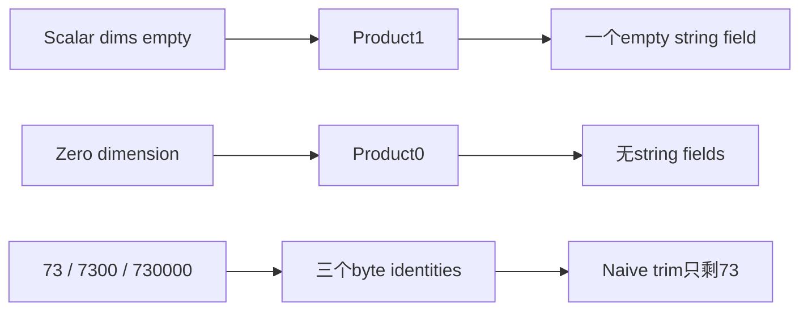

# AI Infra 数据契约 FAQ：ONNX STRING Tensor 的 UTF-8、Opaque Bytes 与末尾 NUL

> **语言**：中文 | [English](onnx-string-tensor-utf8-opaque-bytes-nul-contract-selection-faq.en.md)  
> **Round 149 · 2026-11-14 白班**：Nov13BJT helper修正的字节身份问题；不是新tensor格式或native序列化benchmark。

**结论速览**：`str`应UTF-8 encode，已有`bytes`应原样保留，STRING不等于C的null-terminated string。原创四个值保留11Bpayload；naive trim丢4B、损坏3/4elements。invalid UTF-8 bytes依旧是合法的本原型opaque值，不要先替换为Unicode再存储。空string和zero-sized tensor的element count分别1与0，即使本轮wire subset都占4B。

**交付**：[H5 byte ledger](../reports/onnx-string-tensor-utf8-opaque-bytes-nul-contract-sizer.html) · [7-Card](../reports/onnx-string-tensor-utf8-opaque-bytes-nul-contract-selection-cards.html) · [1600px SVG](../../assets/svg/onnx-string-tensor-utf8-opaque-bytes-nul-contract-selection-faq-summary.svg) · [封存报告](../../experiments/string_tensor_bytes_selection/report.json)

## Q1：最新修正针对什么，为什么不能只看text打印结果？

ONNX固定commit在11月12日16:15UTC＝**Nov13 00:15BJT**修正`make_tensor`的STRING路径。NumPy inferred fixed-width string dtype可能在collect/convert steps损失末尾NUL；新代码在两个步骤使用object dtype，并明确`str`UTF-8编码、`bytes`不变。它是helper correction，不是引入新格式。



只有肉眼相同或正常text打印，不证明serialized byte identity。原型用typed text/hex records避免隐式dtype inference；naive `.rstrip(NUL)`只模拟丢值错误，**没有复现完整旧NumPy行为或native helper**。

## Q2：UTF-8 text、opaque bytes和Unicode normalization如何分开？

| 原创值 | exact bytes | UTF-8 inspection | naïve trim |
| --- | --- | --- | --- |
| bytes | `00750000`，4B | valid，含NUL | `0075`，2B |
| text“猫+NUL” | `e78cab00`，4B | valid | `e78cab`，3B |
| bytes | `fe4100`，3B | invalid UTF-8，bytes保留 | `fe41`，2B |
| empty bytes | empty，0B | valid empty text | empty，0B |

text `é`和`e+combining accent`分别UTF-8 2/3B；原型不做NFC/NFD normalization，不能因视觉相同去重。UTF-8 BOM也保留，invalid opaque bytes只产生inspection diagnostic，不触发替换字符。Unicode text里的unpaired surrogate显式报错，Python/JS均拒绝而不默默替换。

## Q3：STRING应该用raw_data还是string_data？

源schema中`STRING=8`，dims字段1、data_type字段2、`repeated bytes string_data=6`；`raw_data=9`不得用于STRING。每个string有独立length delimiter，末尾NUL和empty string是值而不是padding。helper显式拒绝STRING `raw=True`。



原创subset用unpacked nonnegative dims varints、datatype8、field6length-delimited bytes，不包括name/metadata/其他fields，也不支持所有合法TensorProto wire variants。选例`0802080210083204007500003204e78cab003203fe41003200`为25B＝11Bpayload+14Bframing。它不是native TensorProto或network packet真实大小。

## Q4：scalar empty、zero dimension与末尾NUL collision有什么区别？

scalar `dims=[]`的product是1，必须有一个element，empty string wire为`10083200`。zero-sized `dims=[0]`的product为0，没有string field，wire为`08001008`。两个本轮subset都是4B但bytes/语义不同；不能仅靠length判断shape。



原创`73/7300/730000`的3个distinct值经trim只剩1个，损失2个identities；主四值虽然损坏3个，distinct count仍是4。因此**distinct count未变不证明byte preservation**，必须逐element比较exact bytes和shape。

## Q5：bytes assembly时延和完整serialize性能有什么边界？

| prebuilt fragments | join（ms） | repeated immutable concat（ms） |
| ---: | ---: | ---: |
| 64 | 0.000667 | 0.010033 |
| 256 | 0.001733 | 0.060567 |
| 1024 | 0.006367 | 0.405800 |
| 4096 | 0.025100 | 7.380833 |

每fragment34B（2Bfield framing+32Bpayload），两个路径构造相同bytes。2warmups、7次交替repeat、每sample3操作，封存median repeat means；排除UTF-8 encode、varint/fragment准备、shape检查、ONNX/protobuf runtime、disk/network/GPU。数字只说明原创primitive assembly，不能宣称native helper修正有这个serialization speedup。

H5限制rank0..2、每dim0..16、每值至512B、总payload≤4096B；timing独立超过UI bounds。wire parser仅识别本轮subset，对truncation、unsupported fields、duplicate datatype和shape mismatch报错；**不是general protobuf parser安全/兼容保证**。

## Q6：如何复现并设置真实artifact integrity验收？

```powershell
python -m unittest discover -s tests -p test_string_tensor_bytes_selection.py -q
python -m experiments.string_tensor_bytes_selection.run --check
# --measure替换原创CPU fragment assembly samples，无native TensorProto。
```

八项测试包含独立literal wire、scalar/zero、NUL collisions/opaque UTF-8、normalization/BOM/surrogate、128Blength-varint边界/truncation、非法输入、64独立random wire fixtures及Node/Python parity、封存完整主矩阵。primitive baseline不是旧NumPy实现镜像。

来源：[helper correction](https://github.com/onnx/onnx/commit/48fc9e0b96520db0b056b74f1af09398790f2eac)、[pinned helper](https://github.com/onnx/onnx/blob/48fc9e0b96520db0b056b74f1af09398790f2eac/onnx/helper.py)、[TensorProto schema](https://github.com/onnx/onnx/blob/48fc9e0b96520db0b056b74f1af09398790f2eac/onnx/onnx.proto)、[Apache-2.0 LICENSE](https://github.com/onnx/onnx/blob/48fc9e0b96520db0b056b74f1af09398790f2eac/LICENSE)。权利保留，无upstream实现镜像。

上线核验实际helper/NumPy版本、shape、storage field、serialization/parse后的逐byte identity，并明确text-only下游如何处理invalid UTF-8。报告`synthetic`、`independently_reproduced=false`，CPU单独`measured`；native helper/protobuf roundtrip、旧NumPy outputs、network payload未知/null。原创60-solid envelope柜不是真实hardware；此前browser refusal仍尊重，未做视觉浏览器验收。
