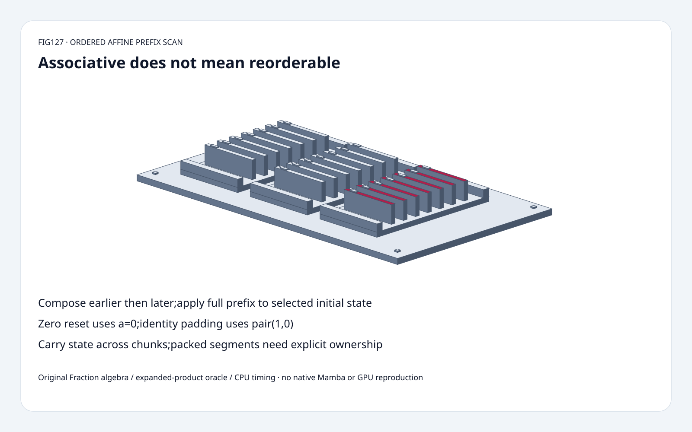
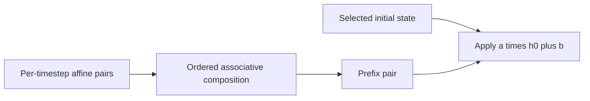
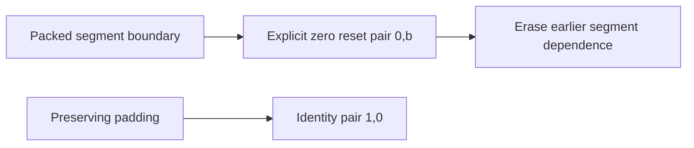
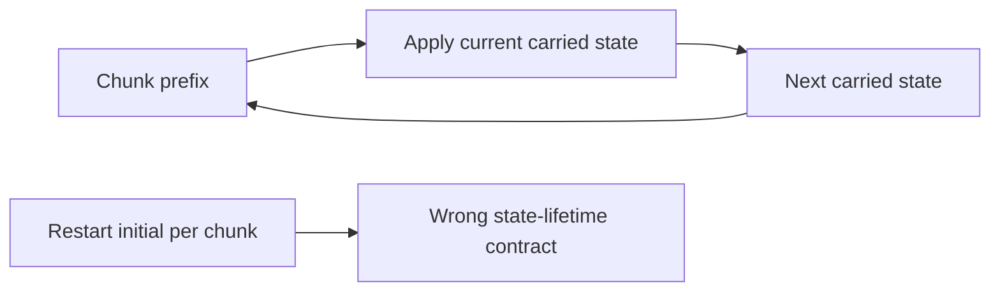

# Selective recurrence FAQ: ordered affine prefix scans, segment resets and state carry

> **Language**: [中文](ordered-affine-prefix-scan-segment-reset-selection-faq.md) | English
>
> **Round127 · 2026-11-14 · Day round4** · [SVG](../../assets/svg/ordered-affine-prefix-scan-segment-reset-selection-faq-summary.svg) · [H5](../reports/ordered-affine-prefix-scan-segment-reset-sizer.html) · [7 cards](../reports/ordered-affine-prefix-scan-segment-reset-selection-cards.html) · [Data](../../experiments/affine_scan_contract_selection/report.json)
>
> **Synthetic, `independently_reproduced=false`.** Original exact scalar affine recurrence/tree scan and independent expanded-product oracle; separately measured original CPU float paths. No native Mamba,discretization,gating,backward or GPU reproduction.



## 1. Executive summary: associative does not mean reorderable

Original pairs `(2,1),(3,4),(4,2),(5,3)` represent
`h[t]=a[t]*h[t-1]+b[t]`, initial state7.
Serial recurrence,ordered prefix scan and independent expansion
all give **[15,49,198,993]**.
Reversing composition gives **[15,51,189,933]**: only **1/4** states match.

Explicit zero-reset before index2 changes states to **[15,49,2,13]**.
Identity padding `(1,0)` keeps final993;
zero-pair padding `(0,0)` erases it to0.
Correct chunk carry ends993; restarting each two-element chunk from7 ends153.

Pinned classic Mamba scan header contains the established ordered
affine operator. Latest inspected tree's July22 Mamba3/Blackwell fix
is a different kernel change,not a new November scan invention
and not executed here.

## 2. Architect Q&A: algebra,temporal order,segments and chunks

### Q1: How can a recurrence be represented as a prefix scan?

Each timestep is an affine map `F(x)=a*x+b`.
For earlier `(a,b)` then later `(c,d)`,composition is:

```text
later(earlier(x)) = c*(a*x+b)+d
ordered pair = (c*a,c*b+d)
identity = (1,0)
```

Function composition is associative over exact scalars,
so a tree can regroup adjacent prefixes while preserving order.
It is **not commutative**: reversing operands generally changes b.
The source's classic selective-scan operator expresses this same ordering.

Our original Hillis-Steele implementation reads a complete previous-
round buffer for each doubling stride.
Mixing newly updated entries into the same scan round changes the
algorithm; a parallel dependency pattern is not a license for
arbitrary in-place reads.

### Q2: Does a prefix pair's b component equal the final state?

Only when selected initial state is0.
The fixture's full prefix is **(120,153)**:
applying initial7 gives `120*7+153=993`.
Discarding a or forgetting the nonzero initial state gives153 instead.

The independent original oracle expands each prefix into products:

```text
h[t] = h0*product(a[0:t+1])
     + sum_j b[j]*product(a[j+1:t+1])
```

This tests the scan against a different computation,not another
copy of the same prefix composition loop.
Scalar affine algebra models one state lane,not the full Mamba
parameter discretization,selective coefficients,complex lanes,
gates,output projection or backward pass.

### Q3: How does a packed-segment zero reset enter the algebra?

In our **explicit original extension**,reset before a timestep
replaces its pair `(a,b)` with `(0,b)`.
The resulting state is b,independent of every earlier segment.
Subsequent composition cannot reintroduce the erased prefix.

Reset before index2 gives state2 then13;
omitting it leaks the previous segment and ends993.
For a selected nonzero reset target r,the pair would instead need
an explicitly derived constant contribution `a*r+b`.
That variant is not the H5's zero-reset control.

We do not claim the pinned native scan API accepts these reset flags
or certify native packed-sequence isolation. State ownership must be
specified by the actual sequence representation and caller.

### Q4: Why isn't `(0,0)` harmless padding?

It maps every prior state to0. Padding meant to preserve state
uses the affine identity `(1,0)`.
Both might be masked from visible output,yet differ if the implementation
reads the final padded state as a carry for the next chunk.

Our synthetic padding controls explicitly consume the padded last
state. Real kernels can use valid-length guards or different state
selection; the original control does not assert their behavior.

For chunking,apply each chunk prefix to the actual carried state.
The source's prefix callback maintains an ordered running prefix
across consecutive scan operations; it is not permission to restart
each chunk from the original initial state.

### Q5: Does exact associativity establish floating bitwise parity or speedup?

No. Floating arithmetic may round intermediate products/additions
differently after regrouping; native dtypes,FMA,complex arithmetic,
underflow/overflow and scan topology require separate validation.
Exact Fraction tests prove selected algebra,not native bitwise equality.
Original float timing only checks tolerance on its chosen .5-coefficient data.

Hillis-Steele has logarithmic dependency rounds but extra work and
intermediate buffers; our serial Python execution is slower than
the sequential recurrence. This says nothing about native GPU speed.

Selected batch8,length4096,channels64,state-width16,float32:
last state **32,768 bytes**,
materialized all states **134,217,728 bytes**,
one full affine-prefix pair **65,536 bytes**.
These are distinct logical alternatives,not a measured peak or
claim that a fused native kernel materializes all states.

## 3. Visual architecture: ordered composition,segment ownership and carry







## 4. Selection matrix: preserve state semantics before optimizing span

| Choice | Good fit | Gate |
| :--- | :--- | :--- |
| Sequential recurrence | Simple reference/stateful update | Linear temporal dependency |
| Ordered prefix scan | Associative affine composition | Preserve operand order and initial state |
| Explicit zero-reset pair | Original packed-state control | Not asserted native reset API |
| Identity padding | Preserve downstream state | `(1,0)`,not a zero pair |
| Chunk prefix carry | Long sequence split into chunks | Carry full effective state/prefix |
| Floating tree | Native optimization under audit | Separate numerical and throughput evidence |

## 5. Hands-on evidence: exact expansion,reset,padding and CPU paths

```powershell
python -m experiments.affine_scan_contract_selection.run --check
python -m unittest discover -s tests -p test_affine_scan_contract_selection.py -q
```

Eight tests cover multiple exact lengths/initial states against product
expansion,associativity/noncommutativity,segment independence,
identity/zero padding,chunk boundaries,invalid inputs,budget,
Node parity and sealed CPU medians.

| Length | Original serial recurrence (ms) | Original Python tree scan (ms) |
| :--- | ---: | ---: |
| 32 | 0.002200 | 0.021633 |
| 128 | 0.009433 | 0.130967 |
| 512 | 0.040567 | 0.711967 |
| 2,048 | 0.171167 | 4.067567 |

Two warmups,seven alternating repeats,three operations/sample,
median repeat means. Original Python float loops/copies,not GPU
parallel execution. Native Mamba/discretization/backward excluded.
H5 bounded exact integers,range errors visible.
Browser visual inspection not performed.

## 6. Sources,provenance and readiness

- [Pinned classic scan operator/prefix callback](https://github.com/state-spaces/mamba/blob/e9594ce1c732d97440f0332fdc43170a2294dbfa/csrc/selective_scan/selective_scan_common.h): ordered affine composition and running prefix.
- [June2024 header change](https://github.com/state-spaces/mamba/commit/3c77dcf7cae77022f74f48ebfe3dd121b1764f99): ROCm support,not a November invention.
- [July2026 tree change](https://github.com/state-spaces/mamba/commit/e9594ce1c732d97440f0332fdc43170a2294dbfa): Mamba3Blackwell corruption fix,different kernel,not executed.
- [Apache-2.0 license](https://github.com/state-spaces/mamba/blob/e9594ce1c732d97440f0332fdc43170a2294dbfa/LICENSE): upstream rights retained.
- [Original experiment](../../experiments/affine_scan_contract_selection/README.md): equations,independent oracle,sealed data and exclusions.

Original implementation/oracle/art;no upstream implementation copied.
Native latency,floating bitwise parity,model quality and peak HBM
remain unmeasured or null.
